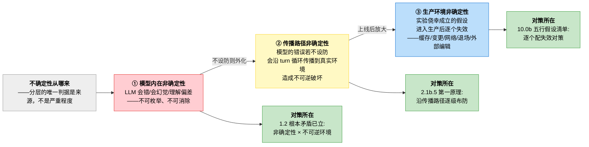

# 2.0b Harness 的本体：不确定性管理

> 本节是第二章 b 系列的奠基——也是全书唯一一节横跨三章的奠基（①模型侧在第一章、③生产侧在第十章）。为什么由第二章来立：第一章立了"是什么"（定义与根本矛盾），第十章才讲"生产环境怎么防"，而**沿什么架构认知正好住在中间这一章。本节不展开论证—论证、源码试金石、防线全景全部在 2.1b.5；本节只立认知合同：**harness 的一切机制，都是不确定性的对策。读后续任何一章的任何机制，先问一句"它在管哪种不确定性"。**
> 三层认识的完整论证各归其章：①的根本矛盾在 1.2（已立）；②的论证在 2.1b.5（三块试金石）；③的五行假设清单在 10.0b（四份源码对策全景）。本节的源码引用仅为指路，不重复复核在各章。

## 2.0b.1 定义合同：一句话论断

> **Harness 是不确定性管理系统。它面对的不确定性不是一个，是一列—从模型内部一直排到生产环境；harness 的每一个机制（压缩、校验、权限、恢复、门控、缓存纪律…）都只是这一列中某一种不确定性的对策。**

"定义合同"指本节对读者承诺回答的四个问题，交付清单如下：

| 承诺回答的问题 | 本节交付 | 所在节 |
| ---- | ---- | ---- |
| 不确定性有哪几种？（本体论） | 三层清单（模型内在/传播路径/生产环境） | 2.0b.2 |
| 凭什么说"都是对策"？（证据） | 三层各配源码锚点一枚（指路，复核在各章） | 2.0b.2 表 |
| 会不会和传统软件混淆？（抗辩） | 质的区别：可枚举 vs 不可枚举 | 2.0b.3 |
| 读者拿什么去拆？（生成程序） | 拆解自己 harness 的三问流程 | 2.0b.5 |

本节与 2.1b 共用五个核心术语，就地定义如下（2.1b.1 术语卡为本表的同源版本，展开与源码在彼处）：

| 术语 | 一句话定义 | 展开在 |
| ---- | ---- | ---- |
| **turn 循环**（turn loop） | harness 的心跳—"调模型→解析输出→执行工具→回灌结果"周而复始的那条主循环；一轮 = 一个 turn | 2.1b.2 |
| **时间切片** | 看待核心区的视角：能力（模型/工具/上下文/压缩/记忆）空间平级，其"层"体现在由循环编排出场的先后—分层在时间轴上，不在空间嵌套上 | 2.1b.2 |
| **能力榨取** | 用注入、压缩、反馈改写等手段，把模型**下什么**变成它**稳定做到什么**—把理论上限变成工程下限。对策双线之一 | 2.1b.7 |
| **约束** | 双线的另一条—不指望模型稳定，只降低它做错时的事后后果**：校验拦截，权限门、沙箱、隔离、分工纠模；榨取管"正确率"（事前提升概率）、约束管"破坏面"（事后遏制后果） | 2.1b.5 |
| **挂起点** | 循环时间轴上预定义的接口位置，能力挂上去介入某一轮，而不侵入循环主干 | 2.1b.3 分野 B |

## 2.0b.2 本体论：不确定性的三层清单

词立住。**不确定性**（uncertainty）在本节指：系统运行时可能偏离预期的全部来源—模型会错、输出会坏、环境会变、假设会失效。它不是单一事物，按"偏离预期的东西从哪来"分三层：

> 图 2-1：不确定性的三层与各层对策的宿主（分层判据=来源；箭头=不设防时的传导链，③①②读）

| 层 | 名字 | 它是什么 | 对策在哪 | 源码锚点（各一枚，指路用） |
| ---- | ---- | ---- | ---- | ---- |
| ① | 模型内在非确定性 | LLM 单次推理就是概率生成—会错、会幻觉、会产生理解偏差；**不可枚举（列不全所有可能错法）、不可消除（不是 bug，是架构本性）** | 第一章已立（1.2 根本矛盾） | 1.4.3：即使 `temperature=0` 也不能保证 100% 正确 |
| ② | 传播路径非确定性 | 模型的错误不是原地消失的—它作为输出离开模型，沿 turn 循环向下游传播，终点是带不可逆副作用的真实环境 | 本章：2.1b.5 立第一原理"沿非确定性传播轴时间轴五站 [A]-[E] 即防线" | `dsh/packages/core/tools/index.ts:1377`："只能失败的调用"在审批之前就拒绝 |
| ③ | 生产环境非确定性 | 实验系统能跑，是因为环境替它兜住了一组隐含假设（缓存友好/变更安全/网络可靠/功能不退场/状态独占）；进入生产后**环境不再兜底**，假设逐个失效 | 第十章：10.0b 全景 | `cc_growthbook.ts`：`{"features":{}}` |

**判据说明（防误读）**：三层的分法**只按来源，不按严重程度**—①不比③"次要"，①也不比③"根本"；传导链（图 2-1 箭头）说的是"不设防时会传导"，不是说它们是同一种东西的三个阶段。
高正确概率、②靠布防（切断传播）、③靠显式化（把假设变成代码里的对策）。

## 2.0b.3 抗辩：这和传统软件的"容错"有什么不同

> 预判质疑：传统软件也要处理网络超时、并发竞争—它也有不确定性，凭什么 Agent 是"质的区别"？

区别在**不确定性的来源处在系统的哪个位置**：

| 维度 | 传统软件 | Agent 工程 |
| ---- | ---- | ---- |
| **不确定性来源** | **环境**：网络、磁盘、并发—核心逻辑自身是确定的 | **核心处理单元**：LLM 内在非确定，环境的不确定性（③）反而排在它后面 |
| **可枚举性** | 可枚举—超时重试、幂等、锁，每类环境故障都有具名对策 | 不可枚举—列不出"模型所有可能的错法"，只能沿传播路径设防、不能按错误类型设防 |
| **对策形状** | 点状补丁（针对每种故障一个处理） | 路径布防（不问它会怎么错，只问错误往哪走、在哪拦） |

一句话：**传统的不确定性是环境的偶发（可枚举，具名对策）；Agent 的不确定性是核心处理单元的内在（不可枚举，只能沿传播路径布防）。这是质的区别，不是量的区别。**

这个区别导致主战场位移：传统软件工程师的隐含假设是"处理逻辑确定"，开发者主战场是**让确定性逻辑正确**（算法、边界、测试），错误是可消除的 bug；Agent 工程的主战场是**管住一个必然出错的处理单元**。

> **预判质疑二：既然 2.0b.1 说"一切机制都是对策"，harness 是不是纯防御系统？**
不是。对策分两线：**榨取**（提升模型正确概率—注入、压缩、反馈改写、约束技巧）与**约束**（降低错误后果—校验、权限、沙箱、隔离）。时间轴上双线并存。光有约束无榨取只是**安全地无能**。
> 榨取与约束双线布防—论证与防线全景在 2.1b.5。

## 2.0b.4 全书机制速查：每章在管哪种不确定性

三层清单是全书机制的索引—后续各章的机制全部对号入座：

| 章 | 机制举例 | 在管哪层 | 一句话分账 |
| ---- | ---- | ---- | ---- |
| 第二章 | 时间轴五站【A]-[E]、注入、解析拦截 | ② | 本层的完整防线地图（2.1b.5 论证） |
| 第四章 | 任务规划、退出信号、错误恢复三级 | ② | 循环侧的布防细化（4.0b/4.1c） |
| 第五章 | 工具契约、调度、并发 | ② | 工具执行侧的布防细化 |
| 第六章 | 记忆四层作用、整合请求 | ①+② | 榨取（喂好料）+ 防线（压缩保真） |
| 第七章 | 约束军火库、输出解析校验 | ①+② | 榨取（约束技巧）+ 拦截（结构校验） |
| 第八章 | 跨 agent 隔离、驱动遏制 | ② | 防线拓扑补维度（2.1b.5 试金石二） |
| 第九章 | 工具爆炸对上下文有限的对抗 | ①+② | 注入侧的取舍布防 |
| 第十章 | 五行假设 × 四套对策 | ③ | 本层的完整地图（10.0b 展开） |
| 第十一章 | 可观测性、反馈循环 | ③+② | 不确定性需要被看见才能被管理 |
| 第十二章 | 权限梯度、沙箱、注入防护 | ② | 【D】侧约束地基的展开 |
| 第十三章 | 评估、判卷、回归 | ①的测量 | 管不住没量过的非确定性 |

## 2.0b.5 生成程序：拿三层拆你自己的 harness

论断不值钱，值钱的是读者拿它拆自己的系统。三问流程（输入→步骤→输出物）：

**输入**：任一 harness（你的产品、或本书三章任一）的任一机制。

1. **问来源**：这个机制在管哪种不确定性？（①模型会错/②错误传播/③环境假设失效—对不上任何一层，警惕：它可能是"没有对策对象的机制"，惯性的产物）
2. **问路线**：它防线设在传播路径的哪一站？（【A】注入/【B】C 解析拦截/【D】工具执行/【E】状态更新对照 2.1b.5 图 2-3；③类机制不在此轴上，属环境锁）
3. **问失效**：这个对策自己失效时系统会怎样对照？（2.1b.5 风险不对称表—它是 fail-closed 兜底、性能损失、还是反向放大？）

**输出物**：一张三行登记表（机制 × 三问答案）。缺行就是设计缺口；**没有"对策对象"的机制是惯性抄来的，没有"失效方案"的对策是下一层不确定性。**

**回放校验**（对本书已落地实例反向验证此程序）：拿 CC 的 `canUseTool` 过一遍—①管②层（模型可能调用不被允许的工具）；②设在【D】（2.1b.5 试金石一）；③失效时 fail-closed（分类器不可用，全通。再拿 CC 的缓存纪律（10.0b）过一遍—①管③层（"缓存友好"是实验环境的隐含假设）；②不在【A]-[E] 轴上、属环境锁；③自己失效时的形态正是 10.0b.2 的账单（击穿=从第一个变化字节起全价重算）。
二问区分出了两类机制的归属，程序可回放。

## 2.0b.6 小结

| 论断 | 内容 | 坐标 |
| ---- | ---- | ---- |
| **本质** | Harness 是不确定性管理系统；每个机制都是某一种不确定性的对策 | 2.0b.1 |
| **三层清单** | ①模型内在（不可枚举不可消除）→②传播路径（错误外化至不可逆环境）→③生产环境（隐含假设失效）；判据=来源，非严重程度 | 2.0b.2；图 2-1 |
| **质的区别** | 传统环境内偶发（可枚举，点状补丁）；Agent 防核心内在（不可枚举，路径布防） | 2.0b.3；论证 2.1b.5 |
| **全书索引** | 传统软件三层—读任何机制先问"管哪种" | 2.0b.4 |
| **生成程序** | 三问拆解（来源/路线/失效）→三行登记表；缺行=设计缺口 | 2.0b.5 |

> 与各章的接口：本节是认知地基，不重复论证①的完整矛盾在 **1.2**；②的第一原理、三块试金石、防线风险不对称在 **2.1b.5**（本节所立认知的源码论证）；③的五行假设清单与四家对策在 **10.0b**
> 结构）与 2.3b（安全/可观测）分别是②层防线在执行侧与安全侧的展开。
