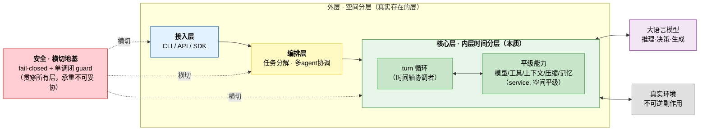
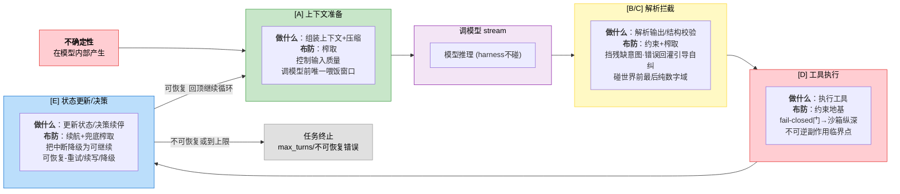
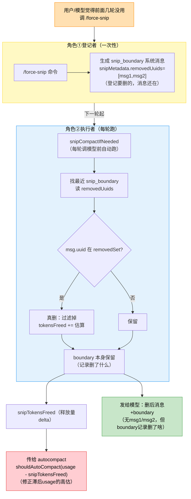
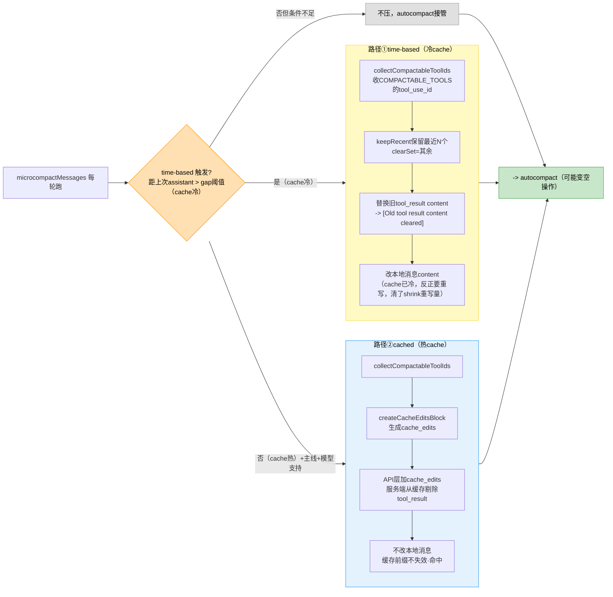
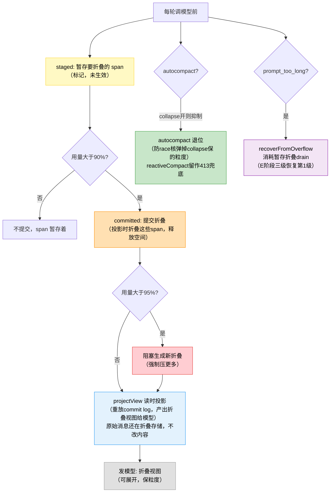
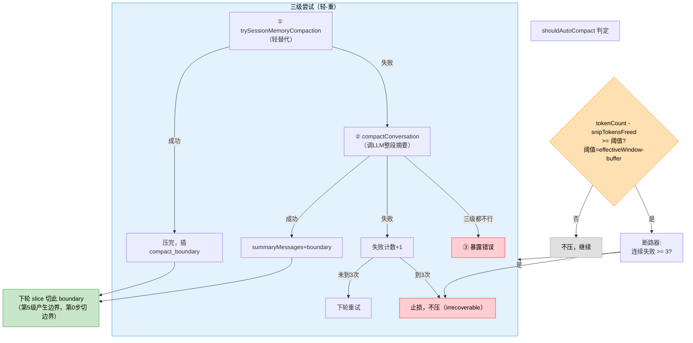
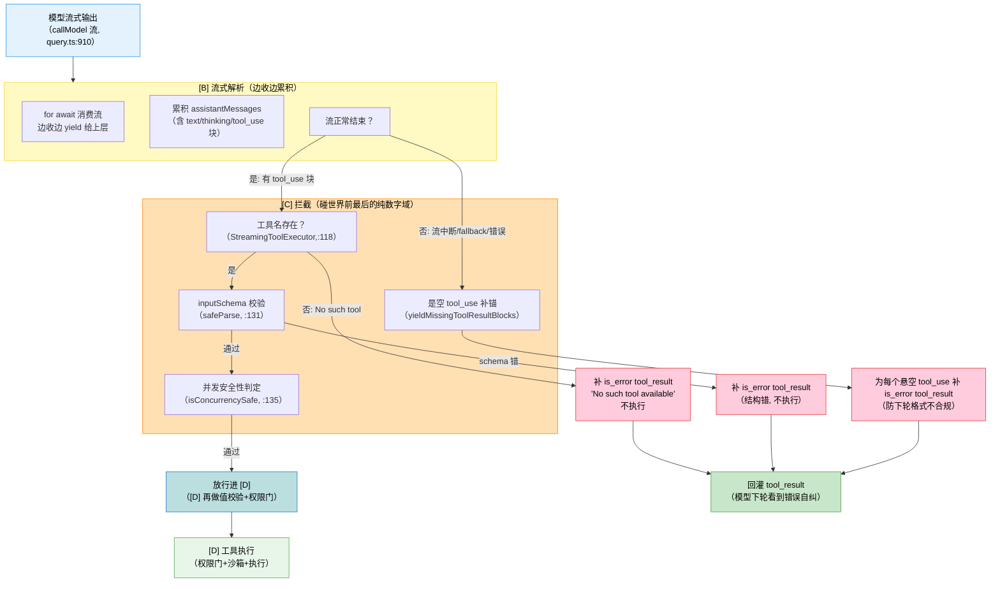
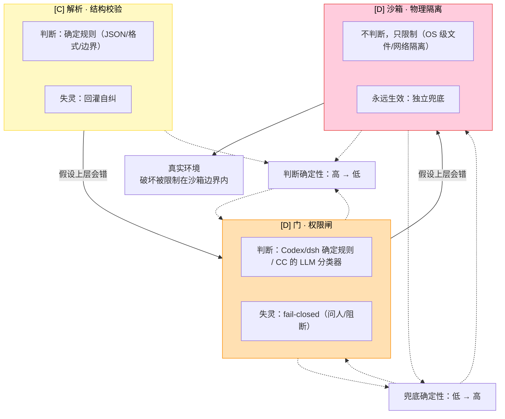
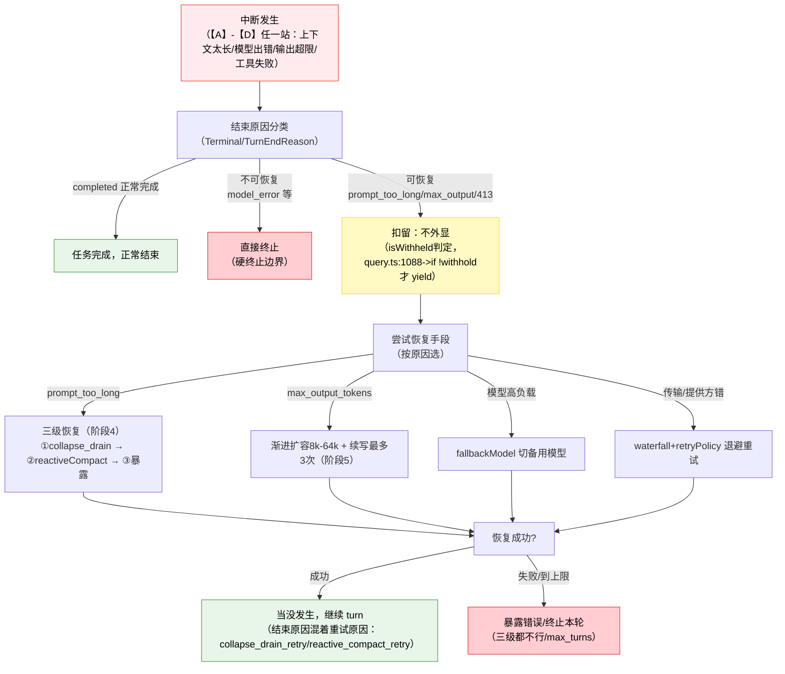

# 2.1b 核心层再认识：时间分层与能力榨取

> 本节是对 2.1「三层 + 横切关注点」参考架构的深化。2.1 抓住了外层空间分层与"同循环交替"的洞察，但用空间语言（星型拓扑、运行时引擎唯一协调者）描述了一个本质是**时间分层**的核心层。本节基于 Claude Code、DeepSeek Harness (dsh)、Codex 三套生产级源码，重新厘清核心层的真实结构，并钻透其中能力榨取最密集的一环——上下文注入。

> 全文结论均经三套源码交叉验证：源码定位精确到文件，可逐条复核。

## 2.1b.1 一句话抽象

本节核心词共五个，先立住再推进（每个词一句话指称，展开随后）：

| 术语 | 一句话定义 | 展开在 |
| ---- | ---- | ---- |
| **turn 循环** (turn loop) | harness 的心跳——调模型→解析输出→执行工具→回灌结果周而复始的那条主循环；一轮 = 一个 turn | 2.1b.2 |
| **时间分层** | 一种看待核心层的视角：能力（模型/工具/上下文/压缩/记忆）在**空间上平级**，没有谁包裹谁；它们的"层"体现在**由循环编排出场的先后**——分层分在时间轴上，不在空间嵌套上 | 2.1b.2 |
| **能力榨取** | 通过注入、压缩、反馈改写等工程手段，把模型**会什么**变成它**稳定做到什么**——把理论上限变成工程下限。它是双线之一，与"约束"配对 | 2.1b.7 |
| **约束** | 双线的另一条——**不指望模型做对，只降低它做错时的破坏后果**；校验拦截、权限门、沙箱、跨 agent 隔离。两线的分工判据：榨取管"正确率"（事前提升概率），约束管"破坏面"（事后遏制后果）；时间轴各站或榨取或约束或双性（见 2.1b.5 图 2-3） | 2.1b.5 |
| **挂载点** | 循环时间轴上预定义的接口位置（dsh waterfall / Codex hook / CC 阶段内调用），能力挂上去介入某一轮，而不侵入循环主干 | 2.1b.3 分野 B |

Harness = **外层空间分层**（接入→编排→核心）× **内层时间分层**（核心 = turn 循环 + 平级能力交替），安全横切地基贯穿。**内层是本质。**



> 图 2-2: Harness 整体抽象—外层空间分层 × 内层时间分层，安全横切地基（核心层是本质；协调者是 turn 循环而非空间节点；安全是承重地基而非普通层）

> 2.1 的价值在抓住了外层和"模型调用/工具执行/记忆更新在同一循环交替"的洞察；它的缺陷在于没有把这个洞察撑成核心层的主结构，反而用一张"星型拓扑"图（空间关系）去描述一个由**时间轴**主宰的循环——而源码里并不存在一个"运行时引擎"作为空间协调者。

## 2.1b.2 内层时间分层（三样本强共识）

核心层**不是**"模型层包工具层包记忆层"的空间嵌套。核心是**一个 turn 循环 + 一组空间上平级的能力**（service / 同 crate 模块），能力在空间上平级，在**时间上由循环编排先后**——这一条。

三套源码的时间轴骨架是同一个（见 2.1b.5 图 2-3，骨架动作与每站布防性质合一）：

`[上下文准备] → [调模型 stream] → [解析输出] → [执行工具] → [状态更新/决策] → 回顶`

- 压缩都在**调模型之前**（dsh 旁路触发 / CC 阶段1 / Codex 采样前），多为预测性，非事后补救。
- 模型调用都流式（`for await chunk`）。
- 工具执行在 tool-call 解析后，结果回灌下一轮上下文。

协调者是 **"turn 的时间轴"本身**——实现可函数（dsh/CC）可事件流（Codex），不拘形态。所谓"运行时引擎"不是空间节点，而是这个时间函数/事件流。

### 三家源码定位

| 产品 | 循环驱动者 | 源码定位 |
| ---- | ---- | ---- |
| DeepSeek Harness | `turn()` / `step()` 双层循环 | `packages/core/agent-loop/src/agent.ts:246` |
| Claude Code | 单层 `while true`，9 阶段 | `src/query.ts:406`（注释自述） |
| Codex | 事件驱动 turn | `codex-rs/core/src/session/turn.rs:153` `run_turn` |

## 2.1b.3 三家的分歧：两种时间分层实现风格

时间分层是真抽象（共性强），但实现上有两条路线。

| 维度 | dsh | Claude Code | Codex |
| ---- | ---- | ---- | ---- |
| 循环形状 | turn/step 双层 | 单层 while true | 事件驱动 turn |
| 时间轴切法 | 粗（主干 + waterfall 挂载） | 细（9 显式阶段） | 中（采样前压缩 + hook 节点） |
| 能力介入方式 | `dispatch.waterfall` 事件名挂载 | 阶段内直接调用 | `hook_runtime::*` 挂载 |
| 压缩时机 | 旁路 service, pressure/overflow 触发 | 阶段1 六级流水线 | `run_pre_sampling_compact` 预测性 |
| 错误恢复 | `waterfall('agent/request-error')` | 编进阶段 4/5（三级恢复） | `emit_turn_error_lifecycle` |

两个清晰分野：

**分野 A—循环切多细？** Claude Code 切到 9 个显式阶段，连错误恢复（prompt-too-long 三级恢复、max_output_tokens 渐进扩容）都编号进时间轴，工程最重、最可断言；dsh/Codex 切得粗，把细枝末节甩给 waterfall/hook 挂载点，主干轻、灵活。这是「显式流水线」vs「主干 + 挂载点」两种风格。

**分野 B—能力怎么挂进循环？** dsh 用 waterfall（事件名分发，多 provider 可插）、Codex 用 hook_runtime、CC 用阶段内调用。本质都是**给循环的时间节点开挂接点，让平级能力不侵入主干**。这正是扩展做成独立层的源码根因：核心是时间轴，能力只能在时间节点上挂，做不成空间层。

## 2.1b.4 Loop 设计范式

> 画时间因果串行化 loop + 在关键因果节点开挂接点。

两者是同一次设计的两面，非先后两步——没有挂载点的纯主干（只做 model->tool）在 harness 里不存在，因为压缩、错误恢复是每轮必经，不是可选装饰。主干与挂载点**解耦**：

- dsh 主干只出现 `dispatch.waterfall` / `loopCtx.llm` / `executeToolCalls`，不 import 任何具体 provider；
- Codex 主干只调 `hook_runtime::*`，不感知具体 hook 实现。

## 2.1b.5 非确定性防线：harness 的第一原理

> 本节原为"核心洞察"，经安全、编排、记忆三子系统源码验证后，升格为贯穿全子系统的第一原理。它也是 Agent 工程区别于传统软件工程的根本所在。

> 认知地基在 2.0b（不确定性三层清单，本节是其第②层「传播路径」的论证）；本节的论证、源码试金石、防线全景是 2.0b 所立论断的证据侧。

### 与传统软件工程的根本位移

传统软件工程的隐含假设是「处理逻辑确定」——开发者主战场是「让确定性逻辑正确」（算法、边界、测试），错误是可消除的 bug。Agent 工程面对的核心处理单元（LLM）**内在非确定、不可消除**，且对接不可逆真实环境。于是主战场发生根本位移：从「让逻辑正确」搬到「**管住一个必然出错的处理器及其拓扑**」。

注意两个易滑向的不准确表述：① Agent 工程并非"传统不处理非确定性"——传统也处理网络超时、并发竞争等**环境的偶发非确定性**（可枚举、可针对性防御）；区别在于 Agent 面对的是**核心处理单元本身的内在非确定性**（不可枚举、不可消除），这是质的区别而非量的区别。② 防线不是全部——时间轴上榨取与约束双线并存，光有防线无榨取只是"安全地无能"。完整表述是"沿非确定性传播路径，榨取与约束双线布防"。

### 时间维度的布防

时间轴上的挂载点不是任意加的，而是沿"LLM 非确定性从产生到造成破坏的传播路径"逐级布防：



> 图 2-3：核心层时间轴骨架 × 非确定性防线布防（同一条轴的两种视角合一——"做什么"是骨架，"布防"是动机；紫=模型推理 harness 不碰，绿=榨取，黄=约束+榨取双性，红=约束地基，蓝=续航兜底）

每过一关，要么榨取（提升正确概率），要么约束（降低破坏后果）。**harness 的整个时间轴，就是一条非确定性传播的防线。**

由此得到一个**预测性原理**：设计新 harness 时，问"不确定性从哪产生、往哪传播、在哪能设防"，答案即该开的挂载点——不必照搬三家的点。

### 三子系统验证：第一原理的解释力

若"非确定性防线"真是第一原理，它应能解释 harness 所有主要子系统的设计动机，而不只时间轴一处。以下三块试金石均经源码验证：

**试金石一：安全（fail-closed）— 通过，且区分了与传统 fail-closed。**

fail-closed 落在 [D]——非确定性即将造成不可逆破坏的临界点。其语义是"不确定该不该放行时就拒绝"。传统软件的权限检查也 fail-closed，但防的是"权限服务故障"，请求方是确定的；Agent 的 guard 多防一层——LLM 这一轮可能产生任何不可预判的调用意图。dsh 源码佐证：对"只能失败的调用"在 execution creation 阶段、在 pre-execute/ask/guard 之前就拒绝——`packages/core/tools/src/index.ts:1377` 注释原话"pre-execute listeners, approval `ask`, and guards must never observe – or worse, approve – a call that can only fail"——传统软件不会如此设计，因为确定性的请求不会"莫名其妙"发生在权限检查跑起来之前，"只能失败的调用"根本不进审批流。CC 同侧佐证：`canUseTool` 是每工具必查的 gate，且源码明示"canUseTool must always be called even when hooks auto-approve"（`Tool.use:262`）——即使 hook 想自动放行，权限闸仍强制必查，防绕过；权限规则集含 `deny` 最高优先级。三家安全侧现已全部坐实。

额外发现：dsh 把 [D] 的闸分为两类性质不同的门——`tools/pre-execute`（reorderable allow/deny/ask，**可协商的判断门**）与 `ctx.tools.guard()`（monotonic，"Later waterfall listeners cannot turn a guard denial back into permission"，**不可协商的约束门**）。这对应 1.3 原则5（可替换后端 vs 不可替换约束）：非确定性防线在 [D] 是"可协商判断 + 不可协商约束"双闸叠加。

**试金石二：编排（跨 agent 隔离）— 通过，防线升级到拓扑维度。**

多 agent 时，非确定性从"单 agent 内部"扩展到"agent 之间"——子 agent 的非确定性输出会变成父/兄弟 agent 的输入。编排层的防线正堵这条跨 agent 传播路径：dsh 的 ACP 子 agent 每个独立进程（"shares no Cordis context"），父只收"最终 assistant 文本或精确结束原因错误"、**不接收中间消息或工具流量**、`inheritsParentContext: false`（no conversation context crosses the process boundary）；Codex delegate 有"driver containment"（失败在驱动边界遏制）与独立 child token（可单独关停出问题的子）；CC 的 fork subagent 用 AsyncLocalStorage 做"context isolation"与 identity isolation、配 cleanup handler 优雅关停，且 worker 的权限请求**经 permissionSync 转发 leader 审批**——子 agent 不能自行放行，必须经 leader。编排不是"纯调度"，是跨 agent 的非确定性传播防线。**防线随 agent 数量增加拓扑维度：单 agent 沿时间轴布防，多 agent 还要沿 agent 边界布防。**

> 三家隔离机制与强度不同：dsh ACP 进程级强隔离（独立子进程）；Codex 同进程异步任务级（`tokio::spawn` + `Session::spawn` 开子会话非 OS 进程，靠 driver containment + child token 隔离）；CC fork 进程内 AsyncLocalStorage 上下文隔离 + 权限上交 leader，机制不同但跨 agent 非确定性防线三家均已坐实。

**试金石三：记忆/压缩（保真）— 通过，揭示防线唯一"自造非确定性"的高危点。**

压缩处于特殊位置：[A] 既是防线（腾空空间让模型基于干净上下文决策），又**自己产生非确定性**（压缩可能丢关键信息）。压缩错误沿时间轴向下累积放大：丢失关键信息→模型基于残缺上下文决策→错误工具调用→不可逆副作用→错误结果回灌→下一轮更糟。三家对压缩的保真投入最重，且这些设计**无法用"省 token"解释**：Codex 有 `collect_annotated_user_messages`（专收标注关键消息）、`replacement_history`+`window_number`（可重建可回滚）、`retained_image_count`（追踪留图数）、`BeforeLastUserMessage` 注入时机精控（"the model is trained to see the user message at the end"）、pre/post compact hooks；CC 有 `buildPostCompactMessages`（压缩后重建非直接用摘要）、postCompact 保留 `invoked_skills`、sessionMemoryCompact 的"Minimum tokens to preserve"保留下限、压缩后 `restore CLAUDE.md and other context`、protectedTail/preserved-segment——省 token 不需要 replacement_history、不需要保留下限、不需要压缩后重注入 CLAUDE.md——这些只能用"防止压缩放大非确定性"解释。

### 防线的风险不对称结构

三块试金石合起来暴露一个结构特性——防线各点风险不对称：

| 防线点 | 性质 | 出错后果 |
| ---- | ---- | ---- |
| [A] 注入（榨取） | 提升正确概率 | 做不好→能力没榨足（性能损失，不破坏） |
| [A] 压缩 | 腾空间**且**自造非确定性 | **出错→放大非确定性，累积传播**（最高风险） |
| [D] 工具执行 guard | 纯约束兜底 | 失灵→fail-closed 止损（破坏被遏制） |
| 编排隔离 | 跨 agent 隔离 | 失灵→污染扩散（但进程隔离重置） |

压缩是防线上唯一"出错会放大"的点——其他点要么出错只是性能损失（[A] 注入），要么有兜底（[D] fail-closed）。这解释了为何三家都把最重工程投在压缩（CC 六级流水线、Codex 版本化重建）：**不是因为它最难，而是因为它最危险——它是防线上唯一能反向放大非确定性的环节。**

### 第一原理定性

三块试金石全部通过，且每块都产出单看源码得不到的增量（[D] 双闸结构、编排拓扑维度、压缩风险不对称）。"不确定性传播路径"透镜不仅解释安全、编排、压缩，还比就事论事读源码产出更深。据此定性：

> **"沿非确定性传播路径逐级布防"是 harness 的第一原理，也是 Agent 工程区别于传统软件工程的根本位移。** 传统主战场是"让确定性逻辑正确"，Agent 主战场是"管住一个必然出错的处理器及其拓扑"。这条原理统合时间轴布防（[A]~[E]）、拓扑布防（跨 agent 隔离）、以及防线的风险不对称（压缩最高危），它不是某子系统的设计技巧，而是**所有子系统设计的共同动机**。

## 2.1b.6 评判 harness 好坏的三问

拿到一个 harness，看三件事：

1. **turn 时间轴清不清楚？** 能否说出一轮里先做什么后做什么——说不清就是主干混乱。
2. **挂载点开得够不够、规不规范？** 能力是挂在明确的循环节点上，还是散落各处硬编码——后者不可扩展。
3. **压缩在不在调模型前、是不是预测性？** 这是健康度的快速指标。

这套标准可直接评判 2.1 的星型拓扑：它用空间语言（谁连谁）描述时间结构（谁先谁后），所以评不出好坏——星型图看不出压缩时机、看不出错误恢复路径。这正是它别扭的根。

## 2.1b.7 钻透 [A]：上下文注入是能力榨取的物理发生点

[A] 上下文准备是调模型前**唯一**能直接控制的输入。模型内部（how it reasons）harness 管不了；模型输出之后（工具执行）harness 只能约束不能提升正确性。**唯一能"提升这一轮正确概率"的杠杆，就是喂进去的下文。** 所以三家都把最重的工程堆在这里——能力榨取不是抽象口号，它**物理上发生在 [A] 这个时间窗口**。

这个窗口做两类事：

- **腾空间**（压缩类）：解决"塞得下"（容量）。
- **喂质量**（注入类）：解决"喂得对"（质量）。

模型这一轮的表现 ≈ f（塞得下 ∧ 喂得对），前者是必要条件（超了直接报错），后者是充分条件（喂得好才准）。

### 两种压缩哲学

压缩何时做，三家分两派（这纠正了一个常见误判——"压缩都在调模型前是共识"在 dsh 上不成立）：

**哲学一：压缩是循环的显式阶段（同步、前置）—Claude Code 与 Codex**

- CC：调模型前跑六级流水线（toolResultBudget→snip→microcompact→contextCollapse→autocompact→预测性 autocompact），同步阻塞，压完才调模型。
- Codex：`run_pre_sampling_compact`，采样前同步压，且预测性。
- 特征：压缩是 turn 时间轴的一级阶段，与模型调用是串行前驱。

**哲学二：压缩是事件驱动的旁路 service（异步、pressure/overflow 触发）—dsh**

- dsh 的 turn 循环根本不调压缩。压缩是 `CompactionEngine extends Service`，由 provider 按 `CompactionTrigger = 'pressure' | 'context-overflow'` 决定何时跑，通过 `compaction/summary`、`compaction/prune` 事件 fold 进会话。
- 特征：压缩是事件流里的旁路操作，不是 turn 时间轴的一级阶段，与模型调用不串行。

---

### 六级流水线逐级深入（源码实证）

上面只讲了"为什么这么排序"，下面逐级讲透**每级具体干什么、解决什么问题、怎么实现、收益与副作用**。源码主链路在 `query.ts:555-730`（阶段1 消息预处理）。

> 阅读约定：每一级按 **问题 → 做法 → 为什么这么做 → 收益 → 启发** 五问展开。所有数值/字段均来自 CC 源码，凡此版本为桩实现（contextCollapse）的会标注。

### 前置概念：上下文窗口是什么（案例数值的来源）

下面的案例会用到 200K / 180K / 167K 三个数，它们是三个不同概念，递进派生。先讲清定义，否则案例里的阈值算不明白。

要分清**两个层面**，因为"上下文窗口"这个词在模型文档和 CC 实现里含义有偏差：

**层面1：模型 API 定义的上下文窗口——input + output 共享总容量**

模型厂商文档说的"上下文窗口"（如 Claude 200K），指**一次请求里输入 token + 输出 token 共享的总容量上限**，输入占一部分、输出占一部分，两者加起来不能超这个数，这是模型本身的物理限制。

**层面2：CC 源码里的上下文窗口——取 max_input_tokens 作近似**

CC 的 `getContextWindowForModel`（`context.ts:56`）返回的不是 input+output 总和，而是 **`cap.max_input_tokens`**（`context.ts:87`，模型能力里定义的"最大输入 token 数"），fallback 到 `MODEL_CONTEXT_WINDOW_DEFAULT = 200_000`（`context.ts:10`）。

> **这两个定义有偏差**：模型侧 200K 是 input+output 共算，CC 侧取的 max_input_tokens 理论上只是输入上限。CC 把它当"上下文窗口"用，是**实现层面的约定/近似**——对 Claude 这类模型，CC 就按 200K 默认值用，不区分 input-only 还是 input+output。读者要知道：CC 源码里的"上下文窗口"是个近似概念，不是严格的总容量。

**关键派生：effective window（有效窗口）≠ 上下文窗口**

CC 真正用来做压缩决策的不是原始上下文窗口，而是 **effective window**（有效窗口），派生方式（`autoCompact.ts:33`）：

```
effective window = 上下文窗口 - reserved（为输出预留）
                 = contextWindow - min(最大输出token, 20000)
```

为什么减？注释原文（`autoCompact.ts:28-29`）："Reserve this many tokens for output **during compaction**" + "p99.99 of **compact summary outputs** being 17,387 tokens"——预留是给 compact 摘要输出留的（compact 要调 LLM 生成摘要，摘要本身也占 token），不是给普通轮次模型输出留的。

> **一个微妙点**：虽然预留名义上是给 compact 摘要，但 `getEffectiveContextWindowSize` 被**通用复用**——不只 compact 用，普通请求的预测性检查（`query.ts:864` effectiveContextWindowSize - estimatedGrowth）、UI token 警告（`TokenWarning.tsx`）、附件预算（`attachments.ts`）都算它。等于 CC 假设"每轮都可能要 compact"，所以统一减掉摘要预留。这是个保守的统一口径，不是只 compact 才减。

**三个概念递进派生（案例数值来源）：**

| 概念 | 是什么 | CC 源码 | 典型值（200K 模型） |
| ---- | ---- | ---- | ---- |
| 上下文窗口 | 模型物理总容量（input+output 共享） | `context.ts:56/87`（取 max_input_tokens 近似） | 200K |
| effective window（有效窗口） | 上下文窗口 - 为输出预留 | `autoCompact.ts:33` | 200K - 20K = **180K** |
| buffer 阈值 | 有效窗口 - buffer（触发压缩） | `autoCompact.ts:101` | 180K - 13K = **167K** |

---

### 第0步：compact boundary slice（切片，流水线之前的前置闸门）

- **问题**：长会话里 compact 已经把旧消息替换成摘要了，但 `messages` 数组里旧的完整消息可能还在（compact 是插入摘要+标记边界，不是原地删）。每轮若不切，又把摘要前的旧原文发一遍，既超窗口又和摘要重复。
- **做法**：`getMessagesAfterCompactBoundary(messages)`（`query.ts:556`）→ `findLastCompactBoundaryIndex`（`messages.ts:5037`）从后往前扫，找最近的 `isCompactBoundaryMessage`（判定 `type='system' && subtype==='compact_boundary'`，`messages.ts:5027`）→ `slice(boundaryIndex)` 只留边界及之后；没找到（返回 -1）→ 全量。
- **为什么这么做**：compact 触发时插一条 `compact_boundary` 标记消息作为"分水岭"。边界之前已经被摘要替代（原文不再是真相），边界之后是 compact 后新产生的近期完整消息。每轮只取边界后 = "摘要 + 近期完整"的来源机制。短会话从没 compact 过（无边界，-1）→ 前几轮原文全保留。
- **收益**：每轮 O(n) 扫一次，极便宜地保证"不重复发已被摘要替代的旧消息"。这是"上几轮怎么给"的第一道闸门——短会话全量、长会话切边界后。
- **启发**：压缩产物（摘要）和压缩标记（boundary）要分开存——摘要进消息流供模型读，标记进元数据供切片用。压缩不是原地覆盖，是"插摘要 + 标边界 + 切片时丢弃边界前"三步，这样可回滚、可审计。

#### 第0步 精简案例：slice 切边界

**场景**：长会话，第20轮 autocompact 触发过（插了 compact_boundary），现在第25轮。

`getMessagesAfterCompactBoundary(messages)`（`query.ts:556`）→ `findLastCompactBoundaryIndex` 从后往前扫，找到第20轮的 compact_boundary（`type=system, subtype=compact_boundary`）→ `slice(20)` 只留第20轮及之后，**第1-19轮的旧原文不发**（已被第20轮的摘要替代），只发"摘要 + 第20-25轮近期完整"。

**对比短会话**：第3轮（从没 compact 过）→ `findLastCompactBoundaryIndex` 返回 -1 → `slice(-1)` 即全量 → 前2轮原文全发。**短会话全量、长会话切边界后**同一函数，靠有无 boundary 决定。

---

### 第1级：toolResultBudget（释放已渲染的原始工具负载）

- **问题**：工具结果有两份——`message.message.content`（tool_result 块，发给 API 的）和 `toolUseResult`（原始输出对象，给 UI 渲染的，如一次读 400KB 文件）。长会话里原始对象永久留在 `mutableMessages`，compact 触发前内存无界增长。
- **做法**：先遍历删 `toolUseResult`（`query.ts:563-572`，UI 已渲染，下次 API 调用只需 content 块），再 `applyToolResultBudget`（`toolResultStorage.ts`）对聚合工具结果大小强制单消息预算，超限的按 tool_use_id 替换/裁剪。
- **为什么这么做**：UI 渲染是一次性的（渲染完原始对象就没用了），但 API 调用每轮都要 content 块。删原始对象对模型输入零影响（模型本来就看 content 块），纯粹是内存优化。注释原文："This prevents unbounded memory growth in long sessions before compact triggers"。
- **收益**：零量级代价释放内存（400KB 的 FileRead 原始对象不再永久留存），且为后续各级减压。
- **为什么排第一**：最便宜——不动消息内容、不碰 tool_use_id、不检查语义，纯删冗余引用，按"便宜优先"原则打头。
- **启发**：同一份数据有"给模型看的"（content 块）和"给 UI 看的"（原始对象）两份副本时，UI 副本用完即删——它是渲染用的一次性数据，不是模型输入。压缩链要从"删对模型零影响的冗余副本"起步，这是无脑第一步。

#### 第1级 精简案例：删原始负载

**场景**：第3轮 agent 用 FileRead 读了个 400KB 的日志文件。工具结果有两份副本：

- `message.message.content`（tool_result 块，发给 API 的）——**保留**（模型每轮要看）
- `toolUseResult`（400KB 原始输出对象，给 UI 渲染的）——**删掉**（`query.ts:563-572`，UI 第3轮已渲染过，后续轮不需要）

第4轮调模型前，`applyToolResultBudget` 遍历：第3轮 user 消息的 `toolUseResult` 被 `delete`（`delete msg.toolUseResult`）。**模型输入零影响**（模型看 content 块不看 toolUseResult），但 400KB 原始对象不再永久留在 `mutableMessages`——防**单次读400KB文件的对象永久留存，compact 触发前内存无界增长**。

**为什么排第一**：这级不碰消息内容、不碰 tool_use_id、不检查语义，纯删冗余引用——最便宜，按"便宜优先"打头。后面各级（snip/MC/autocompact）才动消息内容。

---

### 第2级：snip（尾部裁剪，可恢复的轻量删除）

- **问题**：有些旧消息已经不需要了（早期探索、废弃方案），但还没到要 autocompact 整段摘要的程度。需要一种"比摘要轻、比不压强"的中间手段。
- **做法**：`snipCompactIfNeeded`（`snipCompact.ts:83`）找 `snip_boundary` 系统消息，过滤掉 `snipMetadata.removedUuids` 里登记的消息：boundary 本身保留（记录删了什么）。阈值 `SNIP_NUDGE_THRESHOLD = 30` 条消息一超 30 条才 `nudge` 提示模型"考虑用 /force-snip"，实际 snip 由模型/用户主动触发。
- **为什么这么做**：snip 是"登记制"——先标记要删哪些（removedUuids），真删时按标记过滤。这让它**可审计、可重推**（boundary 记录删了什么）。token 释放量 `snipTokensFreed` 显式传给 autocompact——因为 snip 删了消息但存活的 assistant 消息的 usage 还反映 snip 前的上下文，`tokenCountWithEstimation` 感知不到释放，必须显式传 delta。
- **收益**：轻量、可恢复、按需——比 autocompact 的整段摘要要便宜得多（不调 LLM 生成摘要，纯过滤）。
- **启发**：轻量删除要"登记+按标记删"而非原地删——保留删除记录才能回滚/审计。释放量要显式传递给下游，不能靠下游自己重算（下游的用量统计可能滞后于实际删除）。

#### 第2级 snip 展开：两个角色 + 两个时机（机制详解）

上面的五问把 snip 压缩了，这节展开讲透——snip 绕在"两个角色 + 两个时机"。

**两个角色：登记者 vs 执行者**

snip 不是"一个函数删消息"，是两个角色配合：

| 角色 | 是谁 | 干什么 | 时机 |
| ---- | ---- | ---- | ---- |
| **登记者** | `/force-snip` 命令（用户/模型主动调，`commands.ts:92`） | 不真删，生成一条 `snip_boundary` 系统消息塞进消息流，其 `snipMetadata.removedUuids` 登记"要删哪些消息的 uuid" | 调命令时一次性 |
| **执行者** | `snipCompactIfNeeded`（每轮自动跑，`snipCompact.ts:83`） | 找最近的 snip_boundary，读 removedUuids，**真删**（`removedSet.has(msg.uuid) → continue` 过滤） | 每轮调模型前 |

**关键：登记者只插"删除清单"（boundary）消息还在；执行者每轮按清单真删。两者分离。**

**为什么登记制不原地删**——可重建可回滚。源码注释（`sessionStorage.ts:1999`）："The boundary records removedUuids at execution time so we can **replay the exact removal on load**"。原地删=消息消失无记录；登记制=boundary 记着删了什么，加载时能 replay，删错了看 boundary 知道删了什么、能回滚。

**两个时机：何时登记、何时真删**

- 会话第5轮 用户调 /force-snip → 插 snip_boundary（removedUuids=[msg1,msg2]）（消息1/2还在，只是被登记要删）
- 会话第6轮 snipCompactIfNeeded 跑 → 读 boundary → 过滤 msg1/msg2 → 真删（消息1/2从发给模型的数组消失，boundary保留）
- 会话第7轮 snipCompactIfNeeded 再跑 → boundary 在 → 但 msg1/msg2 已不在 → 无可删（幂等）

登记一次性（调命令时），真删每轮（snipCompactIfNeeded 每轮跑、幂等）。不管哪轮调模型，登记过的删除都会被执行，不漏。

**`snipTokensFreed` 传 delta 解决什么**——autocompact 靠滞后的 usage 估 token，看不见 snip 删了啥。

autocompact 判"要不要压"靠当前 token，它用 `tokenCountWithEstimation`——**从受保护尾部的 assistant 消息 `usage`**（API 每次返回的实际 input token 数，存 assistant 消息里，注释 `query.ts:603`）。问题：

- snip 删的是**历史消息**（中间的），**不碰尾部 assistant**
- 尾部 assistant 的 `usage` 是**上一轮 API 返回的数**，那时 snip 还没删，usage 反映 snip 前上下文
- autocompact 用它估 token → **高估**（以为被 snip 删的消息还占着）

解决：`snipCompactIfNeeded` 删时算释放量（`tokensFreed += estimateMessageTokens(msg)`），delta 显式传给 `shouldAutoCompact(... snipTokensFreed)`，autocompact 用 `usage - snipTokensFreed` 修正高估。

#### 第2级 snip 流程图



> 图 2-3b: snip 两角色两时机——登记者（黄）调 /force-snip 经 boundary 登记不真删；执行者（蓝）每轮按 boundary 真删+算释放量；释放量 delta 传 autocompact（红）修正滞后 usage 高估；删后消息+boundary 发模型（绿）。

#### 第2级 snip 真实案例

**场景**：用户排查支付 bug，会话前几轮 agent 探索了错误方向（读了无关的 a.ts/b.ts、grep 了不对的关键词），第5轮用户发现这些没用，调 `/force-snip`。

**第5轮 登记阶段**（角色①）——用户调 `/force-snip`，命令生成 `snip_boundary` 系统消息塞进消息流：

```
snip_boundary:
  snipMetadata.removedUuids: ["msg_003", "msg_004", "msg_005"]
  (第3-5轮读a.ts/grep错误关键词/中间推理)
```

**此刻 msg_003/004/005 还在数组里**，只是被登记要删。boundary 是"删除清单"不是删除本身。

**第6轮 真删阶段**（角色②）——`snipCompactIfNeeded` 每轮自动跑：

1. 从后往前找最近的 snip_boundary（第5轮插的）→ 找到
2. 读 removedUuids = ["msg_003","msg_004","msg_005"]
3. 遍历消息：`removedSet.has(msg.uuid)` → msg_003/004/005 被 `continue` 过滤掉，`tokensFreed += 估算`（如释放 8000 token）
4. boundary 本身保留（记着删了 msg_003/004/005）

发给模型的 messagesForQuery：**无 msg_003/004/005**（删了），但**有 snip_boundary**（记录删了啥，可审计）。模型看到的是"第1-2轮 + boundary（删了3-5）+ 第6轮新输入"，跳过了废弃的探索。

**第6轮 snipTokensFreed 修正 autocompact**——autocompact 判要不要压：

- 尾部 assistant 的 `usage` = 170K（上一轮 API 返回，那时 snip 没删，含 msg_003/004/005）
- 但 snip 已删，实际降到 162K
- autocompact 若只用 usage → 170K > 167K 阈值 → **误判要压**
- 修正：`shouldAutoCompact(usage=170K, snipTokensFreed=8000)` → 170K - 8K = 162K < 167K → **不用压**

**第7轮 幂等**——`snipCompactIfNeeded` 再跑：boundary 还在，读 removedUuids=[msg_003/004/005]，但它们第6轮已删、不在数组了 → `removedSet.has` 不命中任何 → 无可删（tokensFreed=0）。**幂等**→重复跑不重复删、不报错。

**案例核心启示**：

1. **登记者和执行者分离**——用户第5轮登记，执行者第6轮才真删。登记是意图（要删这些），执行是落实（每轮按意图删）。
2. **boundary 是审计/回滚凭证**——删了 msg_003/004/005 全记录在 boundary，要回滚看 boundary；要审计看 boundary。原地删没这个。
3. **snipTokensFreed 修正滞后 usage**——autocompact 靠上一轮 usage 估 token，看不见本轮 snip 删的，必须 snip 显式告诉"我省了8K"，否则 autocompact 误判要压（其实 snip 已经腾够空间了）。
4. **幂等保证**——boundary 每轮都在，但删过的消息不在了，重复跑无害，登记一次，执行幂等。

---

### 第3级：microcompact（清旧工具结果内容，按 tool_use_id 不查内容）

- **问题**：工具结果占大头（读文件/grep/bash 动辄几万 token），且早期的工具结果本轮多半用不上了（已经基于它往前走了）。但要区分"哪些能清"——不能清用户刚问的、不能清还在被引用的。
- **做法**：`microcompactMessages`（`microCompact.ts:257`）只压 `COMPACTABLE_TOOLS`（FileRead/Shell/Grep/Glob/WebSearch/WebFetch/FileEdit/FileWrite），把旧的 tool_result content 替换成 `[Old tool result content cleared]`。**按 tool_use_id 操作，从不检查内容**；**两条路径**（legacy 普通路径已移除，`microCompact.ts:297`）：① **time-based**——距上次 assistant 超 gap 阈值（cache 已冷）→ 清旧 tool_result 本地 content（`slice(-keepRecent)` 保留最近 N 个）；② **cached**（热 cache）——不改本地消息，用 editing API 在 API 层加 `cache_edits` 告诉服务端删哪些 tool_result（缓存前缀不失效）。time-based 先短路，触发则跳过 cached（cache 冷不能编辑）。
- **为什么这么做**：只压"可压的工具"（用户消息、assistant thinking 不压）；按 id 不查内容 = O(1) 决策且不破坏 cache——缓存型 MC"完全通过 tool_use_id 操作（从不检查内容），因此内容替换两者可以干净地组合"（注释 `query.ts:574-576`）。必须在 snip 后、autocompact 前——snip 可能已删部分消息，MC 要在 snip 后的视图上操作；MC 在 autocompact 前释放，可能让 autocompact 变空操作（保住粒度更细的上下文而非单一摘要）。
- **收益**：精准（只压工具结果不碰推理）、便宜（不调 LLM）、cache 友好（按 id 不破坏 cache）。是"腾空间"主力之一。
- **启发**：压缩要分级——能按 id 精准清的（工具结果）别用整段摘要（autocompact）。粒度越细的压缩越要放前面，让重压缩有机会变空操作。

#### 第3级 microcompact 展开：两条路径 + cache 冷热分流（机制详解）

上面的五问压缩了，这节展开——microcompact 绕在"按 cache 冷热分两条路径"。

**核心：两条路径，按 cache 冷热分流**

microcompact 不是"一个清逻辑"，是**按 cache 冷热分两条路径**，time-based 先跑决定走哪条：

| 路径 | 触发条件 | 怎么清 | 改本地消息？ | 破坏 cache？ |
| ---- | ---- | ---- | ---- | ---- |
| **time-based**（冷 cache） | 距上次 assistant > gap 阈值（cache 已冷） | 替换旧 tool_result content 为 `[Old tool result content cleared]`，`slice(-keepRecent)` 保留最近 N 个 | **改 content** | 不破坏（cache 已冷，本来就要重写前缀，清了反而 shrink 重写量） |
| **cached**（热 cache） | cache 热 + 主线 + 模型支持 | API 层加 `cache_edits` 告诉服务端删哪些 tool_result | **不改**（本地消息原样，cache_edits 在 API 层加） | **不破坏**（缓存前缀在服务端，服务端从缓存剔除 tool_result 不重算） |

**为什么按 cache 冷热分流**——cache 决定能不能"不破坏地清"。

- cache 热（刚用过，前缀在服务端缓存）：用 cached 路径——本地不动，API 层 cache_edits 让服务端从缓存剔除 tool_result，前缀不重算，命中缓存省 token。
- cache 冷（距上次 assistant 久，前缀已过期）：用 time-based 路径——反正前缀要重写，不如趁机清掉旧 tool_result shrink 重写量。**cache 冷时 cached 路径没用**（编辑假设 cache 热，注释 `microCompact.ts:271` "editing assumes a warm cache, and we just established it's cold"）。

**time-based 清逻辑**（`microCompact.ts:440-490`）：

1. `collectCompactableToolIds`——从 assistant 的 tool_use 按 COMPACTABLE_TOOLS 收集 id（`microCompact.ts:238`，只收 FileRead/Grep/Shell 等，不收用户消息/thinking）
2. `keepRecent = max(1, config.keepRecent)`——保留最近 N 个工具结果（floor at 1，注释 `:467` "clearing ALL leaves the model with zero working context"）
3. `keepSet = compactableIds.slice(-keepRecent)` / `clearSet = 其余`
4. 遍历消息：`tool_result` 且 id 在 clearSet 且 content 不是已清标记 → 替换成 `TIME_BASED_MC_CLEARED_MESSAGE`（`[Old tool result content cleared]`）
5. **幂等**：`block.content !== TIME_BASED_MC_CLEARED_MESSAGE` 检查，已清的不重复清

**cached 清逻辑**（`microCompact.ts:301-340`）：`collectCompactableToolIds` → `createCacheEditsBlock` 生成 cache_edits → API 层加 cache_edits → 服务端从缓存剔除 tool_result → 本地消息不动、缓存前缀不失效。

#### 第3级 microcompact 流程图



> 图 2-3c: microcompact 两条路径——time-based（黄，冷 cache 时清本地 content）/ cached（蓝，热 cache 时 API 层 cache_edits 不改本地）/ 条件不足跳过（灰）。按 cache 冷热分流：冷就趁机清 shrink 重写，热就 cache_edits 不破坏前缀。

#### 第3级 microcompact 真实案例

**场景**：用户排查支付 bug，会话跨了一顿午饭（cache 冷了）。前几轮 agent 读了大文件（tool_result 各几万 token），现在第8轮继续。

**路径选择**（`microCompact.ts:267`）——time-based 先跑：`evaluateTimeBasedTrigger` 算 `gapMinutes = (now - 上次assistant时间)/60000`。午饭间隔 90 分钟 > gapThresholdMinutes（如30）→ **cache 已冷，走 time-based 路径**，跳过 cached（cache 冷不能编辑）。

**time-based 清**（`microCompact.ts:440-490`）：

1. `collectCompactableToolIds` 从 assistant 的 tool_use 收集——第3轮 FileRead(payment-svc.log)、第5轮 Grep(WARN)、第7轮 Bash(git log) 的 id，都是 COMPACTABLE_TOOLS
2. `keepRecent = max(1, 2)`（假设 config 保留最近2个）→ keepSet = [第7轮Bash，第5轮Grep]，clearSet = [第3轮FileRead]
3. 遍历：第3轮 FileRead 的 tool_result（4万 token 的日志原文）在 clearSet → 替换成 `[Old tool result content cleared]`，`tokensSaved += 40000`
4. 第5/7轮的保留原文（最近2个，模型还可能用到）

发给模型的 messagesForQuery：第3轮 FileRead 的 tool_result 变成占位符 `[Old tool result content cleared]`（省4万 token），第5/7轮原文保留。**模型看到"前面读了 payment-svc.log（已清）+ grep 了 WARN + git log"，最近的细节在，早期的腾掉了**。

**对比 cached 路径（若 cache 热）**：第8轮若距上次 assistant 只隔10秒（cache 热），走 cached——本地消息**原样不动**（第3轮 FileRead 原文还在本地），但 `createCacheEditsBlock` 生成 cache_edits，API 层加到请求告诉服务端"缓存里剔除第3轮 fileRead 的 tool_result"，服务端从缓存前缀剔除（不重算前缀），命中缓存省 token。**本地消息有原文、服务端缓存里没有**——cache 友好。

**幂等**（`microCompact.ts:485`）——第9轮 time-based 再跑：第3轮 FileRead 的 content 已是 `[Old tool result content cleared]`，`block.content !== TIME_BASED_MC_CLEARED_MESSAGE` 检查 → 已清跳过，不重复清。

**案例核心启示**：

1. **按 cache 冷热分流是核心**——cache 热用 cached（不破坏前缀）、cache 冷用 time-based（趁机清 shrink 重写）。同一目的（清旧 tool_result）两条路径，选哪条看 cache 状态。
2. **keepRecent 保底**——至少留最近1个工具结果原文（floor at 1），清光会让模型"zero working context"。压缩要有保底，不能清到模型没上下文。
3. **按 id 不查内容**——O(1) 决策（id 在不在 clearSet）+ cache 友好（cached 按 id 生成 cache_edits 不碰 content）。查内容昂贵且非确定。
4. **cached 不改本地是关键**——本地消息原样（缓存命中），cache_edits 在 API 层让服务端剔除。这是"清了但不破坏 cache"的机制：本地有、服务端缓存没有。
5. **MC 在 autocompact 前**——MC 清掉4万 token 后，autocompact 可能变空操作（本来要压，MC 释放够就不用压了）。**粒度细的（MC 按 id 清）先动手，让重压缩（autocompact 整段摘要）有机会不触发**。

---

### 第4级：contextCollapse（折叠，保留粒度的渐进压缩）

- **问题**：autocompact 一压就是整段摘要，丢失粒度（"前面读了 a.ts/b.ts/c.ts"变成一句"读了几个文件"）。能否在 autocompact 阈值前，用更细粒度的"折叠"先释放空间，推迟/避免整段摘要？
- **做法**：`applyCollapsesIfNeeded`（`contextCollapse/index.ts`）——staged spans（分阶段折叠 span）+ committed（提交的折叠）+ 跨轮持久化（折叠视图是读时投影，摘要存折叠存储而非 REPL 数组，`projectView()` 每次入口重放提交日志）。阈值：**90% 提交 / 95% 阻塞生成**（`autoCompact.ts:231` 注释）。
- **为什么这么做**：折叠是"把多个消息压成一个折叠视图"，比摘要保留更多粒度（知道压了哪些、能展开）。90% 就提交 = 在 autocompact（~93%）之前先动手，用细粒度折叠顶住，让 autocompact 没机会把整段压成粗摘要。
- **关键互斥设计**（`autoCompact.ts:230-238` 注释原文）：**contextCollapse 开启时抑制 autocompact**——因为 autocompact 阈值（~93%）恰落在 collapse 的 commit-start(90%) 和 blocking(95%) 之间，若两者都跑会 race 且 autocompact 通常赢，"nuking granular context that collapse was about to save"（毁掉 collapse 本要保留的粒度上下文）。所以 collapse 开时把 headroom 问题全交给它，autocompact 退位（reactiveCompact 留作 413 兜底）。
- **收益**：推迟/避免整段摘要，保留粒度——压缩质量上限提高。
- **诚实标注**：此 CC 版本 `contextCollapse/index.ts` 是 **auto-generated stub（桩实现）**，真实实现在 ant-only 内部，机制靠接口名（staged/committed/recoverFromOverflow/isWithheldPromptTooLong）+ autoCompact.ts 注释推断，非逐行实证。
- **启发**：重压缩（autocompact）前要有轻量渐进层（collapse）先吃掉空间——重压缩是"核弹"，轻量层是"手术刀"，让手术刀先动手能保住粒度。两个吃空间的机制阈值不能重叠 race，必须互斥（开 A 就关 B）。

#### 第4级 contextCollapse 展开：staged/committed 投影 + 与 autocompact 互斥（机制详解）

上面的五问压缩了，这节展开——contextCollapse 绕在"读时投影 + staged/committed 两阶段 + 与 autocompact 互斥"。

> **诚实前置**：contextCollapse 在此 CC 版本是 auto-generated stub（`contextCollapse/index.ts` 返回默认值）。以下机制靠**接口名 + autoCompact.ts 注释推断**，非逐行实证。接口名（stagedSpans/collapsedSpans/committed/recoverFromOverflow/isWithheldPromptTooLong）揭示了设计意图，但具体实现是 ant-only 内部。

**核心概念：折叠 = 读时投影，不原地改消息**

contextCollapse 不是"把消息删了/替换了"，是**读时投影**——折叠视图是计算出来的，原始消息还在折叠存储里。`projectView()` 每次入口重放提交日志（commit log），产出折叠后的视图给模型。**折叠状态存折叠存储，不存 REPL 消息数组**——这让折叠能跨轮持久化（下轮还在）又不污染原始消息。

对比第3级 microcompact（改 content 成占位符）/ 第5级 autocompact（替换成摘要）：collapse **不改消息内容**，是"看的时候折叠起来，需要时能展开"。

**两阶段：staged（暂存）→ committed（提交）**

接口名揭示两阶段（`contextCollapse/index.ts:15-17,25-26`）：

- **stagedSpans**——暂存的折叠 span（还没生效，等阈值才提交）
- **committedSpans**——已提交的折叠（DrainResult.committed，生效了，投影时折叠这些 span）

**90% 提交 / 95% 阻塞生成**（`autoCompact.ts:231` 注释）：

- 用量到 90% → staged 的 span 提交成 committed（折叠生效，释放空间）
- 用量到 95% → 阻塞生成新折叠（强制压更多）

**为什么两阶段**——渐进式，先 stage（标记要折叠哪些），到阈值才 commit（真折叠）。避免"一上来就全折"，给"可能不需要折"留余地（90% 才提交，说明空间还够时不折）。

**与 autocompact 互斥**（`autoCompact.ts:230-238`，最关键设计）

contextCollapse 开启时**抑制 autocompact**（`shouldAutoCompact` 里 collapse 开则 return false）。注释原文（L233-235）："autocompact 阈值（~93%）sits right between collapse's commit-start(90%) and blocking(95%), so it would race collapse and usually win, **nuking granular context that collapse was about to save**"。

**为什么互斥**——阈值重叠会 race：

- collapse 90% 提交（保粒度折叠）
- autocompact 93% 触发（整段摘要）
- 若都跑，autocompact 通常赢（93% 在 90% 后），把 collapse 刚折叠保住的粒度上下文"核弹"成粗摘要
- 所以 collapse 开时，headroom 问题**全交给 collapse**，autocompact 退位（reactiveCompact 留作 413 兜底）

**recoverFromOverflow**（`contextCollapse/index.ts:64`）——prompt_too_long 时的恢复：消耗暂存的折叠（drain），和 [E] 的三级恢复衔接（`autoCompact.ts:1396` contextCollapse.recoverFromOverflow 是第1级恢复）。

#### 第4级 contextCollapse 流程图



> 图 2-3d: contextCollapse 流程——staged 暂存（黄）→ 90% 提交 committed（橙）→ 95% 阻塞生成（红）→ projectView 读时投影不改内容（蓝）；collapse 开则抑制 autocompact（绿）drain 恢复（紫）。读时投影是核心：折叠是视图非删改。

#### 第4级 contextCollapse 真实案例（假设它开启，桩版本示意）

> 桩版本无真实行为，本案例是"假设 contextCollapse 开启"的机制示意，非源码实证数值。

**场景**：200K 模型（effective 180K），长会话用量涨到 165K（90% = 162K 已过，95% = 171K 未到）。

**staged 阶段**——前面几轮 agent 读了 a.ts/b.ts/c.ts 三个文件（每个 tool_result 几千 token）。collapse 把这三个读文件操作标记成要折叠的 span（staged），暂存着。

**committed 阶段**（90% 触发）——用量 165K >= 162K(90%) → staged 的 span 提交成 committed。`projectView()` 投影时把这三个读文件 span 折叠成一个视图："读了 a.ts/b.ts/c.ts"。**原始 tool_result 还在折叠存储，没删没改**，只是投影给模型时折叠起来。释放空间（三段详细内容 → 一句折叠视图）。

**对比 autocompact 若不互斥**——若 autocompact 也跑（93%=167K，165K 还没到），暂不触发。但若用量继续涨到 168K（>93%）：autocompact 会把整段（含这三个读文件）压成粗摘要，**collapse 刚折叠保住的"a.ts/b.ts/c.ts"粒度被 autocompact 核弹成"几个文件"**。所以 collapse 开时抑制 autocompact——粒度保住，headroom 交给 collapse 管。

**projectView 读时投影**——模型看到的 messagesForQuery 是投影后的：三个读文件 span 折叠成"读了 a.ts/b.ts/c.ts"，但**需要时能展开**（折叠存储有原文）——这和 autocompact 不同：collapse 可逆（投影是视图，原文还在）。

**recoverFromOverflow**——若用量继续涨到超窗口报 prompt_too_long，`recoverFromOverflow` 消耗暂存的折叠（drain）救急——和 [E] 三级恢复的第1级衔接。

**案例核心启示**（基于接口推断）：

1. **折叠是读时投影非删改**——projectView 投影出折叠视图，原文还在折叠存储。可逆（能展开），区别于 autocompact 不可逆摘要。
2. **staged/committed 两阶段渐进**——先暂存要折叠的，90% 才提交，空间够时不折，到阈值才折。
3. **与 autocompact 互斥防 race**——阈值重叠（90/93/95）会 race，collapse 开则 autocompact 退位，防"核弹掉 collapse 保的粒度"。
4. **保粒度是核心价值**——collapse 折叠保"a.ts/b.ts/c.ts"粒度，autocompact 摘要丢成"几个文件"。手术刀（collapse）先动手保粒度，核弹（autocompact）退位。
5. **drain 衔接 [E] 恢复**——recoverFromOverflow 是 prompt_too_long 三级恢复第1级，和 [E] 衔接。

---

### 第5级：autocompact（整段摘要，最重的压缩）

- **问题**：前面各级都压不动了（工具结果清完、折叠到顶），上下文还是超阈值——必须整段摘要。
- **做法**：`autoCompactIfNeeded`（`autoCompact.ts:270`）→ `shouldAutoCompact` 判定 → 先试 `trySessionMemoryCompaction`（实验性 session memory 压缩，更轻），不行再 `compactConversation`（调 LLM 生成摘要，最重）。产物是 `summaryMessages`（摘要）+ attachments + hookResults，插 compact_boundary 标记。
- **阈值设计**（`autoCompact.ts:62-120`）：
    - `getAutoCompactThreshold` = 有效窗口 - buffer；buffer 按窗口分档：≥800K→50K，≥400K→30K，否则 13K（`getAutoCompactBufferTokens`）。**大窗口留更大 buffer**——因为单轮能产更多 token（更长输出+更大工具结果），`TOOL_RESULT_GROWTH_ESTIMATE=15000`。
    - 三级 buffer 叠加：autocompact（触发）/ warning（警告）/ error（报错），都是 `threshold - N`（`calculateTokenWarningState`）。
    - 断路器 `MAX_CONSECUTIVE_AUTOCOMPACT_FAILURES = 3`——连续失败3次停（注释：曾有 1279 会话 50+ 连续失败，浪费 ~250K API 调用/天）。
- **为什么这么做**：autocompact 是最后手段，最贵（调 LLM）也最危险（摘要丢信息→错误放大，见 2.1b.5）。所以阈值要保守（大 buffer）。要有断路器（防 irrecoverable 上下文死循环 hammer API）、要先用更轻的 session memory 试。
- **收益**：兜底——前面都压不动时保证不超窗口。但代价是信息损失（整段→摘要）。
- **启发**：最重的压缩要配断路器→失败重试，连续失败说明上下文 irrecoverable，再试只是烧 API。阈值要按"单轮最大增长"动态调（大窗口留大 buffer），不是写死百分比。

#### 第5级 autocompact 展开：阈值分档 + 三级尝试 + 断路器（机制详解）

上面的五问压缩了，这节展开——autocompact 绕在"阈值分档 + 三级尝试 + 断路器"。

**核心：阈值不是写死的，按窗口大小分档 buffer**

autocompact 判"要不要压"靠 `getAutoCompactThreshold`（`autoCompact.ts:101`）：

```
阈值 = effectiveContextWindow - buffer
```

buffer 按 effective window 分档（`getAutoCompactBufferTokens`，`autoCompact.ts:77`）：

| effective window | buffer | 理由 |
| ---- | ---- | ---- |
| ≥800K | 50K | 大窗口单轮能产更多 token（长输出+大工具结果） |
| ≥400K | 30K | 中等 |
| < 400K（如200K模型） | 13K | 小窗口单轮增长有限 |

**为什么大窗口留大 buffer**——`TOOL_RESULT_GROWTH_ESTIMATE=15000`，单轮工具结果可能涨1.5万 token，加上模型输出（大窗口模型输出上限也高），单轮可能涨几万。buffer 要覆盖"单轮最大增长"，否则"判没超→调模型→本轮涨超→报错"，**buffer = 单轮最大增长的保险垫**，窗口大单轮涨得多就留大垫。

**判定：`tokenCountWithEstimation(messages) - snipTokensFreed`**

`shouldAutoCompact`（`autoCompact.ts:189`）算当前 token：`tokenCountWithEstimation(messages) - snipTokensFreed`（L254）。注意**减 snipTokensFreed**——和第2级 snip 衔接：snip 删的消息 usage 看不见，得减掉 delta，若 `tokenCount >= 阈值` → 该压。

**三级尝试：session memory → compactConversation → 暴露**

autocompact 触发后不是直接调 LLM 摘要，是**三级尝试**（`autoCompact.ts:316-359`）：

| 级 | 手段 | 成本 | 做什么 |
| ---- | ---- | ---- | ---- |
| ① session memory | `trySessionMemoryCompaction` | 轻 | 实验性，用 session memory 压缩（更轻替代） |
| ② compactConversation | 调 LLM 生成摘要 | 重 | 整段送 LLM 生成 summaryMessages，最重 |
| ③ 暴露错误 | 不压 | - | 三级都不行才外显 |

**为什么先试 session memory**——它是更轻的替代，若成功就不用调 LLM 做整段摘要（省成本+保粒度），compactConversation 是兜底重手段。

**断路器：连续失败3次停**（`autoCompact.ts:289-294`）

`MAX_CONSECUTIVE_AUTOCOMPACT_FAILURES = 3`——连续失败3次直接 return 不压。注释原文（L96-98）："1,279 sessions had 50+ consecutive failures (up to 3,272) in a single session, wasting ~250K API calls/day globally"——**失败≠重试**，连续失败说明上下文 irrecoverable（压了还是超），再试只烧 API、断路器止损。

**产物：插 compact_boundary 标记**

compactConversation 成功后，产物是 `summaryMessages`（摘要）+ attachments + hookResults，**插一条 `compact_boundary` 标记消息**——这就是第0步 slice 切的边界！autocompact 产生 boundary，下轮 slice 切它。**第5级产生边界，第0步切边界，两级衔接**。

#### 第5级 autocompact 流程图



#### 第5级 autocompact 真实案例

**场景**：200K 窗口模型，长会话第32轮，工具结果累积，当前用量 168K。

**阈值计算**（`autoCompact.ts:101`）——effective window = 200K - 20K（输出预留）= 180K，buffer：< 400K 档 = 13K，阈值 = 180K - 13K = **167K**。

**判定**（`autoCompact.ts:254`）——`tokenCountWithEstimation(messages) - snipTokensFreed`。假设 snip 本轮没删（snipTokensFreed=0），tokenCount=168K，168K >= 167K → **该压**。

**断路器检查**（`autoCompact.ts:289`）——`consecutiveFailures` 当前 0（之前没失败过）< 3 → 继续。

**三级尝试**：

- ① `trySessionMemoryCompaction`（`autoCompact.ts:317`）——试 session memory 压缩。假设本场景 session memory 不适用/失败 → 进②
- ② `compactConversation`（`autoCompact.ts:342`）——调 LLM 把旧消息整段生成摘要。产物：summaryMessages（如"前31轮讨论了支付超时排查，读了 payment-svc.log，改了超时配置..."）+ compact_boundary 标记。成功，用量从 168K 降到约 60K。

**产物衔接**——插的 compact_boundary 标记，**下轮第0步 slice 会切它**（`getMessagesAfterCompactBoundary` 找这个 boundary，slice 留边界后）。即：第32轮 autocompact 产生 boundary → 下轮 slice 切此 boundary，只留"摘要 + 第32轮后近期"。

**对比断路器场景**——若连续3次 compactConversation 失败（如上下文 irrecoverable，压了还是超），断路器触发：第4次直接 return 不压，不再烧 API。避免"1279 会话 50+ 连续失败浪费 25 万 API 调用/天"。

**对比预测性（第6级）**——本例是"到了 168K>167K 才压"（事后）。若第6级预测性介入：调模型前算 `当前用量 + estimateMaxTurnGrowth`，若预判超阈值就**提前**压，不等真超。第6级是"预测要超就先压"，第5级是"真超了才压"。

**案例核心启示**：

1. **阈值按窗口分档非写死**——200K 模型 buffer=13K（阈值167K），800K 模型 buffer=50K。大窗口单轮涨得多留大垫。
2. **三级尝试轻→重**——先试 session memory（轻），不行才 compactConversation（调 LLM 重）。能用轻的别用重手段。
3. **断路器防死循环烧 API**——连续失败3次，不无限重试。失败≠重试。
4. **第5级产生 boundary 供第0步切**——autocompact 插 compact_boundary，下轮 slice 切它。两级衔接：产生边界（5）→切边界（0）。
5. **tokenCount 减 snipTokensFreed**——和第2级 snip 衔接，snip 删的 usage 看不见要减 delta。各级释放量显式传递。

---

### 第6级：预测性 autocompact（提前一拍，防当轮超限）

- **问题**：autocompact 是"到了阈值才压"，但单轮可能一次产出很多 token（长输出+大工具结果），等到检测到超阈值再压，本轮可能已经超窗口报错 prompt_too_long。
- **做法**：`estimateMaxTurnGrowth`（`autoCompact.ts:88`）= 最大输出 token + `TOOL_RESULT_GROWTH_ESTIMATE(15000)`。调模型前用"当前用量 + 单轮最大增长"预判，若预判超阈值就提前压——不等真超。
- **为什么这么做**：压缩是同步前置量（压完才调模型），所以能在调模型前预判。预测性 = 把"超限报错后救火"前移成"预测要超就先压"。Codex 的 `run_pre_sampling_compact` 同理（采样前预测性压）。
- **收益**：消除 prompt_too_long 的当轮硬错——把不可恢复错误降级成可预防。
- **启发**：同步前置量的防线要"预测性"——既然能在动作前算，就别等动作后报错。预测 = 用"最大可能增长"而非"当前用量"做判定，留足提前量。

#### 第6级 精简案例：预测性 vs 第5级事后

**场景**：200K 模型（阈值167K），第31轮用量 155K，本轮模型可能输出长内容+调大工具。

**第5级（事后）判**：`tokenCount=155K < 167K` → 不压。但本轮模型输出了 2万 token + 工具结果 1.5万 = 涨3.5万 → 155K+35K=190K > 180K effective → **报 prompt_too_long**（事后才救火）。

**第6级（预测）判**：调模型前算 `estimateMaxTurnGrowth = 最大输出(20K) + TOOL_RESULT_GROWTH_ESTIMATE(15K) = 35K`。预判 `155K + 35K = 190K > 167K` → **提前压**（触发 autocompact 压到 60K 再调模型 → 本轮不超）。

**对比**：第5级"真超了才压"会报错救火；第6级"预测要超就先压"把 prompt_too_long 降级成可预防。**预测用"最大可能增长（35K）"而非"当前用量（155K）"**——留足提前量，宁可误压（压了没用）不可漏压（压晚了报错）。

---

### 六级流水线的整体设计哲学（小结）

把六级合看，CC 的压缩是**一个从便宜到昂贵、从粒度细到粒度粗、从可逆到不可逆的递进链**：

| 级 | 手段 | 成本 | 粒度 | 可逆性 | 解决的问题 |
| ---- | ---- | ---- | ---- | ---- | ---- |
| 0 | slice | 切边界 | 极低 | 不压（取边界后） | - | 不重复发摘要的旧消息 |
| 1 | toolResultBudget | 删原始负载 | 极低 | 不压（删冗余引用） | 可（UI已渲染） | 内存无界增长 |
| 2 | snip | 登记删除 | 低 | 整条删 | 可（boundary记录） | 早期废弃消息 |
| 3 | microcompact | 清工具结果 | 低（不调LLM） | tool_result内容 | 部分（按id） | 工具结果占大头 |
| 4 | contextCollapse | 折叠 | 中 | span折叠 | 可（读时投影） | 保粒度地推迟摘要 |
| 5 | autocompact | 整段摘要 | 高（调LLM） | 整段摘要 | 不可逆 | 兜底超窗口 |
| 6 | 预测性 | 提前autocompact | 高 | 整段摘要 | 不可逆 | 防当轮超限 |

**三个核心设计原则（贯穿六级）**：

1. **便宜优先 + 释放量传递**：从最便宜的（删引用）到最贵的（调 LLM 摘要），前级释放的量显式喂给后级阈值（snipTokensFreed），让后级有机会变空操作。
2. **粒度从细到粗**：能按 id 精准清的（MC）别用 span 折叠（collapse），能折叠的别用整段摘要（autocompact）——粒度越细信息损失越小。
3. **互斥防 race**：吃空间的机制阈值不能重叠（collapse 90/95 vs autocompact 93% 会 race），开 A 就关 B，留一个兜底（reactiveCompact 接 413）。

**对 harness 设计的启发**：压缩不是"一个 compact 函数"，是"一条递进链"——每级成本/粒度/可逆性不同，按"便宜优先+粒度从细到粗+互斥防 race"排序，最重的（autocompact）要配断路器+预测性+更轻的替代先试（session memory），压缩链的每一步都要回答"为什么不用更轻的手段"——能用删引用解决就别调 LLM。

### 六级流水线全景图

> 图 2-3f：六级流水线全景——同一段消息流依次流过六级，每级用更重的手段丢掉/替换一部分（从删引用→删消息→清内容→折叠→摘要→预测），最后剩下"摘要/折叠 + 近期完整"发给模型。颜色从浅到深表示手段从轻到重。

**这张图的关键直觉**：六级不是"六选一"，是**瀑布**——前一级先动手，动手后若够了，后级就是空操作（不压）。只有前级压不动、还超阈值，才轮到更重的下一级。所以一个长会话的某一轮，可能只触发第3级（MC 清工具结果就够了），也可能一直触发到第6级（预测性整段摘要）。下一节的案例会展示这种"逐级升级"。

```mermaid
flowchart TB
    RAW["原始 messages 数组<br/>（含 compact 前的旧完整消息 +<br/>toolUseResult 原始负载 + 近期消息）"]

    subgraph S0["第0步 slice"]
        S0IN["找 compact_boundary 标记<br/>slice 留边界后"]
        S0OUT["× 丢掉边界前已摘要的旧原文<br/>保留：摘要 + 近期完整"]
    end

    subgraph S1["第1级 toolResultBudget"]
        S1IN["删 toolUseResult 原始对象<br/>applyToolResultBudget 单消息预算"]
        S1OUT["🗑️ 丢掉 UI 渲染过的原始负载<br/>（400KB FileRead 对象）<br/>保留：content 块（模型看的）"]
    end

    subgraph S2["第2级 snip"]
        S2IN["找 snip_boundary<br/>过滤 removedUuids"]
        S2OUT["× 丢掉登记删除的废弃消息<br/>保留：boundary 记录 + 其余消息<br/>（snipTokensFreed → 传给后续）"]
    end

    subgraph S3["第3级 microcompact"]
        S3IN["按 tool_use_id 清 COMPACTABLE_TOOLS<br/>保留最近 keepRecent 个"]
        S3OUT["🗑️ 旧工具结果 → [Old tool result content cleared]<br/>保留：最近 N 个工具结果原文"]
    end

    subgraph S4["第4级 contextCollapse"]
        S4IN["90% 提交 / 95% 阻塞<br/>staged span 折叠"]
        S4OUT["🗑️ 多条消息 → 一个折叠视图<br/>保留：粒度（可展开）<br/>（开它则抑制 autocompact）"]
    end

    subgraph S5["第5级 autocompact"]
        S5IN["阈值=有效窗口-buffer<br/>先试 session memory，再 compactConversation"]
        S5OUT["🗑️ 整段 → LLM 摘要<br/>丢掉：粒度（最重，不可逆）<br/>插 compact_boundary 标记"]
    end

    subgraph S6["第6级 预测性"]
        S6IN["estimateMaxTurnGrowth<br/>当前用量+单轮最大增长 预判"]
        S6OUT["🚨 预判要超就提前压<br/>防当轮 prompt_too_long"]
    end

    RAW --> S0 --> S1 --> S2 --> S3 --> S4 --> S5 --> S6
    S6 --> FINAL["发给模型的 messagesForQuery<br/>= 摘要/折叠 + 近期完整 + 本轮新输入"]

    style RAW fill:#e0e0e0,stroke:#9e9e9e,color:#000
    style S0 fill:#f5f5f5,stroke:#bdbdbd,color:#000
    style S1 fill:#e8f5e9,stroke:#4caf50,color:#000
    style S2 fill:#fff3e0,stroke:#ff9800,color:#000
    style S3 fill:#e3f2fd,stroke:#2196f3,color:#000
    style S4 fill:#f3e5f5,stroke:#9c27b0,color:#000
    style S5 fill:#ffebee,stroke:#f44336,color:#000
    style S6 fill:#fce4ec,stroke:#e91e63,color:#000
    style FINAL fill:#c8e6c9,stroke:#43a047,color:#000
```



---

## 2.1b.10 一个可拓展方向：prompt 变体择优能否补上？

能补——而且 dsh 的架构天然留了接入点。择优三要素的落点：

- **变体生成**：dsh 的 `PromptAssembly` 是结构化 + waterfall 可改写 + per-agent 可覆盖。生成变体不需改主干，只需在 `system-prompt/assemble` waterfall 插一个 provider 按策略改写 sections；per-agent 覆盖机制天然支持 agent 粒度 A/B。
- **打分**：Codex 的 `async_scorer`（LLM-as-judge transcript 打分）是现成范式，把"安全合规打分"换成"任务完成质量打分"几乎可原样复用。
- **择优**：唯一新建一个记录"变体-分数"映射、按分数选留的策略层，作为新 service 插入，不侵入主干。

但有三道坎（诚实标注）：

1. **效果打分指标难定**：安全合规打分（选不违规二元）、"任务完成质量"难自动量化——这是 LLM-as-judge 在非安全场景的通用难题，且裁判模型本身有偏差。
2. **变体空间巨大**：persona + 工具指引 + 顺序 + 注入时机的组合爆炸，需配搜索策略，不然评不完。
3. **效果信号弱且慢**：一次任务跑完才有分数，反馈周期长（不像 fine-tuning 的 loss 秒级），要积累足够样本才敢择优。

**判断**：prompt 变体择优在架构上可补（接入点现成），但工程瓶颈在**效果打分**而非"机制接入"。三家都没做，不是不知道机制，是 prompt 效果的自动评测信号太难拿到可靠，所以退而求其次用**人工专家固化 + 回归审计**。**谁能解决 prompt 效果的可靠自动打分，谁就能把这个闭环补上——那才是真正的"无权重后训练"。**

## 2.1b.11 钻透 [B/C]：解析拦截点—约束与榨取的双性关卡

[B/C] 是非确定性第一次外化、且是模型世界前后最后的纯数字域关卡。非确定性在这里仍是数字（文本/JSON），尚未造成副作用，故拦截成本最低、收益最高——三家都把拦截放这里，符合逻辑"在传播路径上尽早设防"。这一站不是约束的结束，而是约束与榨取并存，值得逐点拆清。

> 本站解析的报文长什么样（content block 序列、tool_use/tool_result 的线上格式），在 [2.4b 通信契约](2.4b_llm_communication_contract.md)（协议站第一站）；本节消费该契约，只讲"解析之后干什么"。

**① 拦截判断的依据：结构校验为主，刻意回避语义判断。**

Codex 的拦截器几乎全是机器可判定的结构契约：解析失败（`failed to parse apply_patch`）、JSON 格式错（`mcp_tool_call.rs`）、参数边界/环境 ID 不匹配、执行超时/`rejected by user`。

> 这是有意设计：若 [C] 用语义判断（如"转账金额合理吗"），判断本身又得靠 LLM、又引入非确定性，防线自己就不稳定了。所以三家把 [C] 判断限定在结构层，把"合不合理"甩给 [D] 的安全策略或模型下一轮自判。**[C] 的拦截不引入新非确定性——判断是二元确定的。**

**② 回避策略：错误以 `FunctionCallOutput/tool_result` 形式如实回灌。**

拦下的错误不做异常终止，而是包成正常的工具结果回灌：Codex `RespondToModel` `(message)` → `ResponseInputItem::FunctionCallOutput` (`stream_events_utils.rs:363`)；CC `yieldMissingToolResultBlocks` 为悬空 `tool_use` 补 `is_error: true` 的 `tool_result`。模型下一轮像看到任何工具结果一样看到错误。

> 拦截不是终点，错误回灌才是——把"模型错误-致命失败"降级为"偶发错误-可恢复迭代"。

**③ 回灌内容是否做引导优化：三家不一致，CC/dsh 有、Codex 无。**

> 此处纠正一个一度产生的误判："三家 [C] 都无引导优化"是单样本归纳过度—深挖 CC/dsh 后推翻。

- **Codex：如实遗传，无引导**。`"patch rejected: {reason}"`、`"execution error: {err:?}"`、`"failed to parse"`，仅 `truncate_rejection_message` 做可读性截断，无策略引导。信任模型自纠。
- **dsh：可编程纠正反馈**。`PostToolDecision` 的 `kind: 'block'; feedback` —— "turning corrective feedback into an error result"，且可附 `additionalContexts`（额外上下文）。留了注入引导的接口，内容由 provider 决定。
- **CC：系统化引导话术**。`DENIAL_WORKAROUND_GUIDANCE`（可做/不可做/何时停三段式："你可以尝试用其他工具如 head 代替 cat，但不应恶意绕过…若认为不可破，STOP 并向用户解释"）、`SUBAGENT_REJECT_MESSAGE`（"Try a different approach or report the limitation"）、`withMemoryCorrectionHint`（满足条件追加记忆纠正提示）。

**④ [C] 站点其他榨取/约束手段（全谱）：**

| 手段类别 | CC | dsh | Codex |
|---|---|---|---|
| 引导话术（约束边界处纠错辅导） | 重（`DENIAL_WORKAROUND_GUIDANCE` 等） | 可编程（`block: feedback`） | 无 |
| 附加上下文注入（回灌顺手塞上下文） | 部分（`plan_mode_reentry` 指令、记忆提示） | 有（`additionalContexts`） | 无 |
| 记忆/学习闭环（错误-会话记忆） | 有（`MEMORY_CORRECTION_HINT` 桥接长期记忆） | 无（仅静态 AGENTS.md 指令，无动态错误学习闭环） | 无 |
| 计划模式拦截（结构性约束通知） | 有（`plan_mode` 强制旧计划评估-冻结/续写） | — | — |
| 失败恢复（重试/降级/max-tokens 续写） | 有（模型降级、`max_output` 渐进扩容） | 有（agent/request-error waterfall + retryPolicy） | 有（`RespondToModel`） |

> 注：失败恢复严格属 [E] 决策/恢复，但与 [C] 耦合（错误从 [C] 传到 [E]），故并列。

**⑤ 关键洞察：调优止于"可枚举边界"，能力错误处是真空白。**

三家在 [C] 的调优分布极不均：**约束边界处**（仅限拒绝、计划模式—错误可枚举、话术可写死）投入重（CC 尤甚）；**能力错误处**（参数错、格式错、逻辑错—不可枚举、因任务而异）几乎全裸（如实回灌让模型自纠）。

深层原因：可枚举边界敢写死话术，不可枚举的能力错误没法预判无法写死。

由此定位真空白：不在 [C] 的"能力错误处"做动态纠错辅导——不只回灌"参数越界"，还回灌"该字段范围 1–100，你传了 500，常用值参考…"。三家都没做，且技术上可行（借 Codex `async_scorer` 的判错思路 + 动态生成辅导）。这与 [A] 的"prompt 变体择优空白"同属一片未开垦地：都需要、动态、针对具体情况的 prompt 工程，而三家现有手段都是**静态、预置的**。**[C] 调优的"潜力"在 CC 的约束边界处已部分实现；真正的蓝海在能力错误处的动态辅导。**

### [B/C] 拦截点全景图：模型输出流怎么被解析和拦截



> 图注：[B/C] 拦截全景——模型流式输出经 [B] 解析（黄），流中断/悬空补锚，正常 [C] 逐层拦截（橙）；工具名/schema/并发的拦截（红）补 is_error tool_result 回灌自纠（绿），通过的放行进 [D]（灰）。**[C] 拦截后都回灌不抛异常—错误降级为可恢复迭代。**

#### [B/C] 真实案例：模型输出错误 tool_use 怎么被拦截回灌

场景：agent 排查问题，模型流式输出两个 tool_use：①一个不存在的工具名 `Serch`（拼错的 Search）②一个 schema 错的 `Read`（`file_path` 传成了数字 `123`）。

1. **[B] 流式解析**（`query.ts:910`）— `for await (const message of deps.callModel(...))` 边收边 yield 给上层 UI（用户看到模型"正在调用工具"），同时累积 `assistantMessages`（含这两个 tool_use 块）。流正常结束，进入 [C]。
2. **[C] 拦截点1 工具名不存在**（`StreamingToolExecutor.ts:118`）— `Serch` 在工具表里找不到。直接补 `is_error tool_result`：

```json
{ "type": "tool_result", "content": "Error: No such tool available: Serch", "is_error": true, "tool_use_id": "toolu_001" }
```

不执行、不进 [D]。模型下轮看到"没有 Serch 这个工具"，自纠成正确工具名。
3. **[C] 拦截点2 schema 校验失败**（`StreamingToolExecutor.ts:131`）— `Read` 的 `inputSchema.safeParse(file_path: 123)` 失败（`file_path` 应是 string）。补 `is_error tool_result`（结构错），不执行、不进 [D]。模型下轮看到 `file_path` 类型错，自纠成字符串路径。

> 注意【[C] vs [D] 校验的边界】：[C] 这里是 `inputSchema.safeParse`（**结构/schema 校验，入队前**）；[D] 入口是 `tool.validateInput`（**值校验，如路径是否存在** + 权限门）。两者不同层：一个 tool_use 要过 [C] 结构校验 + [D] 值校验 + [D] 权限门才能真执行。

4. **[C] 补锚点：悬空 tool_use**（若流中断）——假设模型刚输出 tool_use 流就中断（streaming fallback/网络断），这些 tool_use 没等到结果。`yieldMissingToolResultBlocks`（`query.ts:149`）遍历 `assistantMessages`，为每个悬空 tool_use 补一条 `is_error tool_result`——否则下轮请求会因"有 tool_use 无 tool_result"格式不合规被 API 拒。这是 [C] 的格式完整性兜底。

**回灌后模型自纠**——三个拦截点/补锚点都把错误包成正常 `tool_result`（不抛异常终止）。模型下轮像看到任何工具结果一样看到错误，自行纠正：把 `Serch` 改成 `Grep`、把 `123` 改成 `src/...`。

> 案例核心启示：
>
> 1. [C] 拦截后回灌不抛异常—工具不存在/schema 错都补 `is_error tool_result` 回灌，模型自纠。错误不是终点，回灌才是。和 [E] 的"先救后抛"同源：错误降级为可恢复。
> 2. [C]/[D] 校验分层两界：[C] 拦结构（schema，入队前），[D] 拦值+权限（执行前）。一个 tool_use 要过 [C] → [D] 值 → [D] 权限才能执行。漏了就是流量/漏洞。
> 3. 悬空 tool_use 补锚是格式兜底—流中断导致 tool_use 无结果，补锚防下轮格式报错。这是 [C] 的完整性维护，不补会导致整个会话格式崩溃。
> 4. [C] 判断限定结构层，不引入新非确定性—工具名/schema 都是二元判定（不用 LLM 判断"合不合理"），把语义判断甩给 [D] 安全策略/模型自判。这是 [C] 刻意回避语义判断的设计已实证：拦截依据全是结构契约。
> 5. [C] 拦在碰世界前成本最低—[C] 是纯数字域（文本/JSON），错误没造成副作用，拦截/回灌/自纠全在数字域完成。等到 [D] 才触碰真实世界（不可逆）。这印证"在传播路径上尽早设防"——[C] 是 [D] 前的廉价防线。

## 2.1b.12 钻透 [D]：工具执行—约束地基、执行策略与纵深防御

[D] 是时间轴上非确定性即将造成不可逆副作用的临界点，也是约束地基（fail-closed）所在。它是五站中最复杂的一站——其他站只管一两件事，[D] 同时管四件：该不该放行（门）、怎么并行（并发+沙箱）、执行出意外怎么办、结果怎么回灌（标准化）。

### [D] 的四面结构

1. **门｜权限用 — 判断：该不该执行**
2. **执行｜并发分组**：逻辑层，工具间能否同时跑
3. **沙箱隔离**：系统层，工具对外界能碰什么 → 与并发正交
4. **不可逆管理**：语义分级响应
5. **榨取面｜结果标准化，衔接 [C] 回灌**

#### ① 门：权限闸—三家机制不一，CC 引入 LLM 分类器

> 此处修正一个一度的隐含假设："[D] 门和 [C] 一样刻意回避语义判断、全程稳定"。这对 Codex/dsh 成立，对 CC 不成立。

门的职责是"这个调用该不该放行"，三家机制不同：

| 产品 | 门判断机制 | 过程是否稳定 | 失灵时 |
|---|---|---|---|
| Codex | guard（代码规则，monotonic 不可回退） | 稳定 | fail-closed |
| dsh | policy + egoclassifier（LLM 分类） | 不稳定 | fail-closed（退回问人/阻断） |
| CC | autoClassifierInput（Anthropic 自研分类器），两阶段 fast/精细 | 不稳定 | fail-closed（分类器不可用→fall back to prompting） |

> 修正后的第一原理：门的"稳定性"不在于判断过程是否稳定，而在于**失灵时是否 fail-closed**。CC 用 LLM 判（过程非确定）但 fail-closed 保底（底线确定）；Codex/dsh 规则判断（过程稳定）本身 fail-closed。
> 试金石的"双闸"在此细化：**可协商判断门（pre-execute，可 ask/allow） + 不可协商约束门（guard，monotonic）**。CC 的 LLM 分类器属于"可协商判断门"的一种实现（用模型判，可被 fail-closed 否决）。

#### ② 执行：并发分组与沙箱隔离正交

工具批准后，执行策略暗含两个正交子层——这是容易被混淆的关键点：**并发管"工具之间"，沙箱管"工具对外界"，互不隶属**。

- **并发分组（工具间，逻辑层）**：三家共识：语义驱动、无序执行有序结果。

三家都用工具语义判定能否并行：CC `isConcurrencySafe`、dsh `isConcurrencySafe`（+ reclassified before start）、Codex `tool_supports_parallel`。并发安全工具并行，非并发工具独占（CC `executingTools.every` 检查 / dsh exclusive barrier waits drain / Codex RwLock 写锁—同构策略不同实现）。核心是**乱序执行（榨取并发效率）+ 有序结果（约束模型认知一致，结果按模型顺序回灌）**。

dsh 明确：`"Dispatch may overlap, while policy, results, and result context remain model-ordered."`

> 流式触发的分岔（诚实标注）：CC `StreamingToolExecutor` `"as they stream in"` 边收边执行（最激进）；dsh bounded rolling pool（中）；Codex 未见明确流式触发（spawn 后并行，偏保守）。

- **沙箱隔离（工具对外界，系统层）**：三家标配，可替换后端。

| 产品 | 沙箱包 | 后端 | 隔离资源 |
|---|---|---|---|
| Codex | `codex-rs/sandboxing` | 独立 crate | MacosSeatbelt/LinuxSeccomp/WindowsRestrictedToken/None | 文件系统 + 网络 |
| CC | `utils/sandbox/sandbox-adapter.ts` + SandboxManager | bwrap/seatbelt | 文件系统(`allowWrite/denyWrite`) + 命令 |
| dsh | `packages/sandbox/`一族(`sandbox-local/windows-acl/sandbox-policy/fs-sandbox/bash-sandbox/pwsh-sandbox`) | 多后端可换 | 文件系统 + shell + 跨平台 |

沙箱的目的（源码设计意图）：工具会执行不可信或可能出错的内容（尤其 Bash/exec 跑外部代码），沙箱限制其对宿主文件系统/网络的破坏范围—`"defend against malicious version"`。`restricted_read_only`、`protected path`。

> 沙箱不防模型犯错（那是门和 [C] 的事），而是**即使工具内容有错/出墙，破坏被限制在边界内，不波及宿主**。CC 双层安全模型：`exepolicy` 控"可以尝试什么"，沙箱控"能做什么"；沙箱假设 `exepolicy` 会错，自己再兜一层。
> 沙箱是**可替换后端**（1.3 原则5）：Codex seatbelt/seccomp/Windows token 可换、dsh sandbox-local/acl 可换、CC bwrap/seatbelt 适配—隔离不变量不变，后端随平台换。与门（不可替换约束）正交，即 [D] 的"可替换能力（沙箱）vs 不可替换约束（guard）"。

#### ③ 不可逆性管理：按工具语义分级响应

[D] 区别于其他站的本质：[A][B][C] 的错误都是"没碰世界"的错误（纯数字域，可逆，统一回灌自纠）；[D] 的错误是"碰了世界但结果未知"—可能已造成不可逆副作用。故 [D] 必须按**工具语义分级响应，不能统一处理**。

- dsh `repair.ts`：工具中断、结果未知时，按语义决策—`"retry only if the operation is read-only or idempotent; if it may have side effects, first verify external state or ask the user. Do not retry blindly"`。且分两类错误码：`ToolOutcomeUnknownError`（已记录开始无结果，危险） / `ToolNotStartedError`（未开始，可安全重试）。
- CC：`isReadonly` / `isDestructive`（`"delete, overwrite, send"`）语义接口 + 三级风险 `LOW/MEDIUM(recoverable)/HIGH(dangerous/irreversible)`。
- Codex：沙箱内/外 + 人审协商升级。

> 共识：防线按不可逆等级分级响应——可逆处宽容（并发/自动重试），不可逆处严格（标记/审批/隔离/问人）。这是 [D] 独有的载荷，[A][B][C] 不涉不可逆性。

#### ④ 榨取面：结果标准化

工具结果被执行后标准化/投影成模型易读形态（dsh `schema.ts` "last-mile content transform for every normalized outcome"、CC `format_exec_output_for_model`），衔接 [C] 回灌。

> 注意这是**效率/可读性榨取**（让模型更好消化结果），与 [A][C] 的能力榨取（更准）维度不同。

#### ⑤ 纵深防御：判断确定性递减、兜底确定性递增



> 图注：纵深防御（三层）：每一层假设上层失灵，独立兜底。越往底层，越不依赖判断、越靠物理隔离。**[C] 校验（可靠判断）→ [D] 权限门（规则/LLM 判断）→ [D] 沙箱（无判断，硬隔离兜底）。**
> 本质：防线不是单点判断，是"判断层 + 物理兜底层"的纵深叠加，每层假设上层失灵，自己独立兜底—这是纵深防御的价值：即便 [C] 的 LLM 门判错了，沙箱仍限制破坏范围。

#### [D] 真实案例：一个危险调用走完完整链路

场景：agent 排查依赖问题，模型输出一个 tool_use：`Bash{ command: "rm -rf node_modules && npm install" }`。这是破坏性命令（删目录/包），是 [D] 最警惕的调用类型。

> **第0步 输入校验（[C]，发生在门之前）**— `checkPermissionsAndCallTool`（`toolExecution.ts:641`）先做两层校验，**还没碰权限门**：
>
> 1. `schema` 校验（`toolExecution.ts:657`）：`tool.inputSchema.safeParse(input)`—检查 `command` 是否 string、必填字段在不在。模型常生成格式错的输入（注释原文：`surprisingly, the model is not great at generating valid input`），所以这层是兜底。失败直接回灌 `tool_use_error:InputValidationError`（`is_error: true`），不执行、不进门。
     > 本例 `rm -rf node_modules && npm install` 结构合法、值合法，通过校验，进入权限门。
>
> **第1步：门：权限闸（四面①）**— `canUseTool`（`toolExecution.ts:539`）判定该不该执行。CC 三种 `PermissionBehavior`（`PermissionRule.ts:26`）：`allow`（允许） / `deny`（拒绝） / `ask`（问用户）。判定路径按段匹配：
>
> - `PermissionRule` 匹配（如 Bash 命令前缀规则），`rm -rf` 这种破坏性命令通常未覆盖或显式 `ask`。
> - 模型侧 `yoloClassifier`（LLM 分类器）判定安全性—`rm -rf node_modules` 模型会判为危险（删目录），`shouldBlock=true`，返回 `ask` 用户（auto 模式 fail-closed：分类器判危险/不可判定都回问人）。
>
> 本例门判定为 `ask` → 弹出权限请求给用户。用户点"允许"，进入执行；用户点"拒绝"，回拒绝结果（带 `DENIAL_WORKAROUND_GUIDANCE` 引导话术：`"你可以尝试...若认为不可破，STOP 并向用户解释"`）。权限闭环，不进入执行。
>
> **第2步：执行：并发分组（四面②，工具间）**— `StreamingToolExecutor`（`StreamingToolExecutor.ts:42`） `"as they stream in"` 边收边执行。本例模型只输出一个 Bash 调用，但若同时有多个 tool_use：
>
> - `isConcurrencySafe` 判定工具能否并行：Bash 是非并发安全（文件系统/共享状态），`executingTools.every` 检查—若已有非并发工具在跑，Bash 排队（exclusive barrier）；并发安全工具（如多个 Read）可并行，无并发问题，直接并行。
    > 本例单调用，无并发问题，直接放行。
>
> **第3步：执行：沙箱隔离（四面②，工具对外界）**— Bash 执行进沙箱（`sandbox-adapter.ts` + SandboxManager、bwrap/seatbelt 后端）：
> 沙箱限制文件系统（`allowWrite/denyWrite` 配置）和网络。`rm -rf node_modules` 只能删沙箱允许的目录内的 `node_modules`，**删不到沙箱外的宿主文件**。
> 这是 [D] 的物理兜底—即便门/`yoloClassifier` 误放行，沙箱限制破坏范围在边界内。
>
> **第4步：不可逆性管理（四面③）**— `rm -rf` 是 `isDestructive`（`"delete, overwrite"`）语义，三级风险属 HIGH（dangerous/irreversible）。这影响中断时的处理：若执行中途被中断（用户 Ctrl+C），结果未知 → [D] 共识，**破坏性操作不盲目重试**（dsh `repair.ts`：`if it may have side effects, first verify external state or ask the user. Do not retry blindly`）。即 `rm -rf` 中断后，不会自动重试（怕重复删/误删一遍），要么验证状态要么问人。

> 案例核心启示：
>
> 1. 顺序是 [C] 结构校验 → [D] 权限门 → [D] 并发调度 → [D] 沙箱执行 → [D] 不可逆语义管控。
> 2. 每一层都独立兜底：结构错直接拦；权限门拿不准就问人；沙箱兜底隔离；破坏性语义禁止盲目重试。
> 3. 不可逆判断是最后一层语义防护，它和沙箱、权限门三者配合，共同解决"碰世界"的风险。

---

### 2.1b.13 钻透【E】：决策/恢复—把中断降级为可继续

#### 先立词：【E】的"状态"是什么、"更新/决策"各干什么

【E】是循环时间轴的最后一站。其他站要么喂饭（【A】）、要么拦（【B/C】）、要么碰世界（【D】），【E】负责把"这一轮发生的事"收尾，并为下一轮/终止做决定。要讲清它，先立三个词：状态、更新、决策。

**状态**——harness 里唯一被当作"记忆"的东西，就是累积起来的那份**消息链**（messages）。模型没有跨轮记忆，它"记得"什么，完全取决于这份链里有什么。链是【A】-【D】各站动作留下的可观测足迹按序堆积，也是下一轮喂给模型的全部输入。2.2b 会把它讲成"只追加的不可变日志"。

| 词 | 一句话定义 | 关键性质 |
| ---- | ---- | ---- |
| **状态** | 累积的消息链（assistant 消息 + tool_result + 进度事件，按发生顺序堆） | 追加不是修改—状态是不可变日志（2.2b 的"只追加+失效标记"契约） |
| **状态更新** | 把这轮发生的事【追溯】进版本：模型输出、工具返回、进度事件按序 append | 状态是被动的，只记录"发生了什么" |
| **决策** | 拿着刚更新完的状态，判断循环**继续还是停止** | 决策读的就是状态的产物—更新完才轮到决策 |

**【E】干两件事，顺序固定（因果序）：**

| 【E】的动作 | 干什么 | 关键性质 |
| ---- | ---- | ---- |
| ① **状态更新** | 把这轮发生的事追溯进版本：模型输出（assistant 消息）、工具返回（tool_result）、进度事件，按发生顺序 append | 追加不是修改—状态是不可变日志（2.2b 的"只追加+失效标记"契约） |
| ② **决策** | 拿着刚更新完的版本，判断循环**继续还是停止** | 决策读的就是①的产物—更新完才轮到决策 |

决策的判断依据全部来自状态：这轮输出有无工具调用（无 → 模型认为任务完成，正常退出，4.1c 钻的就是它）；有 → 回灌结果回顶开下一轮；轮数到 max_turns / 不可恢复错误 / 用户打断 → 终止。

> **状态用来干唯一一个用途：从"模型失忆"推出来**

| 用途 | 说明 |
| ---- | ---- |
| 下一轮的输入 | 消息链就是下一轮喂给模型的全部—模型"记得"上轮查过什么，是 harness 把结果追加进链又喂了回去 |
| 续停判断依据 | 决策读的就是状态（有无工具调用/轮数/上下文长度） |
| 崩溃后恢复 | resume 从日志重放出状态（2.2b 存活基线+失效标记） |
| 审计/可观测 | 排查回放的就是这份按序记录 |

一个具体例子（排查任务第 3 轮）：模型调用 `Grep("error log")` →【B/C】解析通过 →【D】执行返回 50 行匹配 →【E】把 assistant 消息+tool_result 追加进链 → 决策：有工具调用、未到上限、回顶，第 4 轮模型"知道"自己查过 Grep、结果 50 行—不是它记得，是链里写着。哪一步把状态搞丢（tool_result 没追加、或压缩删了关键结果），第 4 轮模型就成了失忆者—重复查、基于不存在的前提继续推理。这也是 2.1b.5 把链压缩列为最高危险的原因—状态是模型唯一的记忆，动态态=记忆。

以下讲的是【E】流程里最复杂的分支——**中断侧（正常/停之外的"出事了怎么救"）**。

#### 核心：原因分类驱动 + 可恢复扣留 + 先救后报

【E】不是"出错就重试"的简单逻辑，而是**先给结束原因分类，再按类别决定后续**。三家都有一套结束原因枚举：

| 产品 | 结束原因分类 |
| ---- | ---- |
| CC | `Terminal`：`completed/blocking_limit/image_error/model_error/aborted_streaming/aborted_tools/prompt_too_long/stop_hook_prevented/hook_stopped/max_turns/collapse_drain_retry/reactive_compact_retry` |
| dsh | `TurnEndReason`：`completed/aborted/blocked/error/max-tokens`（plugins extend it by merging variants"—可扩展） |
| Codex | `TurnComplete` / `TurnAborted` + `responses_retry` 的 retryable 分类 |

> **关键洞察：结束原因里混着"重试原因"。CC 的 `collapse_drain_retry` / `reactive_compact_retry` 既是"本轮结束"又是"触发恢复的信号"—一轮不等于停止，有些"结束"只是换个策略再来。**

#### 可恢复错误的"扣留"—先救后报

CC line 1053 是精妙设计：`Withhold recoverable errors (prompt-too-long, max-output-tokens) #until we know whether recovery can succeed`—可恢复错误先扣着不报，等确认恢复手段能否成功，再决定还是报错。Codex 的 `handle_retryable_response_stream_error` 同理做 retryable 分类。

> **错误不是一发生就外显，而是"先看能不能救，能救就不报"。传统软件出错即抛异常（逻辑确定、该停）；Agent 的"错误"很多可恢复（上下文太长压一下就好、输出太长续写就好），故【E】选择先尝试恢复。**
> 这是【E】区别于传统异常处理的核心：Agent 错误处理是**先救后报**，不是"出错即抛"。

#### 恢复手段全谱（三家）

| 结束原因 | 恢复手段 | 出处 |
| ---- | ---- | ---- |
| prompt_too_long | 三级恢复：`contextCollapse drain → reactiveCompact → 不行才暴露错误` | CC 阶段4 |
| max-output-tokens | 渐进扩容（8k→64k）+ 多轮续写（最多3次） | CC 阶段5 |
| 模型高负载 | fallbackModel（备用模型） | CC FallbackTriggeredError |
| request-error（传输/提供方错） | `waterfall["agent/request-error"]` → retryPolicy → retry 或抛 LimError | dsh |
| 传输错误 | connection_retry + backoff 退避 | Codex responses_retry |
| 模型切换压缩不兼容 | `previous-model compaction fallback`（回退旧模型做压缩） | Codex turn.rs:1055 |
| max-tokens（轮内） | sticky（粘性：一旦命中，后续正常完成也不降级）+ 续写 | dsh/CC |
| token 上限 | auto_compact_fallback（自动压缩兜底） | Codex |

> dsh 的恢复是**可插拔 waterfall**：`agent/request-error` 让 provider 决定 retry 策略，`action?.kind != 'retry'` 才做统一恢复策略由 provider 注入、不硬编码（呼应 dsh 一贯"主干+挂载点"格局）。

#### 【E】是"续航 + 兜底榨取"双性，非纯续航

源码显示【E】也有榨取面：模型降级（fallbackModel/previous-model fallback）是"用备用能力兜底"的榨取；max-tokens 续写是榨取完整输出；可恢复错误扣留是给恢复机制机会榨取"本可救活"的任务。**【E】不把任务跑死，还在跑的过程中榨取兜底能力。**

#### 终止边界：能救则救，救不了或到上限才终止

【E】有硬终止条件，不无限重试：`max_turns`/轮次上限（防死循环），恢复失败（三级恢复都不行才暴露错误）、不可恢复错误（model_error 等直接终止）。

> 【E】哲学：**能救则救（扣留+恢复），救不了或到上限才终止。**

#### 【E】给第一原理的增量（三家全验证）

防线的最后一站不是"再设一道筛"，而是**给前面所有闸的失败兜底**—把【A】-【D】各站的中断降级为可继续，且按**可恢复性分级响应**：可恢复的扣留+恢复手段激活；不可恢复的才终止。这与【D】的"可逆性分级响应"形成对称—【D】按可逆性管"碰世界后"，【E】按可恢复性管"中断后"；三家共识（原因分类驱动/可恢复扣留/先救后报/硬终止边界）坐实，形态各异（dsh 可插拔、CC 阶段化、Codex 内置+模型回退）。

#### 【E】决策流图：中断进来怎么分类、救还是终止



> 图 2-3j：【E】决策流—中断进来先分类（黄），不可恢复直接终止（红），可恢复的**扣留不外显**（黄），按原因选恢复手段（蓝），成功则当没发生继续（绿），失败/到上限才终止（红）。"先救后报"的决策路径可视化。

**图的三个关键路径：**

1. 不可恢复-直接终止：`model_error` 等，没得救，硬终止。
2. 可恢复-扣留-恢复-成功：扣留不外显（`if (!withhold) yield`），恢复成功当没发生继续—用户/上层根本看不到这次中断。
3. 可恢复-扣留-恢复-失败：恢复手段用尽（三级都不行）或到上限（`max_turns`）才暴露错误终止。

#### 【E】真实案例：prompt_too_long 走完三级恢复

> 场景：长会话第 40 轮，模型调了一批大工具结果，本轮请求发出后 API 返回 `413 prompt_too_long`（上下文超窗口）。这是【A】上下文准备没压够的后果传导到【E】。

**第1步 错误到达 + 分类**

API 返回 `prompt_too_long` 错误消息。CC 的【E】先判定它属哪类结束原因—这是可恢复错误（上下文太长压一下就好），不是 `model_error`（不可恢复）。

**第2步 扣留：不外显（`query.ts:1065-1090`）**

错误消息进来，`isWithheldPromptTooLong` 判定（`contextCollapse` 的 L1067 + `reactiveCompact` 的 L1076）返回 `withhold = true`。
L1088：`if (!withhold) yield yieldMessage`—扣留的错误**不 yield 给上层**，用户/UI 看不到 `prompt too long` 报错。错误被暂存，等候恢复。

> 这就是**先救后报**的代码实证：错误不是一发生就外显，而是扣着看能不能救。传统软件出错即抛异常；CC 的 Agent 错误处理是"先扣留，能救就不报"。

**第3步 三级恢复（阶段4，`query.ts:1366-1463`）—按"便宜优先"逐级尝试（和压缩6级同哲学）：**

- **级别1 contextCollapse.recoverFromOverflow**（`query.ts:1396`）—消耗暂存的折叠（前面 `contextCollapse` 提交过但还没真正的折叠 span）。这是最便宜的：不调 LLM、不重算，只是把"折叠了但还占空间"的页释放。成功 → 设 `collapse_drain_retry`（`query.ts:1412`）重试本轮请求。
- **级别2 不行 → 级别2 reactiveCompact.tryReactiveCompact**（`query.ts:1422`）—紧急压缩，调 LLM 生成摘要压上下文。比级别1贵（调 LLM），但比暴露错误强。成功 → 设 `reactive_compact_retry`（`query.ts:1463`）重试。
- **级别2 也不行 → 级别3 暴露错误**—三级恢复都救不活，才把扣留的错误外显，终止本轮。

**第4步 重试（结束原因混着重试原因）**

假设级别1 drain 成功，设 `collapse_drain_retry` 重试。

> **关键洞察：`collapse_drain_retry` 既是本轮结束原因又是"触发重试的信号"—一轮不等于终止。这个"结束"只是换个策略（drain 折叠）再来。重试时上下文已变小，本轮请求成功 → 当没发生，继续 turn。**
> 用户全程没看到任何报错—只看到 agent 稍微顿了一下（drain + 重试的延迟）然后继续工作。`prompt_too_long` 这个中断被【E】完全吞掉了。

**对比：若三级都不行的失败路径**

→级别1 drain 没空间（折叠早消耗完了）→级别2 reactiveCompact 也压不下（上下文 irrecoverable）→级别3 暴露错误、本轮终止，报 `context too long` 给用户。这时才对外抛。

> 一旦已经试过所有手段，是"救不活"才报，不是一错就报。

**案例的核心启示**

1. 【E】的"先救后报" = 扣留 + 尝试 + 成功则隐—`prompt_too_long` 被扣留（`if (!withhold) yield`），三级恢复试完，成功就当没发生。用户看到的连续性是【E】兜出来的，不是模型/上下文天然没问题。
2. 【E】恢复手段也按"便宜优先"逐级试—和压缩6级同哲学：drain（不调LLM）→ reactiveCompact（调LLM）→暴露。最便宜先试，贵的不轻易用。
3. 结束原因是**双重身份**：`collapse_drain_retry` / `reactive_compact_retry` 是"结束+重试信号"双重身份。判断【E】行为时不能把"结束"当"终止"，要看是不是重试原因。
4. 【E】与【D】对称：【D】按可逆性管"碰世界后"（可逆宽容/不可逆严格）；【E】按可恢复性管"中断后"（可恢复扣留/不可恢复终止）。都是分级响应、分级兜底不同。
5. **终止边界的防无限重试**：`max_turns`/轮次上限、恢复失败、不可恢复错误，是【E】不无限重试的底线。能救则救，但有上限，救不了或到上限就停。

---

### 2.1b.14 小结

- 核心层是**时间分层**（turn 循环 + 平级能力），不是空间分层；协调者是 turn 时间轴，不是空间节点。
- 时间轴的挂载点沿"非确定性传播路径"布防，每点要么榨取要么约束。
- 【A】上下文注入是能力榨取的物理发生点，做"腾空间 + 喂质量"两类事；三家都有场景化 prompt、结构化组织、模型适配。
- 注入调优是"无权重后训练"，但当前闭环程度止于"人工固化 + 回归保护"；自动择优的机制（LLM-as-judge）已存在于 Codex 安全侧，移植到 prompt 调优侧是空白也是机会，瓶颈在评测信号而非架构。
- 【B/C】解析拦截是碰世界前最后的纯数字墙：判断刻意限定结构层（不引入新非确定性），拦截后**围堵不抛异常**；调优止于可枚举边界，"能力错误处的动态辅导"是真空白。
- 【D】工具执行是唯一"碰世界"的站：门（权限）+并发分组+沙箱正交叠放，纵深防御"判断确定性递减、兜底确定性递增"—每一层假设上层失灵；【D】独有**不可逆性分级响应**（可逆宽容/不可逆严格）。
- 【E】决策/恢复是续航层："先救后报"（可恢复错误扣留→恢复→成功则隐），结束原因里混着重试原因；与【D】对称—【D】按可逆性管碰世界后，【E】按可恢复性管中断后；【E】站的正常退出侧（模型收工的判定信号）在 `../04_runtime/4.1c_loop_exit_signals.md` 补全。
