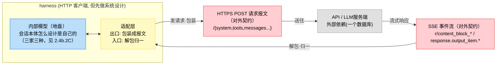
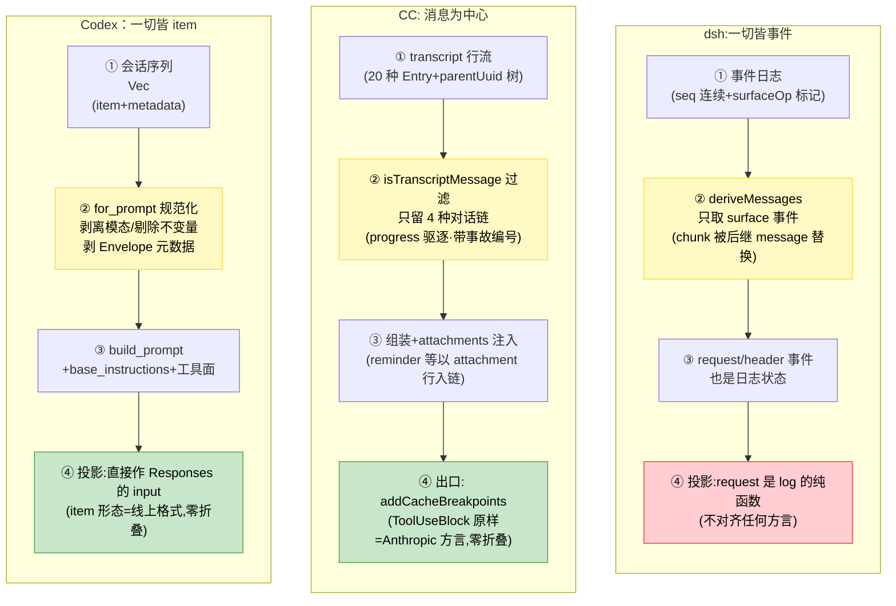
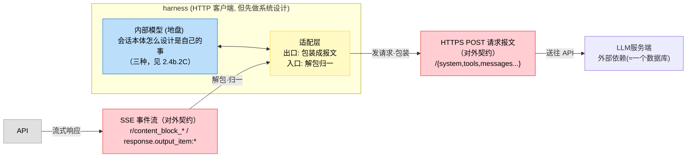
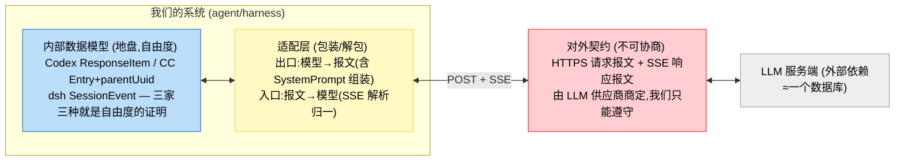
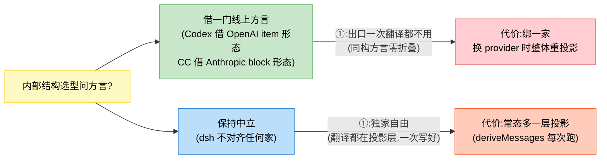
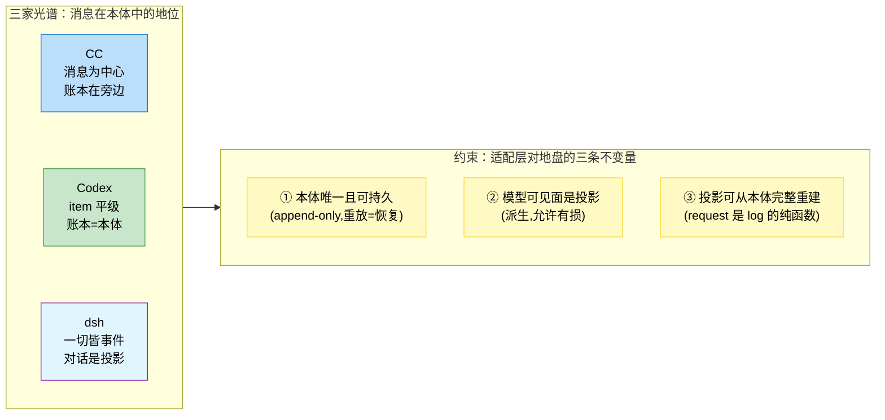
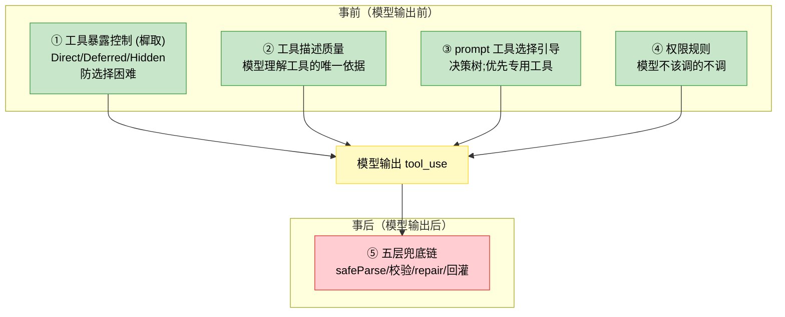
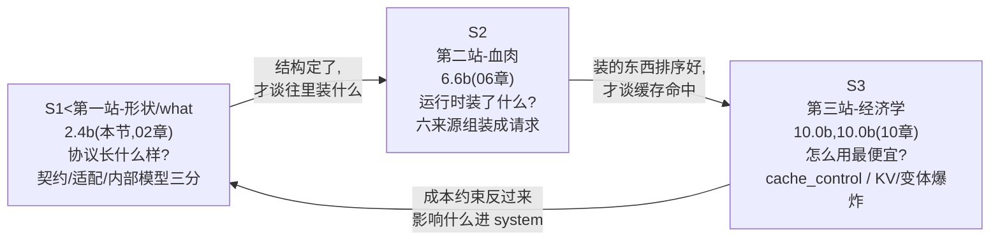

# 2.4b harness+LLM 通信契约：消息结构、输出格式与流式

>
> 本节是对2.4“统一消息格式”的深化。2.4 用简化的 `Message(role, type, content字符串)` 模型描述通信——这是给读者的入门视图，但与生产级源码差距很大。本节基于 Claude Code (CC)、Codex 两套源码（dsh parse），而是“边收边累加、结束才 parse”。
> 全文结论经两套源码交叉验证；源码定位精确到文件，可逐条复核。

## 2.4b.0 通信协议主题索引（本书导航）

>
> **harness+LLM 通信协议是贯穿全书的主线**——本一节（2.4b）是主线第一站，此处给出全线索索引。各站在自己的开篇有回本索引的导航；从任何一站进入，回到这里即可看到全景。

### 主线三站（协议的三次深挖，依次递进）

| 站 | 位置 | 回答的问题 | 内容 |
| --- | --- | --- | --- |
| ① 形状 | 2.4b.1 | 协议长什么样？ | 系统设计三分：对外契约（请求报文 + SSE 双方言响应报文，逐字段梳理）/ 适配层（包装解包，`responsesAdapter.ts` 佐证 OpenAI SSE-Anthropic 方言事件翻译）/ 内部模型（三家三种设计：本体与投影分离/流式三变量；输出格式三层控制（工具协议/API strict/prompt 兜底）） |
| ② 血肉 | 6.6b | 请求解剖 | `../06_memory/6.6b_final_request_anatomy.md`（06 记忆）协议运行时装了什么？六种来源（历史/CLAUDE.md/skills/记忆/MCP/工具）怎么组装成最终请求—严格按源码字段还原完整的请求，每个字段标注来源、约束 |
| ③ 经济学 | 10.0b.2b | 流控、缓存怎么组织、响应怎么解析 | 这个结构怎么用最便宜？ |

三站的递进关系与回路总图见本节尾注。

### 协议机制的消费点（各专题用到协议的哪一块）

| 协议机制 | 深挖位置 | 那里讲了什么 |
| --- | --- | --- |
| `tool_use`/`tool_result` 回灌通道 | 5.0b | 工具层本质 |
| `content_block` 事件流的退出消费 | 4.1c | 循环的退出 |
| `content_block` 内的内容涓流(`thinking_delta` 逐字渲染) | 4.1d | 思考的实时输出 |
| 注入位置的区别（system vs skill_listing vs attachment） | 6.1b | 记忆框架 |
| MCP 工具调用/返回结果通道 | 8.6b | 扩展与可逆 |
| 流式响应的收边（边收边解析的调度） | 4.3 | 流式处理 |
| 请求结构与缓存（第三站的展开） | 10.0b.2b | `../10_production/10.0b_uncertainty_essence.md#llm-protocol-station-3` |

---

### 相邻但不同层的协议（防混淆）

- [09 MCP 章](../09_mcp/README.md)讲的是 **harness+MCP server** 的 JSON-RPC 协议——另一条线，不与 harness+LLM 协议混（MCP 工具的调用结果如何进入 LLM 协议的 `tool_result` 通道，在 `../08_orchestration/8.6b_extensibility_reversibility.md`）。
- [07 模型集成章](../07_model_integration/README.md)的 Provider 抽象（[7.1](../07_model_integration/7.1_model_abstraction.md)）是 2.4b“适配层”（包装/解包）的教学前身。

### 2.4b.1 先厘清：没有自研通信协议，就是 HTTPs API

harness 对 LLM 服务端而言**本质是一个 HTTP 客户端**。通信是标准 REST over HTTPS——发一个 POST 请求，请求体是 JSON，收 SSE 事件流响应。没有自研协议、没有 TCP/UDP 特殊通道。所谓“通信契约”这个 HTTPS 请求体/响应流的字段约定，不是传输协议。



>
> 图 2-4b-0：harness-LLM 通信的系统设计视角——对外契约（红）不可协商，适配层（黄）包装解包，内部模型（蓝）是地盘。报文的字段梳理、适配层的佐证、内部模型的三家设计，全部在 2.4b.2 展开

### 2.4b.2 从做系统的角度切分：对外契约 / 适配层 / 内部模型

先立框架再谈再谈细节。**LLM 服务端对 agent 系统而言就是一个外部依赖——和数据库、缓存、第三方 API 没有本质区别。正常人设计这样的系统：**

1. **先和外部依赖约定报文**：请求怎么解析—这是不可协商的契约；
2. **内部数据结构是自己的地盘**（领域模型怎么设计是系统自己的事）；
3. 中间放一个**适配层**：出口把内部模型包装成报文，入口把响应报文解包回内部模型。


# 2.4b harness+LLM 通信契约：消息结构、输出格式与流式
> 本节是对2.4“统一消息格式”的深化。2.4 用简化的 `Message(role, type, content字符串)` 模型描述通信——这是给读者的入门视图，但与生产级源码差距很大。本节基于 Claude Code (CC)、Codex 两套源码（dsh parse），而不是“边收边累加、结束才 parse”。
> 全文结论经两套源码交叉验证；源码定位精确到文件，可逐条复核。

<a id="llm-protocol-index"></a>
## 2.4b.0 通信协议主题索引（本书导航）
> **harness+LLM 通信协议是贯穿全书的主线**——本一节（2.4b）是主线第一站，此处给出全线索索引。各站在自己的开篇有回本索引的导航；从任何一站进入，回到这里即可看到全景。

### 主线三站（协议的三次深挖，依次递进）
| 站 | 位置 | 回答的问题 | 内容 |
| ---- | ---- | ---- | ---- |
| ① 形状 | 2.4b.1 | 协议长什么样？ | 系统设计三分：对外契约（请求报文 + SSE 双方言响应报文，逐字段梳理）/ 适配层（包装解包，`responsesAdapter.ts` 佐证 OpenAI SSE-Anthropic 方言事件翻译）/ 内部模型（三家三种设计：本体与投影分离/流式三变量；输出格式三层控制（工具协议/API strict/prompt 兜底）） |
| ② 血肉 | 6.6b | 请求解剖 | `../06_memory/6.6b_final_request_anatomy.md`（06 记忆）协议运行时装了什么？六种来源（历史/CLAUDE.md/skills/记忆/MCP/工具）怎么组装成最终请求—严格按源码字段还原完整的请求，每个字段标注来源、约束 |
| ③ 经济学 | 10.0b.2b | 流控、缓存怎么组织、响应怎么解析 | 这个结构怎么用最便宜？ | `../10_production/10.0b_uncertainty_essence.md#llm-protocol-station-3`（10 生产·缓存下节） | cache_control 标记位置（缓存单元是块不是请求）/静态-动态边界界定/KV-cache 命中与击穿的微观机制/变体爆炸（2^N 前缀哈希桶） |

三站的递进关系与回路总图见本节尾注。

### 协议机制的消费点（各专题用到协议的哪一块）
| 协议机制 | 深挖位置 | 那里讲了什么 |
| ---- | ---- | ---- |
| `tool_use`/`tool_result` 回灌通道 | 5.0b | 工具层本质 | `../05_tool_layer/5.0b_tool_essence.md` (5.0b.5) | “错误即限流”整个机制建立在“错误以 `tool_result_is_error` 回灌不循环”上；错误消息怎么写=错误契约 |
| `content_block` 事件流的退出消费 | 4.1c | 循环的退出 | `../04_runtime/4.1c_loop_exit_signals.md` | 循环退出判定如何从事件流中快速识别—CC 做 `tool_use` 块不 `stop_reason` 含一次真实的 `tool_use` 事件流推送 |
| `content_block` 内的内容涓流(`thinking_delta` 逐字渲染) | 4.1d | 思考的实时输出 | `../04_runtime/4.1d_thinking_streaming.md` | 思考字流五道阀：同一事件流，适配层边收边攒、UI 逐量渲染、signature_delta 不进输出 |
| 注入位置的区别（system vs skill_listing vs attachment） | 6.1b | 记忆框架 | `../06_memory/6.1b_memory_framework.md` | 6.6b 扩展与可逆 | `../08_orchestration/6b_extensibility_reversibility.md` |
| MCP 工具调用/返回结果通道 | 8.6b | 扩展与可逆 | `../08_orchestration/8.6b_extensibility_reversibility.md` | `mcp_server_tool` 命名—`FunctionCallOutput` 回灌，与 skill 的 `system-render` 注入是两条路 |
| 流式响应的收边（边收边解析的调度） | 4.3 | 流式处理 | `../04_runtime/4.3_streaming.md`（数学版）SSE 消费的数学化简视角，与 2.4b.4 互为参照 |
| 请求结构与缓存（第三站的展开） | 10.0b.2b | `../10_production/10.0b_uncertainty_essence.md#llm-protocol-station-3` |

### 相邻但不同层的协议（防混淆）
- [09 MCP 章](../09_mcp/README.md)讲的是 **harness+MCP server** 的 JSON-RPC 协议——另一条线，不与 harness+LLM 协议混（MCP 工具的调用结果如何进入 LLM 协议的 `tool_result` 通道，在 `../08_orchestration/8.6b_extensibility_reversibility.md`）。
- [07 模型集成章](../07_model_integration/README.md)的 Provider 抽象（[7.1](../07_model_integration/7.1_model_abstraction.md)）是 2.4b“适配层”（包装/解包）的教学前身。

### 2.4b.1 先厘清：没有自研通信协议，就是 HTTPs API
harness 对 LLM 服务端而言**本质是一个 HTTP 客户端**。通信是标准 REST over HTTPS——发一个 POST 请求，请求体是 JSON，收 SSE 事件流响应。没有自研协议、没有 TCP/UDP 特殊通道。所谓“通信契约”这个 HTTPS 请求体/响应流的字段约定，不是传输协议。


>
> 图 2-4b-0：harness-LLM 通信的系统设计视角——对外契约（红）不可协商，适配层（黄）包装解包，内部模型（蓝）是地盘。报文的字段梳理、适配层的佐证、内部模型的三家设计，全部在 2.4b.2 展开

### 2.4b.2 从做系统的角度切分：对外契约 / 适配层 / 内部模型

先立框架再谈再谈细节。**LLM 服务端对 agent 系统而言就是一个外部依赖——和数据库、缓存、第三方 API 没有本质区别。正常人设计这样的系统：**

1. **先和外部依赖约定报文**：请求怎么解析—这是不可协商的契约；
2. **内部数据结构是自己的地盘**（领域模型怎么设计是系统自己的事）；
3. 中间放一个**适配层**：出口把内部模型包装成报文，入口把响应报文解包回内部模型。


## 2.4b.2 从做系统的角度切分：对外契约 / 适配层 / 内部模型
### C. 内部模型（地盘—三家三种设计，分开描述，后析共性与差异）
**C3. dsh：一切皆事件，对话是投影**
*内部结构 demo（SessionEvent，判别联合）*
```text
// 一会话的日志（每一行一个事件, seq 单调连续）
{type:"turn/start",      seq:0, time:..., data:{turn:1}}
{type:"user/message",    seq:1, ..., surfaceOp:"append", sourceEventSeqs:[], data:{role:"user",...}}
{type:"assistant/chunk", seq:2, ..., data:{chunk:"..."}}    ← 原始流块也是事件
{type:"assistant/message",seq:3, ..., surfaceOp:"replace:2",
                          sourceEventSeqs:[2], data:{message:"..."}}  ← 替换 chunk2
{type:"tool/call",       seq:4, ..., surfaceOp:"append", data:{callId, name, arguments}}
{type:"tool/result",     seq:5, ..., surfaceOp:"append", data:{callId, isError}}
{type:"request/header",  seq:6, ..., data:{header:EpochHeader}}  ← 请求信封也是事件
{type:"turn/end",        seq:7, ..., data:{reason:"completed"}}
```

*内部 → 报文的转换：没有“键”——`deriveMessages()` 从日志纯函数派生模型可见面（只认 surfaceOp 标记的事件，chunk 被后继 message 替换）。请求信封 `request/header` 也是日志事件—every conversation request is a pure function of the log。*

*遇到了什么问题、为什么这么设计：*

- 问题：把“日志优先”贯彻到底。若对话是本体，日志与对话会漂移。解法：本体只有日志，消息是投影（"derived from this log, never stored separately"）。
- 问题：投影的依据要可审计。解法：surfaceOp / sourceEventSeqs 溯源（这条 message 替换了哪些 chunk、源自哪些事件）→投影过程本身入账。
- 问题：插件要能扩展事件类型。解法：declaration merging + ignorable 纪律（不认识的必需事件，重放拒绝不静默跳过—over-refuse 优于 resume 一个被掏空的会话）。

先给一张三家转换链的对照图—同构的站点上对齐，差异点标色：



图 2-4b-2：三家转换链对照—**三列同构：序列→规范化/过滤→拼装→投影**（黄=第二步都有筛选，绿=Codex / CC 投影零折叠借了方言，红=dsh 有投影因保持中立）。同一根骨架三种表达这就是“共性是结构、差异是方言”的直观形态。

**C4. 共性与差异：先归纳，再归因**
**共性（三家都满足，即地盘上的真约束）：**

1. **本体 = append-only 序列**（Vec/JSONL 行/日志事件）—会话状态即序列本身，没有并行的状态对象
2. **账本 = 报文**—账本总是比发出去的多记（Envelope 元数据 / 20 种 Entry / 非 surface 事件），且**账本信息在包装时被剥掉**
3. **包装是有损耗的规范化**（Codex 是剥离模态、CC 过滤 Entry / dsh 只取 surface 事件）—丢的信息在账本里都有
4. **投影可从账本完整重建**—resume/replay 全靠这条（最彻底表述：dsh 的"request 是 log 的纯函数"）

**差异及其成因（不强行耦合，各有道理）：**

| 差异轴 | 设计 | 为什么（成因） |
| --- | --- | --- |
| 工具调用放哪 | Codex 独立 item / CC 长 content 里 / dsh 独立事件 | 对齐的方言不同：Codex 借 OpenAI item 形态（零转换），CC 借 Anthropic block 形态（零转换），dsh 不对齐任何一家（换家时都在投影层） |
| 内部结构选型 | 选一门方言少一次翻译，或保持中立多一次投影 |  |
| 序列形状 | Codex Vec / CC parentUuid 树 / dsh 单调 seq | 历史与需求不同：CC 要支持会话分叉（resume 的分支语义）；Codex 不分叉（fork=拷贝新 rollout 文件）；dsh 的 seq 兼取顺序 |

---

## 2.4b.0 通信协议主题索引（本书导航）

### 相邻但不同层的协议（防混淆）

- [09 MCP 章](../09/README.md) 讲的是 **harness-MCP server** 的 JSON-RPC 协议—另一条线，不与 harness↔LLM 协议混（MCP 工具的调用结果如何进入 LLM 协议的 tool_result 通道）
- [07 模型集成章](../07_model_integration/README.md) 的 Provider 抽象（[7.1](../07_model_integration/7.1_model_abstraction.md)）

### 2.4b.1 先厘清：没有自研通信协议，就是 HTTPS API

harness 对 LLM 服务端而言**本质是一个 HTTP 客户端**。通信是标准 REST over HTTPS—发一个 POST 请求，请求体是 JSON，SSE 事件流响应。没有自研协议、没有 TCP/UDP 特殊通道。所谓“通信契约”：



图 2-4b-0：harness↔LLM 通信的系统设计视角—**对外契约（红）不可协商，适配层（黄）包装解包，内部模型（蓝）是地盘**。报文的字段规格、适配器的铁证、内部模型的三家设计，全部在 2.4b.2 展开。

### 2.4b.2 从做系统的角度切分：对外契约 / 适配层 / 内部模型

先立框架再谈细节。**LLM 服务端对 agent 系统而言就是一个外部依赖—和数据库、缓存、第三方 API 没有本质区别。正常人设计这样的系统：**

1. **先和外部依赖约定报文**：请求怎么解析—这是不可协商的契约；
2. **内部数据结构是自己的地盘**（领域模型怎么设计是系统自己的事）；
3. 中间放一个**适配层**：出口把内部模型包装成报文，入口把响应报文解包回内部模型。



图 2-4b-1：系统设计视角的三分—**内部模型（蓝，我们的地盘）/适配层（黄，包装解包）/对外契约（红，供应商的地盘）**。此版本把这三分的内容混排成“四层模型”（对话层/消息层/注入层/转换器），按系统设计视角应重排如下：①转换器=适配层本体；②对话层=内部模型；②消息层是半条腿在两边（ContentBlock 既是内部结构、又恰好是 Anthropic 线上格式原样—历史产物，不是独立一层）；③注入层是适配层出口包装的一部分（SystemPrompt 组装报文的动作）。

#### A. 对外契约（先约定报文—本节的主体）

对外契约就是两张报文：**请求报文（我们发什么）和响应报文（对方怎么回）**。逐字段梳理，全部按源码核验。

**A1. 请求报文（`POST /v1/messages`，CC `services/api/claude.ts` 组装 / Codex `ResponsesRequest` 同构）：**

```json
{
  model, max_tokens, stream: true,
  system: [                          ← 系统提示（text block 数组）
    {type:"text", text:"...", cache_control:{...}},
    {type:"text", text:"..."}
  ],                                 ← 不挂 = 动态尾部
  tools: [                           ← 工具面（紧跟 system 排最前）
    {name, description, input_schema:{...},
     cache_control:{type:"ephemeral"}},
  ],
  messages: [                        ← 对话历史（user/assistant 交替）
    {role:"user",    content:[{type:"text",...}]},
    {role:"assistant", content:[
      {type:"text", text:"..."},
      {type:"tool_use", id:"call_abc", name:"get_weather", input:{...}}
    ]},
    {role:"user",    content:[
      {type:"tool_result", tool_use_id:"call_abc", content:"..."}
    ]},
  ],
  tool_choice: "auto", parallel_tool_calls: true
}
```

>
> - `tool_use` 折叠在 assistant 的 content 里
> - `tool_result` 以 user 角色回灌，按 `tool_use_id` 配对

**历史量的两家设计（分开说，同一问题两种解法）：**
上面是 **Anthropic Messages** 的形态—服务端无状态、无续传概念，`messages` 每轮+全量重发当前完整历史（50 轮任务的输入总量 ≈ 0（轮数），靠 `previous_response_id` 引用上次响应、**只传新增 items**—Codex 做了条件复用（`client.rs` 的 `get_incremental_items`）；14 个请求属性与上次匹配 + 新 `input` 前缀与上次响应 item 相等，两条件都过则 WebSocket 路径只发 delta；HTTP 路径默认 `store: false`，不用增量。**历史线性增长的结构性事实两家不变—差异在解法：Anthropic 服务端无状态（把重计费问题交给 prompt cache），OpenAI 有状态可记（把重复传输问题交给增量引用）。**

三个契约的要点：

1. `system` 是数组（可分块、每块独立挂 `cache_control`—为什么必是数组见第一站③注入层与第三站经济学）；
2. **工具调用在线上格式里折叠在 assistant 消息的 content 里、结果以 user 角色 `tool_result` 回灌、按 `tool_use_id` 配对**—这是对话 item 平级性在报文端的投影（折叠是适配层的动作，见 B）；
3. **tools 紧跟 system 排最前**—任何变动同样击穿缓存（5.4b 的工具上下文经济学在协议端）。

**A2. 响应报文（SSE 事件流，`stream:true` 时）—两家方言，源码实证：**
*Anthropic 方言（CC 消费侧，`claude.ts:2060-2303`）：*

```text
event: message_start      { message: {usage 基线} }
event: content_block_start { index:0, content_block:{type:"tool_use", id, name, input:{}} }
event: content_block_delta { index:0, delta:{type:"input_json_delta", partial_json:"{\"c1\"}"} }
event: content_block_delta { index:0, delta:{type:"input_json_delta", partial_json:"ty..."} }
event: content_block_stop  { index:0 }
event: message_delta       { delta:{stop_reason}, usage:{最终} }
event: message_stop
```

*OpenAI Responses 方言（CC 的 `responsesAdapter.ts` 消费侧，Codex 原生）：*

```
event: response.output_item.added   { item:{type:"function_call", call_id, name, output_index} }
event: response.function_call_arguments.delta { delta:{arguments片段}, output_index }
event: response.output_item.done    { item:{...完整} }
event: response.completed           { response:{usage,...} }
```

两家方言的差异（block 按 index 分流 vs item 按 output_index 分流；`input_json_delta` vs `function_call_arguments.delta`）**就是适配器必须存在的直接原因→见 B 的铁证。**

**A3. 契约的边界：契约只管到“报文长什么样”—不管你怎么组织内部数据（你的地盘）、不管多个工具调用怎么调度（5.2b）、不管报文里各字段的内容怎么生成（6.6b 的六来源）。** #把契约当全部、把地盘当契约（或反之），是这一主题最常见的两类错误。

#### B. 适配层（包装/解包—实体存在的铁证）

适配层不只是概念，CC 源码里有一个**双方言适配器**作为铁证：`services/api/openai/responsesAdapter.ts`—**内部统一流事件类型是 Anthropic 的 `BetaRawMessageStreamEvent`，适配器把 OpenAI Responses 的 SSE 事件翻译过去：**

```
response.output_item.added (function_call)  → content_block_start (tool_use, 新 index)
response.function_call_arguments.delta      → content_block_delta (input_json_delta)
response.output_item.done                   → content_block_stop
response.completed                          → message_delta + message_stop
```

（源码 `responsesAdapter.ts:340-419` 逐分支对应；甚至处理了“文本块还开着先关掉再开工工具”的顺序细节。）

**这说明什么？**
内部模型选型了 Anthropic 方言做统一流，OpenAI 就要经适配器翻译进来—**内部模型无论选哪家方言，另一家都要翻译**。这就是适配层的全部工作：出口把内部模型包装成 AI 的报文（合 item 列折叠成角色消息），入口把 A2 的 SSE 解包归一成内部流事件。

**折叠是适配层最大的信息损失点：** Codex 内部 `FunctionCall` 是平级 item，出口包装成 `assistant` 消息里的 `tool_use block`—item 身份在线上格式里消失（resume 重放时从账本重建，不从报文重建，所以丢了也不影响正确性—这正是“本体与投影分离”的价值：**投影可以丢信息，因为本体还在**）。

#### C. 内部模型（地盘—三家三种设计，分开描述，后析共性与差异）

内部数据结构怎么玩是自己的地盘。但“自由”不等于“随便”—每一家的设计都是**对一组具体问题的回答**。逐家看结构、demo、遇到的/解决了的问题，再抽共性与差异。

**C1. Codex：一切皆 item 的会话序列**
*内部结构 demo（运行时的会话序列，账本行的本体）：*

```text
// 会话是 Vec<ResponseItemEnvelope> append 序列 (history/src/lib.rs:138)
ResponseItemEnvelope { item: Message{role:"user", content:[InlineText("查北京天气!")], metadata: None },
ResponseItemEnvelope { item: Reasoning{...},              metadata: None },
ResponseItemEnvelope { item: FunctionCall{call_id:"call_abc", name:"get_weather",
                          arguments:{"city":"北京"}}, metadata: None },
ResponseItemEnvelope { item: FunctionCallOutput{call_id:"call_abc", output:"..."}, metadata: None },
ResponseItemEnvelope { item: Message{role:"assistant",...},             metadata: None },
ResponseItemEnvelope { item: Compaction{...},                           metadata: Some(...) },
...
```

>
> 注意：**账本行是 Envelope（item + 可选 harness 元数据）**—元数据（如 `client_authored`：这条 developer 消息是不是客户端给的）跟 item 一起持久化，但不进 item。`metadata: Option<CodexHarnessMetadata>` 是“账本记录比报文多”的显式证据。

*内部 → 报文的完整转换链（一次请求的包装路径，逐站源码）：*

```text
① 会话序列 (Vec<ResponseItemEnvelope>, 账本)
    ↓ context_manager/history.rs:206  for_prompt(input_modalities)
② 规范化: normalize_history —
    · 按 input_modalities 剥离模型不支持的内容（图片/音频能力丢弃）
    · 删不合适 item, 维持 call/output 配对不变量
    (remove_corresponding_for: 删掉一个 call 连带删它的 output,
    "keep the invariants intact without running a full normalization pass")
    ↓ session/turn.rs build_prompt + bound_executed_tool_calls_for_prompt
③ 拼装: items + base_instructions + 工具面 → Prompt
    ↓ client.rs
④ 投影: Prompt.input 直接作为 Responses API 的 input 字段
    (Responses 的线上格式恰好就是 item 形态—函数调用不折叠，
    这是“内部模型选了某家方言”的最初底案例)
```

**这条链回答了“包装时会发生什么”：包装不是字段搬运，是一次规范化+一次有损投影——模态剥离（老模型不支持图/片）、配对不变量维持、不支持 item 的删除。而 Envelope 的元数据在①→②处被剥掉（`for_prompt` 返回裸 item）—**账本信息不进报文**。

*遇到了什么问题、为什么这么设计：*

- 问题：resume 要从断点完整重建会话，若工具调用/压缩藏在消息的字段里，“重建”就得解析每条消息的内部结构。解法：一切皆平级 item，重建=重放序列（`rollout_reconstruction.rs` 整个文件就是干这个的），连 window 链和世界状态基线都能从 item 序列还原。
- 问题：多 providers。内部若用某家的角色消息模型，换家就翻译地狱。解法：内部 item 中立，且 ④ 处直接借了 OpenAI Responses 的 item 形态（原线上格式与内部同构、零转换；Anthropic 反向折叠）。
- 问题：账本要比报文多记东西。解法：Envelope（item+metadata），多层的在包装时剥掉。

**C2. CC: 消息为中心 + transcript 账本**
*内部结构 demo（transcript 的行，`types/logs.ts`）：*

```json
// 一段会话的 transcript JSONL（每一行一个 Entry，parentUuid 链成树）
{type:"user",     uuid:"u1", parentUuid:null, message:{role:"user", content:[...]}}
{type:"assistant",uuid:"a1", parentUuid:"u1", message:{role:"assistant",
    content:[TextBlock{...}, ToolUseBlock{id:"tool_u1", name:"Bash", input:{}}]}}
{type:"user",     uuid:"u2", parentUuid:"u1", message:{role:"user",
    content:[ToolResultBlock{tool_use_id:"tool_u1", content:"..."}]}}
{type:"attachment",uuid:"t1", parentUuid:"u1", attachment:{type:"todo_reminder",...}}
{type:"summary",  uuid:"s1", parentUuid:"u1", summary:"...", leafUuid:"..."}
// 另有 FileHistorySnapshotMessage / ModeEntry / QueueOperationMessage 等 20 种
```

>
> 与 Codex 的两个形态差异：
>
>
> - 工具调用长在 assistant 消息的 content block 里（不独立成行）；
> - 行间用 `parentUuid` 链成树（还有 `logicalParentUuid`：会话断点物理父空但保留逻辑父→为 resume 的分支语义）。

*内部 → 报文的转换链：*

```text
① transcript 行流（20 种 Entry）
    ↓ loadTranscriptFile + isTranscriptMessage 过滤
② 只留 user/assistant/attachment/system 四种对话链
    (progress 被驱逐—注释带两个事故编号: "Including them caused
    chain forks that orphaned real conversation messages on resume")
    ↓ messages.ts 组装 + attachments.ts 注入
③ 对话链
    ↓ claude.ts  addCacheBreakpoints + buildSystemPromptBlocks
④ 报文: assistant 的 ToolUseBlock 原样即 Anthropic 的 tool_use;
    attachment 行在出口处展开成 user 消息里的 text block
```

*遇到了什么问题、为什么这么设计：*

- 问题：历史包袱与真实事故。CC 的结构是演化产物（transcript 从日志演化来），不是设计出来的。`progress` 送错的两次事故（#14373/#23357）催生了 `isTranscriptMessage` 单一事实—**每条行算对话与否从约定变成了代码里的类型守卫。**
- 问题：UI 需要的东西模型不需要（文件快照/模式切换/队列操作）。解法：Entry 联合比消息类型宽得多，出口过滤。
- 问题：会话可能分叉。解法：`parentUuid` 树而非线性序列—比 Codex 的线性 Vec 多出的维度。

**C3. dsh：一切皆事件，对话是投影**
（前面已写，三家共性差异汇总）

| 序列形状 | Codex 线性 Vec / CC parentUuid 树 / dsh 单调 seq 日志 |
| --- | --- |
| 历史与需求不同 | CC 要支持会话分叉（resume 的分支语义）；Codex 不分叉（fork=拷贝新 rollout 文件）；dsh 的 seq 兼取顺序 |
| 事故驱动痕迹 | CC 最深（驱逐 progress 带事故编号） |
| 演化产物 vs 设计产物 | CC 结构是长出来的，事故化石直接写在代码里；Codex/dsh 更接近一次成型 |
| 元数据挂哪 | Codex Envelope / dsh sourceEventSeqs / CC 独立 Entry 类型 |
| **比报文多记的东西**每家不同 | Codex 记准写的，dsh 记投影依据，CC 记 UI/运维事实—账本的超集内容由各家产品方言经济学决定—差异成因表里最有解释力的一行，升为图： |



图 2-4b-3：方言经济学—**没有免费选项：借方言=绑定，中立=多投影**。选型前先答一个问题：“会换 provider 吗、多频繁”（频繁→中立；不换→借当前家的方言最省）。

**给我们的启发：**

1. **内部结构选型是方言经济学**：选一门线上方言对齐（省一次翻译、绑一家）或保持中立（多一层投影、换家自由）—没有免费选项。Codex / CC 选了前者（各绑一家），dsh 选了后者。选型时先回答“会换 provider 吗、多频繁”。
2. **账本必须严格超集**：任何进了内部结构的东西，发出去之前想清楚“这个字段账本要不要保留”—CC 的 `logicalParentUuid`、Codex 的 metadata 都是“报文不留、账本留”的显式设计。
3. **事故化石是红利**：CC 代码里带编号的缺陷说明结构是被真实失败教训出来的—**没有事故痕迹的“干净设计”反而值得怀疑没生产检验过。**
4. **投影依据要可审计**（dsh 的 sourceEventSeqs）；重放/评估/测试都依赖“当时模型看到了什么”的精确链路—这条直接支撑 13.2b 的 replay 评估。

三家差异沿“消息离本体中心多远”一根轴滑动（C4 已归纳共性与差异，这里补全景图）：



**本体离消息多远是自由度，“本体与投影分离”是约束→三条不变量不是通信协议定的，是适配层定的（要能包装、要能解包、要能重建）。第 3 条直接咬合全书—因为投影是纯函数，冻结输入才能冻结输出—13.2b 的 replay 评估踩在这块地基上。内部模型的设计因此可以像任何领域建模一样自由（三家三种），唯一要满足的是适配层的要求。**

---

## 2.4b.3 输出格式控制：三层机制 + 能力门控

模型返回格式（尤其 tool_call 的结构化输出）由谁控制？源码显示是**三种机制叠加，按模型能力门控选用，不是单靠 prompt，也不是纯特训。**

| 机制 | 在请求体哪个字段 | 谁保证格式 | 强度 |
| --- | --- | --- | --- |
| ① 工具协议 | `tools` + `tool_choice` | 模型训练（function calling） | 高（概率性） |
| ② 结构化校验 | `output_schema` + `strict` | API 服务端强制校验 | 最高（强制） |
| ③ prompt 引导 | `messages` 文本 | 模型自觉 | 最低 |

- **机制①**：请求带 `tools` 字段 → 模型经 function calling 训练，输出结构化 `tool_call` 而非纯文本。Codex `tools: Arc<[ToolSpec]>` + `tool_choice:"auto"`；强制—模型可能不听，故【C】仍需服务端校验兜底。
- **机制②**：请求带 `output_schema` + `output_schema_strict:true`（Codex 默认打开）→**服务端强制校验输出符合 schema，不符拒收。保证来自服务端，最硬。CC 用 `STRUCTURED_OUTPUTS_BETA_HEADER` + `modelSupportsStructuredOutputs()` 门控。**
- **机制③**：prompt 文本引导“请返回 JSON”，最弱，兜底。

>
> **能力门控是关键：结构化输出是模型/provider 能力，不是所有模型都支持。CC `modelSupportsStructuredOutputs()`；Codex `parallel_tool_calls && !model_info.use_responses_lite`**
>
>
> **设计教训：** 常见误区“用 prompt 让模型返回 JSON”。源码真相—**优先用工具协议（模型训练）和结构化校验（API 强制），prompt 引导是最后兜底。** 输出格式控制权应在 API/协议层，不在 prompt 层：
>
>
> - 关于训练阶段（诚实边界）：function calling 这种“见 tools 就输出 tool_call 的行为对齐上去”，主要是 **post-training（SFT + RLHF）阶段训练的，不是 pre-training。pre-training 给基础语言能力，post-training 把“工具调用格式”这个行为对齐上去。但具体训练细节是模型厂商内部，不在 harness 工程。本节只确认“这是训练出来的，不是 prompt 约束的”，训练阶段的精确结论靠厂商文档，不打包票。**
> - 格式可靠性的根基与天花板：
    >   - FC 模式下：模型训练过 FC，输出 `tool_call` 的概率性由模型能力（FC 训练），不在 harness 工程。harness 的工程手段（strict + 兜底链）补的是**残余概率**，补不了“能力缺失”；
>   - 无 FC 模型下：根基缺失。harness 只能事后容错（safeParse/多策略解析/自愈重试/降级终止），到了 FC 模式下的“事中强制”（约束解码/strict），但保证不了“可靠工具调用”，可靠性有硬天花板。
>
>
> 源码证实：CC/Codex 不处理 FC 基座，而是按 FC 限定只接 FC 模型。CC 甚至主动抑制模型自发的 `<function_calls>` XML 文本格式：`extract_tool_mentions_with_sigil` 是解析用户输入里的工具提及 `@tool`，非解析模型输出—传空 tools 给 Sonnet 多产 XML 噪音，把它当不可靠噪音而非备选格式。Codex 的 `tools: []` 是明确抑制 FC；**harness 选择“坚持 FC 模型”，不兼容 XML 旁路。** 实证显示生产 harness 不走文本这条路。

**工程端如何提高 tool_use 正确性：事前控为主，事后兜底为辅**
格式可靠性的根基是模型能力，但工程端仍有大量杠杆在**能力上限内提升 tool_use 正确率**。源码显示杠杆最大在**事前（模型工具之前）**，不在事后（错了再兜）：



图 2-4b-4：工程端 tool_use 正确性体系（绿=樨取，红=约束；事前樨取为主，事后兜底为最后防线）

1. **工具暴露控制（樨取）**—工具越多，模型选错/参数错概率越高。Codex `ToolExposure` 枚举 `tool_executor.rs:51`：`Direct`（常驻）/`Deferred`（延迟，模型在 SearchExtraTools 发现）/`CodeModelOnly`/`Hidden`，配 `tool_is_model_visible()` 过滤。CC `tools.ts:275`：`"The actual decision to defer tools happens at request time"`—**唯一能提升这一工程杠杆决定每个工具对模型可见与否—少而准的工具列表是上下文的一部分。**
2. **工具描述质量（樨取）**—工具描述是模型理解工具的唯一依据（Codex `default_namespace_description`, `collect_tool_namespaces_info`；CC Tool 定义要求高质量 description）。描述差 → 模型乱调。控制描述质量 = 控制 tool_use 正确性根基。
3. **prompt 工具选择引导（樨取）**—CC 在 prompt 写工具选择决策树（`promptEngineeringAudit.runner.ts:240`）：`"Prefer dedicated tools / Reserve shell operations"`—教模型何时用哪个工具（如该用 Read 却用 cat 的常见误区）。纯 prompt 樨取【A】的“无权重后训练”，用在工具选择上。
4. **权限 deny 规则（约束）**—CC `getDeniedRuleForTool`, Codex `AppTooPolicyEvaluator`；工程直接禁止某些工具被调，模型就算想调也拦下。防“读了不该读的”。
5. **事后兜底链（约束）**—safeParse/降级/校验/repair/回灌（详见【2.1b,11 解析拦截点】）；tool_use 已错之后保证不崩。**这是最后防线，不是主力。**

**核心调通：工程端提高 tool_use 正确性，**杠杆最大在事前控制工具集（暴露/描述/引导），不在事后兜底。事后兜底是防线，但真正提升正确率的是事前给模型少而准的工具 + 好描述 + 选择引导、让模型从源头更容易选对。这时应【A】：**工程提升的是模型已有 FC 能力下的正确率（如 80→95%），**不能让无 FC 模型获得 FC 能力（那是模型训练的事）。能力上限仍由模型封顶、工程樨取在能力圈内上调正确率—与【A】的“无权重后训练”同构：不增加能力，靠上下文定向把原有能力用到最优。

---

## 2.4b.4 流式响应：边收边累加，结束才 parse

模型响应不是一次性 JSON，是 SSE（Server-Sent Events）事件流—服务端把生成过程切成事件序列逐个推送。

### CC 的事件序列（典型）

```text
message_start       → 消息开始
content_block_start → 一个 block 开始 (text/tool_use/thinking)
content_block_delta → block 内容增量（可多次）
text_delta          → 文本增量
input_json_delta    → tool_call 参数的 JSON 增量（关键！）
thinking_delta      → 推理增量
content_block_stop  → block 结束
message_delta       → 消息级增量（stop_reason/usage）
message_stop        → 消息结束
```

**关键洞察：tool_call 参数不是一次性来的，是 `input_json_delta` 逐片推送的 `partial_json`。模型生成 `{"city":"北京"}` 时，流里可能是 `{"ci` → `ty":"` → `"北京"}` 这样的片段序列。**

### 攒出完整 tool_call 的机制

CC `messages.ts:3426`：按 block 的 `index` 找到对应 tool_use，把 `partial_json` 片段累加进 `unparsedToolInput`：

```typescript
case 'input_json_delta':
  const delta = streamMsg.event.delta.partial_json
  onStreamingToolUses_ => {
    const element = _find( _ => index === index ) // 按 index 分流（并行 tool_call 各自累加）
    return { ...element, unparsedToolInput: element.unparsedToolInput + delta }
  }
```

等 `content_block_stop` 时 `unparsedToolInput` 攒齐，再 `JSON.parse()` 成完整参数。Codex 对等：`AssistantTextStreamParser.push_str(chunk)` 增量推送、`finish()` 定形；`Utf8StreamParser` 专门处理 UTF-8 字节边界被切断（一个中文字符的字节可能跨两个 chunk），dsh 印证：`BlockAssembler.push(chunk)` + `assembler.finish()`，同构。

### 三家共识

1. **SSE 事件流（非一次性响应）**
2. **按 block index 分流（并行 tool_call 各自累加）**
3. **partial 增量累加（unparsedToolInput / push_str），不每片 parse**（性能），结束时一次 parse—CC 注释明示 `partialParse()` on every input_json_delta, which we don't need
4. **处理字节/字符边界**（Codex Utf8StreamParser）

### 与各站的呼应

- 呼应答层【B/C】：流式攒齐后（`content_block_stop`），才进入【B/C】的结构校验。流式是【B/C】的前置。
- 呼应答执行层“流式触发执行”：CC `StreamingToolExecutor` "as they stream in"—攒出 tool_call 后不等整条消息结束就执行，流式解析是“边收边执行”的基础（并发调度的完整机制见【5.6b 工具实现】）。

### 设计教训

`output_schema strict`：strict 校验在消息结束（完整输出后）做，流式中是 partial、无法 strict 校验（还没攒齐）。strict 是事后校验。

**流式解析的核心难点不是“解析”，是**增量累加 + 边界处理**：`tool_call` 参数是 JSON 片段流，要按 index 累加（不能 parse 半个 JSON）；UTF-8 字节可能跨 chunk；多 tool_call 并行要分流；性能上不每片 parse。**常见误区：“流式=边收边 parse”——源码真相是“流式=边收边累加（字符串拼接），结束才 parse”。`unparsedToolInput` 这个命名点明：流式中是“未解析的”，只在结束时转解析。**

---

## 2.4b.5 小结

harness↔LLM 通信工程按系统视角是三分结构（**对外契约 / 适配层 / 内部模型**）+ 三层输出控制 + 增量流式：

- **对外契约**：请求报文（`system` 数组+tools+messages，工具调用折叠在 assistant、结果 user 回灌按 id 配对）+ SSE 双方言（Anthropic block vs OpenAI item 流）。
- **适配层**：出口包装（含折叠）/入口角色消息归一（不可变证据，`responsesAdapter`）。**内部模型可见面不是投影，本体才可见面；投影可重建（可重放）是适配层对地盘的强约束。**
- **内部模型是地盘**：对话 item 流（不止三种角色、消息 block 数组（非字符串）、SystemPrompt 分段组装作适配层注入）。
- **输出格式三层控制**：工具协议（模型训练，概率性）< 结构化校验（API strict，强制）< prompt 引导（最弱），按模型能力门控选用。控制权在 API/协议层不在 prompt 层。
- **流式=SSE 事件流、边收边累加、结束 parse**：`input_json_delta` 片段累加，按 index 并行分流，UTF-8 边界处理，结束才 JSON 解析。

>
> 本节与 2.1b 互补：2.1b 讲核心层“怎么循环”（时间轴/防线），本节讲核心层“和 LLM 怎么对话”（通信契约）。两者合起来是核心层与 LLM 交互的完整图景—循环驱动对话，对话遵循契约。

**协议三站总图—本节是 harness↔LLM 通信协议主线的第一站。同一条协议，三站各答一问（全线索引见本节开头的 2.4b.0）；三站递进与回路：**



>
> 本节的注入层“SystemPrompt 分段数组”在第二站获得血肉（六来源每段里装什么），在第三站获得第二重动机：**分段不只是组织清晰，是每段独立挂缓存标记—同一段内容增删还是续后，成本差一个数量级。**

# 主线三站（协议的三次深挖，依次递进）

| 站 | 位置 | 回答的问题 | 内容 |
| --- | --- | --- | --- |
| 1 | 2.4b | 协议长什么样？ | 系统三分：对外契约（请求报文 + SSE 双方言响应报文）、适配层（包装解包，`responsesAdapter.ts` 铁证）、内部模型（地盘三种设计） |
| 2 | 6.6b | 请求解剖 | 报文运行时装了什么？六个来源（历史/CLAUDE.md/skills/MCP/工具）怎么组装成最终请求—严格校验不是请求、静态/动态边界异质；`KV-cache` 命中与击穿的微观机制/变体爆炸（2^N 前缀哈希桶） |
| 3 | 10.0b | 经济学 | 这个结构怎么用最便宜？`cache_control` 标记位置（缓存单元是段） |

>
> 三站的递进关系与回路总图见本节尾注。

## 协议机制的消费点（各专题用到协议的哪一块）

| 协议机制 | 深挖位置 | 那里讲了什么 |
| --- | --- | --- |
| `tool_use/tool_result` 回灌通道 | 【5.0b 工具层本质】   `../05_tool_layer/5.0b_tool_essence.md`（5.0b,5） | “错误即闭环”整个机制建立在“错误以 `tool_result[is_error]` 回灌不循环”上：错误消息怎么写=错误闭环 |
| `content_block_*` 流的退出消费 | `tool_discuss-needsFollowUp` | 【4.1c 循环的退出】   `../04_runtime/4.1c_loop_exit_signals.md` |
| `stop_reason`/含一次真实的 `thinking_delta` 事件流 | 【4.1d 思考的实时输出】   `../04_runtime/4.1d_thinking_streaming.md` | 思考逐字渲染的五通管道：同一事件流、适配层边流边攒、UI 渲染基架 |
| `content_block_delta` 的内容混淆（thinking_delta） | 【4.1d 思考的实时输出】 |  |
| 注入位的区别（system vs skill listing vs attachment） | 【6.6b 记忆框架】   `../06_memory/6.6b_memory_framework.md` |  |
| `6b_extensibility_reversibility.md` | 【6.6b 扩展与可逆】   `../08_orchestration/6b_extensibility_reversibility.md` |  |
| MCP 工具调用用 `tool_result` 回灌 | 【MCP 与 Skill】   `../08_orchestration/8.6b_extensibility_reversibility.md` | `mcp_server_tool` 命名—`FunctionCallOutput` 回灌，与 skill 的 `system-render` 注入是两条通道 |
| 流式响应的数学 | 【4.3 流式处理】   `../04_runtime/4.3_streaming.md`（数学版） | SSE 消费的数学化简，与 2.4b.4 互为参照 |
| 请求结构与缓存 | 【第三站的展开】   `../10_production/10.0b_uncertainty_essence.md#llm-protocol-station-3` |  |

>
> 协议不止被“三站”研究，多个专题建立在它的某个机制之上—这张表“某机制在哪被深挖”用这张表。

>
> 本文是对 2.4 简化版的深化。2.4 用简化的 `Message(role, type, content字符串)` 模型描述通信—这是给读者的入门视图，但与生产级源码差距很大。本节基于 Claude Code（CC）、Codex 两套源码的 `responsesAdapter.ts` 是实体铁证，最后看内部模型（我们的地盘—三家三种设计），归纳出统一范式；**输出格式控制不是“prompt 约束”，而是模型训练 + API 强制 + prompt 兜底三层；流式不是“边收边 parse”。**
> 全文结论经两套源码交叉验证；源码定位精确到文件，可逐条复核。
