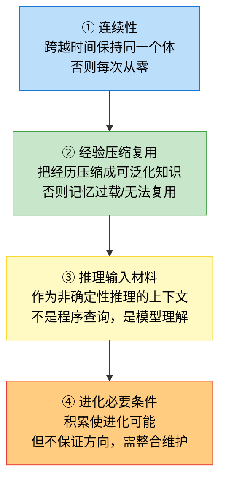

## 6.0b 记忆的本质：对智能体意味着什么
> 本节是第六章的奠基。6.1-6.5 讲记忆系统的工程设计（架构/写入/组装/整合/实战），本节先回到第一性原理—不落地怎么落地，先想清楚“记忆对智能体到底意味着什么”。这是后续所有记忆设计决策的认知根基：不懂记忆的本质，设计的记忆系统只是“又一个数据库”。
> 本节从智能体（LLM agent + 人类）的共性本质推演，非凭空设定。

### 6.0b.1 出发点：时间是连续的，但认知是局部的
一个智能体（无论 LLM agent 还是人类）面对的世界有一个根本特征：**时间是连续的，但认知是局部的**。
- **人类**：此刻的你，只能意识到此刻的思考。你之所以是“你”而非每秒一个新人，靠的是记忆—记得昨天做了什么、自己的偏好、学过的教训。没有记忆，人就是每秒重启的失忆者，谈不上“连续的人格”。
- **LLM agent**：单次推理是“无状态的”—模型权重固定，一次推理只看这次输入的上下文。agent 之所以能会话保持一致、积累经验，靠的也是记忆。没有记忆，agent 每次会话从零开始，不知道用户是谁、之前做过什么。

这个矛盾—**连续的世界 vs 局部的认知**—是记忆存在的根本理由。记忆是弥合这个矛盾的唯一桥梁。

### 6.0b.2 记忆的四层本质作用
从这个出发点推演，记忆对智能体有四层递进的作用：

>
> 图 6-1：记忆对智能体的四层本质作用（递进：连续性→压缩复用→推理输入→进化必要）

#### ① 连续性—跨越时间的同一个体

没有记忆，智能体退化成“一次性计算器”一算完就忘，无法成长、无法保持一致。

- **人类**：失忆症患者每天醒来不记得昨天，每次都是“新人”—没有连续的人格。
- **LLM agent**：无记忆的 agent 每次会话从零开始—不知道用户是谁、之前做过什么、偏好是什么，用户每次都要重新解释背景，agent 无法积累。

记忆的第一个本质作用：跨越时间的连续性。它让智能体在时间维度上保持“同一个体”。

#### ② 经验压缩复用—从经历提炼可泛化知识

光有连续性（记住过去发生什么）不够。如果只是把过去的事全记下来，记忆会无限膨胀—人类大脑每天接收海量信息，若全记，早就过载；LLM 上下文窗口也有限，全记历史会撑爆。

>
> **记忆不是“事件的忠实实录”，是“经验的压缩”**
>
>
> - **人类**：你记得“上次摸火烫手”，不是记得每次摸火的精确瞬间，而是压缩成“火=危险”的教训。记忆把无数次经验压缩成可复用的知识/教训/偏好。
> - **LLM agent**：记忆不该是完整对话历史的副本（那是日志，不是记忆），而该是**从历史中提炼的、可复用的经验—用户偏好、踩过的坑、有效的方法**。

记忆的第二个本质作用：经验的压缩与复用。这和数据库的“忠实存储”根本不同—数据库存“事实”（这次订单金额100），记忆存“经验”（这类用户偏好小额订单）。事实是点状的，经验是压缩的、可泛化的。

#### ③ 推理输入材料—非确定性推理的上下文

这一层最关键，且是 agent 记忆和传统存储的根本分界。

智能体（LLM agent）的核心是**非确定性推理—模型每次推理都是“基于上下文的概率生成”**。记忆的作用是**作为推理的输入材料，影响这个概率分布**：

- 没有“用户偏好简洁回答”这条记忆，模型可能默认详细输出。
- 有这条记忆，模型更可能简洁输出。

>
> **记忆不是被程序“查询取用”的（那是数据库），是被模型理解后影响推理的**。这决定了记忆的形态：必须是模型能理解的（自然语言/语义化），而非程序能查询的（结构化SQL）。CC 的 `findRelevantMemories` 用 LLM 选择而非向量检索正是这个原因：**记忆的“相关性”是语义判断，不是程序匹配**。

记忆的第三个本质作用：作为非确定性推理的输入材料。这把记忆和【A】注入彻底统一了—SystemPrompt、skills 都是“喂给模型的上下文”，只是来源不同：SystemPrompt 是预设的、skills 是场景化的、记忆是历史积累的。记忆是【A】注入在时间维度的延伸—把过去的经验，作为现在推理的输入。

#### ④ 进化必要条件—但不保证方向

记忆让智能体积累经验，所以它**是进化的必要条件**—没有记忆，每次从零开始，无进化可言。但记忆**不保证进化方向**：

- 记了错误的经验，会让智能体越走越偏（人类也有“记错教训”导致偏航）。
- 记忆会过时（用户偏好变了，但旧记忆还在）。

所以记忆需要**整合/清理**（CC 的 dream/autoDream，人类的遗忘）—不只是记，还要更新/淘汰。**记忆不是静态仓库，是活的、会过时、需维护的**。这又是和数据库的区别—数据库追求“持久一致”，记忆追求“新鲜有效”（过时的记忆不如没有）。

记忆的第四个本质作用：进化的必要条件（但不保证方向）。这联系到自进化（8,6b,9）—记忆是自进化的基础，但记忆质量要靠整合维护+评测。没有记忆，自进化无从谈起；有记忆但不维护，进化可能跑偏。

### 6.0b.3 记忆 vs 传统存储：本质区别

| 维度 | 传统存储（数据库） | 记忆 |
| --- | --- | --- |
| 服务对象 | 确定性程序（程序读取执行逻辑） | 非确定性推理（模型读记忆辅助决策） |
| 存什么 | 事实（点状：订单金额100） | 经验（压缩可泛化：这类用户偏好小额） |
| 形态 | 结构化（SQL/schema） | 语义化（自然语言/半结构化） |
| 检索 | 精确匹配（SQL query） | 语义相关（LLM 判断相关性） |
| 一致性要求 | 强一致（ACID） | 容忍模糊/过期（模型能取舍） |
| 维护 | 持久一致（不丢不改） | 新鲜有效（会过时，需整合/遗忘） |
| 可推导性 | 存所有 | 只存不可推导的（可推导的用工具现查） |

>
> **核心区别一句话：传统存储服务于确定性程序（程序查询事实执行逻辑），记忆服务于非确定性推理（模型理解经验辅助决策）。这决定了记忆的形态（语义化）、检索方式（语义相关）、维护需求（会过时需整合）。**
>
>
> >
> > CC 的“可推导不记”原则（`memoryTypes.ts`）印证了最后一行—代码模式/架构/git历史/文件结构是可推导的（通过 grep/git/CLAUDE.md），不应保存为记忆。只记 grep 不到的（用户偏好/反馈/经验），能 grep 到的不记—这是记忆和工具现查的边界。

### 6.0b.4 案例：一个 agent 排查线上问题的记忆生命周期

用一个示意场景贯穿四层作用，看记忆对 agent 到底意味着什么（场景为说明四层作用构造，`prod-diagnose` 是示意 skill 非源码真实）。
**场景**：用户用 `prod-diagnose` skill 排查线上问题，跨多次会话。

**会话1（首次排查）**

- 用户：排查订单服务下单失败
- agent 无记忆，从零开始查数据、查日志、读代码，发现是库存检查的 bug，修复。
- → 记忆提取：agent 从这次会话提取记忆—“用户偏好先查数据再查日志”（user 类型）、“订单服务的库存检查模块容易出问题”（project 类型）、“排查时先看 error log 的 WARN 级别比 ERROR 更早发现问题”（feedback 类型）。

**会话2（一周后，类似问题）**

- 用户：又下单失败了
- ① 连续性：agent 记得这个用户（跨会话保持同一个体），不用重新问背景。
- ② 压缩复用：agent 记得“订单服务库存检查模块易出问题”（压缩的经验），直接先查库存检查—不用重新全量排查，复用上次的经验。
- ③ 推理输入：记忆“用户偏好先查数据再查日志”（推理的概率分布被记忆影响），记忆“先看 WARN 比 ERROR 早”让 agent 这次优先扫 WARN → 记忆作为推理输入，改变 agent 的排查路径。
- ④ 进化：比上次更快定位（复用经验 → 积累了），但若上次记错了“库存检查易出问题”其实是偶发，真正常见的是支付模块，这次会先查库存（白跑）—记忆不保证方向，可能误导。

**会话3（一个月后，记忆整合）**

- agent 的 dream/autoDream 整合记忆→发现“库存检查易出问题”只出现过一次（偶发），而“支付超时”出现了五次→更新记忆：淡化库存检查、强化支付超时。
- ④ 进化方向修正：整合让记忆“新鲜有效”—过时的偶发经验被淡化，高频经验被强化。**没有整合，记忆会积累噪音，进化跑偏**。

>
> **这个案例印证四层：**
>
>
> 1. 没记忆，会话2从零开始（无连续性）
> 2. 有记忆但存全量对话，上下文撑爆（无压缩）
> 3. 有记忆但存结构化SQL，模型用不了（非推理输入）
> 4. 有记忆但不整合，偶发经验误导（进化跑偏）

>
> **四层缺任何一层，记忆系统都不完整**—这是后续 6.1-6.5 工程设计的认知根基。

### 6.0b.5 小结

记忆对智能体意味着：**跨越时间的连续性基础—把过去的经验压缩成可复用的语义材料，作为非确定性推理的输入，使智能体能积累、能一致、能进化。**

四层作用（连续性/压缩复用/推理输入/进化必要）缺一不可。且记忆和传统存储本质不同—服务非确定性推理（非确定性程序）、存经验（非事实）、语义检索（非精确匹配）、需整合维护（非持久一致）。CC 的“可推导不记”原则进一步划清记忆与工具现查的边界。

>
> 本节是 6.1-6.5 的认知根基：理解了记忆的本质，后续的架构设计（多层）、写入（提取什么）、组装（怎么注入）、整合（怎么维护）才有判断标准—不是“把数据库套到 agent”，而是“为非确定性推理设计经验积累系统”。

