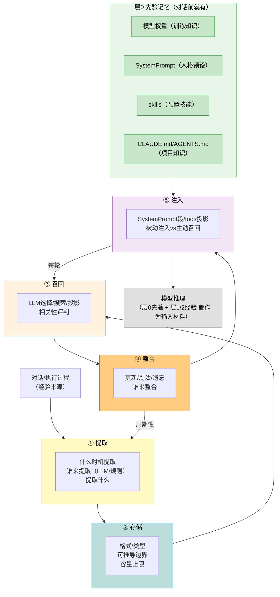

## 6.1b 记忆设计全局框架：生命周期五阶段
### 6.1b.1 框架总览
本节是记忆系统设计的**全局框架**，统领后续逐个深入探索。框架基于 6.0b 的记忆本质（四层作用）+ 三家源码（CC/Codex/dsh）反推的设计思路建立。框架本身是**假设**——后续逐阶段深入探索时验证，发现问题回修框架。

> 组织维度是**记忆生命周期：提取-存储-召回-整合-注入**。这是本质—具体源码（CC 的 memdir/Codex 的 memories crate/dsh 的 session-reference）只是各阶段的不同落地实现，我们用落地反推设计思路。

记忆不是从对话才开始——agent 在任何对话之前，就已经有“先验记忆”（模型权重/SystemPrompt/CLAUDE.md/skills）。记忆的来源分三层：
| 层 | 来源 | 人类的类比 | agent 对应 |
| ---- | ---- | ---- | ---- |
| 层0 先验 | （对话前就有，非提取） | 预设/训练、基因/本能/社会化价值观 / 教育技能 / 工作前了解的项目背景 | 模型权重 / SystemPrompt / skills / CLAUDE.md-AGENTS.md |
| 层1 经验 | （从对话提取） | 对话 / 工作中积累的经验 | extractMemories（用户偏好/反馈/项目经验） |
| 层2 认知 | （反思后生成） | 整合/反思 | 反思后形成的新认知 | dream/autoDream（综合多次经验的新认知） |

**层0 是记忆的基底——agent 一启动就带着它进入对话，不是从对话提取的。层1/层2 在层0之上积累。**
>> 这把【A】注入和记忆彻底统一：SystemPrompt/skills（【A】注入）本质是层0先验记忆。记忆系统积累的是层1/层2经验记忆，两者都是**推理输入材料**。

图 6-2：记忆来源三层 + 生命周期五阶段——层0先验（绿，对话前就有）；层1/2 经验记忆五阶段（提取-存储-召回-整合-注入）；层0和层1/2 都注入模型推理；整合周期性回调提取，注入每轮可触发召回。

### 6.1b.2 五阶段的设计问题 + 三家做法 + 验证状态（五阶段均已深入验证）

#### 层0 先验记忆（对话前就有的基底）

**设计问题**：agent 启动时带哪些先验？先验怎么注入？先验和经验记忆怎么协同？

**三家做法**

- CC：SystemPrompt（人格预设）+ CLAUDE.md（项目知识）+ bundled skills（预置技能）+ 模型权重（训练知识）。这些都“对话前就有”，通过【A】注入进入推理上下文。
- Codex：SystemPrompt / AGENTS.md / skills / 模型权重。
- dsh：persona（order-0）+ agent-instructions（AGENTS.md 禁答）+ skills + 模型权重。dsh 的 persona 是 Cordis context 的0层——通过 effect 注入 context。

>
> 层0 的特殊性（区别于层1/2 经验记忆）：
>
>
> - **非提取**——不是从对话提炼、是训练/带进来的。
> - **相对静态**：SystemPrompt/CLAUDE.md/skills 不会每轮变（虽可热替换，但非每轮提取）。
> - **注入方式不同**：SystemPrompt 进 system 消息，skills 进 skill_listing，CLAUDE.md 进 `<project-instructions>` attachment（2.4b/8.6b 已讲）。经验记忆（层1/2）**分两路**：CC 的记忆+机附实。
> - **是经验记忆的基底**→层1/2 在层0之上积累。agent 的“人格”由层0定，经验记忆不改人格，只在其上叠加场景经验。

**待深入验证**

- 层0 先验和层1/2 经验记忆的**优先级**——当先验（CLAUDE.md 说“简洁”）和经验（记忆说“用户偏好详细”）冲突，谁优先？【6.2b 已验证】
- CC：不用位置限定（CLAUDE.md 走权重 project-instructions，记忆条目走低权重 system-reminder），靠模型语义判断；Codex 用位置限定先验优先。
- 先验记忆怎么更新——SystemPrompt/CLAUDE.md/skills 更新算不算“记忆整合”？还是记忆整合只针对层1/2？
- 层0 和层1/2 的边界——CLAUDE.md 是层0（项目先验），但 CC 的 project 类型记忆（层1）也存项目相关—两者边界在哪？

#### ① 提取（对话→经验记忆，在层0之上）

**设计问题**：什么时机提取？谁来提取（LLM 理解 vs 规则匹配）？提取什么（全量 vs 压缩）？

**三家做法**

- CC：agent 提取（extractMemories，LLM 从对话理解后提炼记忆）。触发：newMessageCount（新增消息数）+ 互斥（主 agent 写了记忆就跳过）+ feature flag，提取的是压缩经验（用户偏好/反馈/项目上下文），不是对话原文。
- Codex：**两阶段流水线**（phase1 提取 + phase2 整合，启动时 spawn）。phase1 从 state DB claim rollout job 送模型抽 raw_memory/summary。【6.3b 已深入】
- dsh：不提取（无独立记忆，session-reference 投影自动派生）。

**已深入验证【6.3b】**

- CC 的提取规则（newMessageCount 阈值）合理吗？太频繁（成本高）vs 太稀疏（丢经验）？→6.3b 实证触发机制
- LLM 提取 vs 规则提取—质量差异多大？LLM 提取的成本（子agent调用）值不值？→6.3b 实证 CC 子agent提取 + 防注入
- 互斥机制（主Agent写了就跳过提取）—会不会漏掉主agent没写但值得记的？→6.3b 实证互斥
- Codex 到底有没有提取机制？→有，两阶段 phase1 提取（6.3b 实证，原“待确认”已修正）

#### ② 存储（记忆怎么存）

**设计问题**：什么格式？分什么类型？可推导的存不存？容量怎么控？

**三家做法**

- CC：MEMORY.md 入口 + memory/ 目录（markdown 文件），四类型（user/feedback/project/reference），**“可推导不记”原则**（代码模式/架构/git历史能 grep 到的不存），行数/字节做上限。
- Codex：MemoryEntry（filename/content/path），文件存储。
- dsh：不独立存（session-reference 投影）。

**已深入验证【6.5b】**

- CC 的“可推导不记”这条边界划得对吗？有没有“灰色地带”？→6.5b 实证可推导边界
- 四类型（user/feedback/project/reference）是否完备？→6.5b 实证四类型
- markdown 文件 vs 结构化数据库，靠模型格式化？→6.5b 实证格式选择
- 容量上限（截断）—截断会丢什么？该截断还是该整合？→6.5b 实证容量边界

#### ③ 召回（怎么找到相关记忆）

**设计问题**：怎么判断“相关”？LLM 选 vs 程序搜索 vs 投影派生？召回多少条？

**三家做法**

- CC：LLM 选择（findRelevantMemories → selectRelevantMemories，模型读记忆列表选相关的），非向量检索。
- Codex：**memory_search tool（模型主动调）+ tool 内程序搜索**→模型主动调 `memory_search` tool（带 queries/match_mode），tool 内 `backend.search` 程序匹配返回。
- dsh：session-reference 投影派生，context 自动含相关引用。

**已深入验证【6.5c】**

- LLM 选（CC）vs 程序搜索（Codex）—LLM 选质量高但成本高，程序搜索便宜但可能漏/错。怎么权衡？→6.5c 实证 CC LLM选 / Codex 模型主动调tool+程序匹配
- CC 不用向量检索—为什么？→6.5c 实证：相关性是语义判断规模小LLM选准，向量是降级手段
- 召回多少条—太少漏相关、太多占上下文。三家各自的策略？→6.5c 实证 CC top5
- dsh 投影派生—能覆盖“跨会话相关记忆”吗？→6.5c 实证 session-reference 有界快照

#### ④ 整合（记忆怎么维护/更新/淘汰）

**设计问题**：什么时候整合？谁来整合（LLM 反思 vs 规则清理）？整合做什么（更新/去重/淘汰/遗忘）？

**三家做法**

- CC：dream/autoDream—stopHook 每轮触发 + 三重门控（功能/时间24h/会话5锁），用 LLM 子 agent 按 4 阶段 prompt（orient/gather/consolidate/prune）反思整合（非程序化流水线），后台 five-and-forget / 手动 / 自动，有 consolidation lock，consolidate-lock 防多线程并发。【6.4b 已深入】
- Codex：**两阶段整合**（启动后 spawn：Phase1 程序化 raw_memory + Phase2 LLM agent 按 881f consolidation.md 整合 + 全局锁 + git baseline）—三家里最结构化。【6.4b 已深入，原“未做”标注已修正】
- dsh：无长期记忆整合（只有 compaction 对话压缩；session-reference 跨会话引用；投影式记忆不做整合）。

**已深入验证【6.4b】**

- CC 的 4 阶段（orient/gather/consolidate/prune）—各阶段具体做什么？源码说“不解析阶段”（只跟状态），那阶段是 prompt 驱动还是状态机？→6.4b 实证：prompt 驱动非状态机，LLM 子 agent 按 prompt 反思
- LLM 整合 vs 规则清理—怎么权衡？→6.4b 实证整合是语义交给 LLM
- 整合触发—后台周期性 vs stopHook 阈值触发？→6.4b 实证 CC stopHook+三重门控 / Codex 启动 spawn
- Codex 无整合—记忆会不会无限膨胀？→**Codex 有整合（两阶段 phase2，6.4b 实证，原“无”标注已修正）+ prune 7天清理**

#### ⑤ 注入（记忆→推理上下文）

**设计问题**：记忆进上下文的什么位置？被动注入（总在）vs 主动召回（模型调）？注入多少？

**三家做法**

- CC：`loadMemoryPrompt` 进 system 段（memoize 缓存、不每轮）；记忆条目走 `relevant_memories` attachment 进 user 消息，`findRelevantMemories` 本轮校验输入相关性；top5 非全量（机制说明）。在输入侧做相关性半主动召回——模型自动找相关条目，模型不是或调 tool，因此不是全量常驻。
- Codex：`memory_summary` 常驻 + `build_memory_tool_developer_instructions`（prompts.rs:27）把 memory_summary 截断后进 `developer instructions`（system prompt，常驻摘要）；详情靠 memory read tool 模型主动调。**摘要常驻 + 详情主动调**。
- dsh：投影派生（session-reference 自动在 context 里）。

**已深入验证【6.6b】**

- CC 半主动召回（relevant_memories top5）vs Codex 摘要常驻+详情主动调—CC 常驻 token 但可能漏召回（只 top5），Codex 摘要常驻 token 但不漏。怎么权衡？→6.6b 实证两路注入
- CC 的 relevant_memories（条目）和 loadMemoryPrompt（机制说明）是两套注入—条目在 user 消息、机制在 system 段，分工清晰（6.6b 已厘清）。
- 记忆注入和【A】注入的关系—它和 SystemPrompt/skills 怎么协同？谁优先？→6.2b/6.6b 实证标签权重分层+模型语义判断
- dsh 投影—记忆自动在 context 里，无需“注入”步骤。优势还是劣势？→6.6b 实证投影派生

## 6.1b.3 三种记忆范式（贯穿五阶段）

三家在五阶段的做法，合起来构成三种范式：

| 范式 | 提取 | 存储 | 召回 | 整合 | 注入 | 特征 |
| --- | --- | --- | --- | --- | --- | --- |
| CC：全程LLM++ | 子agent | 四类型+可推导不记 | LLM选 | dream agent | SystemPrompt段 | 记忆全生命周期LLM参与，质量高成本高 |
| Codex：工具化++ | 两阶段phase1提取 | 文件 | memory tool主动调 | Phase2 LLM-agent | memory tool+summary常驻 | 召回/注入工具化，提取/整合两阶段结构化（6.3b/6.4b） |
| dsh：投影++ | 不提取 | 投影派生 | Cordis管理 | 无独立记忆 | 靠context投影 | 无独立记忆，靠context投射，跨会话弱 |

>
> 范式分解的结论（接 6.0b + 我们已有认知）：
>
>
> - CC 的“全程 LLM”是记忆本质的忠实实现——记忆服务非确定性推理（6.0b，③），所以提取/召回/整合都该 LLM 做，但成本高。
> - Codex 的“工具化”是**成本妥协**——召回用程序 search 降成本，但质量可能低（程序匹配不如模型判断）。
> - dsh 的“投影”是用 Cordis 绕过记忆——记忆和 context 合一，无独立记忆系统，最简但跨会话弱。

这个分野呼应我们整体的**非确定性 vs 确定性张力**——记忆的本质要求 LLM 参与（做），但成本推动程序化（Codex），dsh 选绕过（不独立做）。**这个矛盾是记忆设计里，后续每个阶段都会遇到**。

## 6.1b.4 本质层：记忆和非确定性推理的关系（贯穿五阶段）

五阶段都是“落地”，贯穿的本源是 6.0b 立的：**记忆是非确定性推理的输入材料**。这个本质约束五阶段的设计：

- 提取→要 LLM 做（压缩经验是语义理解，非规则）——CC 做法
- 召回→要 LLM 判（相关性是语义，非精确匹配）——CC 做法
- 整合→要 LLM 反思（什么该留该删是语义判断）——CC 做法
- 存储→要语义化（模型能理解的格式，非结构化SQL）——三家都这么做（markdown/文件）
- 注入→要推理进上下文（SystemPrompt/tool/投影，都是模型可读的）

>
> 所以记忆设计的本质矛盾：记忆生命周期要求 LLM 参与，但 LLM 参与有成本（每次提取/召回/整合都调用）。CC 选质量（全程LLM），Codex 选成本（部分程序化），dsh 选绕过（不独立做）。
> 记忆的设计权衡，后续每个阶段都会遇到。

- 层0 先验（层0）与经验（层1/2）的另一个贯穿本质：记忆不是从零开始，agent 带着先验（SystemPrompt/CLAUDE.md/skills/权重）进入对话，经验记忆在先验之上积累。这统一了【A】注入和记忆：>
> 层0 先验 =【A】注入的 SystemPrompt/skills/CLAUDE.md（预设上下文）
> 层1/2 经验 = 记忆系统积累的（历史经验）
> 两者都是“推理输入材料”，只是来源不同（预设 vs 积累）
> **层0 定人格（agent 是什么），层1/2 叠加场景经验（这个用户/项目具体怎样）——经验不改人格，只在其上叠加**
> 这个关系后续深入每个阶段都要对照—如召回时先验和经验怎么协同、注入时谁优先、整合时先验要不要更新。

## 6.1b.5 框架的使用方式

这个框架是后续深入探索的统领：

1. **逐阶段深入**：按①提取→②存储→③召回→④整合→⑤注入顺序，每阶段钻透三家源码 + 本质评判。
2. **验证框架**：深入时若发现框架有问题（如某阶段划分不对/遗漏了阶段），回修本框架。
3. **本质贯穿**：每阶段深入时，对照 6.0b 四层作用 + 本节“记忆和非确定性推理的关系”评判。

>
> 本框架基于已探的三家源码建立。五阶段已全部深入验证：①提取(6.3b)②存储(6.5b)③召回(6.5c)④整合(6.4b)⑤注入(6.6b)。**Codex 的提取/整合原标“待确认”已修正**——Codex 有两阶段提取(phase1)+整合(phase2)，是三家里最结构化的。dsh 跨会话靠 session-reference 投影(无整合)。CC 各阶段机制均已源码实证。