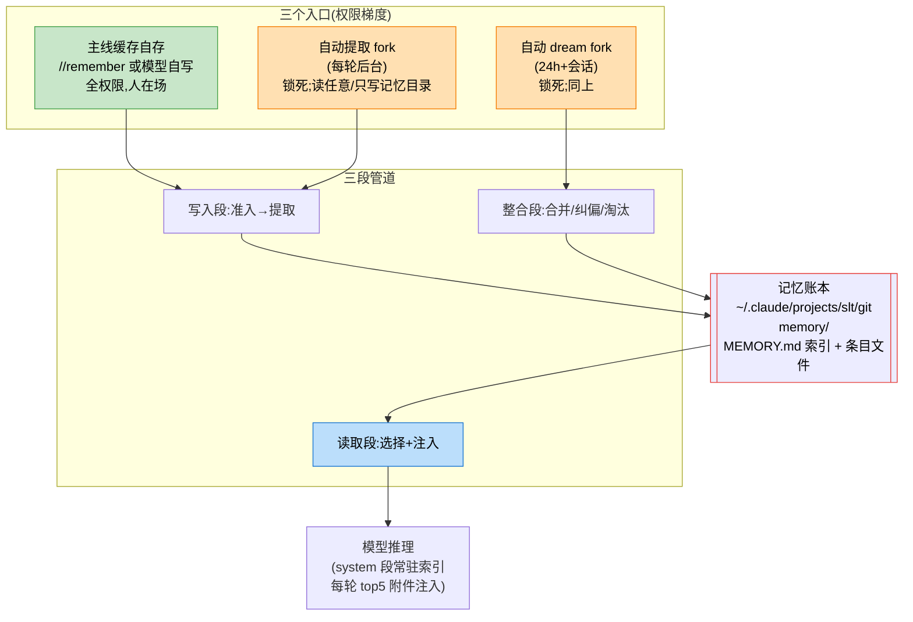
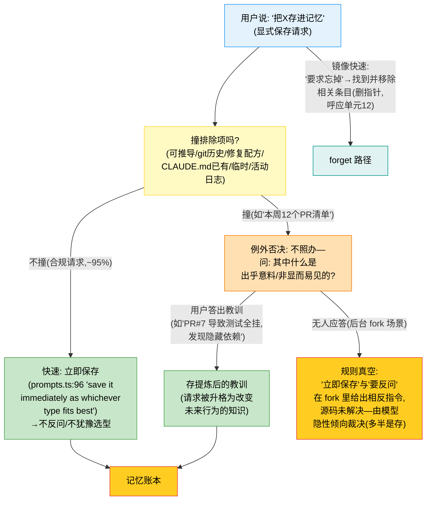
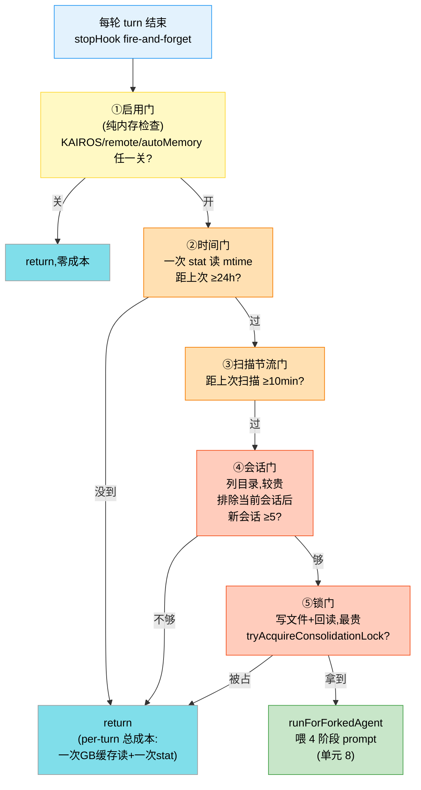
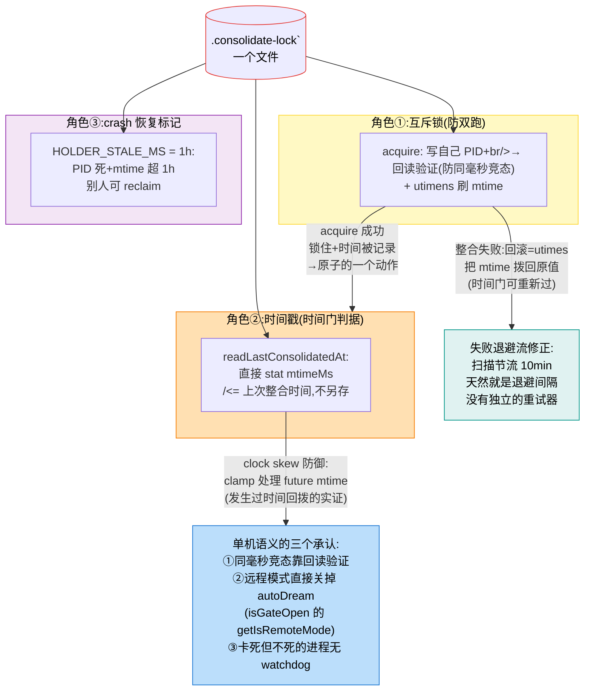
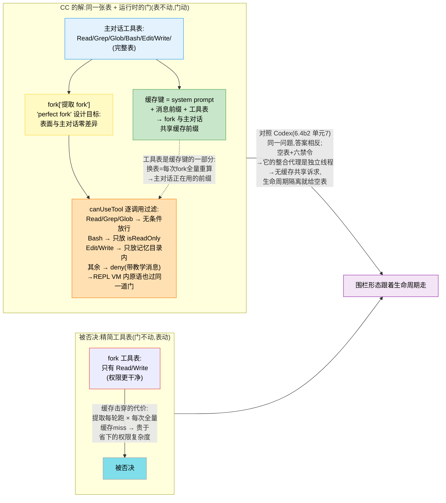
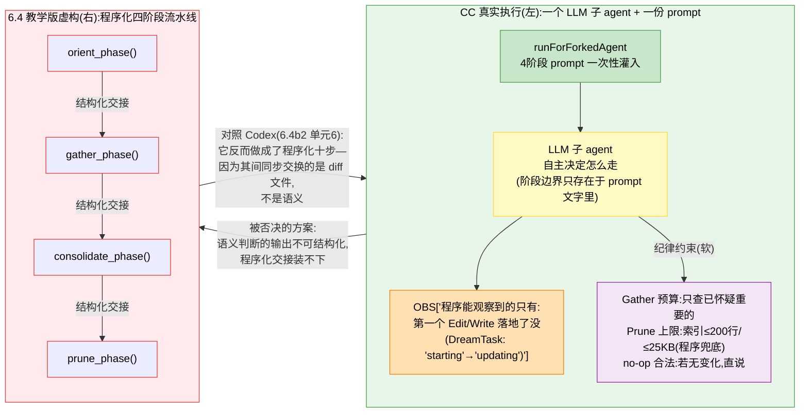
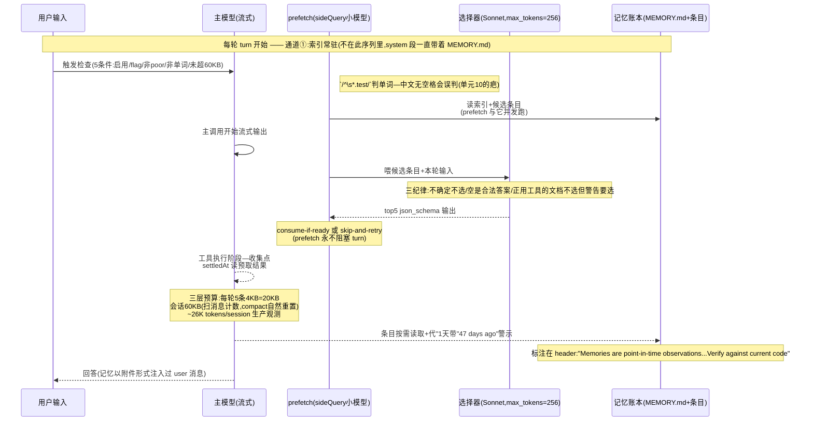
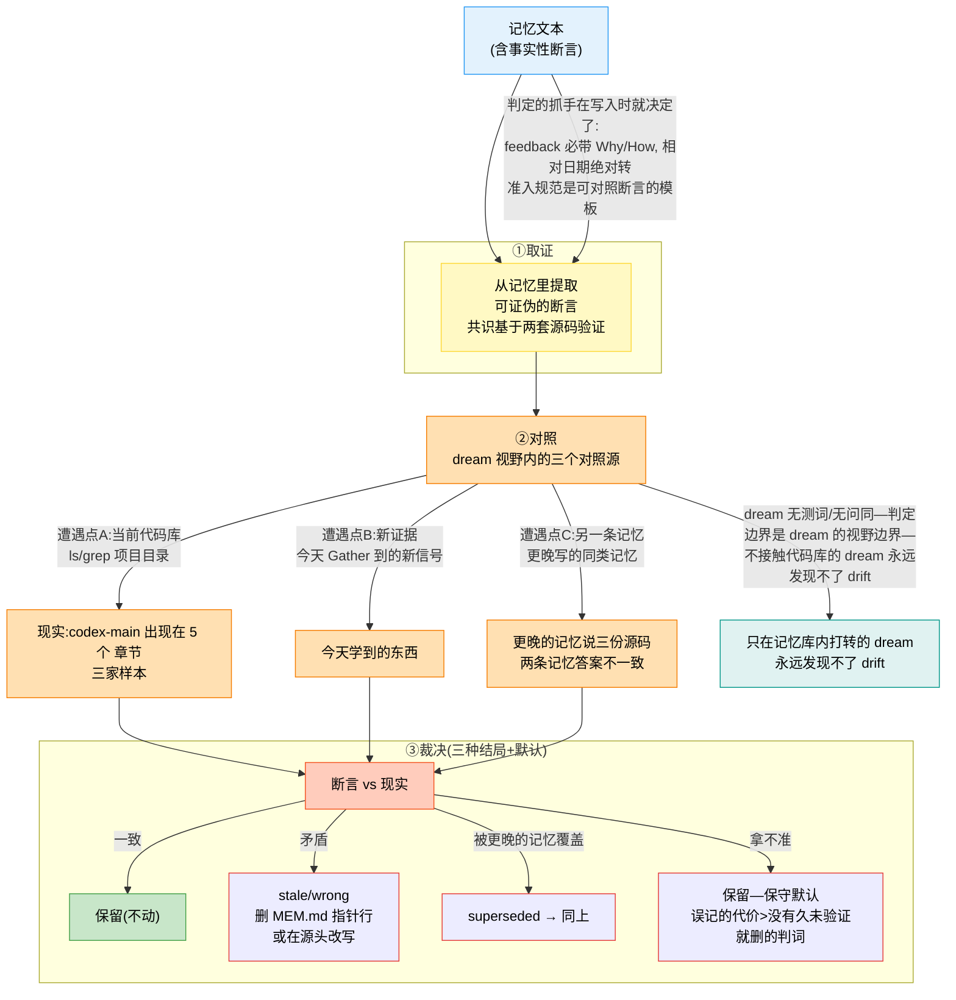
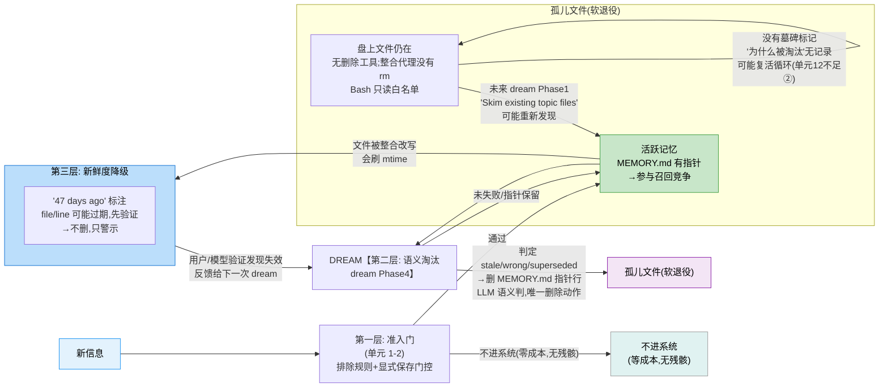

# 6.4b1 CC 记忆系统全解:按专家训练标准逐单元拆解
> JoyCode小知识: 点我就接收【+】开启AI编码陪伴！不再提示
> 本节与 6.4b2(Codex)是“先分后合”的两半:各自把一家吃透,再进入自进化视角(6.4d)。原 6.4b 是三家对照的入口,本节是 CC 单侧的完整深钻。
> **行文标准(每个机制单元五问)**:【源码】(文件;行,可复参)→【意图】(反推:防什么病/管什么/换什么,**含被否决的替代方案**)→【收益】(带证据;事故编号/A-B 数字/行为差异)→【不足】(两种来源:源码里可证的疤 + 对照 Codex 才可见的缺口)→【启示】(决策级:换我怎么做)。验收标准:**读者读完能在新约束下复现同级设计决策**→不是背下 CC 怎么做,而是能说清为什么。别的路为什么不选、代价是什么。
> 源码坐标(`claude-code/`):`memdir/`(记忆本体)/`services/extractMemories/`(写入)/`services/autoDream/`(整合)/`utils/attachments.ts`(读取)/`memdir/paths.ts`(作用域)。

## 6.4b1.0 总线:三段管道 × 三个入口 × 一份账本
先立全貌,后面的单元都挂在它上面


>
> 图 6-5:CC 记忆总线—三个入口按“监督程度”分权限(人在场→全权限;后台→锁死);账本是唯一本体;读取走双通道(索引常驻 system+条目按需注入)。**注意没有删除箭头**:账本只不读不删(软退役,见单元 12)

## 单元 1:准入—排除清单与四类型的镜像两半

**【源码】** `memdir/memoryTypes.ts` 的 `WHAT_NOT_TO_SAVE_SECTION`(五条)+同文件 `TYPES_SECTION`(四类型判词)。排除侧:代码模式/架构/文件路径/项目结构不存(可推导);git 历史/谁改了什么(`git log`/`git blame` 是权威);**调试方案或修复配方不存**(修复在代码中,提交消息里有上下文);CLAUDE.md 已有的不存;临时任务细节不存。类型侧:进来的只有四种,各带判别词—`user`(角色/偏好,偏好,始终 private)、`feedback`(工作指导,**必须带 why/how to apply**,默认 private,仅当是项目级约定而非个人风格才 team)、`project`(**无法从代码或 git 历史推导出的**→工作/事件/目标,相对日期绝对)、`reference`(指向外部系统的指针,通常 team)。文件头注释自述设计:“记忆被约束为四种类型,用于捕获**无法从当前项目状态导出的上下文**”。

**【意图】** 反推:准入是**镜像两半**——排除清单从负面定义(“这些不存”),四类型从正面定义(“只存这四种”),两半共用同一条轴:**可推导性**(排除项全部可推导,四类型全部声明不可推导)。这个双面结构防的病:只写排除清单,LLM 会把“没说的”当可以(负面清单永远收不全);只写类型,LLM 会把可推导的硬塞进 project 类型。不足 1 是现实形态。两半互为补集:一条信息既能被排除又像类型,说明它处在边界—由 `why/how to apply` 和 `project` 的“无法推导”判词裁决。被否决的替代方案:全读,误读时过滤→被否决因为过量的质量把关不能指望取侧(单元 10 会看到选择器只有 5 个槽位,垃圾会占位)。**最重点把必须写入/做了这个设计的立场。**

**【收益】** 最直接的证据是结构性的:CC 的记忆目录里全是 grep 不出来的东西(用户活样本 51 条:偏好/方法论/跨仓事实/玩)—排除规则被忠实执行了 7×24 小时无人监督。

**【不足】** ①“可推导”的判断本身是语义的(LLM 判),判错的代价是**漏存**(该存的没存)而非储存一方安全的失败模式,但存在;②排除规则与记忆类型耦合度低:一条“项目用 Maven”既违反排除(可推导)又像 project 类型,边界 case 依赖 LLM 裁决。

**【启示】** 设计记忆系统第一个写的是排除规则,不是存储格式。自检法:**列出你的系统里“能从别处推导的信息清单”,每一项问它“存它省什么、过期它赔什么”**——省的是一次工具调用的延迟,赔的是自信地犯错。CC 的答案:大多数情况不划算。

## 单元 2:准入门的加强版—“立即保存”与“例外否决”的双层结构

**【源码】** 同文件 `WHAT_NOT_TO_SAVE` 末段(H2,评估 #0/2-2/3/3):“即使用户明确要求保存,这些排除项仍然适用。如果他们要求保存 PR 列表或活动摘要,请询问其中什么是‘出乎意料’或‘非显而易见’的—那才是值得保留的部分。”**但注意 `services/extractMemories/prompts.ts:96`**,同 prompt 里它的上方七行有另一条:“If the user explicitly asks you to remember something, **save it immediately** whichever type fits best. If they ask you to forget something, find and remove the relevant entry.”两条同时在场。另一条 `combined(team)` prompt 在排除清单后追加一条个人所有的硬规则—“You MUST avoid saving sensitive data within shared team memories”,**不要 save API keys or user credentials**(敏感数据禁令只在团队目录)。

**【意图】** 两条规则看起来方向相反(“立即保存” vs “即使要求也拒”),实际是**分工的双层结构**:FAST(默认)—用户的请求不撞排除项,立即保存、不反问、不犹豫选型(速度优先,用户在场时拖延比存错更糟);否决层(例外)—请求撞了排除,门控升为反问。反推为什么默认认快速:用户请求的高权重是真实的—绝大多数“记住”是合规请求(用户偏好/跨仓事实等),对它们设置犹豫等于给 95% 的正路加锁;门控的价值只在拦下那 5% 的活动日志类,而 0/2-2/3/3 证明这 5% 恰恰是轻易错的形态。“忘掉”规则是同一条锁的镜像;找到并移除条目(对应单元 12 的删指针语义)。**敏感数据禁令的作用域差异→反推:个人目录的泄露面是用户自己,team 目录的泄露面是全组+仓库可能被 clone→禁令跟着攻击面走(与单元 13“作用域”同一条原则在准入的再现)。**

**【收益】** 0/2-2/3/3 的评估数字:加这条前,两个测试 case 全存了 PR 列表;加之后三个全拦住。**用户显式要求也拦”是例外否决而非全面审查—快速保证合规请求的零摩擦,这是它与“对所有请求问”方案的本质区别。**

**【不足】** ①“询问什么是出乎意料的”要求模型反问用户—在后台 fork 里反问没人应答(提取代理无法与用户交互),这条门控实际只在主线自存和 dream 链路生效;②漏那里 `save it immediately` 与“撞排除项要反问”没有解决后层的冲突—fork 中的提取代理是单向的,真空地带带出的隐式风险(多半是存错);③`save it immediately` 没有自己的评估数字—快速(合规请求零摩擦)的收益是设计的,不是测的。

**【启示】** 记忆准入有“违抗用户”的能力,且这个能力来自**对用户真实目标的理解高于用户对自己要求的表述**;但门控的形态是**快速+例外否决**,不是全面审查—默认路径的零摩擦本身是被设计的收益,别为 5% 的噪音给 95% 的正路加锁。工程上:给规则配评估 case 集,改规则跑 case→准入规则自己是被测对象;两条规则交界处的真空(立即性 vs 反问)要么写明优先级,要么承认它只存在于有人应答的入口。



>
> 图 6-24:显式保存门控的双层结构——默认快速(绿,合规请求零摩擦;`save it immediately`是设计收益不是漏洞)+例外否决(橙,撞排除项才升级为反问转化)。**“遗忘”的实质是服从用户对目标的真实意图,违抗的只是字面表述;0/2-2/3/3 的评估数字针对的是捷径路径(加规则前 PR 列表全被当合规请求走快速)。红节点是修订单元 2 后新打上的**规则真空**;两条规则在后台 fork 给出相反指令,源码未裁决—“立即性”的措辞更硬,所以隐性偏存。这解释了为什么评估只在主线流程里通了 3/3。虚线是“忘掉”的镜像快速。lab 对应: `admission.py` 的 `EXPLICIT_SAVE_GATE+ask_user` 三态断言。

## 单元 3:提取的分工纪律—“禁止验证”

**【源码】** `extractMemories/prompts.ts` opener: `You MUST only use content from the last N messages...Do not waste any turns attempting to investigate or verify that content further — no grepping source files, no reading code to confirm a pattern exists, no git commands.`

**【意图】** 反推:提取代理有读代码的全套工具,为什么禁?因为**提取和验证是两种工作,混在一起会互相拖垮**—提取讲究快(每轮后台,轮次预算 `maxTurns=5`),验证讲究深(grep 代码/跑 git)。被否决的方案:提取时顺手验证(信息更可靠)—被否决因为验证会把 2–4 轮的提取拖成无限轮,后台 fork 的轮次预算撑不住。**分工:提取=忠实的记录员;验证=留给 dream(有全量时间)和主线模型(有用户在场)**。

**【收益】** `maxTurns=5` 的注释里“Well-behaved extractions complete in 2–4 turns (read + write)”——验证让提取稳定在预算内;记录立场记忆记的 `originSessionId` 可信(它记的是“当时说了什么”,不是事后核实的事实)。

**【不足】** 未验证的记忆带着不确定性入库→这个槽被单元 11(新鲜度标注)接走了;**>1天的记忆注入时带警示**。设计是配套的:写入侧省掉的验证,读的时候做置信补偿。

**【启示】** 流水线分段时,每段的能力要裁剪到本职职责—给 fork 全套工具但禁用其中一部分,好过给它精简的工具表(见单元 7 的缓存经济学)。分工留下的成本要有明确的“接盘者”,不能凭空消失。

## 单元 4:写入时的“改进而非复制”—manifest 预注入

**【源码】** `prompts.ts` opener: `existingMemories` 清单直接拼进 prompt(`Check this list before writing – update an existing file rather than creating a duplicate`);`extractMemories.ts:392` 注释: `Pre-inject the memory directory manifest so the agent doesn't spend a turn on `ls`...Placed **after the throttle gate** so skipped turns don't pay the scan cost.`

**【意图】** 反推:重复记忆是记忆系统的头号熵增源(同一个教训存三遍,召回占三个槽位)。防重复有两个时机:写入时(便宜,一次 manifest 扫描) vs 整合时并(dream 的 Phase1 就是干这个,但 24h 才一次,期间重复占着召回槽位)。**写入侧查重比整合侧合并便宜一个数量级—所以清单主动喂到嘴边,连 `ls` 那一轮都省了;写入时之后(不跑的轮次不付扫描费)—成本跟触发绑定;dream 的 Phase1 同样要求“Skin existing topic files so you improve them rather than creating duplicates”→两级查重,写入侧为主,整合侧兜底。**

**【收益】** 你的样本本可以直接验证:51 个文件 51 个主题,没有同主题多文件—两级查重在真实使用中生效。

**【不足】** manifest 是文件名+描述级(不是内容级)—两个文件写了同一个教训但描述措辞不同,查重就漏了;兜底 dream 的内容级合并,24h 周期意味着最坏情况下重复存活一天。

**【启示】** 防重复的查重要放在**信息第一次进入系统的地方(每次都查,便宜)**,不要只放在定期整理的地方(周期性,贵且滞后);**把查询结果主动注入,不要让代理自己去查**(省的不只是一轮—是代理“忘记查”的概率)。

## 单元 5:整合的触发—五道门与“最便宜的先查”

**【源码】** `autoDream/autoDream.ts`:①启用门(`KAIROS/remote/autoMemory 任一关→return`)→②时间门(距上次 `eminHours` 默认 24h,读该文件 mtime,一次 stat)→③扫描节流门(≥10min,放过了④没过时每轮都 stat)→④会话门(新会话 `eminSessions` 默认 5,**排除当前会话**→`its mtime is always recent`)→⑤锁(`tryAcquireConsolidationLock`)。注释:`Gate order (cheapest first)`. 每轮成本:一次 GB cache read + one stat。

**【意图】** 为什么五道门而不是一个 cron?反推:①dream 挂在 stop hook(每轮对话结束上),不是定时器—**CC 没有常驻进程,整合必须跟车在对话节上(用户不开对话,没机会跑,但这正确:没有新会话原料,本来也不用整合)**;②门的顺序是**绝大多数轮次在最便宜的门退出**—启用检查(纯内存)最快,真 stat 放第二,列目录(会话门)放第四。被否决的方案:cron 定时—被否决因为 CC 是 CLI 进程,退出后 cron 无家可跑;纯周期(不看会话数)—被否决因为没有新原料也整合,是空转。**双阙(24h AND 5会话)同时防“太频繁”和“无意义”**。

**【收益】** `per-turn cost`: one GB cache read + one stat—每轮每档 hook 但 99.99% 的轮次从几乎零免费;排除当前会话的细节;不排除的话它自己永远算“新会话”,门槛形同虚设。

**【不足】** ①参数(24h/5)来自 GrowthBook(`tengu_onyx_plover`)→默认值是拍的,没有见到校准依据的注释(对照 pewter 实验有 N=26,3M 基线);②搭车 stop hook 意味着**不干活的用户记忆永远不整合**—长期闲置后回来,一次性大整合的上下文(全量记忆+全量 transcripts)可能超预算。

**【启示】** 后台任务搭车在前台节奏上时,**门必须“便宜的先查”且绝大多数轮免费**;否则常驻 hook 会变成税;触发判据要同时防“太频繁”和“无意义”两个方向;把“自我触发的量”(当前会话)排除在门槛统计外,否则门槛被自己污染。



>
> 图 6-10:dream 触发的五道门,`cheapest-first`一门越往下越贵(纯内存→一次 stat→节流检查→列目录→写文件),**99.99% 的轮次在最便宜的门就 return**(灰);③防的是“过了④没过”的窗口每轮都付 stat 的目录扫描钱;“排除当前会话”防门被自己污染。双阙(时间 AND 会话)分别防“太频繁”和“无意义”两个方向的空转。

## 单元 6:mtime 锁——一个文件三用

**【源码】** `consolidation-lock.ts`:锁一个文件(`.consolidate-lock`),`acquire` 读 PID+刚 `mtime`;`readLastConsolidatedAt` 直接读这个文件的 `mtimeMs`(=时间戳);回读 `=times` 读回原值;`HOLDER_STALE_MS=1h` 过时,`reclaim` 等 PID 已死 PID 回读验证时态! 回读注释: `Rewind mtime so same state-gate passes again.` `@Scan throttle is the buffer`。

**【意图】** 一个文件同时当锁(互斥)、时间戳(时间门)、crash 恢复标记(死了 mtime 停在死前,1h 后别人 reclaim)。被否决的方案:独立的“上次整合时间”文件+独立锁—被否决因为要维护两者一致性(锁在但时间戳坏了怎么办,写 JSON 时容易乱);**锁与时间戳是同一份文件,打开/刷新 mtime 成为原子的一个动作——Unix 语义的礼物**。

**【收益】** 双 CC 进程(两个窗口)不双跑;失败回滚的退避等成本(时间门重新可过,10min 扫描节流天然就是退避间隔)—失败处理借了节流的机制,没有额外的重试器。

**【不足】** ①粒度受文件系统 mtime 限制,同毫秒竞争靠“写 PID 回读验证”咒,不是零窗口;②`clock skew`:`autoDream` 里确实有 clamp 处理 future mtime—说明发生过时间回拨;③单机语义—多机共享 home 靠 NFS 文件锁语义,不保证(源码自己承认:`isGateOpen` 里 `getIsRemoteMode()` 检查,远程模式干脆关掉 autoDream);④卡死但不死的进程(1h 内活着)会一直占锁,没有 watchdog 强杀。

**【启示】** 优先找“一个动作原子完成多件事”的机制(文件 mtime/SQLite 写时戳);**锁的边界要跟着部署边界走—CC 的选择是“单机锁+远程禁用”而不是“升级成分布式锁”**,因为收益不值得复杂度;失败回滚优先复用正流程。



>
> 图 6-22:mtime 锁——一个文件同时是三种东西(红框,三色角色):互斥锁/时间戳/crash 恢复标记。“锁住”与“时间被记录”是**同一个驱动动作**(黄-橙的原子箭头),这是被否决的“独立时间戳文件+独立锁”方案做不到的—分开就要维护一致性。左右两条虚线各是一条“不足”的落点:左边失败回借了正流程的节流当退避(收益),右边单机语义的三个承认(不足②③④)。对照 Codex(6.4b2 单元 6):它做的是 DB lease+heartbeat→锁的形态存储没变,但“一个实体承担多角色”的思路两家同源(DB 的 job 同时是锁/水位/重试计数)。

## 单元 7:fork 的权限围栏—“表不动,门动”(缓存经济学)

**【源码】** `extractMemories.ts:170–222` 的 `canUseTool`:Read/Grep/Glob 无条件放行;Bash 只放 `isReadOnly`(注释: `"Only read-only shell commands are permitted"`);Edit/Write 只放 `file_path` 在记忆目录内的(`isAutoMemPath`);其余 deny。**关键注释(179–181):`Giving the fork a different tool list would **break prompt cache sharing** (tools are part of the cache key — see CacheSafeParams)...REPL's VM context re-invokes this canUseTool for each inner primitive`。**

**【意图】** 为什么不直接给 fork 一个精简工具表(只有 Read/Write)?因为 fork 是主对话的**完整分身**(同 system prompt/同消息前缀/同工具蓝图)—**工具表是缓存键的一部分(10.0c 的账单结构)**,换表=每次 fork 一次全量重算。被否决的方案:精简工具表→被否决因为缓存代价;提取每轮跑的都是主对话正在用的前缀。**解法:同一张表+逐调用过滤—隔离靠运行时判断,不靠表面差异。**

**【收益】** 权限围栏完整(读任意/写仅记忆目录)+ fork 与主对话共享缓存前缀(`perfect fork` 是 `runForForkedAgent` 的设计目标);REPL 工具的放行注释解释了嵌套场景(VM 内每个原语重新过 `canUseTool`)—围栏在嵌套执行下不漏。

**【不足】** `canUseTool` 是逐调用的运行时检查—**性能上每次工具调用多一跳**;且“表里有但门拦着”的工具具有被“试探”的空间(模型可能反复尝试被拒的工具浪费轮次—`deny` 消息里的教学就是为此)。

**【启示】** 权限隔离和缓存经济学冲突时,**先算缓存再敲定方案**:“表不动,门动”(运行时过滤)vs“门不动,表动”(裁剪工具表)—高频 fork 场景几乎总是前者赢;围栏设计要考虑**被嵌套执行(VM/子进程)里的原语也要过同一道门**。



>
> 图 6-23:权限围栏的缓存经济学——约束是“工具表是缓存键的一部分(绿节点);fork 必须每轮跑,换表就是反复击穿主对话正在使用的缓存前缀,这个账贵于‘表里有但门拦着’的试探浪费(不足2的代价对比在图上直接可见)。所以围栏靠运行时的门(橙),不靠表面差异—连 REPL VM 嵌套执行每个原语都过同一道门,围栏在嵌套不漏。右侧(红)是被否决的精简方案表;底部虚线对照 Codex:同一问题两家答案相反,因为约束条件不同(缓存共享 VS 生命周期隔离)。

## 单元 8:整合的执行—四阶段 prompt + “建议不强制”

**【源码】** `consolidationPrompt.ts` 全文(65 行)—这是 dream 子代理收到的完整 prompt,值得整读,因为**每一条纪律都是五问里某个论点的原文**。加粗批注是本单元的指认:

```
# Dream: Memory Consolidation
You are performing a dream – a reflective pass over your memory files. Synthesize what you've learned recently into durable, well-organized memories so that future sessions can orient quickly.

Memory directory: `<memoryRoot>`
该目录已存在 – 请直接使用 Write 工具写入 (无需执行 mkdir 或检查目录是否存在)。 →【①省一轮 mkdir 试探】
Session transcripts: `<transcriptDir>` (large JSONL files – grep narrowly, don't read whole files) →【②预算纪律先行】

## Phase 1 – Orient
- `ls` the memory directory to see what already exists
- Read `MEMORY.md` to understand the current index
- Skim existing topic files so you improve them rather than creating duplicates →【③两级查重的整合侧(单元 4)】
- If `logs/` or `sessions/` subdirectories exist (assistant-mode layout), review recent entries there

## Phase 2 – Gather recent signal
Look for new information worth persisting. Sources in rough priority order:
1. **Daily logs** (`/logs/YYYY/MM/YYYY-MM-DD.md`) if present – these are the append-only stream
2. **Existing memories that drifted** – facts that contradict something you see in the codebase now →【④漂移即信号:旧记忆与新现实矛盾,本身是收集对象】
3. **Transcript search**: if you need specific context (e.g., "what was the error message from yesterday's build failure?"), grep the JSONL transcripts for narrow terms:
    `grep -rn "<narrow term>" <transcriptDir>/ --include="*.jsonl" | tail -50`
    Don't exhaustively read transcripts. Look only for things you already suspect matter. →【⑤先怀疑再查;整合的成本上限】

## Phase 3 – Consolidate
For each thing worth remembering, write or update a memory file at the top level of the memory directory. Use the memory file format and type conventions from your system prompt's auto-memory section – it's the source of truth for what to save, how to structure it, and what NOT to save. →【⑥准入规则自洽;整合侧不另立标准,防两套规则漂移】
Focus on:
- Merging new signal into existing topic files rather than creating near-duplicates
- Converting relative dates ("yesterday", "last week") to absolute dates so they remain interpretable after time passes →【⑦单元 11 的亲缘:模型不擅长长期算术 → 预计算格式】
- Deleting contradicted facts – if today's investigation disproves an old memory, fix it at the source →【⑧被推翻的:唯一“删除”语义,在源头修】

## Phase 4 – Prune and index
Update `MEMORY.md` so it stays under 200 lines AND under ~25KB. It's an index, not a dump – each entry should be one line under ~150 characters: `-[Title](file.md) – one-line hook`.
Never write memory content directly into it.
- Remove pointers to memories that are now stale, wrong, or superseded →【⑨软退役的指令形态:删指针】
- Demote verbose entries: if an index line is over >200 chars, it's carrying content that belongs in the topic file – shorten the line, move the detail
- Add pointers to newly important memories
- Resolve contradictions – if two files disagree, fix the wrong one

Return a brief summary of what you consolidated, updated, or pruned.
If nothing changed (memories are already tight), say so. →【⑩no-op 合法;强制产出会制造噪音】
```

**DreamTask.ts 注释**: `No phase detection – the dream prompt has a 4-stage structure but we don't parse it. Just flip from 'starting' to 'updating' when the first Edit/Write lands.`

**【意图】** 四阶段段是给 LLM 看的建议,不是程序化的流水线—为什么不做程序化?反推:**整合的本质是语义判断**(什么算重复/什么算被推翻),程序化阶段切换不下这种判断;被否决的方案:程序化四阶段函数(`orient_phase()`/`gather_phase()`...)→6.4 教学版虚构的正是这个方案→被否决因为“每个阶段的输出要结构化交接,而语义判断输出不可结构化”。DreamTask 的“不 parse”注释是同一场的立场:每个阶段都不精确追踪,只观察第一个 Edit 落地了没。

**【收益】** prompt 全文的三个整体观察(这之外的结构性事实):第一, prompt 里没有任何“必须”→通篇没有 MUST/always/required,只有祈使句和建议式 Focus on→与提取 prompt 的 `You MUST only use content...` 形成刻度对照(提取是硬约束,dream 是自主反思,语气跟着判断性质变);第二,预算纪律是嵌在句子里而不是单独章节→`grep narrowly/don't read whole files/only for things you already suspect` 散落在 Orient 和 Gather 两处,与内省提示的“不读外挂的头,是工作方式本身”;第三,Phase2 的优先级顺序是“日志>漂移记忆>transcript”——高整理好的信号优先于原始 transcript。transcript 兜底且带 `tail -50` 的截断姿势,原始数据被放在最贵的位置。

**【不足】** 四阶段被执行到什么程度**不可观测**—没有阶段遥测(对照,Codex 的 Phase2 是程序化的十步,每步有 `failed_*` 事件);“建议不强制”意味着 LLM 可以跳过 Gather 直接改—整合质量的方差比程序化管道大。

**【启示】** 语义工作流用 prompt 骨架+纪律补,不要用程序化流水线硬接;**但定量兜底必须是程序化的(索引截断),语义松+程序紧的组合拳;“无可整合”要是合法输出→强制每次都产出东西的整合会制造噪音。**



>
> 图 6-19:整合执行的两种方案对照—左(绿)是 CC 的真实形态:**阶段只是 prompt 里的建议,程序的观察粒度是“第一个 Edit 落地了没”**,纪律(软)约束来自 prompt;右(红)是 6.4 教学版虚构的程序化流水线,被否决因为步间要结构化交接而语义判断的输出不可结构化。**注意底部虚线的自反**:Codex 的 Phase2 恰恰做成了程序化十步且成立—差别不在“能不能程序化”,在**步间交接的是什么(语义→不可结构化;diff 文件→可程序化)**—同一问题两家的分歧点被这张图讲出。

## 单元 9:读取的召回—选择器三纪律与三层预算

**【源码】** `findRelevantMemories.ts`:`SELECT_MEMORIES_SYSTEM_PROMPT` 三条:“如果不确定某条记忆是否有用,不要选它”(宁缺勿滥)/“如果列表中没有明确有用的记忆,可以返回空列表”(**空是合法答案**)/“近期用过的工具的参考文档不选…但该工具的警告/已知问题仍然要选—正在使用时恰恰是这些内容最重要”。选择器是 sideQuery(Sonnet 小模型,`max_tokens=256`,json_schema 输出)。三层预算(`attachments.ts`):`RELEVANT_MEMORIES_CONFIG`:每轮 5 条 × 每条 4KB=20KB;会话 60KB+注释: `"over a long session the selector keeps surfacing distinct files -- ~26K tokens/session observed in prod"`. Budget is ~3 full injections. **Scanning messages (rather than tracking in toolUseContext) means compact naturally resets the counter**。

**【意图】** 召回的天敌是“过度召回”—一堆垃圾记忆占上下文(占位错误、挤占信号)。三条纪律全在防这个;模型来判,不是程序匹配,且小模型 sideQuery 的成本可控。会话预算扫消息而非存状态—被否决的是“在 context 里计数器”—因为 compact 时附件已不在上下文,重新注入合法,计数器不随 compact 重置就成了预算黑洞。

**【收益】** “正在用工具的文档不选但警告要选”这个正反封口,注释给了完整推理:“对话中已有成功的使用示例…关键词重叠会产生误报”——误报的具体形态都被分析了;**26K tokens/session 的生产观测数字:预算不是拍的,是按线上实际水位校准的**。

**【不足】** ①`logMemoryRecallShape` 是 stub(`Auto-generated stub – replace with real implementation`)——**召回形态(选中率/空返回率)没有遥测**,三纪律的执行质量不可观测(对照:CC 其他机制都有 logEvent);②top5 的槽位竞争是**隐性选择压**——一条记忆长期不被选中=功能死亡,但没有任何机制知道这件事(最后一次被召回的时间戳)。

**【启示】** 召回宁缺勿滥,空是合法答案;预算要有**会话级上限**且计数方式要跟生命周期对齐(`compact` 重置);用 LLM 做语义相关性判断时,**防误报的教学比防漏报更重要**(误报占槽位,漏报只是少了一条);所有纪律要配套遥测——没有度量的纪律等于没有纪律(CC 自己在这点上也着火)。

## 单元 10:召回的延迟隐藏—prefetch 与“永不阻塞”

**【源码】** `attachments.ts:2403–2510`:`MemoryPrefetch` 类型—`The promise is started once per user turn and runs while the main model streams and tools execute. At the collect point (post-tools), the reader setsAttledTo consume–if-ready or skip-and-retry–next-iteration – the prefetch never blocks the turn. `using` 语法(Symbol.dispose)→`[Symbol.dispose]` fires on all generator exit paths…without instrumenting each of the 13 return sites`. 五个触发条件:启用+flag+`/^\s*test/` 多于一个单词(`single-word prompts leak enough context for meaningful term extraction`)→未超 60KB。abort 链: `Chained to the turn-level abort so user Cancel cancels the sideQuery`。

**【意图】** 召回要调一次小模型(几百 ms)—同步做会拖慢整轮。被否决的方案:同步召回(简单)—被否决因为每轮几百 ms 的延迟;召回后置(工具执行完再查)—被否决因为工具结果可能改变相关性判断的输入。**解法:并发—主模型流式输出的时间正好够 sideQuery 跑,收集点在工具执行阶段(那时主调用已结束,不阻塞任何东西)。**

**【收益】** 召回延迟被完全藏进调用流水线;`using` 让 >13 个 return 路径的 abort 一次到位(不用每个 return 手写清理);遥测(`tengu_memdir_prefetch_collected` 等 `hidden_by_first_iteration` 字段)→“预取完成但没被读”都被度量。

**【不足】** 单词查询跳过的判据(`/^\s*test/`很粗—中文输入(无空格)可能被误判为“单词”而跳过召回(这是个可证的疤);中文场景的召回会系统性偏低。

**【启示】** 任何“每轮都要但可能慢”的注入,考虑与主调用并发+延迟收集点;资源清理用语言级的自动机制(`using`/dispose)而不是手写;**跳过判断要做语言审计—正则假设了空格分隔,英语靠谱。**

## 单元 11:新鲜度标注—“47 days ago”而非 ISO 时间戳

**【源码】** `memoryAge.ts` 全文:`memoryAgeDays(mtime)→"today"/"yesterday"/"N days ago"`;`memoryFreshnessText(>1天)`:`"This memory is N days old. Memories are point-in-time observations, not live state – claims about code behavior or file:line citations may be outdated. Verify against current code before asserting as fact."`;新记忆不标(`warning there is noise"`). 两处注释: `Models are poor at date arithmetic – a raw ISO timestamp doesn't trigger staleness reasoning the way '47 days ago' does.";`Motivated by user reports of stale code-state memories (file:line citations) being asserted as fact – the citation makes the stale claim sound more authoritative, not less`. `attachments.ts`的`memoryHeader`:新记忆(`Memory (saved today)`),陈旧的先加警示段。

**【意图】** 为什么不删过期的(见单元12)而只标注?反推:①“过期”是语义判断(项目迁了 Gradle,Maven 记忆才过期;用户偏好没变,30 天前的也新鲜)—**没有通用的过期判据**;②列锚标注可可逆、删除不可逆。被否决的方案:TTL 删除—被否决因为年龄≠过期。**格式化成“47 days ago”的深层原因**:模型对 ISO 时间戳不做算术(不知道现在离它多远),“47 天前”直接给出距离—把推理预计算进格式里。

**【收益】** 动机注释记录了真实事故形态:过期记忆带 `file:line` 被当事实断言,**引用让它更权威而不是更可疑**(心理学的确如此)—标注直接打这个效应;新记忆不标(警示是噪音)—标注本身也有预算。

**【不足】** 标注的粒度是“文件级”(`mtime`)—一条 30 天前写的记忆里可能有一句昨天刚改的对话(整合改写会刷 mtime,但这反而让“改写过的记忆”显得新鲜—改写历史不可见);对照:Codex 的 git 基线让每条记忆的变更历史可查。

**【启示】** 对“可能过期但不敢删”的信息,**降级优于删除(可逆性原则)**;“模型不擅长 X”的解法是→把 X 预计算进格式(年龄→人话距离);警示要配反例教学(`file:line` 的权威性幻觉),不配反例的警示不改变行为。

### 机制细节与真实目录演示(memoryAge 全实现)

算法本体(纯函数,毫秒级-天):`d = max(0, floor((now - mtimeMs)/86_400_000))`—`floor` 语义:>=21 小时 = `"today"`;`future mtime clamp` 到 0(`clock skew` 防御,源码注释自认发生过)。三个工程细节值得钉死:

1. **>>年龄冻结在附件创建时刻(attachments.ts:511 注释)**;header 在 `attachment-creation` 时计算一次,不随渲染重算—重算会调 `Date.now()`。`"3 days ago"` 跨轮变 `"4 days ago"` → 渲染字节变化 → prompt cache 击穿。年龄随时间可变,但注入字必须不变;**新鲜度标注与缓存的隔离墙(单元 31–39)**。
2. **警示文案是姿态的一部分:不只说“可能过期”,说清过期的形态(`file:line citations may be outdated`)和动作(`Verify against current code before asserting as fact`)—与 `TRUSTING_RECALL_SECTION` 同构;不同反例教学的警示不改变行为。**
3. **消费端有三个出口**: `memoryFreshnessNote`(自带 `"system-reminder"` 包装,`FileReadTool` 输出用)/`memoryFreshnessText`(纯文本,`attachments` 用—调用方已有自己的包装)/`memoryHeader`(拼接好的完整开头)—同一警示,三种出口,跟着消费场景走。

**真实目录演示**(写项目自己的 memory,2026-10-01):10 条记忆按当时 `mtime` 跑这套算法—`expert-training-purpose`(21 小时前)标 `"saved today"`(不带警示);`floor(21/24)=0` 小时算今天,这是 39 天的 `verify-dont-appease` 和 1 天的新记忆,在 CC 的世界里新鲜度不同、生死相同(没有年龄淘汰,见单元12)。

单元 9–11 合起来是一次完整的召回旅程—把三张静态描述串成时序:



>
> 图 6-16:CC 读取一次完整召回时序的一对双通道:索引常驻 system 段(不占本序列)/条目走 prefetch 每轮注入;召回的几百 ms 被藏进主模型流式输出的时间窗里(prefetch 与主调用并发,收集点在工具执行阶段,永不阻塞);三层预算的计数扫消息实现,`compact` 时旧附件已不在上下文,重新注入合法,预算自然重置—**内容与变量分离的同轨思路**;>1天的条目带年龄标注进场。`point-in-time observations` 警示把验证责任显式交给模型。**它也画在序列里最右:单词判据对中文的系统性误判,是这条流水线上唯一标了“注意”的节点。**

## 单元 12:淘汰的三层防线与“软退役”的物理真相

**【源码】** 三层:①准入(单元 1-2)+②语义淘汰(dream Phase4: `"Remove pointers...stale, wrong, or superseded"`;`"Deleting contradicted facts – fix it at the source"`;索引 200 行/25KB 程序侧截断—memdir.ts 注释:“处于当前 p97 水位;用于捕获行数未超限但条目过多出现过 `N` 的情况”);③新鲜度标注(单元11)。所有淘汰不删文件,只删指针,注释明确 `rm` 不是被许可工具:CC 无 `FileDelete` 工具—**不删 MEMORY.md 的指针行=改写条目自圆,文件本身不动。你的样本本验证:51 文件是 950 字节,无空文件无删除痕迹。**

**【意图】** 为什么物理上不给删除能力?反推:①agent 只有一个“种群”(一份记忆库),不像生物进化靠海量个体冗余对冲错误—**一次错(把该留的判成过期)硬删除=永久丢基因**,软退役(删指针)下孤儿文件可被 `Skin existing topic files` 重新发现;②CC 语义:删引用不删内存;②索引=活跃对象表,文件=唯一遗落条目退出召回(选择器只扫有指针的)但保留复活的可能。被否决的方案:真删除—被否决因为“判错不可逆”(对照 Codex:真删除但 git 对象可查,它用版本库换回了可审计性—两种答案都成立,代价不同)。

**【收益】** 误杀可恢复;盘上文件可重用;“冷备份”零成本存在;索引截断的程序化兜底保证 dream 失灵时索引不至于无限膨胀(唯一硬淘汰)。

**【不足】** ①**孤儿文件永远不清扫**—一盘只增不减(没人知道);②“退役”和“死亡”在 CC 世界里没有区分—一样的文件和新文件对 dream 一样可见,重新扫描时可能把已淘汰的又捞回来(淘汰的靠 dream 每次重新判断,不是持久的死标记);③对照 Codex 才可见的:没有 git 基线—**“为什么上次淘汰了它”没有记录**。

**【启示】** 单种群系统的选择压必须软(可逆淘汰);**软退役需要死标记**(否则复活循环)—CC 的索引指针就是标记,但盘上的孤儿就一个“已主动淘汰”的墓碑;如果做硬删除,配版本库(Codex 式 git 换回审计能力→删除形态决定可审计性的上限)。

### 逐字回答:到底是 LRU 还是别的?—都不是,CC 没有算法淘汰

这个问题值得单独钉死,因为“淘汰”这个词会诱导读者去找一个算法。**源码证据链:CC 的淘汰里没有任何算法—不是 LRU、不是 LFU、不是 TTL**:

- 代码层命令中: `memdir/` 九个文件 `grep unlink/delete/evict/expire/lastAccess/hitCount`,没有一行删除或淘汰逻辑;`mtime` 在整个 memdir 里只有两个用途→**显示(memoryAge 的 47 days)和 dream 触发**。
- 权限层物理禁止:整合代理的白名单没有 `rm`,没有 `FileDelete`—想删也执行不了。
- **为什么不可能 LRU/LFU/TTL**:LRU 需要“最后使用时间”,LFU 需要“使用次数”。CC 不记录任何使用。一条记忆被召回 top5 注入模型,这个事件不留任何痕迹(没有“最后一次被召回”的时间戳。`logMemoryRecallShape` 是 stub)—没有使用时序(注入日志),CC 的世界里“记忆被用过”这件事不存在。
- →那淘汰到底怎么发生?唯一的删除动作:dream 整合代理(触发条件:距上次 ≥24h 且 ≥5 个新会话)在 Phase4 读到某条记忆的语义判断→它 stale/wrong/superseded。然后删 MEMORY.md 里一行指针。**MEMORY.md 里一行指针删掉了,文件还在。dream 里那一行逻辑:遍历全部记忆,读 MEMORY.md。那里一行指针删掉了,它只是本轮看不见、不被召回(软退役)。mtime 是唯一的 200 个文件的上限,超过 200 个时最旧的→静默删除指针;软退役和看不见是两回事—事实上 mtime-LRU(最旧的先挑出视野),但设计者没有把它叫淘汰,也没给移出视野的文件任何标记。**这是隐性容量淘汰,软退役是两回事(软退役=dream 判断后,容器丢弃,容易被人误判。它只是看不见)。
- 活样本验证(书写项目自身的 memory,2026-09-30):10 个文件,最早 8 月 22 日,无删除痕迹,**目录里没有 `.consolidate-lock`—这次 dream 都没跑过**。也就是说该目录至今只经历两道防线(准入+新鲜度标注),没有第三道语义淘汰。
  对照 Codex 精确化两家的差异:淘汰判据上,CC 全语义(`stale/wrong/superseded` by dream 判断),Codex 分层(TTL `max_unused_days=30` 是程序侧的容量淘汰+LLM 按证据推翻结论)—Codex 的 DB 里有 `usage.count/last_usage`,所以它做得了 LFU+TTL;CC 没有记账,所以它的“淘汰”只能全语义。**要不要算法淘汰,取决于你有没有使用记账—记账是算法淘汰的前置条件,先于算法选择。**

### dream 判定的真实形态:遭遇战,不是评估

“什么样的记忆被淘汰”的答案:dream 从不扫描记忆库问“哪些过期了”—它只在处理别的事情时撞上过期。判定发生在三个具体的遭遇点:

| 遭遇点 | prompt 原文判词 | 对照组 |
| --- | --- | --- |
| Gather 主动漂移 | `"Existing memories that **drifted** – facts that contradict something you see in the codebase now"` | 当前代码库 |
| Consolidate 处理新信号 | `"if today's investigation **disproves** an old memory, fix it at the source"` | 新证据 |
| Prune 过索引 | `"if two files disagree, **fix the wrong one**"` | 另一条记忆 |

三个判词(`stale/wrong/superseded`)都需要一个对照组—**没有对照组就没有“被推翻”可言。这就是为什么“没用/太久没用”不在判词里:孤立记忆没有“被推翻”这个谓词。**淘汰不是周期性评估,是遭遇战。dream 的成本模型因此成立(不需要全量复核,只需要在撞上时处理)。

### 判定本身的信息流:取证 → 对照 → 裁决

“语义判断”拆开看不是黑盒,是三个可指认的步骤



>
> 图 6-25:语义判定的信息流—①取证:从记忆提取**可证伪的断言**(不是“我们对 harness 理解很深”这种不可判的话—准入侧的 Why/How 规范在写入时刻就保证了断言的可对照性,判定能力是写进记忆里的,不是判定时才有的);②对照:三个遭遇点各提供一种对照源,而 dream 的视野(无测词/无问同)就是判定的物理边界—不接触代码库的 dream 永远发现不了 drift;③裁决:一致保留/矛盾删指针/覆盖删指针/拿不准保守默认—三判词同是“快速+例外否决”同构(默认不动,例外才动—CC 在准入和淘汰两个方向用了同一个模式)。

判定的适用范围:只判事实断言,不判准则
信息流图还精确画出了判定的边界—**它能判的是关于世界的可证伪断言,不能判的是行为准则**:

- `verify-dont-appease`(“被反驳先自我验证”)是准则;没有对照源能“推翻”它—代码库怎么变,“先验证再回应”不会因此变错。它走不到裁决步,因为取证步提取不出任何可对照的断言。准则的生死不由 dream 管,由用户下次“别这样”管。
- 判定对准则失效就是不推翻:准则的对照源是用户是否认同这个,这个信息只在用户侧—dream 的视野里根本没有。语义淘汰的适用域因此收窄为:**事实漂移**,准则变更属于另一个责任通道。

### 真实目录演示:dream 判定的逐条走查

拿写项目自己的 memory(10 条,2026-10-01)按三个遭遇点:

```
| 记忆 | 判定 | 过程 |
| ---- | ---- | ---- |
| use-codegraph-for-code-retrieval (39天) | **保留(休眠)** | 判据写的是“仓库有 `.codegraph` 时才优先”—本项目当前无索引,条件不满足,记忆正确休眠。**判词把条件写进记忆,记忆自带适用性开关,不需要淘汰来管在不用上的场景** |
| harness-guide-definition-rework (39天) | **stale → 源头改写(不是删除)** | 见下方逐步案例 |
```

**逐步案例: `harness-guide-definition-rework` 的完整判定→按图 6-25 的信息流四步走,dream 代理的实操时序**:
①取证:读该文件,提取事实断言—“1/2/1.3 章节于 2026-08-22 重写,共识基于**两套生产源码验证;CC + deepseek-harness**”。这是可证伪断言(读一下源码版本即可验证)—**取证能成功,是因为写入时的结构规范(它写的是“何时/基于什么/结论是什么”,不是“我们理解很深”)。**
②对照(这个 dream 在 2026-10-01 跑,会撞上两个对照源,与走查其余条目):

- 另一条记忆: `docs-as-outline-evolve-from-source`(更晚写)说我们按思路+**三份源码(CC/Codex/为 dsh 补充)演进—两条记忆对“几套源码”答案不一致**→触发 `if two files disagree, fix the wrong one`
- 当前代码库+`grep` 项目目录,`codex-main` 出现在 5 个章节文件里,Codex 样本深度参与全书→现实是三家。
  ③裁决:判“哪条是错的那条”—判据两个:**时间方向**(`definition-rework` 断言的是 8-22 时点的共识,当时它**没错**—错的是现在)和**现实核对**(现在确实三家)。所以这条的判词是 `stale`(时点正确、现已漂移),不是 `wrong`(当时就错)—两个判词的区别在“错发生在何时”,处置因此不同:`wrong` 直接删,`stale` 优先改写。
  ④执行(`fix it at the source`):**这不是删除,是记忆的自我修订→改写会刷新 mtime,新鲜度警示同时解除(39 days old → today,单元 11 的标注跟着自动更新)。三个机制在一个动作里耦合**。

对照走查表里的反例: `verify-dont-appease` 永远走不到①—它的内容是“被反驳先自我验证”,**取证步提取不出任何关于世界的断言(准则不可证伪),判定对它天然失效**。同一目录里 1 条可判/9 条不可判或无矛盾,这个比例本身就是语义淘汰的真实工作量画像。

走查最核心的事实:**10 条里只有 1 条会被 dream 动手,且判据是语义性 superseded(样本从两家变三家),不是年龄**。与单元 11 的演示连成完整图景:39 天的 `verify-dont-appease` 带着 `39 days old` 警示继续被召回,1 天的记忆光活进场景→新鲜度影响置信权重(读侧),年龄不影响生死(淘汰侧),两条轴完全解耦。这就是 CC 的答案:它不淘汰“老的”,只淘汰“错的”——而“错”需要对照才能显形。



>
> 图 6-11:淘汰的三层防线与软退役的物理真相——**唯一的“删除”动作发生在 MEMORY.md 指针层(橙,dream 的 LLM 语义判),盘上文件永不删(紫,CC 语义;删引用不删内存,可复活);过期信息的处理降级走侧不删除(蓝,可追溯)。实线路径=程序化流程,虚线=语义判定或设计缺口→右上虚线的“复活循环”与右下反馈断路正是单元 12 列的两条不足。对照 Codex(6.4b2 单元 8):它删文件但 git 对象可审计,CC 删文件但无基线—两种答案各自成立的代价已在正文。**

## 单元 13:作用域—双体系与“会变性的围栏”(索引见 6.2b.7b)

**【五问要点】** 源码:memdir 主线程只有项目级(项目=git `worktree` 共享,`agentMemory` 三级(`user`/`project`/`local` 枚举,`frontmatter` 声明);条目 `scope` 软标签(四类型+默认判词)。意图:主线无全局—用户偏好简洁(在写作项目是局部);代理全局能全局=跨项目稳定才配;**分界判据=信息是否语境无关**。收益:目录覆盖排除 `projectSettings` 的安全注释(`"malicious repo could...ssh"`);是作用域=攻击面。不足:scope 判词 LLM 提取时刻判,判错污染 `team` 目录(个人风格进团队)。启示:不给“不确定会不会变”的信息全局通行证;**作用域的物理边界(目录)不可读不可改来改写它**。

## 单元 14:观测与实验文化—A/B 是记忆系统的一部分

**【源码】** 全链 `logEvent(tengu_auto_dream_fired/completed/failed, tengu_auto_mem_tool_denied, tengu_memdir_prefetch_collected)`;数学文本带评估数字: `TRUSTING_RECALL` 的标题 A/B(在推荐之前 `3/3` vs `"信任你召回的内容" 0/3`—**相同正文只有标题不同**);`WHAT_NOT_TO_SAVE` 的 `0/2-2/3/3`;`MEMORY_DRIFT_CAVEAT` 的 `H6(#22856)`。“被当”承认后覆盖的反馈式。

**【意图】** 为什么标题措辞都做 A/B?反推:**记忆 prompt 的每一句话都是行为干预→它改变提取/召回/使用的行为,而行为改变不能靠 review 预测,只能测。被否决的方案:凭直觉写 prompt—被否决因为 3/3 vs 0/3 这种差距直觉猜不出。**

**【收益】** 已证的收益:三个带数字的教学改进;一次反模式的发现(H6)直接来自分支污染评估。

**【不足】** `logMemoryRecallShape` 是 stub—读取侧(最影响行为的环节)恰好没有度量++;评估是手动的 case 集,不是持续的回归(对照:生产 prompt 每次改动跑 case,CC 的 prompt 靠 `"memory-prompt-iteration"` 这种零星案例)。

**【启示】** 记忆系统的 prompt 是行为干预,**改动必须跑 case**;度量欠账最危险的地方是“感觉最不需要”的地方(召回天天在跑,反而没人测它的形态)。

## 6.4b1.15 单元地图与设计者画像

| 单元 | 机制 | 一句话设计立场 |
| --- | --- | --- |
| 1–2 | 准入 | 质量把关在写入侧;排除规则=免疫力 |
| 3–4 | 提取 | 分工纪律;查重前置到写入时刻 |
| 5–6 | 触发 | 搭车不常驻;机制复用(mtime 三用) |
| 7–8 | 执行 | 表不动门动;建议不强制+定量兜底 |
| 9–10 | 召回 | 宁缺勿滥;延迟藏进主调用 |
| 11–12 | 淘汰 | 降级优于删除;软退役+GC 语义 |
| 13 | 作用域 | 会变性的围栏;目录边界是攻击面 |
| 14 | 观测 | prompt=行为干预,A/B 必备 |

**CC 设计者画像(从十四个单元反推):** 认知科学家气质—把记忆当**认知过程**而不是数据结构;对“判错”高度警惕(处处选可逆的方案);对 LLM 的能力边界有精确模型(不做日期算术/权威性幻觉/关键词误报—每个“模型长 X”都被显式补锚);工程上极致抠成本(门的最便宜先查/manifest 预注入/扫描节流后)。**最深的立场:记忆系统是给概率过程喂料,所以一切设计都在控制“喂进去的每一口”——这与 6.2b.7d 的目的完全咬合。**

>
> 下一节 6.4b2:Codex 同标准深钻(素材已勘察:两阶段管道/git 基线十步/锁死配置/遗忘传播/citations 留痕/验证经济学/NO-OP 语义门)。之后 6.4d:自进化视角的四环节模型与 fitness 缺口。
