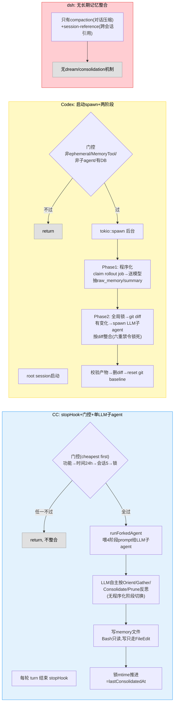

## 6.4b ④ 整合阶段深入：三家入口与对照（全解见 6.4b1/6.4b2）

> 本节是整合专题的**入口+对照**：CC 与 Codex 各自的单侧全解已按专家训练标准（五问：源码/意图/收益/不足/启示）独立成节——**CC 见 6.4b1（十四个单元），Codex 见 6.4b2（十个单元）**。本节保留三家全景图、对照表、dsh 的架构定位和决策启示，细节论证（被否方案、疤、对照缺）全部回指两节。

> **重要勘误**（沿用）：6.4 节的 autoDream 三门 Python、4阶段流水线、EmbeddingIndex 向量索引是教学示意，非源码。CC 真实 dream 是"LLM 子 agent 按 prompt 反思"；Codex 有且有三家里最结构化的两阶段整合（6.1b 曾错标"未见独立整合"，已修正）。

### 6.4b.1 一段话总览：三家整合机制

- **CC（6.4b1）**：每轮 stopHook 搭车 + 五道门 cheapest-first（功能/时间24h/扫描节流/会话5锁）+ 单个 LLM 子 agent 按 4 阶段 prompt 自主反思（Orient/Gather/Consolidate/Prune，"建议不强制"，程序只兜底索引 200 行/25KB 截断）。权限围栏走"**表不动门动**"——fork 与主对话共享工具表以保缓存前缀，逐调用 canUseTool 过滤。淘汰是"**软退役**"：删 MEMORY.md 指针不删文件，整合代理物理上没有 rm。深钻见 6.4b1 单元 5–8/12。
- **Codex（6.4b2）**：root 会话启动时 spawn + 四条件准入（非 ephemeral/feature 开/非子代理/有 DB）+ **两阶段**：Phase1 程序化认领 rollout（DB lease，每次≤2条，SQL 客观谓词）送模型提取；Phase2 全局锁（单串行）→ DB 选 LFU+TTL top-N → 同步进 **git 基线工作区** → git diff 判变化 → 有变化才 spawn **六重禁令锁死的整合代理**（cwd=记忆根/ephemeral/禁递归生成/禁 Collab/MCP 空/无网）按 diff 整合。淘汰是"**证据传播式删除**"：数据层程序删（DB 行/文件，进 diff），认知层 LLM 按证据粒度删结论。**citation 强制留痕 → usage_count 记账 → LFU 选择**，是三家里唯一的显式读写闭环。深钻见 6.4b2 全节。
- **dsh**：**无长期记忆整合**——源码实证：grep dream/consolidat 命中全是无关（pty send-state、对话摘要措辞）。dsh 的"记忆"是 session-reference（其他会话快照投影）+ compaction（对话压缩）。"投影派生不需整合"——快照不存在"过时合并"问题，这是架构分野不是缺陷（见 6.4b.4 启发5）。

### 6.4b.2 三家对照表（源码事实）

| 维度 | CC（→6.4b1） | Codex（→6.4b2） | dsh |
| --- | --- | --- | --- |
| 整合机制 | 有：autoDream（+手动/dream） | 有：Phase1+Phase2，最结构化 | 无（投影式，不需整合） |
| 触发 | stopHook 每轮搭车，五门 cheapest-first | root 会话启动 spawn，一次性 | N/A |
| 调度介质 | 文件系统（锁文件 mtime 三用） | SQLite state DB（lease/heartbeat/watermark） | N/A |
| 执行体 | 单 LLM 子 agent 按 4 阶段 prompt，**建议不强制** | Phase1 程序化抽取+Phase2 LLM 按 diff，十步严格线性各带失败遥测 | N/A |
| 变化呈现 | 无显式 diff—代理自己读全量再改 | **git 基线 diff 是整合代理的输入** | N/A |
| 权限围栏 | 同表+门（缓存经济学，6.4b1 单元7） | 空表+六重禁令（生命周期隔离，6.4b2 单元7） | N/A |
| 淘汰形态 | 软退役：删指针不删文件，可复活 | 证据传播式删除：程序删数据+LLM 删结论，git 可审计 | N/A |
| fitness 记账 | 无（槽位竞争隐性，logMemoryRecallShape 是 stub） | 有（citation→usage_count→LFU，硬闭环） | N/A |
| 失败观测 | completed/failed 事件级 | 十步各带专属 failed_* 遥测 | N/A |
| 版本基线 | 无（孤儿文件无墓碑） | git 基线，删除可审计 | N/A |

> 这张表里有三对"同题反答"值得停留：**权限围栏**（同表+门 vs 空表+禁令—约束条件是缓存共享 vs 生命周期隔离）、**淘汰**（软退役 vs 传播式删除—可逆性 vs 可审计性各取一端）、**fitness**（零记账 vs 硬闭环——两家都只做了自进化的一半，这是 6.4d 的入口）。每对的完整推理见两节相应单元。

### 6.4b.3 整合机制全景图

图 6-14：三家整合机制—CC（蓝）每轮门控+单 LLM 子 agent 按 prompt 反思；Codex（黄）启动 spawn 两阶段（程序化 Phase1+LLM Phase2+git 基线）；dsh（红）无长期记忆整合。CC 轻（单 agent 全包）、Codex 重（程序化+LLM 分离+可审计）、dsh 不做（投影式记忆）。

### 6.4b.4 五问浓缩（详细论证见 6.4b1/6.4b2）

#### 问题：记忆怎么维护、更新、淘汰？什么时候整合？

记忆会积累（每次会话提取新条目）、会过时（事实变了）、会冗余（重复/矛盾）。不整合则召回噪音大、记忆膨胀、记忆失真。整合回答"何时把散乱记忆整理成稳定长期记忆 + 淘汰过时"。

#### 做法：两家有（CC 单 LLM 子 agent / Codex 两阶段），dsh 不做

CC：每轮 stopHook 五门门控后，单 LLM 子 agent 按 4 阶段 prompt 自主反思（6.4b1 单元 5–8）。Codex：启动 spawn，程序化 Phase1 抽取+LLM Phase2 按 git diff 整合（6.4b2 单元 2/6）。dsh：无—投影式记忆不存在"提炼"需求。

#### 为什么这么做

- **为什么 CC 单 LLM 子 agent 全包，Codex 分两阶段？**——分阶段是规模驱动的：CC 记忆量小（单会话提取，量小到不值得程序化预抽取）；Codex 的 rollout 存 DB、量可大，先程序化批量抽取（每 rollout 独立，DB lease 并发）再全局整合。**语义判断什么时候都交 LLM**——CC 和 Codex 的程序化分工边界画在"客观谓词（SQL 判断得了的：认领/选择/淘汰）下沉，语义谓词（提取/整合）交模型"（6.4b2 单元 2 的判据：错了能不能靠重跑修复）。
- **为什么 CC 门控 cheapest-first、Codex 用 DB lease？**——调度介质匹配存储后端：CC 记忆在文件系统，锁=文件 mtime（一个文件三用：互斥/时间戳/crash 恢复，6.4b1 单元 6）；Codex 记忆在 DB，锁=DB lease +heartbeat（90s 续约，1h 过期）。两家门序哲学相同：绝大多数轮次在免费/便宜的门退出。
- **为什么 Codex 给整合代理喂 diff 而不是全量记忆？**——变化集同时解决三件事：预算（增量便宜）、注意力（代理只看变化）、**遗忘传播**（删除的文件作为 D 条目成为遗忘指令，6.4b2 单元 8）。CC 没有这个机制—它的整合代理每次看全量，靠 prompt 纪律省。

#### 收益

- **CC**：轻（单 agent 无基础设施），门控保证 99.99% 轮次免费，软退役误杀可恢复
- **Codex**：结构化（每步可观测可失败），git 基线让整合与遗忘可审计，citation 闭环让"记忆的使用"成为数据
- **共同**：整合后的干净记忆是召回质量的前提—垃圾记忆召回出来还是垃圾（6.5c）

#### 启发（五条，浓缩版）

1. **整合是语义活，程序管调度**——合并/去重/淘汰/解矛盾全是语义判断，程序化流水线装不下；但**定量兜底必须程序化**（CC 的索引 200 行截断/Codex 的产物校验）。→ 6.4b1 单元 8
2. **分阶段是规模驱动的**——量小单 agent 全包，量大才值得程序化预抽取；判据见上。→ 6.4b2 单元 2
3. **调度介质匹配存储后端**——文件存储用文件锁+mtime 巧用，DB 存储用 DB lease+heartbeat；门序永远 cheapest-first。→ 6.4b1 单元 5/6，6.4b2 单元 6
4. **权限围栏的形态跟着生命周期走**——必须共享缓存前缀的 fork 用"同表+门"，生命周期隔离的独立线程用"空表+禁令"；每条禁令对应一个具体的反馈回路（递归提取/递归委派）。→ 6.4b1 单元 7，6.4b2 单元 7
5. **投影式记忆不需整合**——dsh 不做整合是架构选择：session-reference 快照派生，不存在提炼；只有"提炼式记忆"才需整合。→ 6.0b 两类范式

### 6.4b.5 小结

整合回答"记忆怎么维护/更新/淘汰"。三家：CC 轻（stopHook 搭车+单 agent 反思+软退役），Codex 重（两阶段+git 基线+证据传播式删除+记账闭环），dsh 不做（投影式）。**深钻入口：CC 十四单元见 6.4b1，Codex 十单元见 6.4b2**；两节各自的"设计者画像"（认知科学家 vs 数据库工程师）解释了同题反答的根源。6.4 的 Python 流水线是教学示意非源码。

> 本节回答 6.1b 框架④整合的待深入问题并修正 Codex 错标。至此 6.1b 五阶段全部深入：①提取（6.3b）②存储（6.5b）③召回（6.5c）④整合（6.4b/6.4b1/6.4b2）⑤注入（6.6b）。自进化视角（读写闭环/槽位竞争/fitness 入口）在 6.4d 展开。
