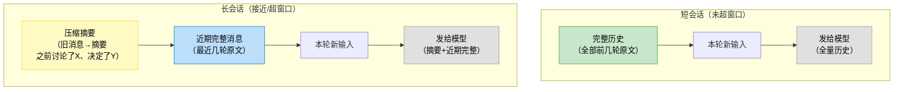
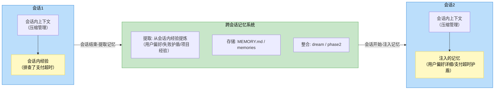

# 6.4.c 会话内上下文 vs 跨会话记忆：两个不同维度的事
> 一个常见疑问：几轮对话后，本轮调模型时，前几轮的内容怎么给？全给还是部分给？这个问题触及一个容易混淆的边界——**会话内上下文管理**和**跨会话记忆**

> 会话内上下文管理在 2.1b/2.2b 已钻透（时间轴【A】阶段1 压缩流水线 + 增量投影），本节是它在记忆 topic 下的定位说明，并衔接两个维度。

## 6.4.c.1 核心区分：会话内 vs 跨会话
|维度|会话内上下文管理|跨会话记忆系统|
| ---- | ---- | ---- |
|时间范围|单次会话内（几轮~几十轮对话）|跨会话（多次会话间，数天~数月）|
|处理什么|当前会话的历史消息（user/assistant/tool_result）|跨会话的经验积累（用户偏好/失败护盾/项目经验）|
|机制|压缩/裁剪/compact（2.1b【A】阶段1）|提取/存储/召回/整合/注入（6.1b 五阶段）|
|类比|短期工作记忆（当前任务的上下文）|长期记忆（跨任务的经验）|
|源码|CC query.ts / 阶段1、Codex compact.rs / dsh session-reference|CC memdir / Codex memories / dsh（无独立）|
|token 来源|当前会话的上下文窗口；CC: 机制说明 system 段 + 条目 user 消息(relevant_memories); Codex: summary 占 developer instructions + tool 按需|

> **两者衔接**：会话结束时，从会话内经验提取记忆（6.3b 提取），存进跨会话记忆系统；下次会话开始时，记忆系统注入相关记忆到会话内上下文。

## 6.4.c.2 会话内上下文怎么组织：不是“前几轮全给”
### 朴素假设 vs 真实做法
- **朴素假设**：第N轮调模型，把前N-1轮所有消息全进去。
- **真实做法**：不是全塞。上下文窗口有限（如 200K token），几轮后历史可能超窗口，且全塞浪费 token（早期消息很多已无关）。真实做法是 2.1b 时间轴【A】上下文准备——每轮模型前对历史处理。

### 三家的会话内上下文处理（源码实证，2.1b/2.2b 已钻）
#### CC：`query.ts` 阶段1, compact boundary slice + 六级流水线
第一步是 **compact boundary slice**：`getMessagesAfterCompactBoundary(messages)`
- `findLastCompactBoundaryIndex(messages, ts:5037)`：从后往前扫，找最近的 `isCompactBoundaryMessage`
- 找到 → `slice(boundaryIndex)`：只留边界之后的消息；没找到（返回 -1）→ 全量保留

> 会话从没触发过 compact（无边界，-1）→ 前几轮原文全量保留。
> 从这一步是“上几轮怎么给”的第一道闸门：compact 触发时会在消息流插入一条 boundary 标记消息，并把边界之前的旧消息替换成压缩摘要。此后每轮 slice 只取边界后的——旧消息不是原文，是已被摘要替代。

slice 之后再进六级流水线：
每轮调模型前：
`getMessagesAfterCompactBoundary`（slice 边界后的消息）
→ `toolResultBudget` → snip → microcompact → contextCollapse → autocompact → 预测性autocompact
→ 处理后的历史消息 + 本轮新消息 → 发给模型

> 所以“上几轮的输入本轮一起输入吗”的源码答案：经 `getMessagesAfterCompactBoundary` 切片一组会话（无 compact 边界）原文全量一起给；长会话（有 compact 边界）边界前的旧消息已被压缩摘要替代，slice 只留边界后的近期原文。这是【A】上下文准备的第一步，先切片再流水线精简。

#### Codex：`compact.rs` 采样前压缩
每轮调模型前：
`run_pre_sampling_compact`（预测性压缩）
→ 压缩后历史 + 本轮新输入 → 发给模型

#### dsh（旁路 service, pressure/overflow 触发）
每轮调模型前：
`session.deriveMessages()`（从日志派生消息，可裁剪）
→ 派生消息 + 本轮新输入 → 发给模型

### 短会话 vs 长会话
- **短会话（未超窗口）**：前几轮完整消息都给—模型能看到完整历史
- **长会话（接近/超窗口）**：旧消息被压缩成摘要，模型看到的是“**压缩摘要 + 近期完整消息 + 本轮新输入**”

>
> 图 6-17：会话内上下文组织—短会话全量历史（绿），长会话压缩摘要（黄）+ 近期完整（蓝）
> **压缩边界（compact boundary）**：边界之前是摘要，之后是完整。模型看到的是“之前发生了什么（摘要）+ 最近详细做了什么（完整）+ 现在要做什么（新输入）”。

## 6.4.c.3 两个维度的衔接

会话内上下文管理和跨会话记忆系统不是孤立的——它们在**会话边界**衔接：

>
> 图 6-18：会话内上下文与跨会话记忆的衔接—会话结束提取记忆（绿），会话开始注入记忆（黄），会话内用压缩管理（蓝）

**衔接流程：**

1. **会话1进行中**：会话内上下文管理（压缩/裁剪）保证不超窗口。会话内积累了经验（如“排查了支付超时”）。
2. **会话1结束→提取**：从会话内经验提取记忆（6.3b 提取）—“用户偏好先查数据”“支付超时是常见问题”。
3. **跨会话存储/整合**：记忆存入 MEMORY.md / memories，可能经 dream/phase2 整合。
4. **会话2开始→注入**：记忆系统注入相关记忆到会话2的上下文（6.1b 注入）—memory_summary 进 system prompt 或 memory tool 可调。
5. **会话2进行中**：会话2的上下文 = 注入的跨会话记忆 + 会话2的新对话历史（用压缩管理）。

## 6.4.c.4 案例：一个 agent 跨两次会话排查问题

**会话1（今天）**：用户说“排查订单下单失败”

- 会话内：agent 查数据-查日志-发现支付超时-修复。几轮对话+工具调用。
- 会话内上下文管理：前几轮完整保留（短会话未超窗口）。若轮次多，旧消息压缩成摘要。
- 会话结束→提取记忆：
    - CC: `extractMemories` agent提取["用户偏好先查数据","支付超时是常见问题"]→存 memory/
    - Codex: phase1提取raw_memory+summary→phase2整合成memory_summary/MEMORY.md/rollout_summary/**pay-timeout-diagnose skill**

**会话2（一周后）**：用户说“又下单失败了”

- 会话开始→注入记忆：
    - CC: 记忆机制说明+`loadMemoryPrompt` 进 system 段；记忆条目包裹（`{"用户偏好先查数据","支付超时常见"}`）经 `findRelevantMemories` 按本轮输入“又下单失败”相关性 top5 召回
    - Codex: `memory_summary` 进 system prompt；memory tool 可调（详情）；skill_listing 含 `pay-timeout-diagnose`（可主动发现）
- 会话内：agent 看到“用户偏好先查数据”（注入的记忆）+“又下单失败了”（新输入）→先查数据→查支付超时
- 会话内上下文管理：会话2的历史从零开始（会话1的历史不在会话2的上下文里——会话1的经验通过记忆注入，不是通过历史消息）

>
> 关键点：会话2看不到会话1的完整对话历史—它看到的是**从会话1提取的记忆**（“用户偏好”“支付超时”）。跨会话的连续性靠记忆系统，不靠历史消息。这就是 6.0.b“连续性”的落地—记忆 agent 跨会话保持认识这个用户“知道这个项目的坑”。

## 6.4.c.5 小结

“前几轮怎么给”的答案：**短会话全给，长会话压缩摘要+近期完整**——这是会话内上下文管理（2.1b【A】），不是记忆系统的事。

会话内上下文管理（压缩/裁剪）和跨会话记忆系统（提取/存储/召回/整合/注入）是两个维度：前者管**单次会话不超窗口**，后者管**跨会话保持连续性**。两者在会话边界衔接：会话结束提取记忆，会话开始注入记忆。

本节澄清了一个易混边界。后续 6.1b 框架的2-存储→3-召回→4-整合→5-注入，都是跨会话记忆系统的事（不是会话内上下文管理），会话内上下文管理已在 2.1b/2.2b 钻透。
