# 6.6b_final_request_anatomy.md
## 6.6b [A] 阶段最终喂给 LLM 的全景：请求解剖
> 本节回答一个核心问题：**[A] 上下文准备最终喂给 LLM 的到底是什么？** jsonl 日志、memory、CLAUDE.md、skills、MCP——这些来源怎么组装成最终发给模型的请求？本节把前面各处讲的碎片（2.1b 时间轴/2.4b 通信契约/6.2b 注入位置/6.4b 会话上下文）拼成一张完整全景，并给一个**严格按源码字段还原的请求格式 demo**。

>>**协议主线定位：本节是 harness↔LLM 通信协议的第二站（血肉）**
>>——第一站 2.4b（02 章）还原原形，本站往形状里装内容（六条来源组装），第三站 10.0b.2b（10 章）讲怎么用最便宜。**全线索引 专题对应协议机制**
> 这是记忆 topic 和通信契约(2.4b)的交汇点—记忆是“喂给 LLM 的什么”的一部分。**本节所有字段均经 CC 源码逐条核验，凡与旧版不符处以源码为准。**

## 6.6.1 六种来源，一个请求
一轮 turn 调用模型前，[A] 上下文准备把多种来源按各自路径组装成一个 HTTPS 请求。**注意：记忆分两路——记忆机制说明 prompt 进 system 段，记忆条目内容进 user 消息 attachment。这是旧版混淆的关键点，本节先分清。**

| 来源 | 注入位置 | 源码 | 对应 |
| ---- | ---- | ---- | ---- |
| .jsonl | 会话日志 | compact boundary slice + 六级流水线 | 消息序列 (user/assistant) | `getMessagesAfterCompactBoundary`（query.ts:556） |
| 记忆机制说明 | loadMemoryPrompt | ✅system 消息 | memory section | `systemPromptSection('memory', ...)`（prompts.ts:458） | 6.4c 会话内上下文 |
| 记忆条目内容 | getRelevantMemoryAttachments（top5 召回） | ✅user 消息 attachment | `(prompts.ts:458)` | 模型想怎么用 |
| `CLAUDE.md` 先验 | prependUserContext | ✅user 消息 | `project-instructions`标签 | api.ts:464 | `messages:ts:4119` + `memoryHeader` | 6.2b 层0先验 |
| `skills/` 技能 | skill_listing attachment | ✅user 消息 | `(system-reminder 包裹)` | `messages:ts:4139` | 8.6b skills |
| MCP servers | getMcpToolsCommandsAndResources | ✅tools 字段（和内置平级） | `query.ts:944` | `mcpTools` | 8.6b MCP |

```mermaid
flowchart TB
    subgraph REQ["发给 LLM 的 HTTPS POST 请求"]
        subgraph SYS["① system 消息（数组-最高优先+cache）"]
            SP["核心人格<br/>你是一个自主运行的agent..."]
            MEM["记忆机制说明<br/>loadMemoryPrompt<br/>（教模型怎么用记忆目录）"]
            ENV["环境信息<br/>env_info_simple"]
            OTH["scratchpad/FRC/<br/>output_style等section"]
        end
        subgraph MSGS["② 消息序列（compact boundary 切片后）"]
            COMP["压缩摘要<br/>（compact边界之前的旧消息）"]
            CMD["CLAUDE.md<br/>project-instructions标签"]
            SKL["skill_listing<br/>system-reminder"]
            RMEM["记忆条目<br/>（relevant memories/top5召回+system-reminder）"]
            NEW["近期完整消息<br/>（compact边界之后）"]
            INPUT["用户输入<br/>本轮新输入"]
            TOOL_RES["tool_result<br/>工具结果"]
        end
        subgraph TOOLS["③ tools 字段"]
            T1["内置工具<br/>Bash/Read/Edit..."]
            T2["MCP工具<br/>mcp_codegraph_..."]
        end
    end

    JSONL[".jsonl 会话日志<br/>(原始事件流）"]
    JSONL -->|compact边界前-摘要| COMP
    JSONL -->|compact边界后-完整| NEW
    JSONL -->|tool_result|TOOL_RES
    
    MEM_MEC["loadMemoryPrompt  
    （机制说明）"]
    MEM_MEC -->|systemPromptSection| MEM
    
    MEM_FILES["memory/*.md  
    （记忆文件）"]
    MEM_FILES -->|findRelevantMemories top5| RMEM
    
    CLAUDE_MD["CLAUDE.md  
    （项目先验）"]
    CLAUDE_MD -->|prependUserContext| CMD
    
    SKILLS["skills/*.md  
    （技能）"]
    SKILLS -->|skill_listing| SKL
    
    MCP_SRVS["MCP servers"]
    MCP_SRVS -->|getMcpTools| T2
    
    style SYS fill:#ffcdd2,stroke:#e53935,color:#000
    style MEM fill:#fff9c4,stroke:#fdd835,color:#000
    style MSGS fill:#bbdefb,stroke:#1976d2,color:#000
    style TOOLS fill:#c8e6c9,stroke:#43a047,color:#000
    style JSONL fill:#e0e0e0,stroke:#9e9e9e,color:#000
    style RMEM fill:#fff9c4,stroke:#fdd835,color:#000
    style CMD fill:#bbdefb,stroke:#1976d2,color:#000
```   



>
> 图 6-12:【A】阶段最终请求全景—**记忆分两路**：机制说明（黄）进 system 段，条目内容（黄）进 user 消息；CLAUDE.md（蓝）经 project-instructions 进 user 消息；jsonl（灰）经 compact 切片进消息序列；MCP（绿）进 tools 字段

## 6.6b.2 真实请求格式 Demo（严格按源码字段还原）

>
> 以下请求体**每一处都对应 CC 源码真实字段**（文件/行号标注）。场景：用户第三次会话说“又下单失败了”，前两次排查过支付超时，记忆已提取，当前会话短（未触发 compact）。

```
{
  "model": "claude-sonnet-4",
  "max_tokens": 8192,
  "stream": true,
  "system": [
    {
      "type": "text",
      "text": "你是一个自主运行的 agent。请使用可用工具完成有价值的工作。\n\n[安全指令...]\n\n[getSystemRemindersSection...]"
    },
    {
      "type": "text",
      "text": "## Memory\n\nauto memory 目录: ~/.claude/memory/...\n[教模型如何使用记忆目录、MEMORY.md规则、frontmatter格式的机制说明 prompt]\n(-- loadMemoryPrompt 返回, buildMemoryLines 产出, prompts.ts:458 systemPromptSection('memory') )"
    },
    {
      "type": "text",
      "text": "[环境信息 env_info_simple: cwd/git/05...]"
    },
    {
      "type": "text",
      "text": "[scratchpad / FRC / output_style 等 systemPromptSection...]"
    }
  ],
  "messages": [
    {
      "role": "user",
      "content": [
        {
          "type": "text",
          "text": "<project-instructions>\n本项目是订单服务，技术栈：Java 17 + Spring Boot 3。\n构建：mvn clean install，测试：mvn test\n支付模块在 src/main/java/com/order/payment/。\n</project-instructions>\n"
        }
      ]
    },
    {
      "role": "user",
      "content": [
        {
          "type": "text",
          "text": "<system-reminder>\nAs you answer the user's questions, you can use the following context:\n# 可用 Skills\n- prod-diagnose: 线上问题智能诊断。触发词: 线上排查/线上问题/线上报错...\n- code-review: 代码审查流程。触发词: review/审查...\n\nIMPORTANT: this context may or may not be relevant to your task. You should not respond to this context unless it is highly relevant to your task.\n</system-reminder>\n"
        }
      ]
    },
    {
      "role": "user",
      "content": [
        {
          "type": "text",
          "text": "<system-reminder>\nMemory (saved 2 days ago): ~/.claude/memory/pay-timeout.md:\n\n支付超时-WARN日志-检查超时配置-验证下单\n停止:3次成功\nMemory (saved 2 days ago): ~/.claude/memory/user-prefers-data.md\n用户偏好先查数据再查日志\n</system-reminder>\n"
        }
      ]
    },
    {
      "role": "user",
      "content": [
        {
          "type": "text",
          "text": "又下单失败了"
        }
      ]
    },
    {
      "role": "assistant",
      "content": [
        {
          "type": "thinking",
          "thinking": "用户说又下单失败了。记忆里有“支付超时-查WARN日志”的失败护盾。先按这个排查。"
        },
        {
          "type": "text",
          "text": "我来排查。根据之前的经验，先查支付服务的 WARN 日志。"
        },
        {
          "type": "tool_use",
          "id": "toolu_001",
          "name": "Bash",
          "input": {
            "command": "grep WARN payment-svc.log | tail -20"
          }
        }
      ]
    },
    {
      "role": "user",
      "content": [
        {
          "type": "tool_result",
          "tool_use_id": "toolu_001",
          "content": "[WARN 2026-08-25 10:32:15 [payment-client] 调用bank-api超时, cost=5012ms, timeout=3000ms\nWARN 2026-08-25 10:32:18 重试1/3...\nWARN 2026-08-25 10:32:21 重试3/3, 放弃]"
        }
      ]
    }
  ],
  "tools": [
    {
      "name": "Bash",
      "description": "执行命令",
      "input_schema": {
        "type": "object",
        "properties": {
          "command": {
            "type": "string"
          }
        },
        "required": ["command"]
      }
    },
    {
      "name": "Read",
      "description": "读取文件",
      "input_schema": {
        "type": "object",
        "properties": {
          "file_path": {
            "type": "string"
          }
        },
        "required": ["file_path"]
      }
    },
    {
      "name": "mcp_codegraph_callers",
      "description": "查找调用某符号的所有函数",
      "input_schema": {
        "type": "object",
        "properties": {
          "symbol": {
            "type": "string"
          }
        },
        "required": ["symbol"]
      }
    }
  ]
}
```

>
> **注意：本 demo 不含 `tool_choice` / `parallel_tool_calls`——这两个字段**只在 `sideQuery.ts` 旁路请求**（permission explainer / yoloClassifier 等子查询）出现，主 agent 循环 `query.ts` 的 `callModel` 只传 `toolChoice: undefined`（query.ts:931）。旧版 demo 把旁路字段当主请求字段写入，是错误。**

## 6.6b.3 请求体逐部分解读

>
> ※读 demo 的定位（系统设计视角）：**本 demo 画的是对外契约**（请求报文）——LLM 供应商定的、不可协商的部分。demo 里“工具调用折叠在 assistant 消息里”是适配包装层的结果；六种来源的内部数据怎么组装，是 harness 自己的地盘（三家设计对照见【第一站 2.4b.2】`../02_architecture/2.4b_llm_communication_contract.md`）。

>
> 唯一可久/模型可见面是投影/投影可重建（见第一站 2.4b.2①）。

```json
"system": [
  {"type": "text", "text": "你是一个自主运行的agent..."} , // 核心人格
  {"type": "text", "text": "## Memory\n机制说明 prompt..."} , // loadMemoryPrompt（机制说明，非条目）
  {"type": "text", "text": "[env_info_simple]"}, // 环境信息
  {"type": "text", "text": "[scratchpad/FRC/...]"} // 其他 systemPromptSection
]
```

>
> >
> > **system 是数组（多段 text），不是单字符串→`SystemPrompt` 类型 `SystemPromptType.ts` → `@ant/model-provider`，prompts.ts:434 `return [...].filter(s != null)` 数组拼接。**
> > `QueryEngine.ts:326` `asSystemPrompt()`。
> > **system 段的 memory 放的是“机制说明”不是“记忆条目”** → `systemPromptSection('memory', () => loadMemoryPrompt())` (prompts.ts:458)。`loadMemoryPrompt()` 返回 `buildMemoryLines(...).join('\n')` (memdir.ts:475)，内容是**auto memory 目录路径 + 教模型怎么用记忆的指南**。**记忆的实际条目内容不在这，在 messages 的 relevant_memories（见②）。**

### ② 消息序列（compact 切片 + project-instructions + skills + 记忆条目 + 历史 + 工具结果）

```json
"messages": [
  // CLAUDE.md (prependUserContext 分流，<project-instructions>标签，高权重，api.ts:464)
  {"role": "user", "content": [{"type": "text", "text": "<project-instructions>项目指令...</project-instructions>"}]},
  // 其余 userContext (skill_listing等，<system-reminder>包裹，带免责声明，api.ts:474)
  {"role": "user", "content": [{"type": "text", "text": "<system-reminder>可用Skills...</system-reminder>"}]},
  // 记忆条目 (relevant memories attachment，top5召回，system-reminder包裹，messages.ts:4119)
  {"role": "user", "content": [{"type": "text", "text": "<system-reminder>Memory (saved xd ago): ...</system-reminder>"}]},
  // 用户输入（本轮新输入）
  {"role": "user", "content": [{"type": "text", "text": "又下单失败了"}]},
  // 上一轮 assistant (thinking + text + tool_use 在同一个 content 数组)
  {"role": "assistant", "content": [
    {"type": "thinking", "thinking": "记忆里有支付超时-查WARN..."},
    {"type": "text", "text": "我来排查..."},
    {"type": "tool_use", "id": "toolu_001", "name": "Bash", "input": {"command": "grep WARN ..."}}
  ]},
  // 工具结果 (关联 tool_use_id)
  {"role": "user", "content": [{"type": "tool_result", "tool_use_id": "toolu_001", "content": "WARN...超时5012ms..."}]}
]
```

>
> >
> > **消息序列来自 jsonl 压缩切片 → `getMessagesAfterCompactBoundary(messages)` (query.ts:556) → `findLastCompactBoundaryIndex` 找最后一个 compact 边界，`slice(boundaryIndex)` 只留边界之后。短会话无边界=全部保留；长会话边界前已被 compact 摘要替代（见 6.4b）。然后进入六级流水线（toolResultBullet-snip-microcompact-autocompact）**
> > `CLAUDE.md` 是 `<project-instructions>` 标签（api.ts:464），**不是 system-reminders**；`prependUserContext` 故意把 `CLAUDE.md` 从通用 `system-reminder` 里独立出来——源码注释原文：`"so it isn't buried inside the generic <system-reminder> with the may or may not be relevant disclaimer, which would degrade its instructional weight"` (api.ts:455-457)。
> > **记忆条目在 `relevant_memories` (messages.ts:4119) → `getRelevantMemoryAttachments`(attachments.ts:2258) 调用 `findRelevantMemories` 按本轮输入相关性检索记忆文件。`readMemoriesForSurfacing` 读内容，`slice(0,5)` 最多带5条，每条带 `memoryHeader(path, mtimeMs)` → 包装 `WrapMessagesInSystemReminder` 包成 user 消息。**
> > **关键观察：assistant 的 `thinking` + `text` + `tool_use` 在**同一个 `content` 数组里**——一条 assistant 消息可同时含思考、文本回复、工具调用（2.4b ContentBlock 数组）。**

### ③ tools 字段（内置 + MCP 平级）

```json
"tools": [
  {"name": "Bash", "description": "执行命令", "input_schema": {...}},
  {"name": "Read", "description": "读取文件", "input_schema": {...}},
  {"name": "mcp_codegraph_callers", "description": "查找调用某符号的所有函数", "input_schema": {...}}
]
```

>
> >
> > **MCP 工具和内置工具平级**→ `query.ts:944` `mcpTools: appState.mcp.tools` → `getMcpToolsCommandsAndResources` (main.tsx:168) 发现，工具名 `mcp_` 前缀路由（toolExecution）。**模型看到统一工具列表，不知哪个是 MCP 哪个是内置（8.6b）。**

## 6.6b.4 多种来源在请求里的位置总结

| 来源 | 在请求体的什么位置 | 怎么来的 | 源码 |
| --- | --- | --- | --- |
| .jsonl 会话日志 | messages 数组（compact 切片后） | `getMessagesAfterCompactBoundary` 切片 + 六级流水线 | query.ts:556 |
| 记忆机制说明 | ✅system 消息 | `loadMemoryPrompt` (buildMemoryLines) | prompts.ts:458 |
| 记忆条目内容 | ✅messages → relevant_memories (system-reminder) | `findRelevantMemories` top5 召回 | attachments.ts:2258 |
| `CLAUDE.md` | ✅messages → user 消息 `<project-instructions>` | `prependUserContext` | api.ts:464 |
| `skills/` | ✅messages → user 消息（system-reminder） | `skill_listing` attachment | messages.ts:4139 |
| MCP servers | ✅tools 字段 | `getMcpToolsCommandsAndResources` | query.ts:944 |

>
> **优先级链（从请求结构看）：**
> `system` 消息（人格 + 记忆机制说明）最高 + cache
> → `<project-instructions>` (CLAUDE.md) → `prependUserContext` 故意独立成高权重标签
> → `<system-reminder>`（skills + 记忆条目 + 其他 context）—带“may or may not be relevant”免责声明，权重低于 project-instructions

>
> **关键修正：旧版声称“记忆条目在 system 段所以经验>先验”是错的。源码真相——记忆条目（relevant_memories）和 skills 同在 system-reminder user 消息里，CLAUDE.md 反而独立成更高权重的 project-instructions。经验 vs 先验谁优先，**靠模型语义判断，不是注入位置硬决定**（详见 6.2b 重审）。

## 6.6b.5 这个 demo 揭示的三个关键事实

>
> **事实1：记忆分两路注入**→机制说明（loadMemoryPrompt）进 system 段教模型怎么用记忆系统；条目内容（relevant_memories）进 user 消息按相关性 top5 召回。模型读到条目后在 thinking 里主动引用“记忆里有‘支付超时-查WARN’的失败护盾”。**记忆条目不是被程序查询后塞进 system，是按相关性召回后模型主动引用——印证 6.0b.③“记忆是推理输入材料”。**

>
> **事实2：jsonl 不是全量给，靠 compact 边界切片**→`getMessagesAfterCompactBoundary` 找最后一个 compact 边界，slice 只留边界后。demo 是短会话（无边界=全量），没展示压缩摘要；长会话时 messages 开头会有 compact 摘要替代边界前的旧消息——印证 6.4b“长会话压缩摘要+近期完整”。

>
> **事实3：多种来源走各自的路径互不混同**→jsonl 走 compact 切片→messages；记忆机制走 loadMemoryPrompt→system、记忆条目走 findRelevantMemories→messages attachment；CLAUDE.md 走 prependUserContext-project-instructions、skills 走 skill_listing-system-reminder、MCP 走 getMcpTools→tools。**同一个请求里，各来源占不同位置、不同标签、不混淆。**

>
> 本节是记忆 topic 和通信契约(2.4b)的交汇——记忆是“喂给 LLM 的什么”的一部分。理解了这个全景，就理解了【A】上下文准备做的全部事：**把多种来源按各自路径组装成 system 消息 + 消息序列 + tools 字段。**
> 旧版三处硬伤（tool_choice 旁路字段、记忆条目误入 system、CLAUDE.md 标签错）已按源码修正。