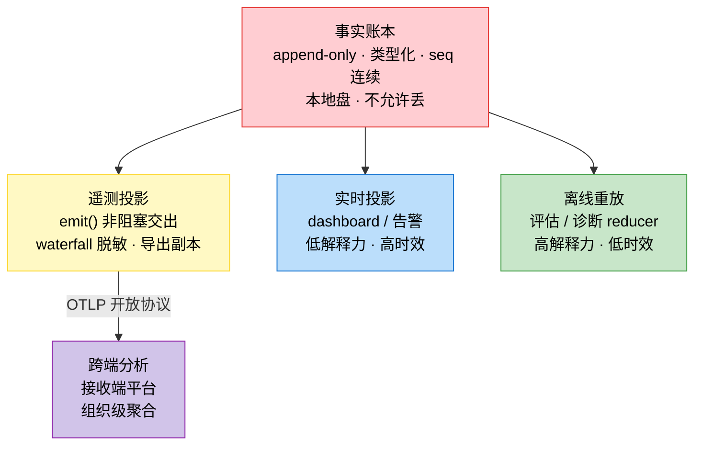

`1# 11.0b 可观测性的本质：事实账本与它的投影

本节是第十一章的奠基，也是第十三章(评估)的共同地基——两个主题共享同一个底座，拆开写会自我稀释。11.1-11.5 讲教学化的三大支柱与容错模式，本节先回到第一性原理：不谈怎么埋点，先想清楚“可观测性对 Agent 系统到底意味着什么”。

本节用四份生产级源码实证：Claude Code( src/utils/telemetry/ 4050 行 + stats.ts 1061 行)、Codex( codex-rs/otel/ + rollout/ + rollout-trace/ + analytics/ )、dsh( packages/session/ 家族)、Langfuse(观测平台的接收端形态)。前三家是发射端，Langfuse 是接收端——四个样本正好拼出完整的链路。

注意：原书 11.1 的“三大支柱(Metrics/Logs/Traces)”是运维通用视角的教科书抽象，回答的是“观测系统由什么构成”。生产级 harness 的可观测性先要回答一个更根本的问题：“什么是事实、事实归谁、丢了怎么办”——这一层定了，三大支柱只是它的实现细节。

## 11.0b.1 一句话本质

> 可观测性 = 把系统的执行变成可查询的事实，并在不伤害执行的前提下，让这些事实流向需要它们的人/流程。

这句话有四个词值得逐个称重，每个词都对应一个架构决策：

| 词 | 称重 | 对应的架构问题 |
| ---- | ---- | ---- |
| 事实 | 不是日志行，是 append-only 事件账本 | 什么算事实？事实有几个副本？(→ 11.0b.3) |
| 可查询 | 不是 grep，是按 seq/turn/callId 结构化可定位 | 事实的形状由谁定？(→ 11.0b.3) |
| 不伤害执行 | 观测是热路径上的房客，不是主人 | 观测的税怎么收？谁付？(→ 11.0b.4) |
| 流向需要的人/流程 | 消费者多种(人/告警/评估平台)，各自要不同的投影 | 投影怎么派生？允许丢吗？(→ 11.0b.4/5) |

## 11.0b.2 四份源码给出同一个答案：账本先行

四份源码、三种语言、发射端和接收端，在“数据从哪来”这个问题上给出同一个结构。这不是巧合——这是本节要立的第一个论断：

**论断一(账本先行)**：harness 的执行事实首先落成一个本地的、append-only 的、类型化的事件账本；一切观测是这个账本的投影，一切评估是这个账本
**论断一(账本先行)**：harness 的执行事实首先落成一个本地的、append-only 的、类型化的事件账本；一切观测是这个账本的投影，一切评估是这个账本的重放。

这个论断的形状本身就是一张图——一份账本，长出两类消费者：

**论断一(账本先行)**：harness 的执行事实首先落成一个本地的、append-only 的、类型化的事件账本；一切观测是这个账本的投影，一切评估是这个账本的重放。

这个论断的形状本身就是一张图——一份账本，长出两类消费者：

图 11-0a：一份账本，两类消费者 (投影 = 实时流，重放 = 离线深解释；跨端分析走脱敏投影，不走账本本体)

## 四份源码的坐标

| 系统 | 事实账本 | 观测 = 账本的投影 | 评估 = 账本的重放 |
| ---- | ---- | ---- | ---- |
| **dsh** | `SessionEventMap` append-only 日志（"single source of truth"，消息历史是**派生**的，never stored separately） | `session-telemetry`：**Ledger records mirror session-log events one-to-one** —— 遥测记录就是账本事件的逐条镜像，外加链路 waterfall | snapshot 测试 / 回放 / replay / refresh 三模式，重放是录制的模型的响应，断言"组装的请求 + 持久化日志"三方 |
| **Codex** | `RolloutRecorder` 写 rollout JSONL（后台写任务，线程失败有保护） | `otel` crate 创建 `SessionTelemetry` + `analytics` facts（独立上传的投影） | `rollout-projects` crate：见 11.0.6 的 `observe first, interpret later` |
| **Claude Code** | `./claude/trace/` 的 transcript JSONL、otel spans/事件/指标（perfetto）本地文件 + OTLP 上传，与 transcript 并行的侧信道 | `stats.ts` 从 transcript 文件**全量重算**日志 / streak / 模型用量——1061 行的纯消费者 | 见 11.0.6（评估从 transcript 重放，与 stats 属同源派生） |
| **Langfuse** | （接收端，无本地账本） | Trace / observation 摄入 Clickhouse | Dataset / Run / RunItem：评估执行锚回 trace（→13.0b） |

---

**读法提示**（表格之外的观察）：

- 前三家是**发射端**，Langfuse 是**接收端**——四个样本正好拼出完整链路。
- "观测"和"评估"两列都指向同一个账本，但**消费方式不同**：观测是投影（实时、脱敏、可丢），评估是重放（离线、完整、不可丢）。
- 唯一一个不设本地账本的是 Langfuse，因为它是"接收端"——账本在发射端，它只收投影。
