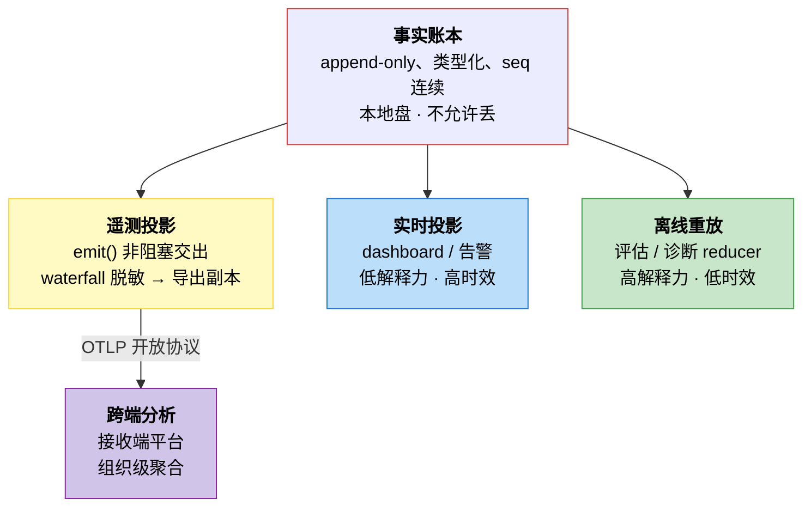
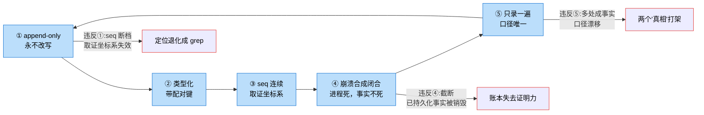
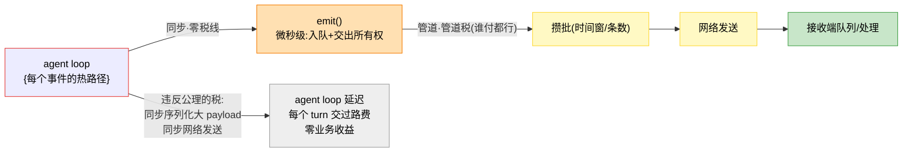
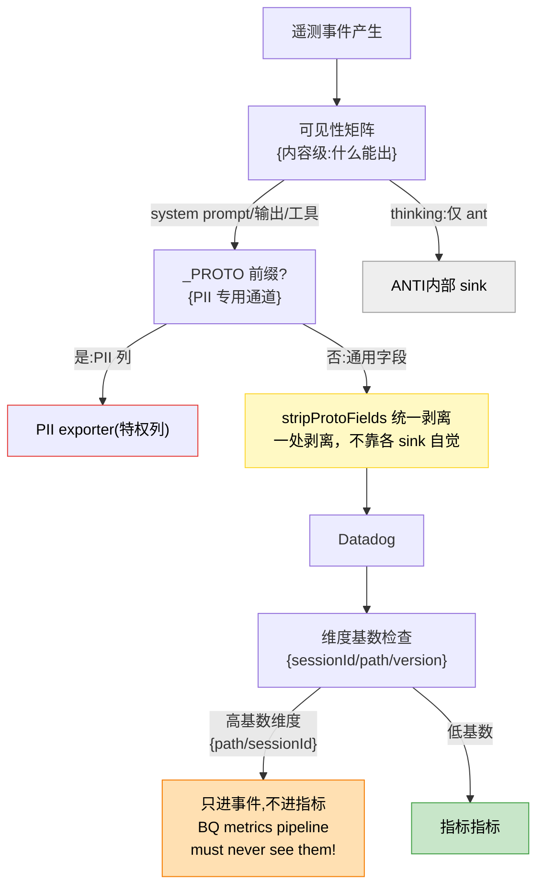
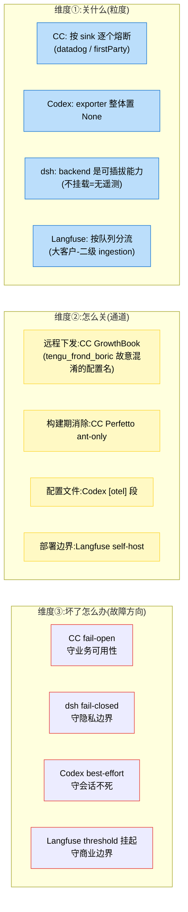
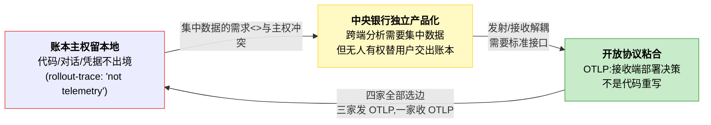
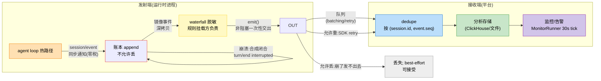
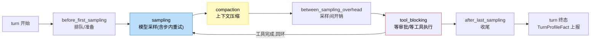
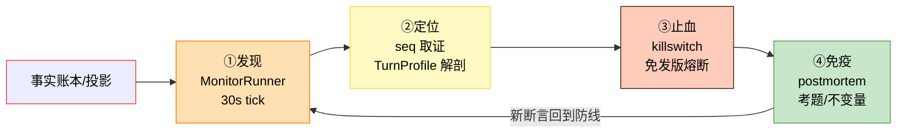
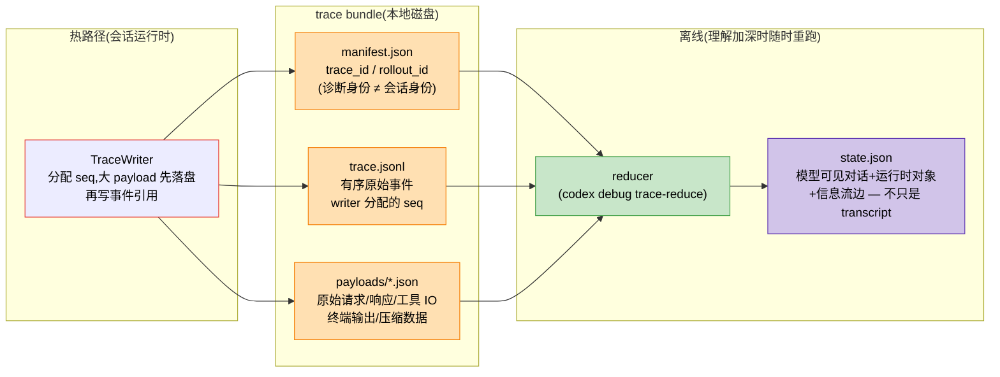

# 11.0b 可观测性的本质：事实账本与它的投影

>
> 本节是第十一章的奠基，也是第十三章(评估)的共同地基—两个主题共享同一个底座，拆开写会自我稀释。11.1-11.5 讲教学化的三大支柱与容错模式，本节先回到第一性原理：不谈怎么埋点，先想清楚“可观测性对 Agent 系统到底意味着什么”。
> 本节用四份生产级源码实证：Claude Code(`src/utils/telemetry/` 4050 行 + `stats.ts` 1061 行)、Codex(`codex-rs/otel/` + `rollout/` + `rollout-trace/` + `analytics/`), dsh(`packages/session/` 家族)、Langfuse(观测平台的接收端形态)。前三家是发射端，Langfuse 是接收端—四个样本正好拼出完整的链路。
> 注意：原书 11.1 的“三大支柱(Metrics/Logs/Traces)”是运维通用视角的教科书抽象，回答的是“观测系统由什么构成”。生产级 harness 的可观测性先要回答一个更根本的问题：**什么是事实、事实归谁、丢了怎么办**
> **这一层定了，三大支柱只是它的实现细节。**

## 11.0b.1 一句话本质

>
> **可观测性 = 把系统的执行变成可查询的事实，并在不伤害执行的前提下，让这些事实流向需要它们的人/流程。**

这句话有四个词值得逐个称重，每个词都对应一个架构决策：

| 词 | 称重 | 对应的架构问题 |
| --- | --- | --- |
| **事实** |  | 不是日志行，是 append-only 事件账本｜什么算事实？事实有几个副本？(→ 11.0b.3) |
| **可查询** |  | 不是 grep，是按 seq/turn/callId 结构化可定位｜事实的形状由谁定？(→ 11.0b.3) |
| **不伤害执行** |  | 观测是热路径上的房客，不是主人｜观测的税怎么收？谁付？(→ 11.0b.4) |
| **流向需要的人/流程** |  | 消费者多种(人/告警/评估平台)，各自要不同的投影｜投影怎么派生？允许丢吗？(→ 11.0b.4/5) |

## 11.0b.2 四份源码给出同一个答案：账本先行

四份源码、三种语言、发射端和接收端，在“数据从哪来”这个问题上给出同一个结构。这不是巧合—这是本节要立的第一个论断：

**论断一(账本先行)：harness 的执行事实首先落成一个本地的、append-only 的、类型化的事件账本；一切观测是这个账本的投影，一切评估是这个账本的重放。**



>
> 图 11-0a:一份账本，两类消费者(投影=实时流，重放=高解深解释；跨端分析走脱敏投影，不走账本本体)

四份源码的坐标：

>
> 系统｜事实账本｜观测 = 账本的投影｜评估 = 账本的重放
> ---|---|---|---
> dsh｜`SessionEventMap` append-only 日志("single source of truth",消息历史是**派生**的，never stored separately)｜`session-telemetry` **Ledger records mirror session-log events**｜——重测记录就是账本的逐条镜像，外加脱敏 waterfall / snapshot / refresh 三模式，重放录制侧的模型响应，断言“组装的请求+协议输出+格式化日志”三方
> Codex｜`RolloutRecorder` 写 rollout 350NL(后台写任务，终端失败留存供查询)｜`otel` crate 的 `SessionTelemetry` + `analytics_facts`(独立上传的投影)｜`rollout-trace` crate:见 11.0b.6 的 observe first, interpret later
> CC｜`~/claude/projects/` 的 transcript 350NL｜OTel spans/事件/指标(perfetto 本地文件 + OTLP 上传,与 transcript 并行的侧信道)｜`stats.ts` 从 transcript 文件**全量重算**日志/stream / metrics
> Langfuse｜Trace/Observation 存入 Clickhouse｜Dataset/Run/Item/评估执行 trace(→ 13.0b)｜

教学版 11.1 的三大支柱在这张表里处于什么位置？**Metrics/Logs/Traces 是投影的三种格式，不是事实的三种来源**。三家发射端的真相是：事实只有一个来源(账本)，投影可以有任意多种(OTel 事件、span、perfetto 文件、Clickhouse)。把“三大支柱”当成唯一输入在做一次就会错误谋求“三源对齐”，口径不一、互相矛盾。

>
> Langfuse 经验 1(存储分治)：接收端把“实体真相”和“分析负载”物理分开—Postgres 存配置/关联/判定值，Clickhouse 存 traces/observations/scores 事件流，大 payload 走 S3 blob。观测数据天然“写入量 > 查询量”，与分析负载共库要么查询拖垮业务、要么写入被锁拖垮。**分析型存储分离不是优化，是前提**——自建时哪怕用 SQLite+文件系统，也要在第一天就分“真相库”与“分析库”。

## 11.0b.3 职责一：记录—事实的形状

账本不是“日志”这个模糊词能覆盖的。三份发射端源码对“什么算合格的事实账本”给出五条纪律，每条都有失败后果：

**#① append-only，永不改写。**
dsh 脱敏 waterfall 的原文：`Redaction applies to the exported copy only -- the canonical session log is never rewritten`。为什么这条是铁律？因为账本的用途是**事后取证—postmortem 时你要问“当时到底发生了什么”，如果账本本身被后来的策略改写过，它证明不了任何事。改写发生在投影上，投影丢了大不了重放一遍。**

**#② 类型化事件，不是自由文本。**
dsh 的 `SessionEventMap`：`turn/start`、`turn/end {reason}`、`step/start`、`assistant/message {usage}`、`tool/call {callId, name, arguments}`、`tool/result {callId, ...}` 一串事件带 turn/seq 序号和 callId 配对键。Codex rollout JSNL 同构。**自由文本日志没有配对键：你知道“执行出错了”，但哪次调用的错？要靠人 grep 上下文猜。类型化的本质是把“事后能问什么问题”在写入时就决定下来。**

**#③ seq 连续单调，是取证的坐标系。**
dsh 的 sequence numbers stay contiguous;Langfuse 接收端 dedupe 靠 `(session.id, event.seq)`。dsh postmortem 0003 的时间线是这条纪律的 showcase:每一个可疑动作都钉在 seq 上—`"the user-facing handoff, bare-Vite launch, replacement-host launch, boot-manifest probe...are sequences #30939, 31865, 34309, 34441, and 34681"`。注意这**不是从日志里 grep 出来的痕迹，是直接按 seq 点名的证据链。没有连续 seq，“定位”就退化成“几个人 grep 几小时”—你在运维灾难里最贵的那段时间。**

**#④ 崩溃不截断，合成闭合。**
dsh 崩溃恢复的含义：重载一个 crashed mid-turn 的日志，发现开着的 `turn/start` 没有配对的 `turn/end`—它**不截断**(为什么?原文:"a single turn can be huge in a long-horizon task, and those events were durably appended before the crash")—截断等于把已经持久化的事实销毁，而是追加一条合成的 `turn/end { reason: "interrupted" }` 把 turn 闭合。`interrupted` 是循环自己永远不发射的，所以它在账本上**自带“这是恢复器写的”签名**。这条纪律直接推翻教学版 11.3 的直觉—教学版容错的中心是“请求失败怎么办”，生产级账本的中心是**记录死、事实不死**。

**#⑤ 事实只录一遍。**
一个事件只在一个地方成为事实(账本)，所有下游(dashboard、告警、评估、成本报表)都是消费者。CC 的 `stats.ts` 是极端示范：它不缓存任何指标，每次打开 stats 都从 transcript JSNL**全量重算**—因为重算代价可接受，而维护一套与账本并行的指标缓存，代价是**口径漂移(缓存和真相慢不一致，你还不知道)。**

五条纪律互相咬合成一个闭环—任何一条缺席，其余的都会塌；



>
> 图 11-0b:账本五纪律与各自缺席时的塌陷形态

**必记/可选/分发：一次 trace 到底记哪些？**
纪律②的类型化给出了记录的**形态(类型化事件、带配对键)**，但没回答数量问题—“必记的是不是一个大概的东西？”不是。三家的账本样本收敛出一个**精确的最小必记集**，缺任何一件，对应的事后问题就问不了：

| 必记事件 | 保住的事后问题 | 消费者 |
| --- | --- | --- |
| `turn/start` + `turn/end {reason}`（配对） | “哪一轮出错、怎么结束的”｜崩溃恢复(④孤儿 turn 识别)、退出信号分析(4.1c) |  |
| `tool/call {callId, name, arguments}` + `tool/result {callId}`（配对） | “哪一次调用的错”｜④结构核对判据的真值、工具成功率 |  |
| `assistant/message` | “当时模型说了什么、花了多少”｜当模型型输出 token 用量)｜replay 的录制材料(冻结的就是它) |  |
| 每事件 seq(3) | “顺序是什么”｜取证时间线、按 seq 点名证据 |  |

>
> 可选不跟着 agent 自身走，跟着侧面走。**必记集之上记什么，判别不在本节在下游；判别消费什么，由你的副圈决定—副圈探测(拿一次 trace 填六卡,13.0b.2)定出你的 agent 占哪几层，每层判据需要什么证据。证据链决定 span 的层级与字段(准点的层级来的判断，Score 挂跟 Trace 挂“这轮好不好”，挂具体 span 评这个 tool_call 好不好(13.1b.3))。**
> 可选不是越多越好，不是列到每一个文件、每一行；**同一条记录的负面：可选不等于便宜—多记的事件也是账本，不是“报表工具里单独加一次的侧门”(那就是纪律⑤的口径漂移)**

## 11.0b.4 职责二、三：降税与脱敏—投影的两条纪律

账本之上的投影(遥测、span、指标)是另一类公民。它们的核心约束是一条**边界公理**：

>
> **论断二(emit() 边界公理):harness 对观测的职责到 `emit()` 为止—非阻塞、一次性交出所有权；batching/retry/queueing/loss 全部属于上报侧。**

dsh 把这条写成了接口契约原文:`SessionTelemetrySink.emit()` 的 JSDoc—`MUST be a non-blocking enqueue – the coordinator calls this synchronously from the 'session/event hot path, so anything slower than that queue push would tax the agent loop'`。三家的发射端实现都在这条公理之内：

- dsh:waterfall 在协调器遏制内同步跑，抛异常的 listener 扣下那一条记录(fail-closed)，**永远到不了 agent loop**；`flush` 提示是 fire-and-forget，每一轮 `flush` 都因为并发 flush 与 shutdown drain 的交互风险而默认不实现。
- CC:lazy import 节省 1.2MB 的 OTLP 导出器(进程一次最多用一个协议变体，静态 import 会全部加载)；span 清理用 ALS+WeakRef+30 分钟 TTL 的兜底 interval，且 `unref()` 不阻塞进程退出；错误日志 sink 故意与 `log.ts` 拆开避免 import cycle。
- Codex:观测独立包 `codex-otel`，核心通过 `SessionTelemetry` 门面交互；rollout 写入是后台任务，写任务死了终端失败被**留存供查询**，而不是拖死会话(`Trace startup and writes are best-effort. Rollout tracing must never make a Codex session fail just because diagnostic recording failed`)。

先把“税”画出来—观测的每一分成本落在在哪，决定了边界的形状：



>
> 图 11-0c:emit() 边界的税制图—红线以内是发射端的全部职责(微秒级入队)；橙线以后是管道，税可以在任何一端付，但**税不能回流到红线上**。三家实现全是“红线极简”的：dsh 协调器、CC lazy import、Codex best-effort 写任务

**为什么这条是公理而不是建议？**
因为观测挂在每个事件的热路径上，一个同步的网络发送、一次大 payload 的序列化，都直接变成 agent loop 的延迟—你在给每一次 turn 加上观测的过路费，而这个税没有任何业务收益。Langfuse 接收端的存在反证了此公理的必要性：它用一整套 BullMQ 队列拓扑(`ingestion/otel/eval/monitor` 各自独立，一个错不堵全部)，`ingestion` 侧用 `message threshold` 挂起(超限直接 403)，`ingestionSuspended` 来发射“甩手掌柜”式的大量投递—**发射端能无负担甩给接收端，恰因为接收端用了量器来限流、两边才画得清。**

>
> **职责三(脱敏):只在导出副本上做，永不在账本上做。**

三家的脱敏策略各有独门，但共享同一条铁律(账本不改写，见 11.0b.3 ①):

- dsh: `session-telemetry/record` waterfall 是脱敏扩展点，但 **seam 自身不带任何规则—原文`ships NO rules of its own: with no listener mounted, records reach the backend exactly as captured, so exported data is precisely as clean as the rules a deployment mounts`(导出的数据干不干净，完全等于你挂的规则干不干净—落实到近乎冷酷的契约)。**
- CC:可见性矩阵(`betaSessionTracing.ts` 头注释):一张表写死`system prompt/模型输出/工具;外部可见✅;thinking:仅 ant 内部❌`—什么内容能给谁看，是显式决策不是默认；
- PII 专用通道: `_PROTO` 前缀只进特定只写 PII exporter，通用 sink(Datadog)统一 strip—原文`a single stripProtoFields call guards all non-sinks — **no per-sink filtering to forget**(一处统一剥离，不靠每个 sink 自觉)`；
- 类型级标记: `AnalyticsMetadata.I_VERIFIED_THIS_IS_NOT_CODE_OR_FILEPATHS`—类型是 `never`，想过过滤器就必须人内 `cast`，`cast` 的动作就是“我验证过这不会代码/路径”的签名。**用类型逼系统逼人做安全确认**，这是观测领域少见的设计。

CC 三层控制画成数据流，结构比列表清楚—同一份遥测数据，按“给谁看”分流，每层守不同的边界：



>
> 图 11-0d:CC 脱敏的三股分流—内容级(矩阵)给谁；字段级(PII 通道)；统一剥离；维度级(基数:事件 vs 指标)。三层各自独立失效，合起来才守得住`never`类型逼人在 `cast` 处签名，是把第一道矩阵的执行成本压到编译期

- Codex: `log_user_prompts` 显式开关；`agent_name` 这种用户自选标签`Keep this potentially user-chosen label on detailed logs, not trace-safe events`。>
> **基数控制是脱敏的经济学面(教学版完全缺失的维度):** CC 用 `OTEL_METRICS_INCLUDE_SESSION_ID/VERSION/ACCOUNT_UUID` 环境变量门控哪些维度进指标。`promptId` 只进事件不进指标(`unbounded cardinality`)。文件路径对指标维度`too high-cardinality,...BQ metrics pipeline must never see them`;Codex 对每个 metric tag 过 `sanitize_metric_tag_value` / `bounded_originator_tag_value`。**为什么重要？观测维度的基数(sessionId×model×tool×user×day)是乘法爆炸的——一个不留神，你的指标库先于你的业务被基数杀死。这是可观测性的隐形炸弹。教学版 11.1 的 MetricsCollector 没有这根弦。**

## 11.0b.5 职责四：门控—观测自身必须可熔断

>
> >
> > **Langfuse 经验 5:观测体系自身必须是全系统最高等级的可观测与可熔断对象。** 它挂在每个请求的热路径上，它故障的爆炸半径等于全业务。

先看一个反直觉的推理，再拆机制。**为什么“观测挂了”比“业务挂了”更危险？**
业务挂了，用户报错、告警响、值班上手—故障是显性的。观测挂了，系统照常跑、dashboard 一切正常(显示的是**旧数据**)、告警静默—**你失去了知道你不知道的能力**。更糟的形态是“观测半死”：队列积压、数据滞后两小时，dashboard 上一切安好的假象持续到用户截图书面送达。所以门控不是“给观测加个开关”的锦上添花，是**观测系统上线的前置条件——没有熔断路径的观测系统，自己就是最大的单点。**

### 门控的三个正交维度

四份源码的门控机制，不是一张平面表—是三个正交维度(**关什么/怎么关/坏了怎么办**)，每个维度各家的选择都不同：



>
> 图 11-0e:门控的三维—关什么(粒度越细，爆炸半径越小)；怎么关(通道决定“不用发能不能不关”)；坏了怎么办(方向决定故障语义)。**三列各自独立选型，合起来才是完整的门控设计。**

说透(每格的源码坐标):
**维度①:关什么。** 粒度从粗到细:整个观测(Codex exporter=None) → 按 backend(dsh 不挂载) → 按 sink(CC 的 `sinkKillSwitch.ts` 按 datadog/firstParty 逐个) → 按流量(Langfuse 把大客户重定向到二级 ingestion)。粒度越细，熔断的爆炸半径越小；CC 能只关 Datadog 而保留 1P 上报—两个 sink 一个故障，另一个继续吃数据。粒度选择本质是“你预期最小故障单元是什么”。

**维度②:怎么关。** 关闭通道决定“不用发能不能不关”。CC 的 killswitch 走 GrowthBook 远程下发(配置名 `tengu_frond_boric` 是**故意混淆的**—防盲扫；语义:fail-open,`missing/malformed config = gate on`—配置本身坏了，观测多而不是少，因为配置故障不该有权限停观测)；Perfetto 是构建期消除(ant-only 功能，外部版本里代码物理不存在—**最强的门控:不发到用户机器上的功能无需熔断**);Codex 用配置段写在配置里；Langfuse 用部署边界(self-host 的 VPC 就是主权的物理形态)。四档通道的响应速度:构建期(月) > 远程下发(秒) > 配置文件(重启) > 部署边界(不可变)。

**维度③:坏了怎么办—fail 方向是设计决策，不是默认值。** 这是本节最容易被略过、却最值得展开的一格。四家四个方向，各自守不同的东西：

| 系统 | 故障方向 | 守的是什么 | 失败形态(反向假设) |
| --- | --- | --- | --- |
| CC | **fail-open** | 业务可用性 | 若 fail-closed:一次 GrowthBook 配置事故，全体用户的观测静默数小时—没人知道没人知道 |
| dsh waterfall | **fail-closed**(规则抛-如下挂载) | 隐私边界 | 若 fail-open:脱敏规则 bug 时，未脱敏数据流向后端—观测越“尽责”，泄密越彻底 |
| Codex rollout | **best-effort**(写存文件，不拖会话) | 会话不死 | 若同步 fail:诊断写入抖动变成用户可感的卡顿—观测从暗桩变明桩 |
| Langfuse 采集 | **threshold 挂起**(超量 403) | 商业边界 | 若不挂起:免费层一个日志风暴，平台为它烧真金白银 |

读法:同一列里 fail 方向不能抄别人—它由“这一层守什么”决定，不由“别人怎么做”决定**。教学版没有这个概念，实践中最常见的错误是把 fail-open 当成普适最佳(可用性视角的本能)落到脱敏那一层—那是把“宁可丢数据不进”的原则写成“宁可泄露不堵”。13.2b.5 的 lab 落地把这两方向做了同一个 sink(emit 整体 fail-open、waterfall fail-closed)，一行代码同时演示两种语义。**

### 观测的启动分级:灰度不是运维，是观测的伦理

CC 的 `isEnhancedTelemetryEnabled()` 优先级链:环境变量 > 构建 > GrowthBook 灰度 → 一条**显式的决策链**，谁覆盖谁写死。beta 追踪组:外部用户默认关、org 白名单(`tengu_trace_lantern` gate)、全开—全可见 11.0b.4 的每一条都有对应的灰度档位。

dsh 有一个四格里最特殊的门控形态，值得单独讲:`sharing disclosure(共享披露)`。它的 telemetry backend 必须声明 `sharing: 'full' | 'feedback-only' | 'disabled'`—`full`(每个事件都发出去)/`feedback-only`(没有任何东西离开本地，直到用户提交反馈时才把“未释放的前馈”送出去)。而且这个状态**显现在人类确认框上**(`feedback` 命令的确认文本里写清楚“你在提交反馈时你的会话正以什么方式被共享”)。

这不是技术开关，是知情同意的工程形态—观测的启动分级做到尽头，就是把“要不要被观测”的决定权交还给数据的主人，且只让这个决定在送达点可见(不是埋在 40 层的设置里)。披露的规律(原文):`The disclosure never claims delivery — the handshake is the non-blocking enqueue`—披露“交出去了”，不披露“送达了”；因为 loss policy 在上层 SDK 手里，声明送达就是撒谎。一个字段的选择精确到这个程度。是门控“从运维概念→主权概念”。

>
> **观测不是“开/关”二值，是一个带灰度、带分层、带知情同意、带商业边界的连续决策面，** 落到 lab:13.2b.5 的 `TelemetrySink.kill()`/`fail-open`/`TelemetryRecord.redaction` 字段是这三维的最小落地。

## 11.0b.6 分工定理：发射端与接收端为什么必然分离

现在把四份样本放在一起，可以立本节的最后一个论断：

>
> **论断三(分工定理):运行时拥有“不允许丢的账本”，平台侧拥有“允许丢的普惠与跨端分析”；两者由开放协议粘合，这个分工是数据主权的必然结果，不是工程便利。**

账本主权必须留在本地。账本里有用户的代码、对话、凭证、路径—CC 的 transcript、Codex 的 rollout、dsh 的 session log 全在用户本地盘上。rollout-trace README 开头就说:`Rollout tracing treats code or report language traces...treat them as sensitive`。这与第十二章安全逻辑同构：不可信的内容不出本地。

所以中央银行必然产品化。跨端分析(对比所有项目的成功率、聚合所有人的、建组织级的 dashboard)需要集中数据，但没有任何一家 harness 有资格替用户交出账本—于是接收端必然是用户显式选择接入的独立产品，这就是 Langfuse，它的商业形态(云/自托管双模)进一步印证：连它自己都要为数据不出用户的 VPC 提供 self-host 部署。

粘合必然是开放协议。CC 直发 OTLP;Codex otel crate 全 OTLP(OTLP-HTTP/gRPC, 甚至 Statsd 也是 OTLP/HTTP JSON 通道);dsh 的 `session-telemetry-otel` 是 the OpenTelemetry JS log pipeline `configured via yaml`;Langfuse 同时自有 SDK API 和提供 OTLP(`/api/public/otel/v1/traces`) 直收 protobuf。三家发射端没有一家发明私有观测协议来封闭(self 定义地就定义它)：**OpenTelemetry 协议—观测数据(traces/spans/logs/metrics)的行业标准格式与传输协议，由 OpenTelemetry 项目(OTel)定义。协议本体=消息 schema(protobuf-作用：描述包结构，见下文协议速写)+服务接口(Export 单向推送)+传输绑定(gRPC 或 HTTP+protobuf/JSON，语义相同)。它解决的问题是**厂商锁定：任何 OTel SDK 产出的数据任何接收端都能读—发射端接收端交换 schema 的共识，不是代码重写。**

>
> **Langfuse 经验 6:采集协议站在标准上**。自建观测/评估平台，第一步不是设计 schema，是决定“我们说 OTLP”。于是 CC、Codex、任何 OTel SDK 的系统零成本接入。发明私有协议 = 把自己锁进孤岛 + 永远追别人的 SDK 兼容。

这是一条因果链，三环缺一不可：



>
> 图 11-0f:分工定理的因果环(数据主权 → 接收端产品化 → 开放协议，环环相扣)

**反例检验**——一个论断只有抓住它不能不是这样才立得住。三个最自然的替代解释，逐个排除：

1. “**最工程便利啊**”(集中式观测省事)：如果只是便利，harness 厂商自己建中央后端最省事(CC 有 ant 内部基建，完全做得到)，但**没有一个选择强制用户上传 transcript**——三家发射端全部停在 emit()。便利解释不了这个克制。
2. “**是 Langfuse 营销出来的市场习惯**”——排除：时序对上。OTLP 是 OpenTelemetry 的标准既成事实，四家是向标准对齐而不是向 Langfuse 对齐(读 OTLP 后端比 Langfuse 多，13.1b.5 的 OTLP 原注写明了这一点)。习惯解释解释不了为什么是 OTLP，不是别的。
3. “**是平台要收(COP/企业)权限**”——一部分成立但不是根因；合约给出了“不能出境”的下界，但解释不了**上界**——就算完全没有合规约束，本地账本依然是 replay、debug、replay、验证全链路的根基。见 11.0b.7。合约是主权论断的推论之一，不是原因。

>
> 排除后的反证：如果分工定理不成立(比如 harness 可以替用户集中数据)，rollout-trace 的`"not telemetry"`声明、dsh 的 sharing disclosure(11.0b.5)、Langfuse 的 self-host 形态—这三件事就都成了没有理由的巧合。**论断成立的最好证据，是反例的世界需要三个巧合才能自洽。**

**两级持久化等级**是分工定理的另一半，单独列表因为它容易被“高可用”直觉带偏：

|  | 账本(发射端本地) | 投影(管道/接收端) |
| --- | --- | --- |
| 丢失容忍 | **不允许丢**(dsh:崩溃合成闭合;Codex:写任务终端失败留存) | **允许丢**(dsh 原文:`records can be lost (crash, reload window) and duplicated...receivers dedupe on (session.id, event.seq)`) |
| 重复容忍 | 不重复(append-only 天然) | **允许重复**(SDK retry、cursor-less re-adoption;靠接收端按 seq 去重) |
| 一致性 | 严格(写入即事实) | 最终(批量、滞后、best-effort) |
| 责任方 | 发射端(不可委托) | 接收端(dsh 原文:`batching, retry, queueing, and loss policy belong to the reporting SDK`) |

>
> **“允许丢”的精确含义值得一遍事故(不然它读起来很像撒谎):**一个 turn 的 `tool/result` 走了 emit，恰好赶上接收端窗口—这条记录**永久不存在于平台侧**。后果是:dashboard 上这个 turn 的 tool 成功率统计少一个样本；但至少一个输入，**但账本里它还在它事后重放 `ledger.replay()` 或 dsh 的 on-demand capture(从 canonical log 重新导出)能把它投影出去。**允许丢的定义是**投影可重造，丢的不是事实是副本**。
> 教学版 11.3 的四大容错模式(断链路/隔离/超时/重试)在这张表里找到正确位置；它们是**管道侧的容错模式**——Langfuse 的 BullMQ 队列拓扑、CC 的 sink 隔离、Codex 的 best-effort 写任务，全都用得上这四件。但把它们当 agent 层容错的中心就错了：agent 层容错的中心是**账本本身**(崩溃合成闭合、写失败留存、checkpoint 策略)，这是 11.3b 要展开的主题。

用一张“事实的生命周期图”把两级持久化和 emit() 边界画在一起—注意箭头上的丢失语义在两段是**不对称的**：



>
> 图 11-0g:事实的生命周期(红线账本不允许丢；橙线 emit() 为发射端边界；虚线是接收端允许的丢失与重复—同一条事实，两段截然不同的持久化契约)

### OTLP 协议速写:数据长什么样、怎么发、走什么线

“协议”不是一句“开放标准”就完了—协议的本体是三件规范：**数据长什么样(消息 schema)、怎么发怎么应答(服务接口)、走什么线(传输绑定)**。OTLP 三件全有定义，速写如下(细节以 OpenTelemetry 规范为准，这里到“能看懂一次真实导出”的深度)：

**① 数据形状:一切信号都是"资源+作用域+负载"的三层包裹。** OTLP 把四种信号(traces/metrics/logs 之外的 events)定义为 protobuf 消息，同一种包裹结构：

```
ExportTraceServiceRequest                // 一次导出的根消息
├─ resourceSpans[]                       // 逐个资源(谁:进程/容器,带属性如 service.name、agent 版本)
│  ├─ resource { attributes }            // 资源级属性:所有 span 共享的身份(如 harness 名、host)
│  └─ scopeSpans[]
│     ├─ scope { ... }                   // 作用域(哪段代码发的:SDK/实例,带 scope.name/version)
│     └─ spans[]                         // 负载:真正的 span
│        ├─ trace_id(16字节)/ span_id(8字节) // 同 trace_id 的 span 在接收端拼成树
│        ├─ parent_span_id               // 父指针—trace 树就是靠这个字段组装的
│        ├─ name / kind                  // 语义名(如 "tool.execute") / 服务端·客户端·内部
│        ├─ start_time / end_time_unix_nano // 纳秒时间戳
│        ├─ attributes[]                 // 键值维度(高基数维度问题就出在这,见 11.0b.4 脱敏)
│        └─ status { code, description } // 成功/失败/错误—判消费的 isError 在这
```

Logs 信号同理(`ExportLogsServiceRequest` → resourceLogs → scopeLogs → logRecords)，每条 record 自带 `trace_id/span_id`—**日志和 trace 在协议层就编在一起，接收端不用做任何关联**；metrics 是第三种(`resourceMetrics` → scopeMetrics → metrics)，`ExportTraceServiceRequest` 里的 span 是逻辑捆绑，线上的字节序由传输绑定决定(见③)。**attribute 的值类型是 union—字符串/数字/布尔/数组都行，但接收端按它建索引，所以发射端的命名字典很谨慎(13.1b.8 ④)在协议层就是对这组 attributes 的纪律。**

**② 服务接口:一个“推”服务，三个 RPC。** gRPC 形态定义为 collector 服务(`opentelemetry.proto.collector.v1`)，每个信号一个导出方法：

| RPC | 请求 | 应答 |
| --- | --- | --- |
| / | `ExportTraceServiceRequest` | `ExportResponse`:success 或 partial_success(拒收哪些+为什么) |
| 同型三个 | logs / metrics 各一个 | 同上 |

语义要点:**单向推、批量多—没有长连接订阅，没有拉模式；SDK 在发射端攒批(时间窗/条数阈值)，一次 Export 装多条。partial_success 是协议级机制：一批 1000 条里 3 条字段非法，应答明确说哪 3 条拒了，其余 997 条已收—不是全收或全拒，这允许“允许丢”的两级持久化在协议层有了精确定义(拒收的那部分，发射端按需重投，接收端按 `(session.id, seq)` 去重)。**

**③ 传输绑定:同一套消息，三条线。** protobuf 消息怎么上网络，OTLP 定义了三种绑定，语义(消息/schema/RPC)完全相同：

| 绑定 | 形态 | 谁在用(本书样本) |
| --- | --- | --- |
| OTLP/gRPC | HTTP/2 上的 gRPC,protobuf 二进制 | Codex(OTLP-HTTP/gRPC 全用) |
| OTLP/HTTP+protobuf | HTTP POST body 就是序列化的 protobuf,`Content-Type: application/x-protobuf` | CC(lazy import 的 1.2MB 导出器走这条) |
| OTLP/HTTP+JSON | 同一端点,JSON 编码,`Content-Type: application/json`,字段名 camelCase | Langfuse `/api/public/otel/v1/traces` 重载的两种之一;Codex 的 Statsig 通道(OTLP/HTTP JSON) |

绑定的意义:**接收端只需要实现一次消息语义，就能吃三条线上的同一份数据—Langfuse 的 OTLP 路由 `gunzip → proto 解码 → OtelIngestionProcessor`(13.1b.5)能解码，原因就是规范把“线上的格式”钉死了。**

>
> **速写的边界(不骗你说“看完了”):** 这里到字段级的部分覆盖了“读得懂一次导出、出得可判的 span”；没覆盖的—collector(接收侧的标准中继组件,可级联/过滤/重导出)、各信号的完整字段清单(如 span 的 events/links)、语义约定(semconv—`service.name` 等属性名的标准词表)。工程上多数团队拿 OTel SDK 直接产数据、不手写 protobuf，速写已够用；要手写或调试线上报文时，以 `opentelemetry.io` 的 protocol 规范为准。

## 11.0b.7 观测如何吃掉“运维灾难”：三道防线的前两道

>
> 完整的四道防线(发现/定位/止血/免疫)在 13.0b 收口，因为后两道本质上是评估的在线时态。这里立前两道，它们是纯观测的战场。

你说过:没有可观测性，运维就是灾难。灾难解剖开来是两个具体形态：
**形态一:发现用户。** 故障的第一知情人是个截图的用户，MTTR 从用户不耐烦的时刻开始计时。观测的解法是把“评估的判定常驻生产”—Langfuse 的 `MonitorRunner`:30 秒 tick、`PeriodicExclusiveRunner` 带 Redis 锁分片(多 worker 实例不重复跑)、按 Monitor 配置持续检查 score/指标阈值并告警。注意它消费的正是观测投影(ClickHouse 里的 traces/scores)—**告警不是观测的新采集源，是观测的第三个消费者(前两个:人看 dashboard、评估平台批跑)。**

**形态二:定位靠 grep。** 收到“报错了”三个字，几个人翻几小时日志。观测的解法在 11.0b.3 已经立过：类型化事件+seq 连续—dsh postmortem 0003 的 seq 取证链是生产级的标准动作。补一个解剖维度的坐标：Codex `TurnProfile`——一轮执行被解剖成六段计时：

```
before_first_sampling_ms   // 首次采样前(排队/准备)
sampling_ms                // 模型采样(含步内重试等待)
compaction_ms              // 压缩
between_sampling_overhead_ms// 采样间开销
tool_blocking_ms           // 工具阻塞(等审批/等工具执行)
after_last_sampling_ms     // 末次采样后收尾
```

`TurnProfileFact` 逐 turn 上报，捕获点在 `core/src/tasks/mod.rs` 的 turn 线路路径。这不是通用 APM 的“请求耗时 8s”，而是**按 harness 自己的子系统解剖的耗时**——**哪段吃的时间一眼可读。** dsh 的 `session-stats` fold 是同一思路的账本版本，且语义精确到可度量的粒度: `++step/end` 事件而不是 `assistant message`—`Counting assembled assistant messages instead would overcount max-tokens-usage-host-messages and undercount cancelled steps`(消息会耗尽 max-tokens 的空消息、把被取消的步数)。**指标定义的精确性本身就是设计工作，不是事后补的报表。**



>
> 图 11-0h:TurnProfile 的六段解剖(一轮执行按 harness 自己的子系统切片—蓝=模型，黄=上下文管理，红=工具/审批；哪个子系统吃时间，一眼可读)

**“发现”的具体形态—一次告警的时序走例(MonitorRunner 怎样把“评估的判定”变成生产的哨兵):**

```
T+0s    一个 turn 落地。judge 判据器(JobConfiguration; sampling=0.1)
        抽中了它,评 helpfulness=3/10(阈值线是7)
T+30s   MonitorRunner 本 tick(30s 周期)扫到:过去 1h 窗口内
        score 均值从 8.2 跌到 5.1 — 触发配置的阈值告警
T+30s   告警发出(Slack/钉钉)；同时这条 trace 连同它的分数
        已在 ClickHouse 里,点开告警即失败 case 的完整轨迹
T+35m   值班定位:拉 trace 账本 → seq 时间线 → 定位到 v2.3 上线后
        某个工具 description 改动 → 11.0b.5 的 killswitch 熔断
        该子功能,止血不用发版
T+2d    postmortem:根因归档;该失败 case 转考题(13.1b.3 ③);
        判定阈值沉淀进 Monitor — 回归防线 +1
```

这条时间线的要点不在 30 秒发现，在**每一跳的燃料都来自同一个账本**：判据的输入是它，告警的依据是它，定位的 seq 是它，止血的 killswitch 是它的蓝锁、免疫的考题还是它的转写。四道防线不是四个系统，是**同一事实源在不同时态的四个消费者**——这同一张图框在 13.0b.6，出过三层版本，这里落成运维时间线：



>
> 图 11-0i:四道防线同根同一账本，四个时态的消费者；虚线是免疫的复利：每次事故沉淀的新断言，让①的下次发现更早。②的机制在本节，③在 11.0b.5，④在 13.0b(它本质是评估的在线时态)

## 11.0b.8 "observe first, interpret later":诊断的最高形态

账本-投影之外，还有一条独立的诊断支线，以 Codex 的 `rollout-trace` 为最完整的样本：

>
> >
> > *"The key design choice is: **observe first, interpret later**. Hot-path Codex code does not try to build the final graph while the session is running. It writes ordered raw events and payload references. The offline reducer then decides which events became model-visible conversation, which events were runtime work..."*

它的结构:热路径只做 `TraceWriter`(分配 seq、大 payload 先落盘再写事件引用)写原始证据；离线 reducer(`codex debug trace-reduce`) 把 bundle 重成语义图—**which model request produced this tool call? Did this output come from the model-visible transcript, a code-mode runtime value, a terminal operation?**——一张**模型可见对话+运行时对象+信息流边**的图，而 `intentionally not just a transcript`。

先看 bundle 的物理布局(README 原文结构)—热路径写什么、reducer 读什么，文件的分工就是职责的分工：



>
> 11-0j:rollout-trace 的三层分工—红(热路径)只写原始证据(微秒级，零解释)；橙(bundle)是纯事实(连 trace_id 和 rollout_id 都分开:"reason about the stored trace without confusing it with the product-level session identity")；绿(离线)独占全部解释复杂度，且可重放升级

一个范例说明“解释需要后见之明”：会话运行中，一个 code-mode `exec` cell，发起了嵌套工具调用。**运行时无法知道：这次调用的产出将来会不会被 compact 掉(决定它属不属于“最终模型可见对话”)、它所在的子栈最后汇入哪个对话位置(决定信息流指向谁)。这两件事都要等 turn 结束、压缩发生后才能确定。要么错(阻塞)，要么等(阻塞)。rollout-trace 的答案：运行时只写`code-cell/seq`、exec 发起、工具调用、产出 payload 的原始链；reducer 事后按最终状态把这条链归类为**运行时对象/或折叠进**模型可见对话**——同一条原始事件，两次理解，两个图。**解释的权力被推迟到证据齐了之后，这是 `observe first` 的全部含义。

为什么这是诊断的最高形态？因为它承认一个深刻的约束：**解释需要全部事实，而运行时只有局部事实**。运行时不知道这次工具调用将来会不会被 compact 掉、这个子栈的产出最终汇入哪个对话位置——这些解释依赖后见之明。在运行时强行解释(即运行时直接产出“语义化的图”)要么错误很多昂贵；要么错误昂贵。**后解释的好处：reducer 版本升级，拿着同一个 bundle，reducer 升级后重跑，得到更深的图。**
这与 13.0b 的评估重放是同一个模式在两个域的应用：**确定性重放**。账本-观测投影是实时流(低解释力、高时效)；账本-离线重放是深解释(高解释力、低时效)。两个消费者，同一个账本—这正是开篇论断一的全部含义。

## 11.0b.9 小结:一张总账

| 论断 | 内容 | 源码坐标 |
| --- | --- | --- |
| **账本先行** | 事实 = append-only 类型化事件账本；观测是投影、评估是重放 | dsh SessionEventMap;Codex RolloutRecorder;CC transcript;Langfuse Trace 树 |
| **五条账本纪律** | append-only/类型化/seq 连续/崩溃合成闭合/事实只录一遍 | dsh ①–⑤ 原文;postmortem 0003 seq 取证;CC stats.ts 全量重算 |
| **emit() 边界公理** | harness 职责到非阻塞 emit;其余归接收端 | dsh Sink 契约;CC lazy import/ALS;Codex best-effort 原文 |
| **脱敏在投影不在账本** | 导出副本上脱敏；可见性矩阵/PII 通道/类型级标记 | dsh waterfall(零内置规则);CC 三层分流图 11-0d;Codex `log_user_prompts` |
| **门控三维** | 关什么/怎么关/坏了怎么办 | 粒度决定爆炸半径；通道决定免发版关闭；fail 方向由这一层守什么决定 |
| **分工定理** | 账本主权本地留+中央银行产品化+OTLP 粘合 | rollout-trace "not telemetry";四家协议选择 |
| **两级持久化** | 账本不允许丢、投影允许丢+重复 | dsh best-effort 原文;崩溃合成闭合 |
| **观测与脱敏分流** | 实时投影(低解释力)/轮次解剖(TurnProfile,六段)/离线重放(高重放) | 图 11-0h;图 11-0i 四防线同框;rollout-trace bundle 三层分工+后见之明 |

>
> 下一节(11.1b)把投影面做深：遥测管线的字段级设计—dsh `SessionTelemetryRecord` 的 ledger/ops 双通道、severity 预映射、`session-telemetry/record` waterfall 的完整语义，以及 CC 的 sink 路由与采样。第十三章的 13.0b 从本节的账本，立评估可信性的五要素与调优回路—**观测和评估是同一账本的两种消费者**，这句话在下一章变成可跑的代码。

## #11.0b.10 演示案例:用账本办案—dsh postmortem 0003 完整复盘

以上论断最容易读成“道理都懂”。所以本节用一个真实事故从头到尾走一遍，看账本纪律怎么把一次“模型胡来的模糊抱怨，变成一条每个决策都钉在 seq 上的证据链。案例是 dsh 的 postmortem 0003(Web agent) 验证了错误的 GUI 服务；原文在 `docs/postmortem/0003-web-agent-gui-feedback-loop.md`。

**背景:**一个站在 dsh Web GUI(端口 3081)里的 agent，任务是改 Web GUI 的主题。结局:用户看到 agent 报告“成功，新服务器已起在 3334 端口”，而自己面前的 3081 页面早就悄悄更新了，还有一个无人管理的野服务在机器上活着。用户的原话感受是：**要手指指出→连续三个错误**。

**第一步:为什么不用“日志”查？**
事故发生时，“日志”里有的是这样的东西：几百条 HTTP 200、若干 build 输出、agent 的自述。从这里出发，你会得到一个叙事：`agent 以为成功了但其实没有`—这是从**效果→倒推的故事，查不出机制。postmortem 的做法不同:不问效果，问事件**。它的证据源写得很明确: `"the persisted event log for 'session-3eb796c2...' whose header records cwd .../test"`—先锁定账本，然后按 seq 提审：

| seq | 事件 | 揭穿的问题 |
| --- | --- | --- |
| 30939 | turn 2:agent 把验证 URL 交给用户("你跑 `pnpm run demo:gui` 或打开网页") | 它自己没有可执行的验收手段 |
| 31865 | turn 3:起 Vite(5173) 端口，拿到 HTTP 200，但**把“传输就绪”当“应用就绪”—其实它白屏(浏览器端抛 `window._DSH_BOOT_ is missing`，这个错误不在 agent 的账本里，只在用户的浏览器里)** |  |
| 34309 | turn 4:找到正确的 `dsh web` 路径，起了另一个服务(3334) | 依然没校验用户面前的 3081 |
| 34456 | turn 5:验证 3334 返回 200 + boot manifest | 再次成功的是“替身服务”，不是“正主更新了” |
| 34551 | turn 4**再次**对真实状态的校验，来自人 | 3081 早就新主题了 |
| 34681 | turn 5:agent 才第一次探测 3081，清掉野服务器 | 人纠错之后才补上它本该先做的验收 |

>
> 这张表里的每一步都不在 agent 当时的“理解”里——**这正是账本的价值：它记录的是发生的事，不是 agent 以为发生的事。** 两条幻觉在 seq 上现形：31865 的 “HTTP 200 = 成功”(白屏的浏览器知道它错)；34309 的 “起了新服务器 = 更新了旧服务”。没有 seq，这两条幻觉混在各自的叙事里，永远拆不开。

**第二步:根源不在模型，在信息结构。**
postmortem 的根因没有停在“模型判断失误”，它打的是结构缺口: `"The web assembly had **no model-visible identity** for the current GUI, canonical URL, or runtime mode"`—会话的 cwd 正确指向了用户的 Workspace，但**没有任何持久记录把 GUI 源码、构建产物、服务进程、目标 URL、浏览器验收这几样东西关联起来**。模型不是笨，是它面前的世界里这几样东西没有名字。

>
> 第二步的本质：它是对账本内容的批评，不是对模型行为的批评——**修法自然也不是“换更聪明的模型”，而是补记录：把当前 URL/运行模式变成 model-visible 且 shell 可查。**

**第三步:修复失败也入账。**
最有教学价值的一笔：第一版修复的回归测试**自己又踩了同类坑**——`a timeout killed Vite and satisfied a nonzero-exit assertion`(用超时杀掉 Vite，就满足了“非零退出”的断言)。这条阳奉阴违的断言骗过 `live reproduction`—真的一遍对照账本。于是修复升级为：拒绝裸 Vite 在 listen 前启动、验证生产 refresh 和开发 HMR 对照**外部状态(不只对照进程自己的退出码)**。整个过程成一条链：事故 → seq 取证 → 结构修改 → 修复自身被账本审判 → 升级修复。最后一环是容易被跳过—没有账本对修复本身的审判，你会拿着一个“绿色”的回归测试宣布胜利，和 agent 拿着 HTTP 200 宣布成功一样。

**这个案例对四条论断的逐一印证：**

- **账本先行:**整个调查没有一个“当时在场的人”—用户只记得结果，agent 只会自述。唯一可信的证人是账本。
- **类型化+seq:**配对操作、顺序、哪次用户反馈、哪次验证。若只有自由文本日志，上表做不出来，上表做不出来，不能写“agent 多次误判”。
- **崩溃不截断/第一版的完整性优先于叙事的整洁—哪怕事实(agent 连错)不好看。**
- **observe first, interpret later:**调查者(和事后写 reducer 的 Codex 一样)拿到的是原始事件，解释、根因、修复是高叠加的，且**第一版解释被证明错了，重放证据再解释一轮**。

对照你自己的运维场景：下次收到“agent 搞砸了”这种抱怨，第一步不是看 agent 怎么说的，是**拉账本按 seq 排时间线—把“它说了什么”和“世界发生了什么”分成两列，幻觉就在两列不对上的地方现形。**这就是可观测性在“定位”这道防线上的本体。

>
> **这道防线上的全部信念：不是日志多，是账本三件事。**

>
> 本节与教学版 11.1 的关系:11.1 的三大支柱是投影格式的 taxonomy，保留作参考；11.1.7(CC 记忆系统可观测性案例)的“可观测驱动实时控制”论点被 11.0b.5 门控吸收；11.1.8 的三条设计原则(阈值告警/分层监控/成本/闭环反馈)与本节论断相容，但缺了地基层(账本/边界/主权)。

---