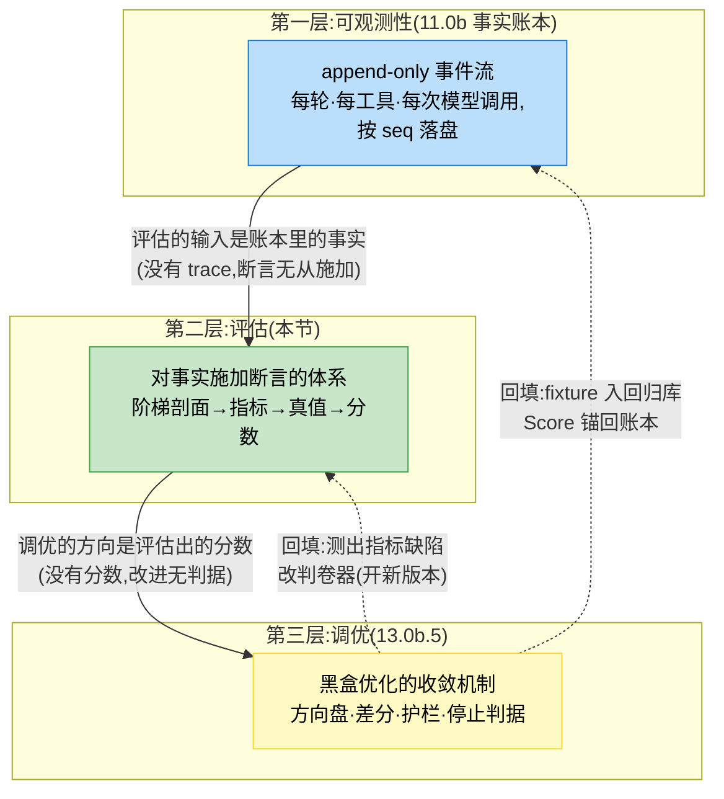
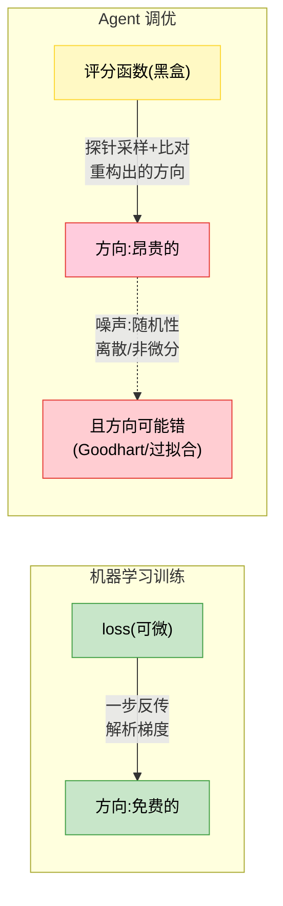
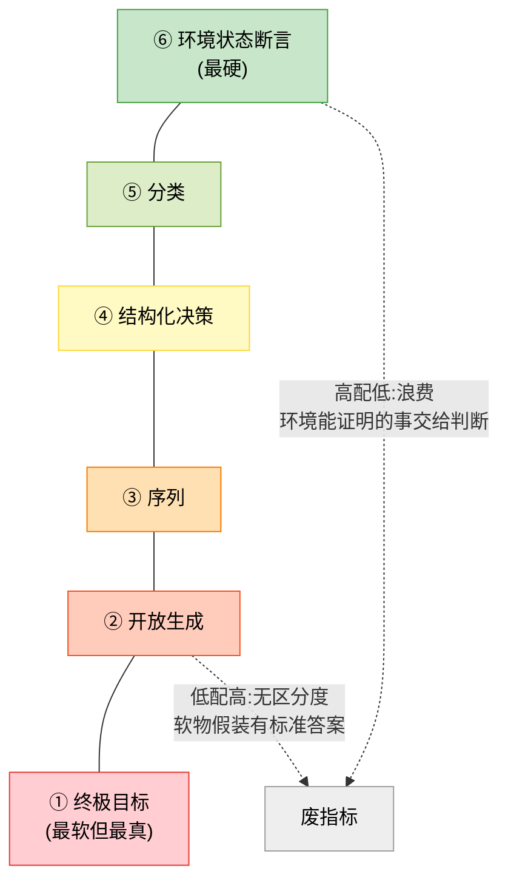
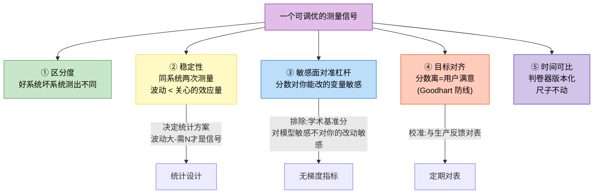
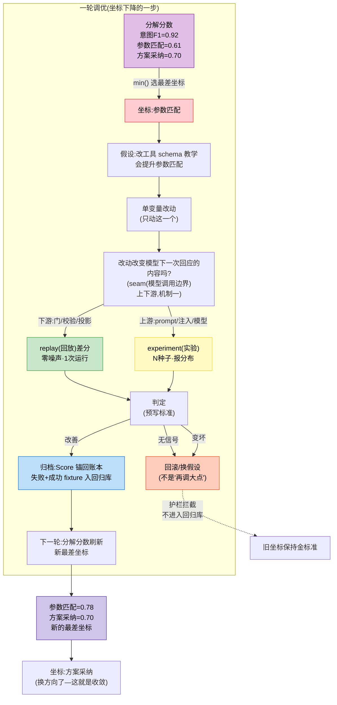
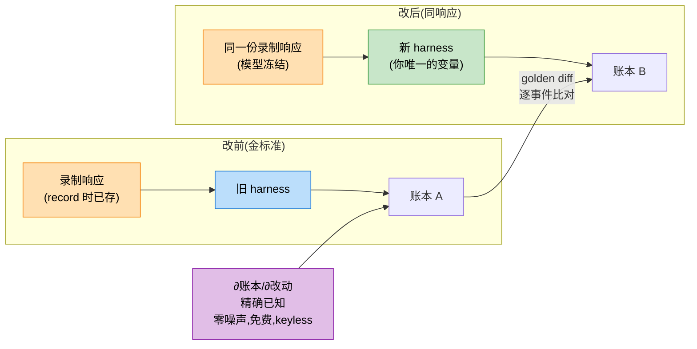
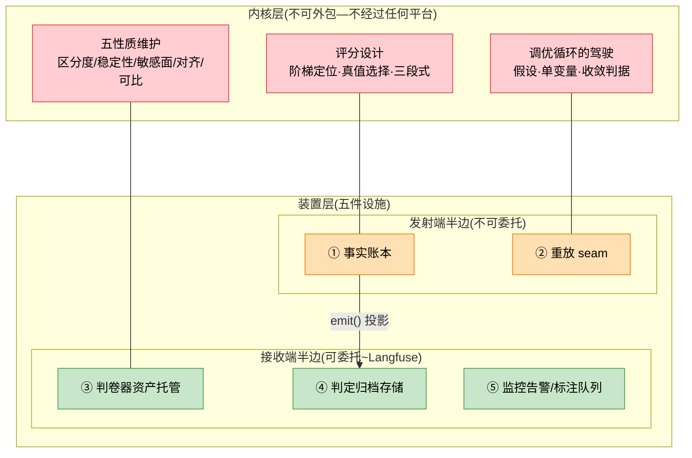
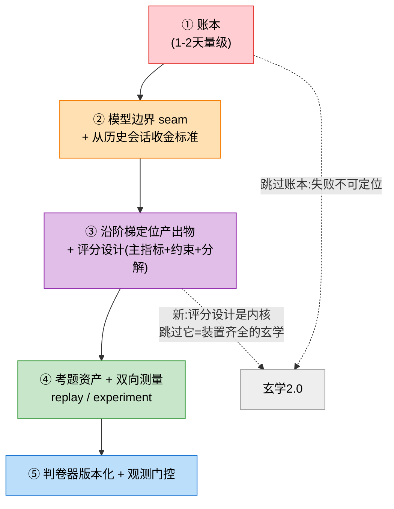

# 13.0b 可评估性的本质：从玄学到可收敛的调优

> 本节是第十三章的地基，地基在 11.0b（可观测性的本质）——那里立了事实账本（append-only 事件流：每轮、每工具、每次模型调用，按序号 seq 落盘的原始事实），这里立"对事实施加断言"的体系。13.1–13.5 讲教学化的三层指标/端到端测试/学术基准/持续评估，本节先回到第一性原理。

> 源码实证四份：Langfuse（接收端装置的完整产品形态）、dsh（重放与回归防线的纪律）、Codex（轮次解剖）、CC（全量重算）。但本节主战场是方法本身——源码标注在论断处。

> 第二轮修订，由首批实践样本反哺（挽留 Agent 评估方案第一个照本节落地的设计），其暴露的问题与读者的复述误差一起定位了六处缺陷：①词汇脊梁换血——"测量"升为全章通称，"分数"保留给数值判卷层；②replay（响应录制回放）定义改为 seam（模型调用边界）上下游切分（原"harness 侧"二分在实践域上崩溃）；③主指标增加真值节奏判据与代理链；④⑥层环境真值补对照组例外；⑤螺旋指标坐标选择的条款；⑥结构修复（四处契约约束表/四问流水线表述/各节回钩/合并重复循环圈）。第三轮：全文术语过扫——源码/统计黑话（录制与金标准、fixture 固定测试案例、种子、开环控制、信号判定门槛、留出集封存库、invariants 不变量断言、OTLP 开放遥测协议……）首现处就地补一句大白话定义（指称病的全面修复；rubric/pairwise/judge 三零件是第一处）。

## 13.0b.0 层级地图：可观测性→评估→调优，栈与回填环

本节讲的一切，坐在一条三层依赖链上。先把链立成论断，再看每层的战略/战术分账——**没有这张地图，后面的内容是散件；有了它，每一节都知道自己在替谁打工。**

> **论断（依赖单向）：可观测性是评估的基础，评估是调优的基础。账本塌了，评估在对空气断言；评估塌了，调优回到开环玄学。** 反向不成立——调优不产出账本也能跑（跑成玄学），评估没有调优仍是有效资产（它照样能告诉你"现在多差、差在哪"）。



图 13-01：三层依赖线与两条回填环。**实线是栈：依赖单向，下层塌上层废；虚线是环：调优的产出回填下两层**——回归库让账本长出防御性资产，对表让评估体系自我修正。只画栈会丢掉"评估体系是活资产"这半边（13.0b.4 末尾），只画环会忘掉"下层不支上层什么"。本节主体在第二层，但三次跳到第三层（.4 性质、.5 全书）——因为**评估设计的每一条判据，都是被"将来要当梯度用"这个下游需求逼出来的**：五性质全部是对着调优的反问（分数能指路吗/会飘吗/对杠杆敏感吗/指向真目标吗/跨版本可比吗）。

每层的战略/战术分账（战略=建立认知与判定标准，战术=可执行的工序与武器；**只讲战略是正确的废话，只有战术是套模板**——本书两层都要，且战术体系化）：

| 层 | 战略（认知） | 战术（武器库） |
| ---- | ---- | ---- |
| 评估 | 无解析梯度论断（.1）·量化阶梯与错配判据（.2）·真值来源排序与三段式组织（.3）·可调优五性质（.4） | **剖面探测六卡程序（.2）·常见指标名录（.2）·评分设计三决策（.3）·rubric 五步造法（.3）·五性质预检法（.4）** |
| 调优 | 黑盒优化=坐标下降，收敛轨迹的形状（.5） | **杠杆清单（.5）·replay/experiment 判定式与 min_gap（.5）·方向盘+螺旋条款（.5）·护栏三触发+停止判据（.5）·落地五步与 SOP（13.0c/13.0d/13.2b）** |

这张表同时是本节的阅读地图：先战略后战术是写序，实际开工时战术在前（剖面探测第一天就能做，战略判据在战术撞墙时回来翻）。

## 13.0b.1 出发点：调优为什么需要评估——把玄学解剖开

一位工程师（本书对话者）去年做了一个 Agent：意图识别 → tool_call → 输出方案。没有评估体系，调优过程的自述原话：**完全是玄学**。这不是谦虚，是精确的技术描述。把"玄学"当病理解剖，四个可指名的病灶：

| 病灶 | 表现 | 机制 |
| ---- | ---- | ---- |
| ✅信号噪声不可分 | 成功率 40%–55%，不知是改动的功劳还是运气 | 信号=你想测的真实效应（"改动真的有效"）；噪声=一切让单次测量偏离真实效应的随机抖动（模型这次手气好、考题恰好抽到擅长的）。每个观察数字都是两者之和，而单次实验（N=1，只跑一遍）没法拆开——变量与运气混在同一份涨落里 |
| ✅多变量不可归因 | prompt、工具描述、调度、裁剪一起改 | 涨了不知归谁，跌了不知冤枉谁——每轮调优都是多变量实验 |
| ✅失败不可定位 | 任务失败只知道"失败了" | 意图识别错了？工具选错？参数拼错？方案本身就是坏的？——没有事实账本，失败是黑箱 |
| ✅改进不可保 | 今天修好 A，上周的 B 悄悄坏了 | 没有回归防线，改进不沉淀，同一个坑反复踩 |

前两条让调优**没有方向**，后两条让调优**没有记忆**。

理论语言一句话：这是**开环控制**——没有反馈回路的控制；改了，不看结果，接着改。调优类比机器学习（用户的原话："就像梯度下降，起码要给定一个方向"）——但 Agent 调优与 ML 训练有一个决定性差异，这个差异塑造出本节的一切：

> **ML 训练有解析梯度**（梯度="参数往哪个方向调会更好"的数学答案；解析=有公式一步算出，不用试）：loss 对参数可微，一步反传就得到改进方向。Agent 调优的"参数"（prompt 文本、工具描述、调度策略）是离散的、非微分的，且系统含随机性——没有解析梯度，只有黑盒。所以**评估体系在 Agent 调优里扮演的角色，远比 loss 函数在 ML 里重：它不只是测量，它是梯度的替代品**——用采样和比对，把"往哪走"重构出来。



图 13-0a：ML 有解析梯度，Agent 调优必须用评估重构方向——评估体系=黑盒优化里的梯度机制。

这个差异推出本节的结构。

> **结构：四个问题是一条流水线，不是四个专题。** 每一问消费上一问的产出——选错了尺，后面的刻度白刻；刻度立不住，验尺必然失败；尺没验过，拿着它走路就是玄学换了套行头。而第一问内部还有一个不能跳的前置次序——**先分层，后配手段**（先把产出物沿阶梯定位，再谈每层配什么测量）；跳过分层直接配手段，就是拿着 judge 评测试、拿着 exact match 评方案的点菜式错配（错配方向见 .2）。


图 13-0a2：四问流水线——每一问消费上一问的产出；后面三节（装置层 .6 / 落地路线 .7）是流水线的收尾，不占问的位置。

**术语卡。** 下面契约表和 .5 节要用四个词，各配一句话指称，后文一律中英对照——细节在 .5 机制里。位置原则：**卡贴着第一个消费者做，不能前**——定义要在读者心里挂着问题（这病灶拿什么还）时才讲得进去，提到开篇就成了词汇囤积（原段"太密集"的病根之一）：

| 词 | 一句话指称 | 细节在哪 |
| ---- | ---- | ---- |
| **replay（重放）** | 把真实模型响应录下来、反复回放——重放时不调模型，harness 代码照常跑，你的改动成为系统里唯一变量 | 机制一（.5） |
| **experiment（实验）** | 固定一批考题真值 N 遍，看分数的散布，不看单次分数 | 机制二（.5） |
| **分解分数** | 不合成总分、并列报告的各维度分（意图/参数/方案各一个） | 机制三（.5） |
| **回归防线** | 一套固定的好/坏案例，每次改动后重测，专防"修好 A 坏了 B" | 机制四（.5） |

> **然后立契约：四病灶在哪一问还债。** 13.0b.1 解剖出的四个病灶，本节开局承诺各自的解药在哪一问兑现，后面每一节回来对账：

| 病灶（欠的债） | 还债的问题 | 还债的机制 | 兑现位置 |
| ---- | ---- | ---- | ---- |
| 信号噪声不可分（观察值=真实效应+随机抖动，单次拆不开） | 尺能不能当梯度 | 先测指标自身抖多少（min_gap=判"变化是真信号"的门槛差值），差值不够就判"测不出"——不调框 | .4 性质② / .5 机制二 |
| 多变量不可归因 | 拿着梯度怎么收敛 | 分解分数指出最差的那一维，一次只改一个变量 | .5 机制三 |
| 失败不可定位 | 行为怎么变成测量 | 事实账本（11.0b）+阶梯分层定位 | .2 / 11.0b |
| 改进不可保 | 拿着梯度怎么收敛 | 回归防线拦截变坏的改动+明确的停止条件 | .5 机制四 |

四问答完，最后两节收尾：装置层（13.0b.6，内核的载体）与落地路线（13.0b.7，开工顺序）。

## 13.0b.2 行为怎么变成测量：量化阶梯

> **本节还病灶三的债（失败不可定位）的坐标轴**——先把失败拆到层，才能谈到哪一层修。

"将 Agent 的行为可量化"，但**量化不等于打分**——多数层的正确量化手段恰恰不是分数。第一件要承认的事：**Agent 的产出物不是一个类型，是一个阶梯**——用那个 Agent 的三步（意图识别 → tool_call → 输出方案）举例，每层的量化手段完全不同：

| 层 | 产出物 | 数学形态 | 量化手段 | 硬度 |
| ---- | ---- | ---- | ---- | ---- |
| 6 | 任务最终结果（文件改对了/测试过了/单下没下成） | **环境状态断言** | 二值；环境自己能证明（跑测试/查数据库/比对文件差异） | 最硬——不需要任何判断者 |
| 5 | 意图识别结果 | **分类** | label 对照；confusion matrix、逐类 F1 | 硬——有标准答案 |
| 4 | tool_call | **结构化决策** | 三层拆：选对工具（label 对照）→参数匹配（结构对照：路径真不真、类型对不对、值在不在合法域）→执行成功（环境反馈） | 中——参数就有"部分正确" |
| 3 | 调用轨迹 | **序列** | 冗余度/顺序合理性/错误恢复率（有参照轨迹时） | 中 |
| 2 | 方案/文本输出 | **开放生成** | exact match 无用；只用 rubric 维度分、pairwise 偏好、judge | 软——没有客观裁判 |
| 1 | 用户体验 | **终极目标** | 采纳率/修改率/满意度/复用率 | 最软但最真 |

> 六形态骨架（分层标准的全谱，通用坐标系的本体）——⑥向①背诵：**⑥环境状态断言 → ⑤分类 → ④结构化决策 → ③序列 → ②开放生成 → ①终极目标**。上表的"数学形态"列竖着读容易丢，齐排在此：分层认的是这六种形态，手段是认完形态后查表配的——**把②记成"偏好"是本节最常见的误读（偏好是②的手段之一，形态是"开放生成"），根子在这列没有对齐的占位。**

> ✅核心论断（阶梯配对）：可评估性的第一本质，是给每一层产出物配上它那个层级配得上的量化手段——能用断言的地方别用打分，必须打分的地方别假装标准答案。

错配的两个方向，每种都是废指标：

- **高配低**（硬的当软的评）：拿 judge 评"测试过没过"——把环境能零成本证明的事交给人/模型主观判断，引入噪声、成本、不一致，什么都没换到。
- **低配高**（软的当硬的评）：拿 exact match 评"方案输出"——永远 0 分或碰运气满分，无区分度（废仪表）；拿单标量评 tool_call（"这次调用 0.7 分"）——丢了参数级的部分正确结构，该修哪也读不出来。



图 13-0b：量化阶梯与错配的两种废指标（自上而下；判断者从"无"到"人"；层级判断错了，指标就废）。

这个阶梯同时回答"评估方案怎么设计"：**先把 Agent 的产出物沿阶梯定位，量化手段就跟着定了**——不是先选工具（judge？打分？diff？）再套上去，而是先认产出物的形态，再取手段。用户的 Agent 定位：意图识别在 ⑤、tool_call 在 ④、方案在 ②——三个不同层，三套手段，不能一刀切。

但这句话只回答了"怎么判定一个评估方案对不对"（判定器），还没回答**我的 Agent 拿到手，怎么拆**（生成器）。先立一条总线再给程序。

> **总线纲领：阶梯是通用坐标系，剖面是案例坐标。** 六层的分层标准是产出物的**数学形态**（环境状态/分类/结构化决策/序列/开放生成/终极目标），不是 agent 类型——形态是一个封闭分类学，且"形态→手段"映射（断言/label 对照/三层拆/比对/rubric·pairwise·judge/行为率）与域无关。这句话展开就是一张分账表：

| 装的是什么 | 举例 |
| ---- | ---- |
| ✅固定件（换 agent 不用重设计） | 六层位与形态标签、错配两列判据、形态→手段映射；④的内部三层拆（选工具/参数/执行——任何用工具的 agent 原样适用）；②的三零件装置（rubric 刻度/pairwise 问法/judge 判卷员——**结构固定，内容**逐例）；⑥环境自证；三段式组织 |
| ✅逐例件（每个域必须重做） | **占位剖面**、各层交付物与真值的**内容**；**真值成本剖面**。占位：无工具的 agent 没有④③，纯分类 agent 只有⑤；内容：⑤的 label 集、⑥的测试维度与锚、判卷器逐案词表；真值成本：每层真值谁付钱、多久回 |

两个常见质疑，各用一句话先回应（细节在后面）：

- **固定件不就是正确的废话？** 不是。它是下面生成程序的执法依据——没有"认形态、错配即废"，程序里"这层配什么手段"就没有判定标准。
- **逐例件是玄学？** 不是。它有结构——下面的六卡程序把它变成填表。

> **坐标系凭什么普适（不是本书偏好）？** 两条独立领域的收敛证据，加上一条结构原因：

| 证据 | 内容 | 说明什么 |
| ---- | ---- | ---- |
| 机器翻译的十年弯路 | 早年拿 n-gram 精确匹配评开放生成（低配高），整个领域花了十年迁移到 pairwise/judge | 不同领域独立走到阶梯预言的位置——映射是规律，不是偏好 |
| SWE-Bench 的选择 | 停在⑥让环境自证（跑测试），没有雇 judge | 硬层不雇判断者——⑥原则在另一个域的原样复现 |
| 结构原因 | 阶梯=turn 循环各阶段（决策→调用→轨迹→产物→结局→人的反应）按测量硬度的重排 | 循环是 harness 的通用结构（第四章），它的测量影子就通用 |

> **固定件为什么必须固定（承五性质⑤时间可比）？** 性质⑤要求跨版本比较时坐标系不动——replay diff、回归防线全部建立在"阶梯不变"上。若拆分本身 case by case 到每次重拆，你每次都拿新尺子量旧长度，13.0b.5 的黑盒优化机制整体垮掉。**通用的不是拆分结果，是拆分规则。**

> **程序：剖面探测（拿一次真实 trace，填六张卡）。** 这一步产出 13.0c SOP 第③步"评分设计"的输入——两份剖面文档。输入是一次真实运行的完整 trace：**不能只拿 PRD，PRD 描述意图，trace 才暴露真实产出点**（PRD 写"智能挽留"，trace 里才看得见它到底产出意图标签还是只有话术）。没有已上线的系统就手工模拟一次。走查方法：沿 turn 循环走一遍，凡 agent 对外做出一个动作、或世界因此多了一件可查的事，记一个**产出点**，归入六卡。每张卡填三项：

| 卡 | 问什么 | 交付物指称举例（挽留域） | 真值成本项 |
| ---- | ---- | ---- | ---- |
| ⑥终态卡 | 任务结束时环境里有什么可查的？ | 单下没成/当月续保状态 | 谁付钱验证、多久回——测试近乎免费即时，市场结局且 T+30 |
| ⑤分类卡 | 有没有"从几种里选一种"的决策？ | 意图分类（价值怀疑/成本抱怨/知情缺失） | label 集、谁标、多少条 |
| ④调用卡 | 每次工具调用，三折各问一遍 | 选对工具/参数（路径·类型·值域）/执行成功 | 账本 isError 即真值，免费 |
| ③轨迹卡 | 多轮序列有参照轨迹可比吗？ | （挽留域；无参照） | **没有就显式记"空"**——空是合法占位，配了指标才是错 |
| ②输出卡 | 给人看的东西，先挖机器可判子集 | 话术里的数字可溯/违禁词→结构断言；余下才配 rubric | 三零件内容逐例 |
| ①行为卡 | 任务结束后人的哪个行为算好？采得到吗？ | 商家采纳/修改/忽略 | 行为采集口径 |

六卡合成两份剖面：**占位剖面**（哪些层占、哪些层空）与**真值成本剖面**（占的层各花多少钱、多久回）。然后主指标落位——落在"真值节奏与调优循环节奏匹配"的那层（13.0b.3 判据），三段式在此成型。两处边界要人判断：③的手段是阶梯里最未定型的（序列拿什么比——process vs outcome 之争仍在打，映射说"用比对类手段"成立，具体比什么开放）；①与⑥的分界在有的域模糊（写作类 agent 的⑥很薄，环境证明不了草稿好不好，①才是真终点——这是话术类域评估天生难于代码域的结构性原因）。

> **程序的自证（回放校验）。** 这个程序不是另拍的，是对已落地的 13.0d 判卷设计反向显式化，再拿考场 trace 回放：⑤意图卡（标签=expected_tools）→ `intent_hit_rate`；④调用卡（账本 isError+call/result 配对）→ `tool_pair_rate`/`tool_error_rate`；②输出卡的机器可判子集（数字可溯+违禁词）→ `redline_score`；⑥模拟环境自证；③空（无参照轨迹）；①空（考场无用户）。六卡输出与 exam.py 实际四件判卷器一一对应，程序自洽。你的域照此填一遍，得到的应该就是"你的 exam.py 该有什么判卷器"的答案。

> **与 13.0c.2 零件盘点的分账：零件盘点**供给侧（这个域已有哪些评估资产——对照组/回测/晋级门槛），剖面探测盘**需求侧**（该测什么）。两表对齐，盖不住的格子=要新建的——这正是 13.0c"先盘点再补缺口"原则的通用化。

> **常见指标名录（阶梯索引的弹药对照表）。** 剖面填完，各层该配什么指标是接下来的问题。下面是业内常见的弹药，按层索引——**使用纪律：先剖面后名录。禁止拿着名录直接点菜**（脱离剖面的"我们也搞一个采纳率"正是"没有认知只会套模板"的形态；名录的价值是让你知道每层有什么现成弹药与已知坑，不是替你做剖面探测）：

| 层 | 指标 | 真值来源 | 已知坑 |
| ---- | ---- | ---- | ---- |
| ⑥ | 任务成功率（pass rate） | 环境自证（测试/订单） | 封闭环境外需对照组（开放市场动作塑造环境） |
| ⑥ | 留存/复购（d30 retention） | 环境自带，T+30 | 慢真值——天级循环吃不到，须代理链 |
| ⑤ | 逐类 F1 / 混淆矩阵 | 人工标注集 | 标注集漂移（任务分布变了，旧标集失真） |
| ⑤ | 置信度校准（自报高置信单成功率-低置信单成功率） | 环境自带 | 校准本身会随模型更新失效，须重测 |
| ④ | 工具选择准确率（label 对照） | 预期序列（考题） | 预期序列本身是假设——先证明"好 agent 就该这么调" |
| ④ | 参数匹配率（逐参数部分得分） | 结构对照（路径真不真/类型对不对/值域） | 拆得不够细就退化成单标量（丢部分正确结构） |
| ③ | 执行成功率 / 错误率 | 账本 isError | **负向指标，不进方向盘**（13.0d 翻车三） |
| ③ | 冗余度（调用数/理想调用数） | 参照轨迹 | 无参照轨迹时不可定义——记"空"别硬配 |
| ③ | 错误恢复率（出错后几步内自纠） | 账本统计 | 需要显式定义"恢复"状态机，否则判不出 |
| ② | rubric 多维分（下文五步造法） | rubric+判卷员 | 无锚刻度不稳；未校准 judge 是没刻度的尺 |
| ② | pairwise 胜率（新旧 A/B） | 判卷员（人或校准过的 judge） | 位置偏差（随机化可消）/冗长偏差（校准才测得出） |
| ① | 采纳率 / 编辑率 | 隐式反馈 | **Goodhart 高危**（哪哪采纳=有效一维链条伺候） |
| ① | 满意度（CSAT） | 用户直报 | 回收率低且有偏（极端体验者才投票） |
| ⑥ | 成本类（单任务 token/$） | 账本统计 | 当约束不当主指标——min 它会优化成"啥也不干" |

名录不是全集，是常用层的覆盖——⑤④②①的弹药密度天然高于③（③的手段最未定型，见剖面探测的边界说明）。每条弹药装填前过一遍五性质（.4），尤其是③敏感面：**这个指标对你能改的变量敏感吗？**

## 13.0b.3 什么是好、给多少分：评分函数的设计

阶梯定了每层"用什么手段测"（上一问的产出），这一节把手段具体化成可执行的评分设计。三个决策，依次是：真值从哪来、分怎么打、**测量结果怎么组织**（第三个决策是本节新增的正位——它曾以"反面教材批判"的形态在本节末尾，现升格为第三个正式决策，因为它是后续坐标下降的前提）。

已知系统性偏差点名：pairwise 时偏好第一个位置（位置偏差——位置随机化可消）、偏好长答案（冗长偏差）、偏好像自己输出风格的答案（自我偏好）——后两个只有校准时才测出来有没有。

> **三件合起来读：** rubric 定刻度，pairwise 定问法，judge（或人）当判卷员——②层的评估设计，实际就是这三个零件怎么组合。**运行示例的落地形态：方案输出用 rubric（三维度带锚）+新旧 pairwise（首选协议）+judge 顶量（先对人的判例校准，一致率达标才允许独立判）。**

> **rubric 怎么造：五步工序，拿挽留话术完整走一遍。** 上面的表给了 rubric 的定位（刻度表）与工艺要点（锚定/下沉），但"定位"不等于"会造"。工序如下，每步带运行实例的实物——**这是②输出卡从"空"到"可判卷"的完整建造过程**：

> **第 1 步：从剖面出发，圈定判卷对象。** ②输出卡问"给人看的东西是什么"——挽留话术（一段 200 字左右的给商家的挽留文案）。**别跳过这步直接写维度**：判卷对象不同（话术/代码/报告/邮件），维度完全不同；对象含混（把"话术+作战卡+跟进建议"当一个整体判），锚就没法写。

> **第 2 步：维度从失败模式来，不从美德清单来。** 坏 rubric 的写法是罗列"专业/清晰/友好/有说服力"——美德清单，每条都好，没有一条可执行。正确问法：这段输出会以什么方式失败？挽留话术的失败模式：数字空壳（合规事故）→承诺越线（监管风险）→通用模板没提商家实际数据（专用不）→档位错位（超赔商家上最足药=赔付恶化）。失败模式各转成一个维度——**数字可溯/无红线/针对性/档位匹配**。这条工艺的判定标准：每个维度都能指出"违反它的具体句子长什么样"，指不出的维度回炉。

> **第 3 步：每个维度写分锚档——给每档贴"长这样"的照片。** 三档起步（1=不可交付/3=可用/5=优质），每档写**锚定描述**（该档输出的具体样貌），不是程度副词。以"针对性"维度走全三档：

| 档 | 锚定描述（照片） |
| ---- | ---- |
| 1 | "感谢您的支持，我们非常重视您这样的优质商家——"任何商家名替换后照样成立，未引用该商家任何数据 |
| 3 | "您店铺 90 天赔付率 1.18，高于同类目均值"——引用了该商家真实数据，但止于报数，没把数据接回商家的抱怨点 |
| 5 | "您提到理赔慢——90 天赔付率 1.18，餐饮类目理赔平均时效 5 天确实偏长；但您店铺动销正常，综合损益测算月贡献 +1600，续保的价值点在这"——数据+接回抱怨原文+给出损益结论 |

锚要写到**判卷员照着能复现**：把两份不同的话术给两个判卷员，同一维度各自独立打分，分差应在 1 档以内——做不到就是锚还没到位（这是 rubric 版的性质②，判卷员间一致率是它的测量法）。

> **第 4 步：机器可判维度下沉，别浪费人。** 逐维度问：这个维度能不能写成结构断言？四个维度里两个能——**数字可溯**（话术里每个数字对回某条工具结果，13.0d redline 判卷器已实现）与**档位匹配**（规则表硬查）。下沉后 rubric 只剩**针对性**（和残余的**无红线**——违禁词机器查，但"擦边话术"仍需人）两个维度归人/judge。**下沉顺序在判卷之前**：先下沉再校准，否则校准花在机器本来就能判的维度上。

> **第 5 步：校准闭环——rubric 上岗前量它自己。** 拿 20 份真实话术（好/中/坏各占），两位专员独立按 rubric 判：①判卷员间一致率高（分差≤1 档的比例≥80%），rubric 本身合格；不一致的维度回第 3 步修锚。②若引入 judge（判卷量大，人判不过来）：先拿这批**人判过的锚定集**喂 judge，量人机一致率，达标（如 ≥85%）才许独立上岗——judge 三纪律在此落地。③版本化：任何改动开新版本号，新旧分不可直比（性质⑤）。

五步走完的实物：一份 4 维度（2 机器判+2 人判）×3 档带锚的 rubric + 一份 20 例锚定集 + 一致率记录——**这组遗产就是②层的刻度盘**，pairwise 用它当问法依据，judge 用它当 prompt 骨架。换域照工序走，五步一个都不能省：省第 2 步得到美德清单，省第 3 步得到不稳定刻度，省第 4 步浪费校准预算，省第 5 步得到没校准的尺。

> **然后是"给多少分"的结构设计。** 这里必须点一个反面教材：教学版 13.1 的 `overall_quality_score`。**它把四层指标加成一维：任务成功率×0.4 + 轨迹效率×0.3 + 步骤准确率×0.2 + 成本×0.1。** 两个致命伤：

1. **权重是拍的**——0.4/0.3/0.2/0.1 没有任何依据，换个人拍出另一组，调优方向就变了。
2. **合成即失忆（标量没有方向）**——总分离目标很远时，你从 72 分读不出"是意图识别烂还是参数匹配烂"。分数被加权平均压缩成标量的那一刻，**它就失去了指路能力**——你只能知道"不好"，不能知道"哪里不好"。

> **正确结构：主指标 + 约束，不合成。** 把你最在乎的一个维度当 loss（朝它优化），其余维度当约束（不超过阈值即合格）：

```
maximize  任务成功率                          （主指标:唯一被优化的量）
subject to
    p99延迟 < 10s                             （约束:守住,不参与优化）
    单任务成本 < $0.05                        （约束）
并列报告: 意图F1 / 参数匹配率 / 方案采纳率      （分解:诊断用,不合成）
```

三段各司其职：主指标给方向，**约束守住不可牺牲面**，分解保持"哪里不好"的可见性。多目标加权合成是把方向盘、护栏、仪表盘熔成一个疙瘩——三个功能全废。

三段式还有一条来自实践的判据（首份落地设计暴露的）：**主指标的真值节奏必须与调优循环节奏匹配。** 循环一轮以天计，若主指标的真值要 T+30 才回写（留存、复购、市场类结局），循环吃到的永远是旧信号——⑤预写标准验收"悬空"。解法不是换掉慢真值，是**显式画代理链**：沿"快的代理→慢的真值"把链条写下来（例：采纳→当日挽留→d30 留存→d90 留存），每环注明对表周期（快环对慢环的相关性多长时间校一次），**优化快环、对表慢环**。性质④（Goodhart 对齐）在链条形态下有了精确的执法对象：代理漂移=链条某一环的相关性掉，对表要逐环做，不是只对终端。

## 13.0b.4 分数凭什么能当梯度：可调优测量的五条性质

13.0b.3 造出的测量，不是天然能当调优方向的。用户说"调优起码要给定一个方向"——把它形式化：**一个测量信号要能提供方向，必须过五条检验。这五条是本节的中心论断**（"测量信号"通称全阶梯——断言的二值、结构对照、偏好对、分数，都过同一组检验）。



图 13-0c：可调优分数的五性质——②决定统计方案，③决定指标选择，④决定校准节奏。

> **① 区分度**：好系统和坏系统测出来必须不一样。全 85 分的指标是仪表不是梯度——它度量了某物，但度量物与你的目标无关。检验法：拿你已知好/坏的历史案例（去年的成功/失败会话）测一遍，分数拉不开就废。

> **② 稳定性**：同一系统两次测量，波动必须小于你关心的效应量（效应量=你想检出的变化有多大，如"15 个点的提升"）。**这条直接决定统计方案**：40%–55% 在指标固有波动 ±10% 时是噪声，在 ±2% 时是信号——同一份数据，结论相反。稳定性差的指标意味着每次结论需要大 N（多种子/多任务）支撑；稳定性好的（如 replay[重放，见契约表速览]的确定性 diff[差异比对]——同一份录像两次重放，结果逐字节相同）一次即结论。**先测指标的稳定性，再设计实验的规模**——顺序反了，实验该跑多少遍就成了拍脑袋。

> **③ 敏感面对准可操控杠杆**：分数必须对**你能改的变量**敏感。这条最容易被忽略，因为它排除的是"看起来最权威"的指标：学术基准（SWE-Bench/GAIA）对模型能力敏感，对你的 harness 改动迟钝——**SWE-Bench 涨了不告诉你你的工具描述哪里能改**。拿它当调优方向=有指标、无梯度（方向指向你没有杠杆的地方）。检验法：改一个你确信有效的小改动（比如修一个已知 bug），分数应该动；完全不动说明敏感面没对准。

> **④ 目标对齐（Goodhart 防线）**。Goodhart 定律先定义：**当一个代理指标成了优化目标，它就不再是好指标**——你优化的是尺子上的数，不是尺子本该代表的那个东西。放在本节：一切可量化指标都是代理（分数代理"用户满意"），代理会漂——分数上去了用户没爽，你就优化了指标而不是目标。校准手段：**与生产反馈定期对表**——"对表"=拿真实世界里慢一档但更真的信号（采纳率/负反馈率），定期算它们与评估分的相关性（两个数同涨同跌的程度），相关性掉=代理漂了=指标该换。这就是"生产考场"（Langfuse Monitor / dsh postmortem，生产环境的持续监控）在方法论层的真正用途：**不只是告警，是给指标本身做健康检查**。

> **⑤ 时间可比**：判卷器必须版本化（判卷器=产生分数的那套规则——含人读的 rubric、机器判的代码、LLM judge 的 prompt；**换判卷器=换尺子**），新旧刻度不可比。Langfuse 的判卷器模板用 `@unique{projectId, name, version}` 强制每次改动开新版本号，是产品级解法。尺子动=等高线动=你在追移动目标。改判卷标准=开新序列，新旧分数不可直接比，必须重判一批历史做桥接。

> **五性质合起来读**：评估体系的建设，说穿了就是构造并维护满足这五条的测量方案族（从断言到 judge 的全阶梯）。**维护是持续动作**：④要定期校准（代理链形态下逐环对表）、⑤要版本管理、①②随系统成熟重测——**测量方案本身是活资产**，不是搭完就完的设施。

## 13.0b.5 调优怎么收敛：没有解析梯度的黑盒优化

前三问答完（尺选了、刻度了、尺验了），最后回答"调优是什么"：**基于现状、朝着目标的收敛过程**——但收敛机制要按黑盒优化的实际来构造。先看全局，再拆四件机制。

#### 全局：一条收敛轨迹长什么样

调优循环的骨架借自数值优化里的**坐标下降**：多个维度纠缠时，不试图同时改全部——每轮只挑一个维度（坐标）改进，其余冻住；下一轮再挑下一个最值得改的。把整个循环画出来，调优的"形状"就固定了——每一步的落点由分解分数决定，每一步的对错由 replay（重放）/experiment（实验）判定。



图 13-0d：坐标下降的一轮与收敛的推进方式——**每一步的"改哪里"由 min（分解分数）决定，"改对了没有"由差分/分布判定；"无信号"走回滚，不走"再调大点"**。右下角的 A2 是收敛的标志：最差坐标换了（参数匹配修完，方向盘转向方案采纳）。图内 Score=得分记录、fixture=固定测试案例、回归库=fixture 的集合，文字定义见下文"完整循环"段。

注意图里两条容易被忽略的边：**"无信号"→回滚**（"再调大点"是玄学的最后藏身处——信号都没有，加大力度只是加大噪声）和**护栏拦截**（变坏的改动进不了回归库，旧坐标的金标准保持——病灶四在这里被物理拦截）。四件机制逐个拆开：

#### 机制一：replay（重放）= 零噪声的有限差分（治病灶一）

数值优化里求梯度的笨办法：改一个坐标、冻住其余、测函数值变化——**有限差分**。replay 把这个办法做到零噪声。先把 replay 本身说清（契约表里的一句话版在此展开）：**正常跑一次 Agent，真实模型响应被原样录下来存档（record，录制）；之后每次重放（replay）都喂这份录制响应，harness 代码照常执行，但模型不再被调用**——于是"模型的随机性"从系统里被拿掉，你改的代码成为唯一变量。两个配套词：**金标准** = record（录制）时存下的那套"输入响应 + 对应账本"，是日后比对的基准；**keyless（不读密钥）** = 重放不读 API key（不花钱，也保证"尺子与测量分离"）。结构：



图 13-0e：replay 差分的结构——随机性只有一个进口（模型边界），seam 堵住它，改动成为系统里唯一变量。

它的可跑形态在 13.2b.4（`golden_diff`，lab 里真实引擎跑通）：改动效应 = 账本的逐事件比对（每条记录逐字段对），精确到行。dsh 的操作纪律：record 花真实 API 配额**强制串行**（两个录制并行写金标准会互相覆盖）、replay 不读 key**免费且可并行**、金标准只在 record 时写（**尺子与测量分离**——dsh 原文级纪律："Replay/refresh never load .env; only record reads a key"，即"重放永不加载密钥，只有录制读 key"）。

**边界要说透：replay 的失效面。** 初版这里写"定义域是 harness 侧改动"——**这个二分在第一个实践域上就崩溃了**（首份落地设计里，注入逻辑与 remedy 生成都是 harness 代码，却都作用在模型输入侧）。正确的切刀不在代码归属，在 **seam（接缝——所有模型调用都流经的那条可替换边界，provider 抽象层）的上下游**：改动在 seam 之前（塑造模型看到什么）=上游；改动在 seam 之后（消费模型已产出的输出）=下游。上游改动让录制响应失真，下游改动不碰模型输入：

> **判定式：这个改动改变"模型下一次看到的内容"吗？** 改变 → 录制响应作废，必须走 experiment（实验，真跑）；不改变（只消费模型已产出的输出——门/校验/投影/交付物组装）→ replay（重放）有效。

- **下游改动**（消费 LLM 输出：门规则、校验器、投影、路由、交付物组装）→ replay 有效 ✓
- **上游改动**（塑造 LLM 输入：prompt 构造、上下文注入、工具 schema 教学、remedy 文本、采样参数、模型本身）→ 录制响应不再代表模型对新输入的反应，**replay 无效** ✗

顺带把**调优杠杆清单**立在这里（评估名录的调优侧对偶——13.0b.2 的指标名录回答"测什么"，这里回答"能改什么"）。黑盒优化最忌拿着方向盘却不知道杠杆在哪：方向盘说"参数匹配最差"，你手里得有一张"参数匹配能从哪里改"的对照表。按剖面层索引，每条杠杆标 seam 侧与对应测量机制——**这是"改哪里"的弹药库，与"测什么"的名录配套使用**：

| 杠杆 | 层 | seam 侧 | 测量 | 说明 |
| ---- | ---- | ---- | ---- | ---- |
| 意图/分类的 few-shot（少样本示例）补例 | ⑤ | 上游 | experiment | 补历史失败案例是最便宜的意图改进 |
| 分类 prompt 重构 / 模型升级 | ⑤ | 上游 | experiment | 大动作，须 N 种子分布 |
| 工具 schema 教学（描述/参数示例） | ④ | 上游 | experiment | 模型选错工具/拼错参数的第一杠杆 |
| 参数校验器 + fail-loud（报错就响）文本 | ④ | 下游 | replay ✓ | 拦错误于门外，报错文本反哺下轮自我纠正 |
| 工具清单增删/合并（减少选错空间） | ④ | 上游 | experiment | 工具多了选错率高，少了能力缺——它是个优化问题不是加法问题 |
| 输出模板/交付物组装 | ② | 下游 | replay ✓ | 最安全的改动面 |
| remedy（补救指令）/话术 prompt 注入选材 | ② | 上游 | experiment | **最易误判处**：以为改了文案走 replay，其实模型没被调 |
| 判卷 rubric 维度与锚修正 | ② | 下游 | replay ✓ | 改尺子不是改系统——但必须开新版本号 |
| 门规则/红绿表/频控阈值 | ⑥/④ | 下游 | replay ✓ | 纯消费输出，秒级验证 |
| 代理链对节奏表调整 | ① | 下游 | replay ✓ | 评估体系自身的调优（性质④的执法） |

两条使用纪律：①**杠杆与失效模式对表**——方向盘指向哪个坐标，先查该坐标有哪些杠杆（如"参数匹配"差→schema 教学 or 校验器，一个上游一个下游，测量机制完全不同）；②**上游杠杆的比例决定实验预算**——你的杠杆清单里上游占七成，experiment（花钱）就是常态，replay 的"秒级免费"只属于下游三成。这张表在 13.0c.4 会以运行实例的判定表形态出现——那里的六行就是本表在挽留域的填法。

越界使用的危害形态要指名：改了上游，跑 replay → 模型根本没被调用 → diff 必然为空 → 判定"无信号" → 按纪律回滚——**一个真实有效的改动被体系亲手回滚**。假阳性只是误判，这是假阴性加自动撤销，体系用你自己的纪律打你，拿确定性的方法得出错误的确定结论，比噪声更危险。

顺带一个域观察：多数 harness 的主要改动面里，下游占相当比例（CC 的 4.2b 流水线里评审/critique 全在下游）——replay 的适用面依然很大；但**评估文档若不显式列出"哪些改动面在下游"，第一个上游改动就会击穿防线**。

#### 机制二：experiment（实验）= 有噪声的采样

改 prompt/模型（机制一末尾会讲为什么这类改动 replay 测不了），只能真跑：同一批固定考题，**N 个种子**各跑一遍（种子=随机性的一次独立取值，如采样温度/任务顺序的起点，换个种子输出就不同）；N 份得分放在一起看**分布**（不是单次分数，是分数的散布形状）。判"是不是信号"的完整判定式：

```
观察到的差: observed = 真实效应 + 噪声

判信号:
    |observed| > min_gap
    其中: min_gap > 指标固有波动(性质②的测量值)

固有波动哪来: 同系统同考题跑 N 遍,分数自身的极差/标准差
一先测这个,再设计实验,顺序不可反
```

一个数字例（把判定式走活）：某意图指标同系统跑 10 遍，**极差**（最高分减最低分，波动大小的粗估）= 0.06 → min_gap 定 0.08（留余量）。改动后新分布均值差 = 0.05 → **无结论，有效果但不显著**；只有 ≥0.08 的差才进入"变好/变坏"的判定。玄学病灶一（40%~55% 不知是运气）在这一步被形式化地终结：**"测不出"和"更差"是两个不同的返回值**（13.2b.4 的 `bea...`，把它做成 `None` vs `False`——返回 None 表示"测不出"，返回 False 表示"确实更差"，两种失败不同命）。

种子数怎么定：不是越多越好（judge/实跑都花钱），是**按 min_gap 反推**——要分辨 0.08 的差、波动 0.06，需要多少个样本才有把握。统计学的**功效分析**（power analysis，"以多大把握测出指定大小的效应"的样本量计算）给出答案；数学底线：N ≥ 5 才谈分布，极差当波动的粗估。

#### 机制三：分解分数 = 坐标下降的坐标选择（方向盘，治病灶二）

这是四件机制里唯一的**方向发生器**；回归防线是护栏（防变坏），分解分数才是方向盘（指出往哪修）。

用用户的 Agent（意图识别→tool_call→方案）演一遍完整的坐标下降，六个回合：

```text
回合1 意图F1=0.71 参数匹配=0.55 方案采纳=0.62 ← min:参数匹配
  动作:给参数加校验器 + fail-loud 报错文本(下游改动,replay 验)
回合2 意图F1=0.71 参数匹配=0.78 方案采纳=0.63 ← min:意图F1(坐标换了)
  动作:意图 few-shot 补历史失败案例(改 prompt=上游,须 experiment)
回合3 意图F1=0.88 参数匹配=0.77 方案采纳=0.66 ← min:参数匹配(又回来)
  注意:参数匹配掉了0.01—上一回合改 prompt 带来的回归!
  动作:不是继续修意图,是先查这0.01(experiment 按任务类型分组比对)
  —哪类任务的参数匹配掉了;replay 看不见上游改动的效应)
回合4 意图F1=0.88 参数匹配=0.79 方案采纳=0.67 ← min:方案采纳
  动作:方案层改判卷 rubric 或输出模板(下游,replay 验)
回合5 意图F1=0.87 参数匹配=0.79 方案采纳=0.75
  意图的0.01回落在噪声内(性质②的极差0.06)—无信号,不追
回合6 三坐标全部>0.85,相邻两轮 min 提升 < min_gap
  → 收敛判据满足,停(见机制四)
```

这个推演里四个此前没写透的要点：

1. **坐标会回来。** 回合3 参数匹配从 0.78 掉回 0.77——上一个回合的改动（改意图的 prompt）带出了别处的回归。坐标下降在耦合坐标系里必然发生这种事。发现靠**分解分数**（告诉你"哪里坏了"），定位靠**细比对的 experiment**——注意上游改动造成的回归 replay 看不见（模型没被重调），只有实验分组才暴露"哪类任务在新 prompt 下参数变坏了"。
2. **噪声内的波动不追。** 回合5 意图 0.88~0.87，在极差 0.06 之内——追它就是玄学复发。min() 只对**超出噪声的差距**负责（13.2b.3 的 `weakest_diagnostic` 在生产使用时应加这条阈值，lab 简化标注）。
3. **min() 的选择不是贪心的全部。** 它假设各坐标改进成本相同；现实中"方案采纳"可能要重构输出模板而"意图"只需加几个案例。生产形态是 **min（分数）打底 × 成本/收益人工重写**——方向盘给默认方向，司机道。这是"评估不替代判断"的又一处体现。
4. **嫌疑指标参与坐标选择要带对表条款**（实践反哺）。被性质④标记过嫌疑的指标（如采纳率——易被"顺嘴"污染）依然可以当坐标，但每次以它为坐标的改动，验收时必须附"该坐标与链条上一环的相关性现状"——嫌疑指标上对表通过前只算**临时胜利**，不进回归库的最终裁定。否则方向盘会被"好抄的坐标"绑架；嫌疑指标往往恰好是最容易涨的。

#### 机制四：过拟合与发散的防线（护栏，治病灶四；并给出停止判据）

三道防线，每道一个具体的触发条件和一个动作：

| 防线 | 触发（可观测的信号） | 动作 | 源码/方法坐标 |
| ---- | ---- | ---- | ---- |
| **过拟合**（系统把考题背下来了——考题分涨但真实能力没涨） | 考题集分数连续涨，生产流量分数平/跌（两条曲线分叉） | 换考题：封存一半考题当**留出集**（平时不拿来调优、只在关键节点考核用的封存题库）；从生产失败 case 采新题 | 留出集；性质④生产对表 |
| **代理漂移（Goodhart）** | 分数与用户反馈（采纳率/负反馈）相关性掉 | 换指标——分数在量别的东西了 | 性质④定期校准 |
| **发散** | 连续 k 轮（建议 k=3）分数不动或来回震荡 | 停下来；先怀疑性质③（敏感面没对准），换指标或改动面，不是继续空调 | 13.0b.4 检验法 |

**收敛判据**（什么时候停，三个条件同时满足）：预写的验收标准达到 + 多种子分布稳定（不是单次高分） + 边际收益递减（相邻两轮 min 坐标提升 < min_gap）。三条缺一：**没有预写标准，停本身是玄学；没有分布稳定，高分可能是抽到好种子；没有边际递减，你只是还没收敛**。

#### 完整循环与它的可跑形态

四件机制拼起来就是八步循环——**它就是图 13-0d 的同一张图，节点换编号而已**（①方向盘=机制三/②③人的假设与改动/④判定=机制一二/⑤-⑦验收归档/回滚边=护栏），不重画。可跑形态（13.2...引擎跑的）只补图 13-0d 没画的三个资产动作——两个词先定义：**Score** = 一次测量的得分记录，带"锚"（anchor，指向账本的具体 seq 区间，即"这个分测的是哪段事实"）；**fixture** = 一份（录制响应+预期账本），回归库的最小单位：

```text
⑤ 预写标准验收 → ⑥ Score 锚回账本("这次改进的证据"永久可查)
→ ⑦ 改前账本(含失败)入金标准目录(下次谁改坏,golden_diff 一分钟变红)
→ 收敛判据满足 → 停;未收敛 → 回①
```

八步里人出场两次（②的假设、③的改动——以及机制三的成本覆写与嫌疑条款），其余全是设施在跑。**这就是"评估体系 = 梯度的替代品"的完整形态：没有一步靠运气，包括停止。**

## 13.0b.6 装置层：承载内核的五件设施

以上是内核。承载它需要五件装置（它们的位置是载体，不是主体——见本节引言）。先看内核与装置的**分层关系**（这张图是委托边界的地图）：



图 13-0g：内核-装置-委托三层图——红=内核（买不来），橙=发射端义务（物理上不过平台境），绿=接收端装置（可委托给 Langfuse）。

逐件说承载关系（可跑形态全部在 13.2b，这里讲为什么是这个承载）：

| 装置 | 承载内核的哪部分 | 为什么必须这个装置承载 | 可跑坐标 |
| ---- | ---- | ---- | ---- |
| **① 事实账本** | 性质④的校准数据、机制三的失败定位、⑥的证据链 | 校准要"分数↔生产反馈"逐 case 对照——对照的锚是账本 seq；没有锚，对照退化成两张报表对不齐 | 13.2b.1（`ledge...`） |
| **② 重放 seam** | 机制一（replay 差分）与机制二（experiment）的物理基础 | "冻结模型"不是测试技巧，是架构性质：模型调用全部流经一个可替换边界，seam 埋在 provider 抽象处——没有它，既没有"冻结"，也没有判定"上游/下游"的那条线（机制一的切刀就切在这） | 13.2b.2（`replay.py`，fail-closed） |
| **③ 判卷器资产** | 性质⑤（版本化）的载体 | 版本管理的**载体**可买（Langfuse EvalTemplate），版本管理的**纪律**买不来：何时开新版本、新旧如何桥接、judge 何时校准——全是内核判（判卷落地） | 13.1b 判卷落地 |
| **④ 判定归档** | 机制三的分解分数存取、证据链锚定 | 分数不带锚 = 悬空的数字；锚的存储可以外包（ClickHouse），**锚的语义**（锚什么、锚多长）是评分设计的一部分 | 13.1b.3③（Data（Score.anchor_seq）） |
| **⑤ 回归防线** | 机制四的过拟合检测的一半 + 病灶四 | 留出集/金标准/**invariants**（不变量断言——"任何时刻账本里不得出现 X"这类系统必须恒真的事实，运行时持续检查）跑在你的 CI 与运行时里——**平台看得见你的分数，看不见你的代码** | 11.0b.10；dsh invariants |

**委托边界**：装置的接收端半边（存储/聚合/dashboard/judge 托管/标注队列/监控告警）可以委托给 Langfuse——发射端半边（账本/**emit** 形状——emit = 账本数据向接收端的投影像，投影时脱敏/seam）与全部内核不可外包。检验法：**"Langfuse 明天停服，你的调优方向感损失多少？"**——按此边界，答案应为"零"；装置可迁（**OTLP**——OpenTelemetry 的开放遥测协议，观测数据的行业标准，从 Langfuse 导出），内核自持（它从来没经过平台）。完整论证（可委托八项/必须自持七项/停服推演）在 13.1b.6–13.1b.8；**外包的是杠杆，不是方向**。

一个演示委托边界的具体走法（用图 13-0g 的三层读一遍"只埋点"提案）：给 harness 接 Langfuse SDK 后，你免费得到 D3/D4/D5（dashboard/judge 托管/告警——杠杆放大）；但 K1 的评分设计（**EvalTemplate**——判卷器模板，平台只提供"存你判卷代码"的壳，`sourceCode` 字段塞的是**你的**判卷函数）；K2 的五性质没有一条进平台（它不知道你的杠杆在哪）；D1/D2 根本不经过它（账本在...）。

## 13.0b.7 落地路线：五步决策依赖序

给去年的 Agent 补地基（或重建），按决策依赖排序——前面的决策是后面的前提（每步的动作/输入/输出物/坑四件套与完整走查实例，见 **13.0c 落地 SOP**——本节给依赖图，那节给操作手册）：



图 13-0h：落地五步——③ 评分设计是内核步，跳过它=装置齐全的玄学。

每步验收物：

1. **账本**：按 seq 回答"第 N 轮发生了什么"。
2. **seam**：喂录制响应，真 runtime 确定性跑；**好会话与坏会话都录**（失败 fixture 是回归库第一批居民）。
3. **评分设计**：产出物沿阶梯定位表 + 主指标/约束/分解三段式写下来——**纸上文档，不是代码**；这步是纯设计，代码救不了它。
4. **双向测量**：改一处**下游**代码（如门规则），replay 一分钟内红绿；改一处上游（如 prompt 注入），固定考题 + N 种子 experiment 出分布。
5. **判卷器版本化 + 门控**（门控 = 观测系统带开关，可随时整体关停——关停后业务逻辑照常跑，只是不再产数据）：一个分数能报出"类型/配置/判卷器版本"三分；观测关停业务照常。

## 13.0b.8 小结：一张总账

| 论断 | 内容 | 索引 |
| ---- | ---- | ---- |
| **层级地图** | 可观测性→评估→调优：依赖单向（下层塌上层废）+回填环（fixture/Score 回归、指标缺陷回修）；评估/调优各自的战略/战术分账 | 13.0b.0，图 13-0i |
| **无解析梯度** | Agent 调优是黑盒优化；评估体系 = 梯度的替代品 | 13.0b.1，图 13-0a |
| **四问流水线** | 选尺→刻度→验尺→持尺；四病灶×兑现位置开局立契约 | 13.0b.1 契约表 |
| **量化阶梯** | 六层产出物各配其层级手段（测量通称，分数仅限软层）；错配=废指标 | 13.0b.2，图 13-0b |
| **剖面探测** | 阶梯=通用坐标系，剖面=逐例坐标值；拿一次 trace 填六卡，产出占位剖面+真值成本剖面→主指标落位；固定件/逐例件分账 | 13.0b.2 拆解程序 |
| **指标名录与杠杆清单** | 常见指标按层索引（先剖面后拿，禁止点菜）/调优杠杆按层索引+seam 侧标注（与测量机制配套）——测什么/能改什么两张弹药对照表 | 13.0b.2 名录，13.0b.5 杠杆清单 |
| **rubric 五步建法** | 圈对象→维度从失败模式来→分档锚（照片非副词）→机器可判维度下沉→校准闭环（判卷委员一致率→judge 达标上岗）；挽留话术全实例 | 13.0b.3 工序 |
| **评分设计三决策** | 真值四来源（⑥层补对照组例外）×打分六方式×组织（主指标+约束+分解，不合成；真值节奏匹配循环，代理链循环对表） | 13.0b.3 |
| **可调优五性质** | 区分度/稳定性/敏感面对准杠杆/Goodhart 对齐/时间可比——测量方案族是活资产 | 13.0b.4，图 13-0c |
| **黑盒优化四机制** | replay 差分（定义域=seam 上下游切分）/experiment 判定式/分解=方向盘（六回合推演+嫌疑指标条款）/防线三触发 | 13.0b.5，图 13-0d/e |
| **装置层与委托边界** | 五件设施=内核载体；内核→装置→委托三层图；"SDK 接入是绿色区采购，不是红色区消失" | 13.0b.6，图 13-0g |
| **落地五步** | 账本→seam→**评分设计（内核步）**→双向测量→版本化+门控 | 13.0b.7，图 13-0h |

对玄学四病灶的最终对账（与 .1 契约表逐行对上）：病灶一→机制一；病灶二→机制三（方向盘）+单变量纪律；病灶三→账本（11.0b）+分解定位；病灶四→机制四+装置⑤。四个全治，且每味药都指到了"明天早上改什么"。

> 本节与教学版 13.1–13.4 的关系：13.1 的三层指标（步骤/轨迹/任务）被吸收进量化阶梯（它的"步骤级"≈阶梯④⑤、"轨迹级"≈③、"任务级"≈⑥），但其 `overall_quality_score` 被点名为反面教材（标量失忆）；13.4 Mock vs 真实二分升级为 replay/experiment 双向；13.3 的学术基准被性质③降位（对模型敏感不对你的杠杆敏感——评模型的生态，不是你调优的方向）；13.4 的持续评估被性质④吸收（生产考场=指标的健康检查）。

> **方法论的自反注（本节如何被自己的循环修订）**：本节教的八步循环，第一次完整跑在了本节自己身上——首批实践样本（挽留 Agent 评估设计）与读者的复述误差是两次"测量"，定位出六处缺陷后按"假设→单变量改动→验收"循环修订：①词汇脊梁换血（复述误差证明高位置词清一色"分数"，读者手里没有别的词，系统性误读是文本教的）；②replay 定义域改 seam 上下游切分（实践域上"harness 侧"二分崩溃，假阴性+自动回滚）；③主指标真值节奏判据（T+30 真值 vs 天级循环，验收悬空）；④⑥层对照组例外（开放市场里动作塑造选词）；⑤嫌疑指标对表条款（被标记嫌疑的指标参与坐标选择须带条款）；⑥结构修复（契约表/流水线表述/回钩/合并重复循环图/版本叙事收敛）。第七处缺陷由读者探针定位（"阶梯是通用还是 case by case？"+ 直接指控"只讲战略=讲正确的废话，看了半天啥也没学会"）：**13.0b.2 只有判定器没有生成器**——读者能认出错配却做不出自己 agent 的拆解。增补剖面探测程序（六卡+回放自证），并把"判定器/生成器"分账写进总纲。这次的误差形态是"读了没学会做"而非"读错了意思"——两种误差都是文本缺陷的信号，后者测认知，前者测执行入口。**方法论文本自己也要过它教的那第五条。** 第十处缺陷（读者探针："四问一来就是给各层配手段，第一步不该先分层吗？"）：**Q1 内部的两步（先分层→后配手段）在图与标签上被压成一步**——比读错更重的信号：**结构级缺口**，读者被迫当"再取手段"。第十一处缺陷（前一轮把②层复述成"偏好"）：**六形态脊梁没有齐排的占位载体**——唯一六词齐排处藏在总纲句的括号里，六层表的"数学形态"列竖着散在六行，图 13-0b 节点更是用手段冒充形态（②节点标"偏好/rubric"）。读者重建"六层是什么"时只能从图抄，抄到的就是手段——"把②记成偏好"的误读根子在此，是文本教的，不是读者忘的。修订=阶梯表下端"六形态脊梁"齐排句（自⑥向①背诵，标注②=开放生成=偏好这一最常见误读）+图 13-0b 全部节点改用数学形态（环境状态断言/分类/结构化决策/序列/开放生成/终极目标），全书确认"偏好/rubric"作为形态标签清零。
