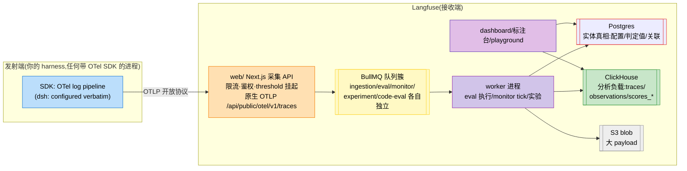
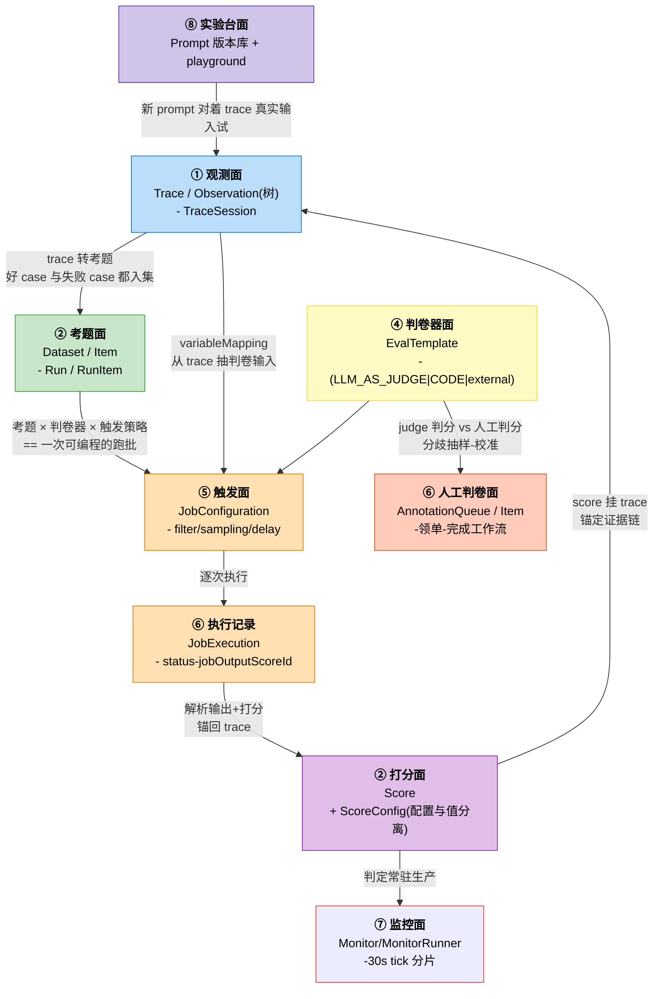
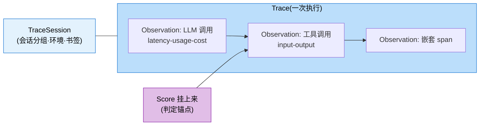
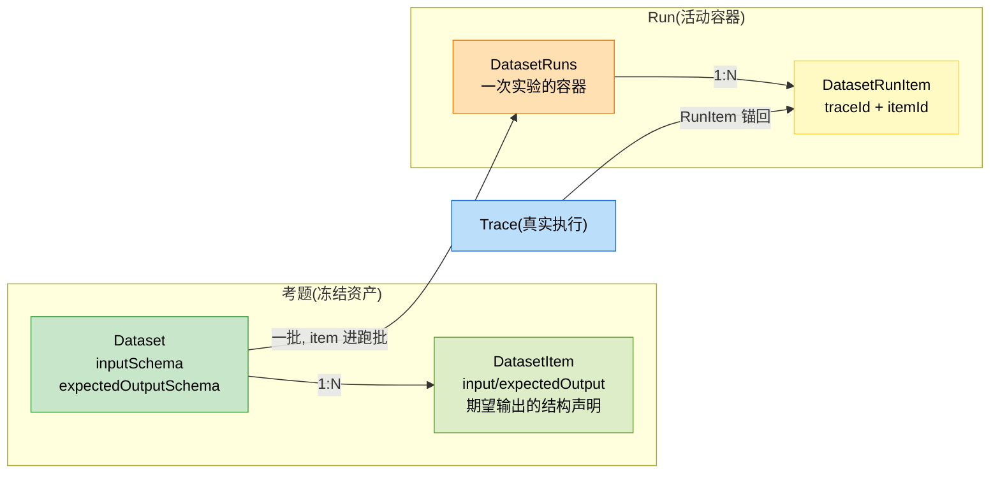
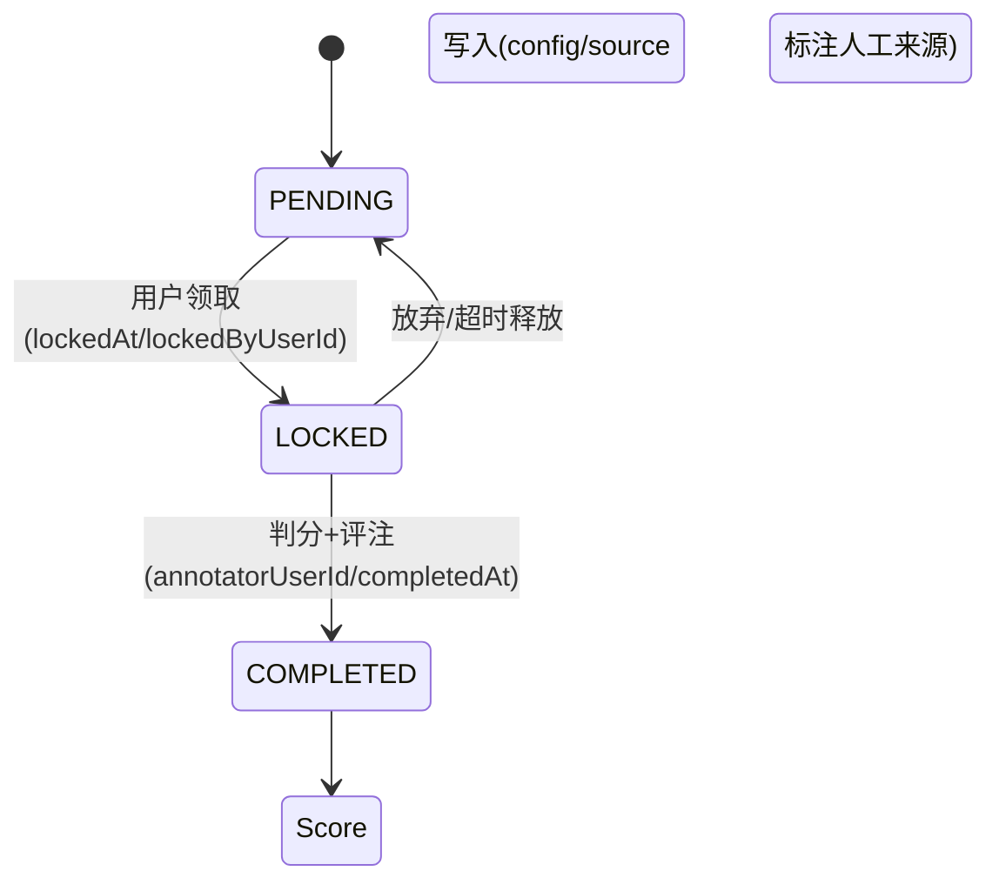
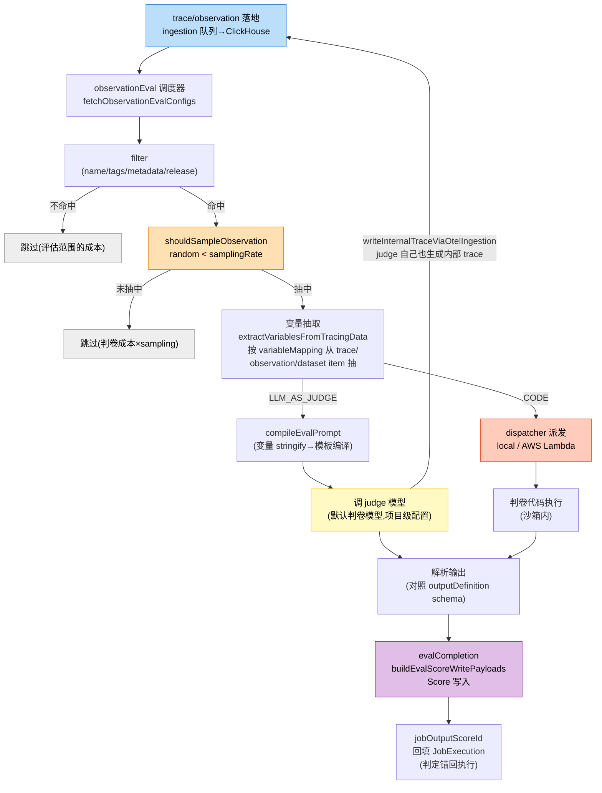
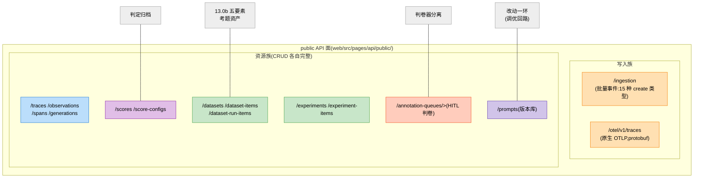
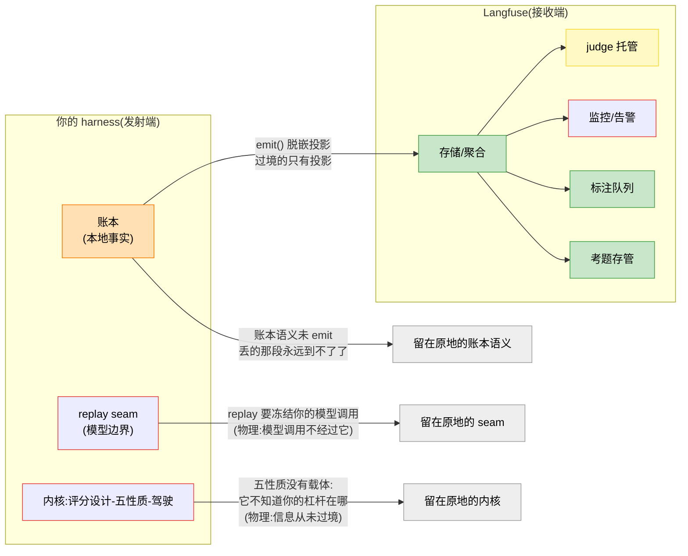

## 13.1b 接收端研究:Langfuse 的实现,与 Harness 的委托边界
> 13.0b 立了测量学内核(阶梯/评分设计/五性质/黑盒优化),装置层压缩成一张表加一句“接收端可委托”。本节把那一句话展开成完整的论证:前半(13.1b.2–13.1b.5)解剖 Langfuse 这个**唯一成熟的接收端样本**——四份源码里三家在发射端,只有它把**数据汇过来之后**做成了产品;后半(13.1b.6–13.1b.8)立**委托边界**:Harness 哪些评估能力可以真外包给 Langfuse,哪些物理上不可能。它是 11.0b.6 分工定理在评估侧的续篇。
> 源码坐标: `/langfuse` web/ Next.js 应用 + worker/ BullMQ 工作进程 + packages/shared 域模型。行级锚点随文标注。

### 13.1b.1 为什么需要一个专节研究“买来的那一半”
上一轮讨论中产生过一个真实的提案(本书对话者的原话):“Langfuse 已经是很成熟的可观测性和可评估性平台了,我们的 Harness 是不是可以直接埋点即可,能力全部外包给 Langfuse?”
这个提案**一半对一半错**,而且错的那半可以精确指认。对的一半:Langfuse 确实成熟——评估的装置(判卷器托管/考题存管/实验对比/监控告警/标注队列)它全有产品级实现,自建这些是重复造平台。错的一半:**可评估性的内核(13.0b 的五性质)和发射端的义务(11.0b 的账本/emit/脱嵌/seam),物理上不经过 Langfuse,它想接也接不住。**
要论证这个“物理上”,不能停留在断言——需要先真正读懂它实现了什么、边界在哪。这就是本节前半的任务。后半给出可操作的清单和一个检验法。

### 13.1b.2 总体架构:一个为“写入量 > 查询量”设计的三进程系统


图 13-1a:Langfuse 三进程架构(web 采集/worker 执行/双库存储)—红线 Postgres 是实体真相,绿线 ClickHouse 是分析负载,两者物理分离(11.0b.2 的 Langfuse 经验 1)
值得逐个注意的设计(每条都是**接收端才需要付的账**,发射端免费躲过):

- **双库分治+S3**:Postgres 存 Score/Dataset/EvalTemplate/JobConfiguration(实体真相,需要事务和外键),ClickHouse 存 traces/observations/scores 事件流(分析负载,写入量主导),大 payload 进 S3。跨库无外键——`JobExecution.jobInputTraceId` 的注释说明:“no fk constraint - traces in Clickhouse, deletion handled via project cascade”。**跨库关联是逻辑层约定,不是存储层保证**——这是分治的代价,接收端买单。
- **队列隔离高**:ingestion/eval/monitor/experiment/code-eval/otel 各自独立队列(`worker/src/queues/` 二十余个)。一个 eval 风暴堵死 eval 队列,不影响 ingestion 收敛——**不同负载形态的工作不共池**。
- **采集端的自我保护**:限流(`rateLimitResource`), usage threshold 挂起(超量 403, `isIngestionSuspended`),大客户定向二级 ingestion 队列。接收端用基建扛发射端的“甩手掌柜”式投递(11.0b.4)。
- **双形态部署**:cloud 与 self-host(docker compose 五分钟)并存—连它自己都要为“数据不出用户的 VPC”提供出口。这不是产品仁慈,是 11.0b.6 分工定理(账本主权)的商业投影:**主权敏感的用户只能用 self-host,数据主权的最终防线是部署边界**。

### 13.1b.3 域模型:评估工程学的八张表

Langfuse 的 Prisma schema(`packages/shared/prisma/schema.prisma`)是一份**评估平台该有什么**的产品级投票。八张表不是平列的——它们恰好围成**一次评估的生命周期**:



图 13-1b:八张表围成一次评估的生命周期—观测(蓝)喂养考题(绿),考题×判卷器(黄)×触发(橙)成跑批,产出判定(紫)锚回观测;人工判卷(橙红)校准判卷器,监控(红)把判定常驻生产,prompt 库(紫)覆盖“改动”一环
**读这张图的方法**:顺着边走,每条边都是一条外键或一次 API 调用—Langfuse 用表间关系把 13.0b 的五要素**物理上焊死了**。逐张解剖,标注它承载 13.0b 内核/装置的哪一层:

#### ① 观测面:Trace / Observation / TraceSession—评估的“被告席”



图 13-1c:Trace 树的形态—span 层级天然映射 agent 的**轮-步-调用**;分数挂在哪个 Observation 上,判定的证据链就锚到哪一级
**它承载什么**:13.0b 装置④“判定归档”的**锚点结构**。注意树形不是可视化偏好,是**归档语义**;Score 挂在根 Trace 还是挂在具体 Observation(某次工具调用),判定粒度完全不同—挂根评“这轮对话好不好”,挂 span 评“这个 tool_call 好不好”。Langfuse 的 Score 允许两级挂载,这直接支撑 13.0b.2 阶梯的分层判(层④ tool_call 质量 span,层⑧ 任务结果 root)。**发射端埋点的层级,就是在选择将来判卷的粒度**——这是“命名字典对齐”(13.1b.8 ④)的具体机制。
TraceSession 是薄的(仅 `bookmarked/public/environment` 几个字段),但它是**环境隔离**的载体:production / staging / evaluation 的 trace 分层—考题跑批的 trace 不污染生产 dashboard,同一套数据面,两种消费者不打架。

#### ② 打分面:Score + ScoreConfig—配置与值分离的物理形态

**一行 Score 的完整解剖(这是“判定归档”的最小单元,值得逐字段看):**

```text
Score {
    id, traceId         → 锚:挂哪次执行
    observationId       → 锚:挂树上哪个 span(判卷粒度)
    name, value, dataType → 值:三件套(name 是 ScoreConfig 的外键)
    configId → ScoreConfig → 身份:这个分数的类型声明
    comment, source     → 评注与来源(judge/annotation/code)
}
ScoreConfig {
    dataType: NUMERIC|CATEGORICAL
    min/max 或 categories[]
}
```

**它承载什么**:13.0b.3“评分词汇表”的落地。配置与值分离的威力在**变更时**:ScoreConfig 改 categories,历史分数的语义跟着 config 走(同一 config 名下可比);要换判卷标准,必须新开 config 或新版本。一行 Score 的成本被 schema 拍出来了,这是 13.0b.4 性质⑤(时间可比)的产品强制。对照 13.2b.3 的 lab 形态: `Scorer.version` 字段 + Score 行内的 `scorer@M`——同一套一维的两种实现。Langfuse 用外键做。

>
> 分值随行抗演化:分数自己携带身份,不依赖 config 表的存续;外键更省存储—取舍点在“判卷器资产是否与平台同寿命”。

#### ③ 考题面:Dataset / Item / Run / RunItem—考题的生命周期



**它承载什么**:13.0b 装置④ + 机制三的存取。三个此前没写透的点:

1. `expectedOutputSchema` 是结构不是内容——期望输出声明为 schema(JSON Schema),不是逐题写死标准答案。这为软层(阶梯②方案输出)留出了判卷空间:schema 验过结构对,再评内容质量。**题库在定义处就已经分层**,不是判卷时临场决定。
2. `trace-item` 的双向通道:正向:跑的 trace 一键转 dataset item(失败 case 同入集)→**考题库由真实流量持续喂养**;反向:RunItem 锚回 traceId→每个判定可回放。两条通道合起来,就是 11.0b.6 图 13-0g 里“判定归档”的完整链路:考题从流量来,判定回流去。
3. **Run 是对跑的容器**。13.0b.5 机制二(experiment)的分布比较“需要一个物理容器:同一 Dataset、不同版本(prompt/harness/判卷器)各跑一个 Run,Run 级对比。**没有 Run 这个容器,experiment 就退化一堆分散的分数——对比的主语都不存在**。

#### ④ 判卷器面:EvalTemplate—三种判卷类型,一张表

```text
EvalTemplate {
    type: LLM_AS_JUDGE | CODE | external(ragas 等伙伴)
    prompt: LLM judge 用
    sourceCode?:(262KB VarChar,代码判卷用)
    provider/model/modelParams(judge 的执行配置)
    outputDefinition(判卷输出的 schema—judge 的输出也被声明化)
    version — @unique(projectId, name, version])
}
```

**它承载什么**:13.0b.4 性质⑤(时间可比)+13.0b.3 判卷三类型,三个值得停下的设计:

- **判卷器的输出也有 schema**: `outputDefinition`, judge 返回的不是一个自由数字,是被声明约束的结构—**软层判卷被底层拉硬**:声明约束统一大类“judge 输出解析失败”的故障(judge 回了个感想而不是 JSON,在 schema 处拦截,不进 Score)。
- **三种类型共存于一张表而非三个表**: judge/代码/伙伴模板共享版本化与触发机制(都挂 JobConfiguration)→**判卷方式的差异被隔离在执行层,资产管理是统一的**。对照 13.2b.3 lab 只落了代码判(有意的,稳定性)。
- **不引入 judge 的不确定性**: 现在能看清那番取舍:资产三类型是完备设计,执行层可以按需先一种。**judge 是一等类型**。ragas 做 `partner` 字段—判卷器是多个生态位,RAG 的 `faithfulness/relevancy` 以模板形态接入。**判卷器市场存在**,说明“怎么判”的领域知识有独立价值—这也印证 13.1b.6 的论断:平台托管判卷器的**执行**,判卷的**方法**仍在你的领域。

#### ⑤ 触发面:JobConfiguration—评估经济学的字段化

把五个字段读成一份“评估预算的申报单”:

| 字段 | 语义 | 经济含义 |
| --- | --- | --- |
| `filter` | Json | 按 trace 的 name/tags/metadata/release 筛 |
| `sampling` | Decimal `0..1` | 命中概率抽评 |
| `delay` | time | trace 落地后多久才评 |
| `timeScope` | NEW/存量 | 只评新数据还是回溯 |
| `blockAt/blockReason` |  | 判卷器可被阻塞并说明原因 |

执行侧 `JobExecution` 逐次落档(status/startTime/error/#jobOutputScoreId)—每次判卷是一次可审计的作业,**判定锚回执行**(`jobOutputScoreId` 是执行与分数之间那条外键)。
**它承载什么**:13.0b“评估触发是可编程策略”。这里藏着本表最容易被忽略的洞察:**采样率是信号与成本的交换率**。`sampling=0.1` 时,一个真实的 5% 涨幅需要更大的样本量才能从噪声里分辨(回到 13.0b.5 机制二的判定论,代价抬高)。**sampling 不是开关,是统计功效的自变量**——一份省检到检测不出自己要找的效应,评估就白做。这两个量必须一起,Langfuse 把它们留在两个配置里(采样在 JobConfiguration,功效在你的设计)。

#### ⑥ 人工判卷面:AnnotationQueue—人判的流水线化



**它承载什么**:13.0b.3 真值来源②(人工标注)的作业形态。值得停下的两点:

- **人判有锁定语义**。`lockedBy`/释放路径—两个人不能同时判一单(重复劳动+标注冲突)。这是把“人”当系统资源管理的最低要求;并发控制、领取、超时回收、“有空看看”式的人工评估在这个模型里不成立——**它连状态都没有**。
- **它的第二用途比第一用途更重要**:judge 的校准(13.0b.4,图 13-0d)。一小批判卷给人工判, judge 分数 vs 人工分数的分歧率 = judge 的健康指标—分歧率抬升,就暂停 judge。`AnnotationQueue` 是 judge 的**安全网**。>
> 13.0b.7 那个“无穷回退在实践上止于人工抽检”,在这张表上落地。

#### ⑦ 监控面:Monitor—判定常驻生产

`MonitorRunner` 的运行形态(11.0b.7 已立):30s tick、Redis 锁分片(`PeriodicExclusiveRunner`),多 worker 实例不重复跑。按 Monitor 配置检查 score/指标阈值并告警。
**它承载什么**:13.0b“生产是免费考场”的机制化。从域模型视角补一笔:**Monitor 是判卷器与生产流量的连接件**——它消费的 score 正是⑤的 JobConfiguration 在生产持续产出的判定。所以“监控告警”在这个体系不是独立系统,是**评估的在线时态**(13.0b.6 双时态复用):同一批判卷器资产,离线时态在跑批里用,在线时态在 Monitor 里用。这解释了为什么 Langfuse 把 monitors 和 evals 做在一个产品里—拆开的话,判卷器就得复制两份。

#### ⑧ 实验台面:Prompt 版本库 + playground—“改动”一环的受管资产

Prompt 的版本化机制(`@unique` + 标签 + `PromptDependency` 依赖图)带一套 Redis 缓存失效协议—写路径:拿锁→失效该 name 全部缓存→写 Postgres→放锁;读路径:无锁读缓存,未命中读库回填。
**它承载什么**:调优回路(13.0b.5 图 13-0d)里“改动”这一环。playground 的特殊价值在于它的**数据来源**:对着 trace 里的真实输入试新 prompt—失败 case 拉进 playground,当场看新 prompt 的反应。这是假设的形成(循环②)从凭空想变成**对着真实失效数据做实验**—11.0b.10 的 postmortem 取证与调优的假设形成,在这里被同一个工具串起来。**评估平台要覆盖改动,不只是测量←Langfuse 经验 7 的完整含义:没有 prompt 版本库,experiment 的“换变量”没有可指的版本;没有 playground,假设没有现场。**

#### 八张表合起来:对 13.0b 五要素的覆盖矩阵

| 13.0b 要素 | Langfuse 覆盖(表) | 覆盖的是 | 不覆盖(回 13.1b.6) |
| --- | --- | --- | --- |
| 考题资产 | Dataset 四表 | 考题的**存管**:schema/冻结/Run 容器 | 哪些 case 值得入集(领域判断) |
| 受控回放 | Run × Prompt | experiment 跑批+对比 | replay 半边(冻结模型)—平台根本看不见你的模型调用 |
| 判卷器分离 | EvalTemplate + AnnotationQueue | 三种类型+人判 | 评分设计本身(什么是好)与五性质维护 |
| 判定归档 | Score + RunItem | 锚定结构与存储 | 锚的语义(锚哪个维度是模型侧决策) |
| 回归防线 | -(假设你在 CI 里有) | 整个半边:invariants/golden diff 在你的运行时 | 唯一的整块缺席就是回归防线,唯一的半缺席是受控回放(replay)—恰好是三大 Harness 各自最强的两件。四份源码的分工在这张表上合拢。 |

这张矩阵是 13.1b.6 委托边界的**域模型级证据**;每行的“不覆盖”列,都是内核或发射端—八张表再完备,覆盖的也只是装置半边。五要素里唯一的整块缺席是回归防线,唯一的半缺席是受控回放(replay)—恰好是三大 Harness 各自最强的两件。四份源码的分工在这张表上合拢。

### 13.1b.4 评估执行管线:一次判卷的完整路径

先看管线的全貌。`evalService` 源码的头部注释自带一张三入口结构图(原文摘录),它揭示了一个容易忽略的事实——**评估不是一条管道,是三个入口汇入同一台执行机**:

```
TraceQueue(实时 trace)  DatasetRunItemUpsert(跑批新条目)  CreateEvalQueue(历史回溯)
        ↓                        ↓                        ↓
        createEvalJobs(拉配置-按 timeScope 过滤→建 JobExecution)
                ↓
                校验(trace 存在?observation 存在?—防“评一个不存在的对象”)
                ↓
                入队(带 delay) → evalQueue → 判卷执行 → Score 写入
```

三个入口的差别在**触发源与 timeScope**:实时 trace 走 NEW(只评新落地的),跑批条目绑定 dataset run(锚 trace+observation)、历史回溯不限定 timeScope(一次性补课)。汇入点之后是同一套执行学(13.1b.3 ⑤)在调度层就分好了账。

执行链的完整形态(worker 侧, `worker/src/features/evaluation/`):



图 13-1e:判卷执行管线—三个“跳过”门(filter/采样/校验)各自守一种成本;judge 与代码判卷在类型处分流,汇于“解析输出”;虚线是“评估自身被观测”的递归闭环

#### 走一遍具体例:一次 judge 判卷的生命周期

抽象管线配上具体数据才有感觉。假设:一个客户服务 Agent 的 trace 落地,JobConfiguration 配了 judge 判卷“回答是否有帮助”—

```
① trace 落地:role=user "怎么退货?" / assistant "请在设置→订单→退货-"(clickhouse 行)
② filter 命中:trace name = "customer_support", tags 含 "v2.3"—这个判卷器只评 v2.3 的客服流量
③ 采样抽中:sampling=0.1,random()=0.07 < 0.1(这一步 90% 的命中 trace 在此离开—判卷成本×0.1)
④ 变量抽取(variableMapping):
    {"question": trace.input, "answer": trace.output} →
    ExtractedVariable=[{var:"question", value:"怎么退货?"}, {var:"answer", value:"请在设置→订单→退货"}]
⑤ 模板编译(EvalTemplate.prompt,带 {question}/{answer} 占位):
    "你是客服质量评估员。问题:{question} 回答:{answer}。
    按 JSON 输出 {\"score\": 0-10, \"reason\":\"...\"}"
    —注意:变量在此处被 parseUnknownToString 拍平(judge 的消费边界)
⑥ 调 judge 模型(项目配置的默认判卷模型—judge 也是一次真金白银的 LLM 调用)
⑦ 输出解析:judge 返回的 JSON 对照 outputDefinition schema—
    不是合法结构?在此拦截,不进 Score(软层判卷被 schema 拉硬的一环)
⑧ Score 写入:{name:"helpfulness", value:8, configId=ScoreConfig(numeric 0-10),
    traceId:锚回原 trace + jobOutputScoreId 回填 JobExecution}
⑨ 同时:judge 调用自身生成一条内部 trace(writeInternalTraceViaOtelIngestion)—
    下个月你在 dashboard 上看到“判卷器平均延迟 1.2s、失败率 3%”,数据就是这么来的
```

这个示例里三个此前只一笔带过的点,现在能看清它们的位置:

- **④ stringify 是消费边界投影**:同一份 `ExtractedVariable`, judge 拿拍平的串(编译进 prompt),代码判卷拿原始结构(被套对象直接进 payload)—源码注释原文: *"Stringify extracted values here (LLM-judge's consumption boundary) — so the upstream extractor can preserve original shapes for code-eval"*。和 11.0b 的版本-投影同构:消费者不同,投影形态不同,事实只抽一遍。
- **⑦ 是软层判卷的硬化带**:judge 输出先过 `outputDefinition` schema 再成为 Score—judge 回了个感想而不是 JSON,这类故障在 schema 处拦截,垃圾判定不进判定库。
- **⑨ 的递归闭环**:judge 的延迟/失败/成本出现在与被评对象同一套观测体系里—13.0b.7“评估体系自身也是被评估对象”在管线里的落点。

#### 代码判卷的执行隔离:接收端跑别人的代码

代码判卷在图 13-1e 的 DISP 分支多一层:**判卷代码不在 worker 进程裸跑**,经 dispatcher 派发—`localCodeEvalDispatcher`(本地开发)或 `awsLambdaCodeEvalDispatcher`。payload 带 scope:organization/project/evalTemplate id + 源码 + 输入。
**为什么隔离?**:判卷代码是用户上传的任意代码。在平台进程内跑 = 一次判卷代码的 bug/死循环/恶意代码打穿整个 worker——一个用户的判卷器把平台的评估队列烧死。沙箱隔离 + 双模式派发(本地开发用 local,云上 Lambda)。
这层的归属值得单独说:**发射端永远不需要付这个账,因为发射端只跑自己的代码**。13.2b.3 的 lab 判卷器(Scorer,fn 直接在测试进程)没有沙箱—不是疏忽,是**位置不同:你的判卷器跑在你的信任域里,信任域要对信任设防。**要不要沙箱不是安全等级问题,是代码的信任边界问题—**跨信任边界(平台跑用户的代码)才需要。这是 12 章安全逻辑在评估域的一次显形。**

三条管线的设计值得抄走(前文立过,这里给它们在图上的坐标):

1. **变量的双形态**—图 13-1e 的 VAR 节点:一次抽取,两种投影,消费边界处分流。
2. **评估自身被观测**—图 13-1e 的虚线:judge 入口即观测入口。
3. **`makeZodVerifiedAPICall` 测试纪律**:API 响应用 zod `strict()` 校验,多一个字段都抛—响应 schema 是契约,不是建议。评估平台的 API 面对的是程序消费者,契约必须机器验证(⑦ 的 schema 拦截是判卷侧的镜像)。

### 13.1b.5 它的 API 形状暴露的评估工程学

读接收端的 API 面,能看到比文档更诚实的东西。先看全貌—`web/src/pages/api/public/` 的完整资源清单,按 13.0b 五要素归位:



图 13-1f:public API 面总览—**两个写入端点(橙)+一族 CRUD 资源(各色)**;五要素(灰)各自找到对应的资源组。注意箭头方向:五要素是从资源面“读”出来的—**API 面是评估工程学最诚实的一张答卷**
三个值得停下的形状,每个展开:

#### 形状一:两个写入端点并存—协议面就是市场面

`/ingestion`(自有 SDK 的批量事件端点)与 `/otel/v1/traces`(OTLP 原生,protobuf)并行且同权。OTLP 路由的代码形状: `gunzip` → `$root` proto 解码 → `OtelIngestionProcessor` →与自有协议走同一条 ingestion 队列**,只是入口解析不同。同时 `markProjectAsOtelUser(projectId)` 把项目标记为 OTel 用户,后续产品决策(配额口径/文档默认值/迁移引导)随之分叉。
**为什么同时收两种协议**是工程决策而非兼容性包袱?因为发射端的存量形态不可选择:CC/ Codex/dsh 全在 OTLP 上(11.0b.6 论证过为什么必然如此),只收自有 SDK 等于把三个最成熟的发射端关在门外。**接收端的协议面就是它的市场面**。
自建接收端时的指导顺序由此而来:**先接标准,再补自有**—自有协议只该表达标准表达不了的东西。Langfuse 自有 SDK 的增量价值集中在一点: `/ingestion` 的事件类型 `union`(`packages/shared/src/server/ingestion/types.ts`)是评估语义的载体—15 种 `create` 事件里, `TRACE_CREATE` / `SPAN_CREATE` OTLP 都能表达,但 `SCORE_CREATE` / `EVALUATOR_CREATE` / `GUARDRAIL_CREATE` 是评估域词汇。OTLP 通用信号(`traces/metrics/logs`)没有原生对应。所以自有协议的合理增量=**领域词汇**,不是传输格式。这也回答“为什么不干脆只收 OTLP”:判定语义需要一等表达,硬塞进 OTLP 的 attributes 里会退化成约定俗成的字符串,回到 13.1b.3 之前的世界。

#### 形状二:评分/考题/锚定是一等公民资源,不是埋点参数

`/scores`、`/score-configs`、`/dataset-run-items` 是独立 REST(CRUD 各自完整,路由由 `[id].ts` 齐备)。这不是 RESTful 洁癖,是一个**可机器验证的开放性声明**:你可以完全不上 Langfuse SDK—任意 OTel SDK 发 trace + 这些 REST 资源管理评分体系是一样同等工作流。SDK 是便利层,不是必经路。
对照一个反面形态:有些平台的分数只能通过它家 SDK 的 `track("score", ...)` 上报—分数是 SDK 调用的**附属参数**,不是资源。两种设计的差别在换发射端的成本:

| 资源化(Langfuse 形态) | SDK 附属参数形态 |
| --- | --- |
| 谁能产判定 | 任何能发 HTTP/OTLP 的进程(装了它 SDK 的进程) |
| 判定的可见性 | REST GET 直接可查 |
| 迁移(停服检验) | 导出一批资源,数据自含 |
| 判定与证据的锚 | score.traceId 是 API 字段,藏在 SDK 内部关联逻辑 |
| 13.1b.6/13.1b.7 的委托边界与停服检验论证依赖这个差别—**资源化的判定才是可迁移的判定**。装置层时把这一点写进验收判:判卷器版本库如果只能经 SDK 读写,停服推演的“导出留档”那一步就不成立。 |  |

#### 形状三:批量的位置—不在热路径,批量不在两端

`/ingestion` 的请求体是 `{batch: [...{}]}`(一次 POST 带多条事件,源码: `batchType = z.object({batch: z.array(z.unknown())})`),worker 侧 chunk 拆解处理。这是 `emit()` 公理(11.0b.4)的接收侧投影:

```
发射端:单条(非阻塞,微秒级)
  ↓ SDK 内部批(时间窗/条数阈值)
管道:批量上行(一次 POST 一批)
  ↓ 接收端:校验整批 → 拆解 → 队列 → chunk 处理
接收端:逐条处理(逻辑最简)
```

**批量化的位置在管道里,不在两端**—发射端保持最简(单条 emit,不感知批的存在),接收端保持最简(逐条处理),攒批/拆批的复杂度由中间吸收。两端各自的最简形态是 `emit()` 公理的两端推论。顺带一个同构:这个分层与 5.0b 工具层的“乱序、顺序提交”(调度端自配、提交端聚合成批)是**同一个模式在两个域的复用**—**复杂度永远住在中间层,两端各留一个最简单的契约**。

#### 一个 API 面外的收获:ingestion 侧的采样

考察中撞见一个不在 API 文档里的机制(`packages/shared/src/server/ingestion/sampling.ts`):**接收端自己也有按 trace-id 的采样**—`LANGFUSE_INGESTION_PROCESSING_SAMPLED_PROJECTS` 按项目配置采样率,用 `traceId` 的哈希%决定整条 trace 进不进处理(`isInSample(traceId, sampleRate)`)。
三个值得记下的点:①采样单位是 `traceId` 不是事件—**同一条 trace 的事件要么全进要么全不进(按事件采样会让一条 trace 缺胳膊少腿,树形结构残废)**;②哈希决定而不是随机决定→**同一 traceId 永远得到同一判定,重试/重放不会“同一条 trace 的不同副本进不同簇”**;③这是**运营侧的过载保护**,与 JobConfiguration 的评估 sampling(为判卷省钱)是两回事—一个在入口(收不收),一个在评估(评不评)。都叫 sampling,一个守管道可少收、一个可被淹死的实体。
这个机制是 11.0b.5 门控维度①(“什么按流量隔离”)的又一实例—接收端的自我保护清单比发射端更长;限流、threshold 挂起、二级队列、**入口采样**。四件全是“管道宁可少收,不可被锁死”的实作。

### 13.1b.6 委托边界:可外包与必须自持的完整清单



图 13-1g:能力过境图—绿区(接收端装置)全部由“过境的投影”喂养;红线(内核/seam/账本语义)不过境的原因不是条款,是**物理:相关信息从未到达那边**。灰色项不是“Langfuse 不肯做”,是“它无从做起”。
读这张图的关键是==虚线的注释==—每一个“留在原地”都对应一个信息论事实,不是合同条款:

- 五性质维护不过境:它不知道你的可控杠杆是什么(哪个变量你能改、哪个指标对你的改动敏感)—这是你与你的系统之间的关系,不存在于任何上报数据里;
- replay seam 不过境:你的模型调用不经过它(冻结模型响应需要坐在模型边界上,那个位置在你的进程里);
- 账本语义不过境:你不 emit 的那段永远到不了它那里(两级持久化的丢失窗口,11.0b.6)。

对照正面:**可委托项(下表)全部只需要“投影过境”就能成立**——存储要的是脱嵌事件、judge 托管要的是判卷 prompt 与输入、监控要的是 score 流、标注要的是待判对象。信息够得着,能力就接得住。

#### ✅ 可以委托给 Langfuse(买来的):

| 能力 | 对应本节坐标 | 要托收盘 | 过境的信息 |
| --- | --- | --- | --- |
| 集中存储与聚合 | 双库+S3 | ClickHouse/Postgres 的运维、留存、删除级联全免 | 脱嵌事件流 |
| judge 托管 | 13.1b.4 管线 | judge 模型管理/重试/错误分类(`classifyEvaluatorLlmError`)/默认模型配置 | 判卷 prompt + 输入 |
| **判卷器版本的载体** | EvalTemplate | 13.0b.4 性质⑤的存储与检索—但**版本管理的载体可以买,版本管理的纪律(何时该开新版本、如何衔接历史)买不来** | 判卷器源码/prompt |
| 考题存管 | Dataset 表 | schema 校验/批量容器/锚定结构 | 考题数据 |
| 监控告警 | Monitor 表 | 判卷常驻生产、分片/通知 | score 流+阈值 |
| 标注 HITL | AnnotationQueue | 领单工作流、RBAC、待判对象快照 |  |
| 实验对比 | experiments | 分组跑批+统计对比 | Run 元数据 |

#### ❗必须留在 Harness(自持的),按“为什么物理上接不住”分类:

| 自持项 | 为什么 Langfuse 接不住 | 证据 |
| --- | --- | --- |
| **事实账本+脱嵌语义** | 它看到的是 emit 出去的投影;崩溃未发出的、被裁掉的上下文,本地 seq—永远在它盲区 | 11.0b.6 两级持久化;投影允许丢 |
| **emit 形状与非阻塞性** | 埋点写了,但 agent loop 上,不在它的管道上 | 11.0b.4 emit() 公理 |
| **脱嵌源** | 数据的生成由你的进程决定,发什么/删什么都在 emit 侧决定 | dsh waterfall 在发射端;CC 可见矩阵在 SDK 侧 |
| **replay seam / golden diff** | 它收不到你的 harness 内部状态;replay 冻结模型调用 harness 改动,这个动作的定义必须在 harness 内 | dsh replay 在 harness 内 |
| **invariants/postmortem** | 回归防线是你系统的 CI/运行时 | dsh invariants 级连注册 |
| **评分函数设计+五性质** | “什么是好”是产品判断;五性质里没有一条是 Langfuse 要做的那一类,调优方向变成 Langfuse 横版库的方向 | 13.0b.4:区分度/稳健/对齐全是“你 vs 你的系统”的关系 |
| **TurnProfile** | 通用平台的 span 是通用语义;harness 子系统视角的解剖(螺旋时间结构)是领域知识 | Codex 六版在 core 内捕获 |

一行版:外包的是杠杆,不是方向。买来的东西放大你已有的方向(存储杠杆/判卷杠杆/告警杠杆),但方向本身—**什么是好、往哪修、怎么证明好了**——从设计到维护都是你的。13.0b.1 那个“无解析桥接”的黑盒,黑盒的主人是你,Langfuse 只是测量仪表的。

### 13.1b.7 停服检验:边界的实测标准

怎么知道边界画对了?一个思想实验,当压力测试用:

>
> **“Langfuse 明天停服/涨价三倍/被竞争对手收购,你的调优能力损失多少?”**

思想实验要推演成时间线才有压力。设 D 日为停服日,按 13.1b.6 的边界逐周推演:

```
D 日(停服当天):
    仪表黑屏了。监控告警静默—注意:静默≠系统故障,业务照常跑
    (11.0b.5 门控的存在使这一条成立:观测挂了业务不许挂)
    你的动作:检查 13.1b.8 的⑥—SDK 整体禁用的开关在不在?
    在,拉闸,agent loop 继续平稳地跑。

D+1~D+7(第一周):
    损失显形:没有新 dashboard、judge 托管停转、标注队列冻结。
    但调优回路不停:replay 差分照跑(模型冻结在你的本地 fixture),
    golden diff 照红黑(账本在你本地盘),回归防线照常(invariants)
    在你的 CI—13.0b.5 图 13-0d 的八步循环,只有⑥(归档)的
    “平台存储链”一条腿换了地方。
    你的动作:数据导出(Langfuse 的 dataset/score-config 是 REST 资源,
    可拉档);考题与判卷器本地资产(13.2b.3 的 Scorer 形态)。

D+7~D+30(第一个月):
    重建接收端:OTLP 标准在—发射端的 emit 不用改一行,换个
    OpenTelemetry Collector + 任意 ClickHouse 后端,投影重新落库
    (11.0b.6:“换接收端=部署决策,不是代码重写”的兑现时刻)。
    判卷器从 EvalTemplate 迁回本地函数—因为版本纪律本来就在
    你手里(13.1b.6:载体可买,纪律买不来,纪律一直在你手里)。

D+30 之后:
    结算。损失清单:一个月的接收端重建工作量。
    不损失清单:全部考题资产(已导出)、判卷器(已迁回)、
    金标准(本来就在本地)、回归防线(从未离开)、方向感(从未过境)。
```

这个推演暴露了**边界画错时的对照形态**—如果当初把内核也委托了出去(比如评分逻辑全部写成 Langfuse 代码判卷模板、本地不留 Scorer):

- D 日:不止仪表黑屏→判卷停转 = 调优回路断在④(测量),你连“刚才的改动是变好还是变坏”都测不出来了;
- D+7:不是“换接收端”，是**重写评分体系**——判卷标准在平台模板库里,导出的是代码,丢的是“为什么这么判”的设计上下文;
- D+30:结算单上多了一项最贵的:重建期间每一次调优都是盲目的(回到 13.0b.1 的开环玄学)。

**通过标准**:损失清单全是“可迁移的装置”,不损失清单里有“方向感”。反之,如果推演发现“停服后我不知道怎么判别好坏了”—说明已经把内核委托出去了,边界画错了,纠正的办法不是换平台,是把评分设计收回来。
这个检验对任何“要不要外包 X”的决策都适用,不止 Langfuse:**外包决策的验收标准不是“它能不能做”,是“它没了之后我损失什么”**。能力清单决定上限,依赖结构决定存活。

### 13.1b.8 发射端义务清单:委托之后的六件必做

“只埋点”的心理陷阱,是把发射端当哑终端。委托给 Langfuse 之后,发射端仍有六件必做(每件都是委托成立的前提):

1. **账本先行**—Langfuse 是投影的消费者,投影的源头在你本地(11.0b.3 五纪律)。
2. **emit 非阻塞**—异步、批量、失败静默(观测流不进热路径)。
3. **脱嵌在 emit 前**—可见性矩阵(什么字段能给接收端)是发射端决策;Langfuse 收到什么存什么。
4. **命名字典对齐**—ScoreConfig 预注册、trace name/tags 用受控词表;free-form 字符串进 ClickHouse,第一天没事,第三个月 dashboard 缝不起来:**发射端的数据集决定平台价值上限(x轴)**。
5. **replay seam 保留**—评估的确定性方向(测 harness 改动)不走平台,本地 CI。
6. **门控**—SDK 可整体禁用(观测挂了业务不许挂);配额意识(threshold 挂起是接收端熔断,发射端要有对应的降级路径)。

>
> 委托之后的正确心智:Langfuse 是你的眼睛的延伸,不是你的判断的替身。**看得更远可以买,看得懂不能买。**

### 13.1b.9 小结—一张总览

| 论断 | 内容 | 坐标 |
| --- | --- | --- |
| 架构 | 三进程+双库分治+队列隔离+采集自我保护;self-host 是主权防线 | 13.1b.2,图 13-1a |
| 域模型八张表 | 八表围成评估生命周期;每表深解剖;Trace 树/判卷-评分分离/RunItem 双向通道、EvalTemplate 输出 schema 硬化、sampling=统计功效自变量、AnnotationQueue=judge 的校准网 | 13.1b.3,图 13-1b |
| 执行管线 | 三入口汇入同一执行机(实时/跑批/回溯,源码自带结构图);图 13-1e 全管线+九步 judge 走例;变量 stringify=消费边界投影;输出 schema=软层判卷硬化带;代码判卷沙箱=跨信任边界设防 | 13.1b.4,图 13-1e |
| API 形状 | 图 13-1f API 总览(两写入端点+资源族+五要素归位);协议面=市场面(自有协议的合理增量=领域词汇);评分/考题锚定是一等公民资源;批量在管道中间,不在两端;额外收获:ingestion 侧 trace 哈希采样 | 13.1b.5,图 13-1f |
| 委托边界 | 图 13-1g 能力过境图—对每一项“数据是一个信息论事实,它不知道你的杠杆/模型调用不经过它/emit 的段到不了”;可委托项全部只需投影过境;**必须自持的是账本/emit/脱嵌/seam/invariants/评分设计/五性质** | 13.1b.6,图 13-1g |
| 停服检验 | D→D+30 四段推演时间线(拉闸→继续跑→导出资产→重建接收端);边界画错的对照形态;停服检验=外包决策的验收标准 | 13.1b.7 |
| 六件必做 | 账本/emit/脱嵌/命名字典/replay/seam/门控 | 13.1b.8 |
